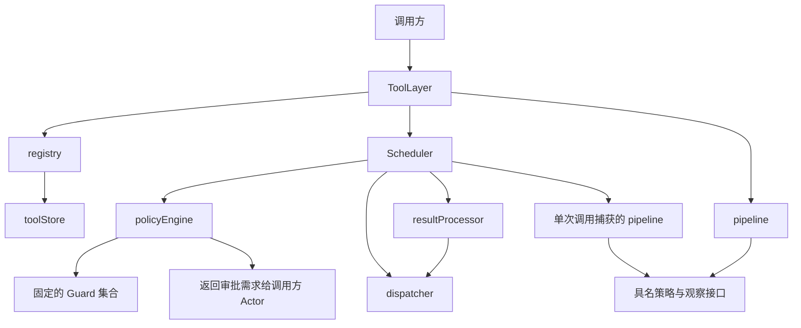
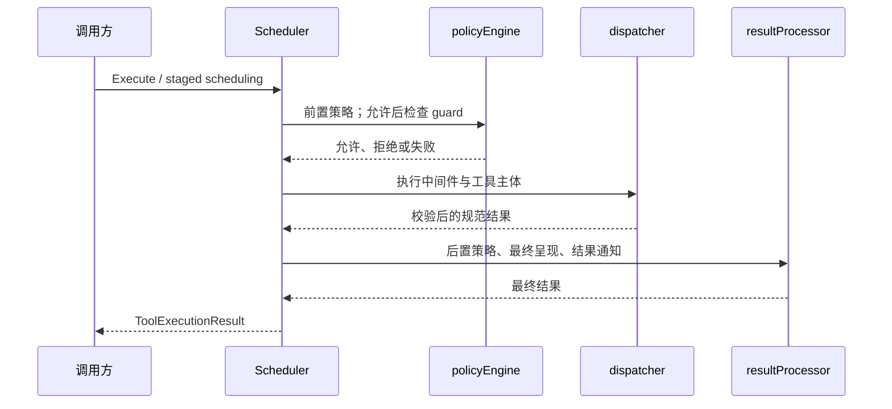
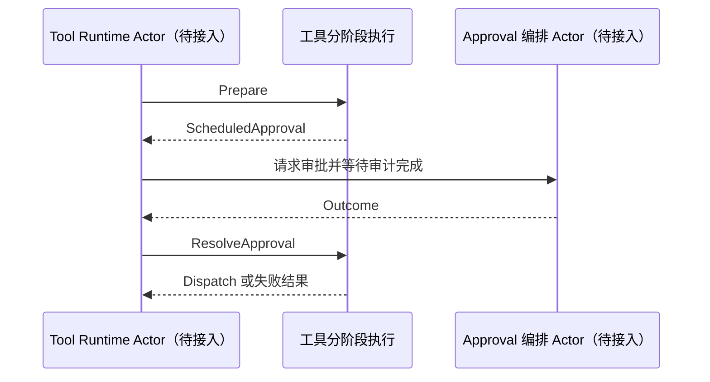

# Tools 业务层

`tools` 拥有工具定义、可见性、执行策略、schema 校验和规范输出。业务包已删除 Plugin、Service 包装及 Factory；Registry 已有批次发布业务对象和 Grain 入口；ToolActor 已实现构造、自注册、工具体执行与资源清理调度，Tool Runtime 首次初始化及关闭已接入生命周期，动态更新与完整执行链仍待完成。目标契约由[工具 Actor 方案](../zh-CN/actor-design/08-tools-implementation.md)拥有，[历史实施进度](../zh-CN/08-implementation-progress.md)不代表本次重构完成度。

## 模块内职责划分

| 职责 | 文件 | 主要对象 |
| --- | --- | --- |
| 对外契约与配置 | [contract.go](contract.go)、[config.go](config.go)、[layer_constructor.go](layer_constructor.go) | ToolRuntime、ToolCatalog、ValidatedConfig、Options；校验配置并直接构造业务层 |
| 注册与本地生命周期 | [layer.go](layer.go)、[layer_registration.go](layer_registration.go)、[layer_tool_set.go](layer_tool_set.go) | ToolLayer；拥有本地定义、注册句柄及执行入口 |
| 定义组合与存储 | [registry.go](registry.go)、[store.go](store.go) | registry、toolStore；组合捕获基线和本地定义，不持有父 owner |
| 定义验证 | [schema.go](schema.go)、[restriction.go](restriction.go) | schema 编译、不可变注册项及可见性规则 |
| 不可变执行策略 | [pipeline.go](pipeline.go)、[pipeline_execution.go](pipeline_execution.go) | pipeline；执行前后策略、执行中间件与结果观察器 |
| 单次执行编排 | [scheduler.go](scheduler.go)、[execution.go](execution.go) | Scheduler；准备、分派、结算和调用状态 |
| 工具体输入与输出 | [invocation.go](invocation.go) | Invocation、BodyResult；独立调用数据和随回复返回的上下文／结束 turn 意图，不持有 Runtime 状态 |
| 执行阶段 | [policy_engine.go](policy_engine.go)、[dispatcher.go](dispatcher.go)、[result_processor.go](result_processor.go) | policyEngine、dispatcher、resultProcessor；分别处理策略、工具主体和规范结果 |
| 定义及事件值 | [definition.go](definition.go)、[events.go](events.go) | ToolDefinition、Definitions、ExecutionCompleted |
| 已发布目录与更新批次 | [registry](registry/README.zh-CN.md) | Registry；纯业务校验、原子发布与结算 |
| 目录消息与事件投递 | [registry/actor](registry/actor/README.zh-CN.md) | RegistryGrain；串行调度业务方法并投递结果 |
| 单工具实现与资源生命周期 | [tool](tool/README.zh-CN.md) | Tool；准备、切换、撤销和资源释放；Actor 调度见 [tool/actor](tool/actor/README.zh-CN.md) |

## 主要对象与依赖

策略、中间件、Guard、Finalizer 和结果观察器获取的执行视图只保留关联身份和参数，不携带内部调度状态。只有 Scheduler 返回给执行编排方的原始句柄能够推进执行阶段；保留视图不能绕过编排方再次派发工具。

ToolRunContext.Execution 是独立 Invocation，不再携带 ToolExecution 的调度状态。Invocation.Run 调用 Executor，返回原始值、error 和本次工具体收集的效果；dispatcher 在原执行阶段采纳效果，再完成标准化与后置策略。上下文仍在包含它的工具结果提交后由 AgentLoop 接纳，失败结果不因结束 turn 标记被当成成功。工具体返回后其收集器关闭，晚到回调不能改变已返回结果。ToolActor 后续仅传 Invocation／BodyResult，不传可变业务 owner。

`New(ValidatedConfig, Options)` 返回已构造的 ToolLayer 与 error，不需要额外激活。Options 提供具名的 Before、After、Execution、Results、Changes 依赖。未指定前后策略时分别使用 Allow/Accept；未指定观察器表示没有订阅方。

ToolLayer 管本地目录和业务入口；Scheduler 调用各执行阶段；pipeline 只保存策略及观察器，不持有 ToolLayer、Registry 或 Runtime。删除了原 Service/effects 循环和 ToolLayer/runtime/effects 循环。

本包不依赖 GoAkt、Plugin、Prompt 或具体工具适配器。当前业务仍接受本地执行器和 Session 相关接口；这不是最终 Actor 消息契约，不能把这些对象放入公开的跨 Actor 配置事件。

## 注册、覆盖与读取

AddTool 完整验证定义后才修改目录，返回只对应本次注册的句柄。旧句柄不能删除同名替代项。NewLayer 在创建时捕获基线，已有子层不随父层增删变化；子层覆盖和 restriction 按原有规则组合，捕获的定义集合不会动态回查父 owner。外部策略与执行器接口自身的状态不由集合快照冻结。

Store 快照不再反向引用 Store。Registry 读取时组合固定基线和本地快照，已经删除 source/revision 缓存和 viewMutex。旧并发执行入口所需的其他同步保护尚未全部收敛。

CaptureDefinitions 输出分离的 Schemas 与 KnownNames；后者包含限制前名称，供 Prompt 检查工具呈现顺序。Tools 不向 Prompt 注册回调，AgentLoop 也不负责搬运 schema。

本地 AddTool 的目录观察器失败会回滚注册，移除后的通知失败不恢复已移除条目。ToolSet 的既有冲突行为仍需在 MCP 原子更新迁移中处理，不能将本地 ToolSet 接口称为已实现的新 Registry 发布事务。

UseExecution 与 ObserveResults 返回 RegistrationID，RemoveRegistration 按 ID 幂等移除。ToolLayer 保存注册目录；每次变更创建新的 pipeline，其本身不持有锁或可变注册句柄。调用方必须串行执行注册、移除、Close 与 Prepare 接纳，最终由 Tool Runtime 邮箱负责。当前尚未接通该 Actor 入口，不能任意并发调用这些方法。

Prepare 在执行前置策略前捕获 pipeline；分派、后置策略和结果通知持续使用同一份快照。移除只影响后续调用，取消的移除不改变目录。快照只冻结策略成员关系，不能冻结提供者内部状态，也不代表可以提前释放旧策略资源。完整用户消息之间的工具更新屏障仍需由 Actor 协议实现。

## 执行交互

调用前取消不执行主体；中间件更换 context 不能解除原调用的取消约束。审批不可用按既有规则拒绝，不默认放行。guard、参数和输出 schema 校验继续生效；实际文件、网络或进程操作仍由工具实现执行权限检查。

策略与中间件 panic 转为失败结果，目录观察器 panic 转为注册错误。结果观察失败不改写已经产生的工具结果；观察端负责报告自身通知失败。工具副作用发生后的取消不意味着回滚，也不会自动重试未知效果。

## 生命周期与当前边界

Close 清空本地目录、执行入口及本地观察器/中间件绑定，不关闭注入的外部策略 owner。关闭后的执行返回失败。当前 Close 不是 Actor 的业务排空协议，不能用它证明所有在途工具主体已退出；最终应由 Tool Runtime 和 ToolActor 消息契约负责。

Definitions 直接包含 AgentID、Schemas 和 KnownNames，每个 Schema 独立携带版本。Prompt ToolsSubscriber 已验证消费映射，但Registry Grain 已实现发布及完整目录查询；启动时的基线追赶、Agent 更新屏障与 ToolActor 资源切换尚未接通。TopicActor 注销确认也不代表这些业务步骤完成。

## 验证

`go test -race -count=1 ./tools/... ./systemprompt/...` 与 `go vet ./tools/... ./systemprompt/...` 通过。工具测试直接构造业务对象，覆盖注册、覆盖、restriction、schema 隔离、取消、审批、结果处理、panic、已准备调用保留旧策略和取消移除不生效；Prompt 的真实 GoAkt 测试负责验证事件消费。

其他模块仍有旧 Tools 构造和 Plugin 调用路径，尚未完成全仓迁移。本包测试通过不代表生产 Agent Actor 链路已接通。

ToolDefinition 只保留具名能力接口，已移除五个函数适配器。生产工具直接实现 Execute、Render 等方法；测试闭包适配局限于测试文件。

## Session 与审批续接

ExecutionSubject 已删除，执行输入只携带 SessionID。Tools 不持有 Session 或 Agent 对象，也不通过 Options 注入同步 Approval Service。Prepare 遇到 AskDecision 返回 ScheduledApproval 和分离的 ApprovalRequest；Actor 完成 asked/decided 审计后调用 Scheduler.ResolveApproval，再根据返回阶段派发或处理拒绝结果。

审批前 Dispatch 和重复 ResolveApproval 均拒绝。允许结果之后仍检查 guard 与取消；拒绝、不可用或取消不会进入工具体。普通 Execute 不能等待跨 Actor 审批，在 Ask 时失败关闭；生产异步执行必须使用 Scheduler 分阶段接口。

真实业务测试覆盖审批需求、提前派发拒绝、重复回答拒绝、允许后单次执行，以及拒绝/不可用/取消不执行工具。该阶段尚未接入真实审批 Actor，也未完成 ToolLayer 其余生命周期与锁的迁移。

## 执行业务迁移进度

Scheduler 已移除对可变分层 registry 的引用。NewScheduler 接收 Descriptor、Policies 和 Invoker；Descriptor 不包含 Executor 或 Resource。参数验证、前后策略、执行中间件与输出规范化复用同一个业务算法。调用错误返回 DeliveryError，区别于 BodyResult.Err；分阶段 Dispatch 不把未确认的工具调用变为普通结果。

ToolLayer 当前仍是待删除的本地目录入口，每次获取 Scheduler 时捕获定义与 Guard；不再保存第二个活动执行器。生产 Runtime 的执行请求仍需接入此业务边界，不能把根包测试通过当作工具执行链完成。ToolActor Describe 已提供按原生命周期和精确实现身份读取 Descriptor 的协议。
