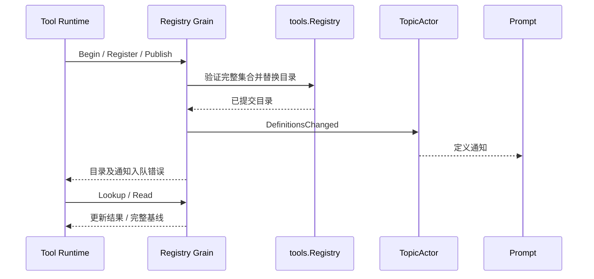

# Tools Actor 边界

本包目前实现共享 Registry Grain，设计与上下游契约由[工具 Actor 方案](../../zh-CN/actor-design/08-tools-implementation.md)拥有。

| 对象 | 职责与依赖 |
| --- | --- |
| RegistryGrain | 用 GoAkt 邮箱串行调用 tools.Registry，发布已提交定义 |
| tools.Registry | 纯业务批次验证、目录替换、结果查询；不持有框架对象或执行器 |
| 消息类型 | Begin/Register/Publish/Read/Lookup/Abort/Settle 及具名回复，错误保留 error |

组合根须用 WithLongLivedGrain 创建共享身份。Actor 调用方使用 RequestGrain；Grain 不等待消费者处理。事件入队失败不回滚已提交目录，调用方查询提交结果后继续恢复；重复发布同一版本允许重复通知。Prompt ToolsSubscriber 在订阅确认后读取基线，并支持显式重读；Runtime 按版本幂等处理。

当前只拥有内存目录，没有外部资源；强制停机不证明 ToolActor 已释放，也不能自动重放工具副作用。配置覆盖事件、生产装配、关闭回收与同 Agent 身份重建防护，以及 Tool Runtime/ToolActor 的切换和更新屏障尚未完成。

真实 GoAkt 测试覆盖完整目录发布、TopicActor 通知、返回值与事件字节隔离，以及 PubSub 不可用时仍可查询已提交结果。纯业务批次测试归 tools 包。测试使用外部 AskGrain 驱动，不表示 Actor 间采用同步调用。
