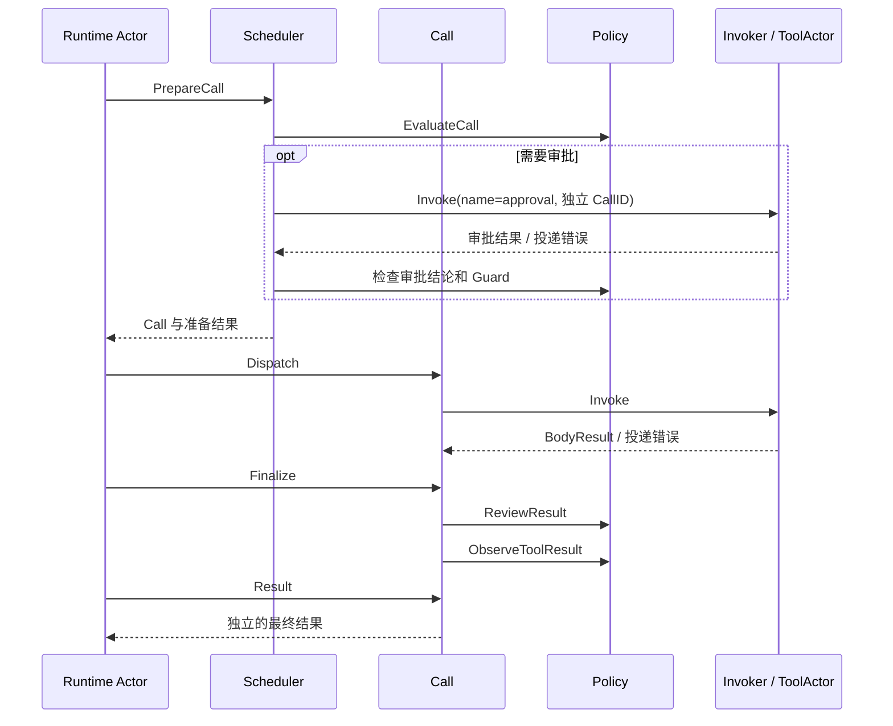

# 工具执行

本包实现工具调用业务，与 Actor 框架隔离。它不注册工具、不创建实例、不写 Session，也不提供工具体资源的关闭操作。

## 对象和模块内职责

| 对象 | 职责 |
| --- | --- |
| Scheduler | 捕获编译后的工具契约、策略和 Invoker，准备 Call，判定并发模式 |
| Call | 保存本次准备结论、实际工具输出、最终结果及未确认投递错误；向调用方提供阶段操作 |
| scheduler_approval.go | 前置策略要求审批时按名称请求 approval 工具，校验并应用已返回的审批结果 |
| 调用状态 | 约束审批、派发与结果处理顺序；只存在于包内，公共 ToolExecution 无调度权限 |
| policyEngine、pipeline | 评估调用、应用审批决定、执行 Guard、中间件和结果观察器 |
| dispatcher | 通过 Invoker 调用已选中的工具体，校验参数与输出、渲染及投影 |
| resultProcessor | 后置审查、定义级内容处理、结果通知与最终快照 |

Scheduler 依赖 `tools` 的契约和调用方提供的 Invoker。Runtime Actor 实现消息投递端口；本包不导入 GoAkt。Call 引用 Scheduler，Scheduler 不保存或反向引用 Call。

## 接口和执行流程

`EvaluateCall` 评估是否允许执行；`ReviewResult` 决定保留、替换或阻止结果；准备业务按名称调用审批工具并应用其结果，不重新运行前置策略。公开 ApplyApproval 和外部提供审批结论的入口已删除。执行中间件经 ExecuteBody 调用工具体。底层准备句柄和阶段方法为私有实现，外部只能驱动 Call，不能提交自造工具结果来结算。

PrepareCall 固定调用所使用的描述与策略；需要审批时等待命名工具返回，Actor 不解释审批阶段。原调用取消传入审批工具，但准备回复仍等待其实际退出；投递回复不确定时保留 Call 和 DeliveryError，不重发副作用。缺少审批工具时按 unavailable 拒绝。调用方串行驱动同一个 Call；不同调用的工具体只有经 ExecutionMode 判定后才可重叠。策略成员快照不延长资源寿命，上游必须在全部调用结束后才替换或关闭对应资源。

取消通过传入 context 到达工具体。DeliveryError 表示工具体退出未确认：Call 保留该错误，拒绝自动重发、Finalize 和最终 Result；不能把它转为可写入 Session 的普通失败。已确认的 BodyResult.Err 才进入普通失败处理。

测试覆盖策略顺序、只读输入、审批、重复阶段拒绝、取消传播、Schema 与投影、上下文顺序、策略快照及投递不确定。真实 Actor 路径由 Runtime 和 server 测试覆盖。Runtime 的真实 Actor 测试覆盖允许、拒绝、取消以及审批等待期间配置屏障；审批 Service 审计与 Interaction 的生产接线仍有缺口。

契约依据：[Tools Actor 设计](../../zh-CN/actor-design/08-tools-implementation.md)。验证与问题记录：[集成记录](../../zh-CN/actor-design/40-integration-findings.md)。
