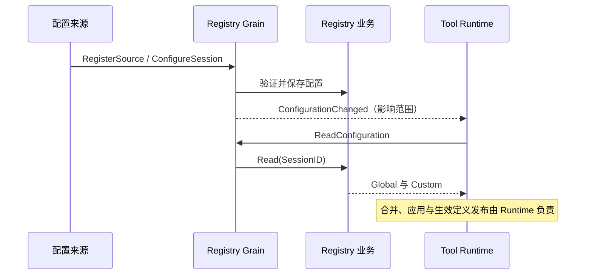

# 工具 Schema 与 Policy Registry

本包保存全局来源和 Session 自定义配置，不合并继承关系，不保存 Provider 或执行器，不拥有工具启停、候选发布或资源清理。设计由 [Tools Actor 方案](../../zh-CN/actor-design/08-tools-implementation.md)拥有。

## 对象与存储

| 对象 / 字段 | 职责 |
| --- | --- |
| Catalog.Schemas | 一个来源或 Session 声明的工具 Schema，使用 llm.ToolSchema |
| Catalog.Policies | key 是工具名，value 是显式策略字段；Session 可以只覆盖 Policy |
| Registry.sources | key 是来源 ID，如 local、mcp:docs；value 是该来源的完整 Catalog |
| Registry.sessions | key 是 SessionID；value 只含该 Session 的自定义 Catalog |
| Configuration | 分别返回 Global 和 Custom，供 Runtime 合并 |

RegisterSource 原子替换一个来源；不同全局来源的同名 Schema 冲突直接拒绝。ConfigureSession 保存自定义配置，RemoveSession 恢复继承。Read 返回独立副本，不允许调用方通过 map、切片或可选布尔值修改 Registry。

业务对象零值可用，由调用方串行访问；没有后台任务或独立关闭协议。配置失败不改变旧值。通知失败不回滚已保存的配置，读取接口可以核实事实。工具的资源生命周期与配置存储相互独立。

Registry 业务和 Actor 配置读写测试已迁移。生命周期已启动 Runtime 配置订阅；生产 HTTP 验收覆盖 Turn 边界切换和 Prompt 定义一致性，详见 Tools 实现方案中的验证边界。
