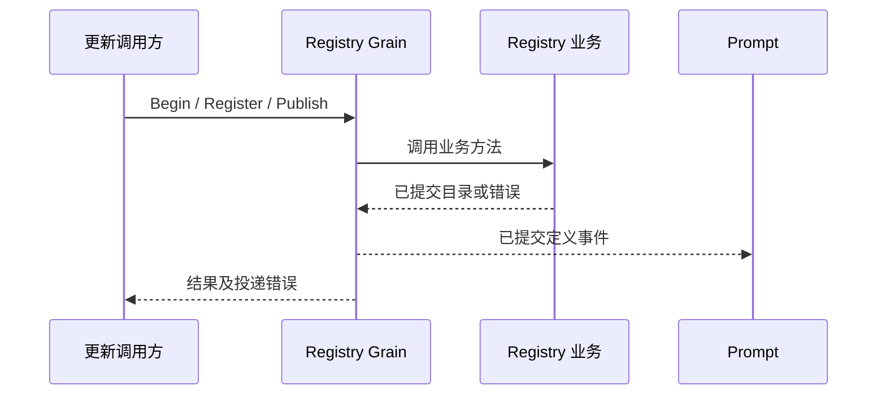

# 工具目录

本包拥有各 Agent 的已发布工具目录及未结算的更新批次。设计和验收契约见[工具方案](../../zh-CN/actor-design/08-tools-implementation.md)，本轮集成缺口见[集成记录](../../zh-CN/actor-design/40-integration-findings.md)；[历史实施进度](../../zh-CN/08-implementation-progress.md)不代表 Actor 迁移完成度。

## 职责与依赖

registry_configuration.go 管启动默认配置、按名称的 Agent 覆盖与更新配置快照。Registry.InitializeDefaults 只初始化一次，Configure 合并完整工具条目并固定到既有 batch；ReadConfiguration 按更新 ID 读取，在 Abort/Settle 时随批次释放引用。Tool.Provider 是借用的只读构造能力，Registry 不调用 Open；不能存入反向引用 Registry 或 Runtime 的 Provider。目录发布仍依赖 ToolActor 提交实际候选 schema。

`Registry` 在 registry.go 中负责候选验证、完整集合检查、单个 Schema 版本分配、幂等发布和批次结算。`Update` 声明一次更新的完整工具名称集合，`Candidate` 提供单个工具定义，`Publication` 表示更新的提交结果。共享定义使用 tools 包契约，本包不依赖 GoAkt，不持有工具执行器或调用 Actor 客户端。

上游通过 [Registry Grain](actor/README.zh-CN.md) 串行调用业务方法；业务返回目录及 error，由 Grain 投递定义事件。Prompt 只消费已发布目录，不读取候选。工具运行实例的创建、切换与释放不由 Registry 决定。

## 生命周期与失败

Registry 零值可用，由调用方串行访问；它没有后台任务或外部资源。候选未齐备、Schema 版本耗尽或重复输入冲突不得改变有效目录。发布前可 Abort；发布后只能由上游完成实例切换和资源释放后 Settle。通知失败不撤销已提交目录，可通过 Read/Lookup 查询结果。停止框架会丢失内存目录，不代表工具资源已释放。业务方法为短操作，没有独立异步取消协议。

registry_test.go 直接测试目录业务；registry_configuration_test.go 验证默认配置、覆盖、快照隔离及结算，actor 包测试真实 Grain 与配置登记、定义事件投递。候选可见性必须与已登记配置一致，不能通过自注册覆盖 Agent 的隐藏配置。配置业务和消息发布已实现；事件消费、动态全局更新、生产工具初始化与实例更新屏障仍未接通。

`tools.Definitions` 直接包含 AgentID、Schemas 和 KnownNames，没有整套目录版本。Registry 按 SessionID 和工具名称保留最后发布的 Schema；工具自身 Version 独立递增，隐藏不删除记录，删除后重加递增原工具版本。准备失败不消耗版本；所有候选及版本检查通过后才一起提交。每 Agent 一个未结算更新约束发布互斥，Begin/Configure 不再接收 ExpectedVersion。更新 ID 只用于准确关联重试和提交结果。

`TestSchemaVersionsAreIndependentAndSurviveRemoval` 覆盖独立递增、重复发布、隐藏恢复、删除重加、空集合和快照隔离；`TestRegistryRejectsProviderAssignedSchemaVersion` 验证版本分配权归 Registry。Runtime 已按精确更新身份关联实现；Prompt 的旧目录版本接口仍在迁移，不能用本包测试通过声明跨模块接线完成。
