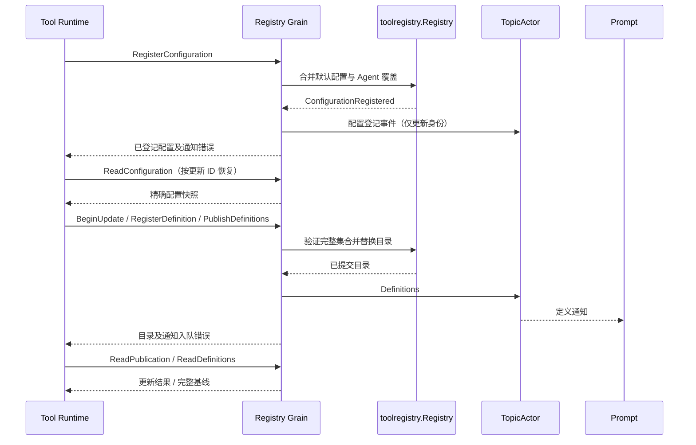

# Tools Actor 边界

本包目前实现共享 Registry Grain，设计与上下游契约由[工具 Actor 方案](../../../zh-CN/actor-design/08-tools-implementation.md)拥有。

| 对象 | 职责与依赖 |
| --- | --- |
| RegistryGrain | 用 GoAkt 邮箱串行调用 toolregistry.Registry，发布配置登记与定义发布事实 |
| toolregistry.Registry | 纯业务批次验证、目录替换、结果查询；不持有框架对象或执行器 |
| 配置请求 | InitializeDefaults、RegisterConfiguration、ReadConfiguration；初始化默认工具、登记 Agent 覆盖、读取指定更新 |
| 目录请求 | BeginUpdate/RegisterDefinition/PublishDefinitions/ReadDefinitions/ReadPublication/AbortUpdate/SettleUpdate 及具名回复，错误保留 error |

ConfigurationRegistered 表示配置已登记，不代表实例已构造或定义已发布。该事件只携带 AgentID 与更新 ID，Runtime 可用 ReadConfiguration 取得精确快照；Provider 不进入广播事件。RegisterConfiguration 回复的 Found=true 表示配置已登记，即使 Err 报告 PubSub 投递失败也不得重复登记同一 ID。

组合根须用 WithLongLivedGrain 创建共享身份。Actor 调用方使用 RequestGrain；Grain 不等待消费者处理。事件入队失败不回滚已提交目录，调用方查询提交结果后继续恢复；重复发布同一版本允许重复通知。Prompt ToolsSubscriber 在订阅确认后读取基线，并支持显式重读；Runtime 按版本幂等处理。

当前拥有内存配置和目录，没有外部资源；强制停机不证明 ToolActor 已释放，也不能自动重放工具副作用。配置事件已发布，生产订阅与装配、动态全局配置更新、关闭回收与同 Agent 身份重建防护，以及 Tool Runtime 的切换和更新屏障尚未完成。

真实 GoAkt 测试覆盖完整目录发布、TopicActor 通知、返回值与事件字节隔离，以及 PubSub 不可用时仍可查询已提交结果。纯业务批次测试归 tools/registry 包。测试使用外部 AskGrain 驱动，不表示 Actor 间采用同步调用。

配置测试另外覆盖真实事件、精确更新查询、默认值覆盖和通知失败后的恢复；ToolActor 执行测试通过登记配置、读取 Provider、构造、自注册、发布和切换再执行工具。生产 Agent 创建尚未使用该完整链路。
