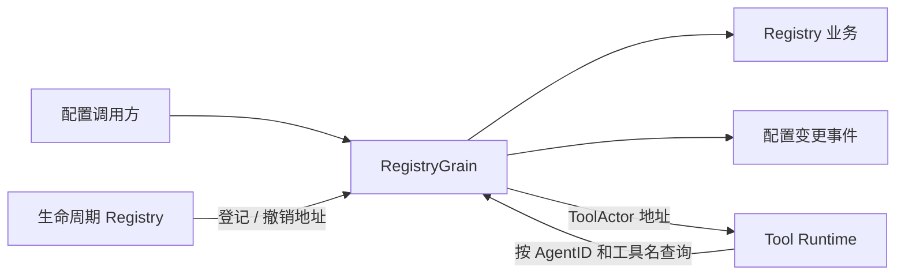

# Schema Registry Actor

RegistryGrain 串行调用 [Schema Registry 业务](../README.zh-CN.md)，并发布 tools/configuration 通知。它不启动工具、不存储 Provider、不执行配置合并。目标契约见 [Tools 方案](../../../zh-CN/actor-design/08-tools-implementation.md)。

RegisterSource、RemoveSource 操作全局来源；ConfigureSession、RemoveSession 操作 Session 自定义配置；ReadConfiguration 返回未合并的 Global/Custom。ConfigurationChanged.SessionID 为空表示全局配置变化。通知失败保留已保存配置并返回 error。

实例地址属于框架边界：actors 的 key 是 (AgentID, 工具名)，value 仅保存 ToolActor 地址及 CreationID。生命周期 owner 显式登记与撤销；地址占用冲突不能覆盖现有实例，旧 CreationID 的撤销不能删除新实例。地址表没有 Schema 或 Provider 副本。

RegistryGrain 使用长期身份。停止框架清除内存登记，不等同于工具业务已停止；生命周期 owner 必须先完成资源关闭。
