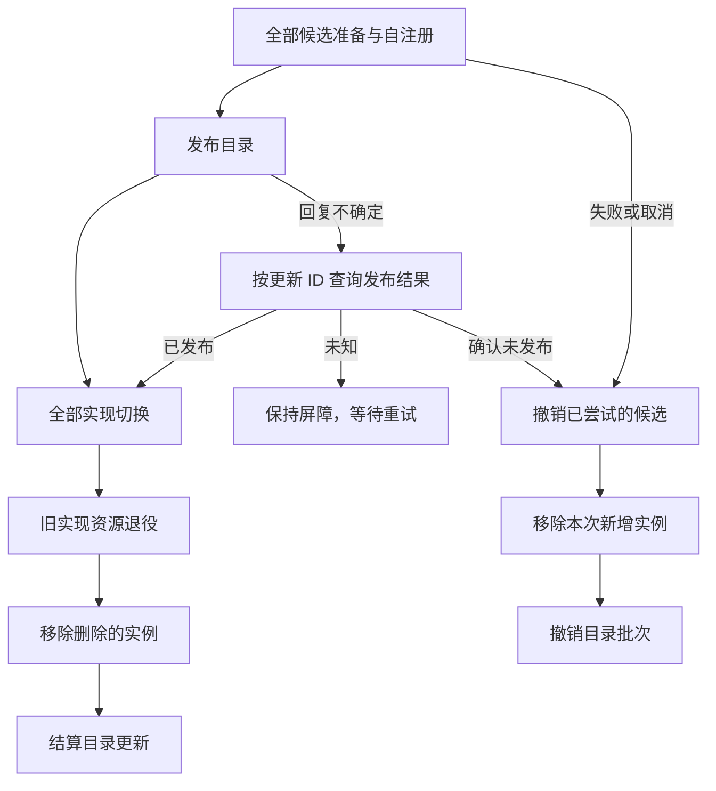

# 工具更新业务

本包实现每 Agent 的工具集合状态与单次更新业务流程，不代表完整 Tool Runtime 已完成。执行策略、中间件、Actor 端口适配与生产生命周期仍待迁入或接通。设计由[Tools Actor 方案](../../zh-CN/actor-design/08-tools-implementation.md)拥有；本轮验证记录见[集成记录](../../zh-CN/actor-design/40-integration-findings.md)，[历史实施进度](../../zh-CN/08-implementation-progress.md)不代表本次迁移完成度。

## 对象职责和模块内划分

`Runtime` 在 runtime.go 中维护当前工具集合、已结算更新身份、未完成更新和最近一次完成结果；它通过精确配置读取建立 Update，同一未完成更新必须先完成，新更新不能越过。Snapshot 在初始化前和更新未完成时拒绝读取，返回的切片不共享内部状态。

`Update` 在 update.go 中拥有配置快照、目标版本、增删成员和业务进度；update_apply.go 实现更新流程。它不拥有工具资源、Actor 地址、等待回复或任务队列。`Catalog` 是发布、查询和结算的消费端口；`Instances` 是准备、自注册、切换及资源清理的消费端口，实例启动和停止仍由生命周期 owner 实施。

调用方先排空工具调用，再串行调用 Apply。它可等待端口结果，必须在框架任务中执行，不能放在 Receive 中。返回 complete=true 且 error=nil 表示更新成功；complete=true 且 error 非空表示回滚已清理完；complete=false 表示仍有未确认的发布或清理责任，不能解除 Agent 更新屏障。

## 交互与失败恢复

准备阶段记录已尝试工具，包括可能留下待清理资源的失败调用。成功与回滚共用实例移除阶段；目录结算或撤销是其最后一步，不独立维护一个阶段。每一步确认后推进游标，失败停留原位，重试不重复已确认的步骤。端口必须幂等处理回复丢失造成的重复请求。

发布结果未知时不撤销候选；查询错误保持屏障。发布后取消不能恢复旧目录，继续完成切换与释放。发布前取消进入回滚。收尾 context 不继承用户请求取消，端口需有界返回，不能假定取消或超时就是资源已释放。

测试使用真实 Registry 和可控实例端口，覆盖已有目录保持、发布回复丢失、查询失败、切换/退役/移除/目录结算失败的续接、准备失败与回滚清理失败、发布前后取消。它不证明真实 Actor 生命周期已接通。

Runtime.Apply 在更新结算后保留最近一次结果，因此重复完成请求无需读取已经释放的配置批次。回滚完成保留原工具集合，发布后清理失败保持快照不可用。runtime/actor/instances_test.go 已通过实际 Registry 和 ToolActor 验证这条调用链；Runtime Grain、执行策略整合及生产初始化尚未接通。

runtime_close.go 实现 Runtime.Close：永久停止新更新与快照读取，先确认未完成更新的发布或回滚结果，再移除工具实例。未发布候选可因关闭意图回滚，已发布更新必须完成切换和清理；不能把取消当作回滚已经完成。工具移除失败保留当前成员，重试不会重复释放已确认完成的成员。Close 不承担目录配置记录删除或框架停用。

runtime_close_test.go 使用实际 Registry 业务与可注入错误的实例端口，覆盖发布前后两种未完成更新、关闭失败重试、拒绝新更新、禁止读取关闭后的快照与重复关闭无副作用。该测试是业务验证，不宣称已经通过 Runtime Grain 关闭。

同一 Session 重建时，Registry 可以保留已发布 Schema，新的 Runtime 在首次更新完成前没有有效快照。首次失败回滚不会把旧定义当作新 Runtime 已拥有的实例。Snapshot.UpdateID 关联已完成切换和清理的实现更新，不是目录版本。Schema 不变的替换保留 Schema.Version，同时切换执行身份。`TestNewRuntimeRebuildsInstancesAgainstRetainedCatalog` 覆盖关闭、重建失败回滚和再次重建成功。
