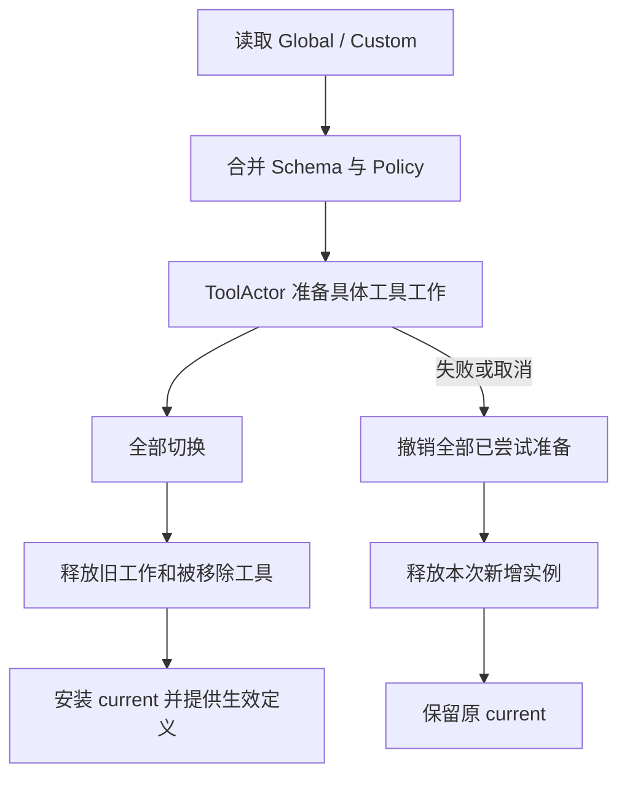

# Tool Runtime 业务

Runtime 合并 Schema Registry 的全局与 Session 配置，管理该 Agent 已应用的工具集合以及尚未完成的替换。业务不依赖 GoAkt，不保存 Provider 或 Actor 地址。设计见 [Tools 方案](../../zh-CN/actor-design/08-tools-implementation.md)。

## 模块内职责

| 对象 | 职责 |
| --- | --- |
| Merge / config.go | 同名 Session Schema 覆盖全局，Policy 逐字段继承和覆盖；剔除禁用工具 |
| Tool | 已生效的 Schema、可见性和执行策略 |
| Runtime / runtime.go | 读取 Registry 输入，发起或恢复替换，提供生效快照 |
| Update / update.go | 准备、切换、旧资源释放、失败回滚与清理进度 |
| Instances | 消费方拥有的工具工作端口，由 Actor 客户端实现 |

versions 的 key 是工具名，value 是最后应用的 Schema，用于跨禁用/删除保留定义版本；它不是当前成员表。Snapshot 从 current 派生，不在业务对象中重复缓存名称列表。Snapshot.Policies 的 key 是生效工具名，value 是本次快照的执行策略。

调用方必须在执行边界排空调用后进入 Apply，直到 complete=true 才能解除边界。准备阶段支持取消回滚；开始切换后必须完成切换和清理，不能伪造回滚。失败保留当前游标和资源责任，重试不重新执行已确认的清理。Close 拒绝后续读取并逐项关闭剩余工作。

Runtime 不再调用 Registry 的 Begin/Register/Publish/Settle。Prompt 只读取 Runtime 的生效定义。业务测试覆盖继承、隐藏/禁用、切换失败恢复、准备失败回滚和关闭失败重试；Actor 动态订阅及完整执行边界正在迁移。
