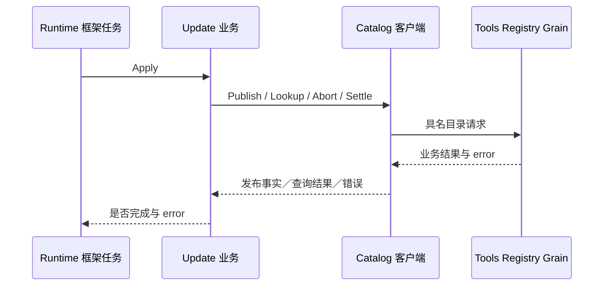
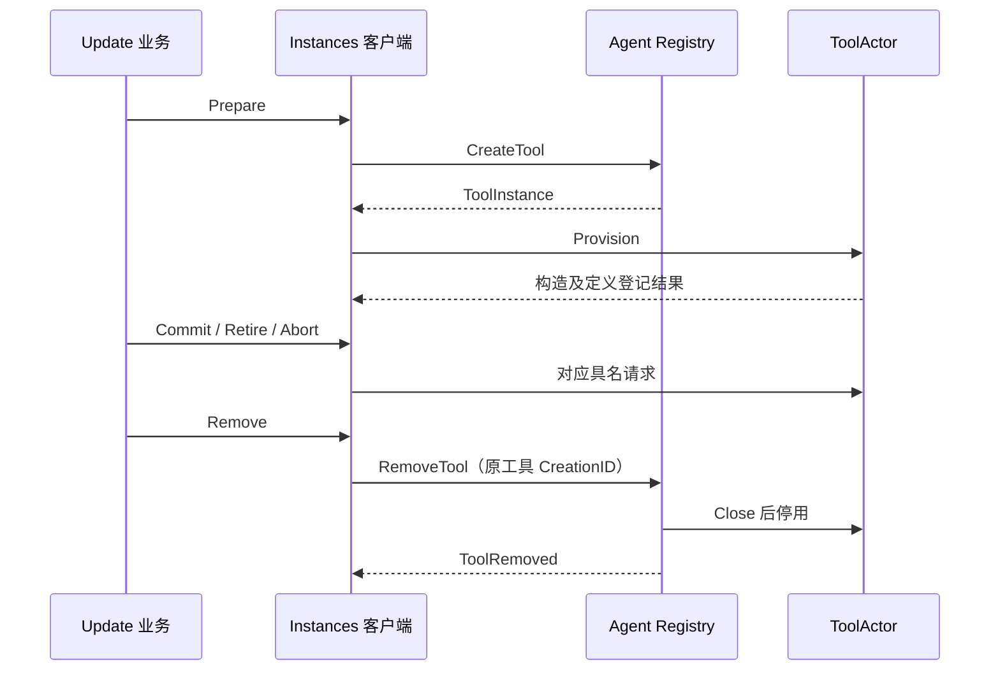
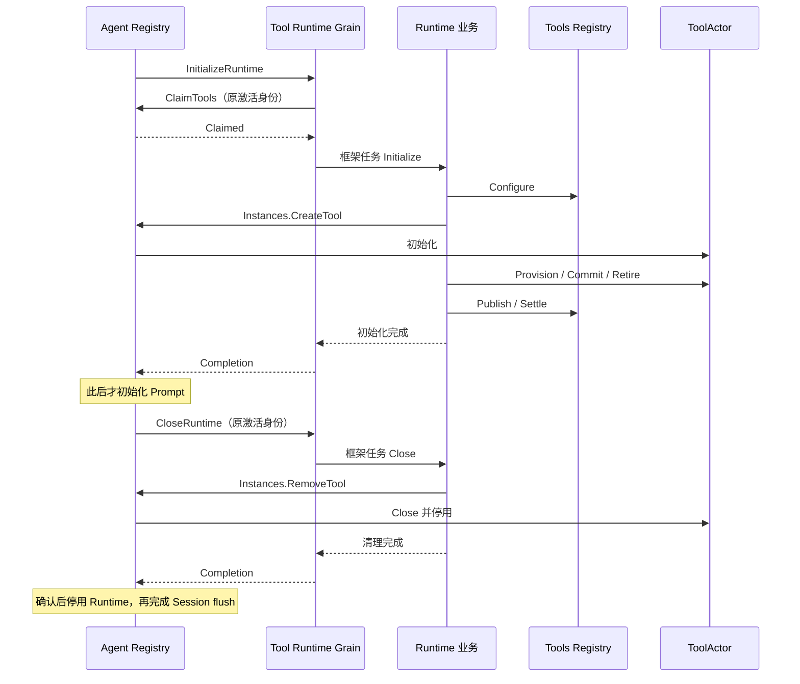

# Tool Runtime 的 Actor 端口

本包实现 `Grain`、`Catalog` 与 `Instances`，将每 Agent 工具初始化与关闭接到业务 Runtime；动态配置订阅、更新屏障及执行请求仍未接通。设计见[工具方案](../../../zh-CN/actor-design/08-tools-implementation.md)，验证范围见[本轮集成记录](../../../zh-CN/actor-design/40-integration-findings.md)；[历史实施进度](../../../zh-CN/08-implementation-progress.md)不代表本次迁移完成度。

## 职责、依赖与交互

catalog.go 中的 Catalog 只保存 ActorSystem、共享目录地址和正请求超时，映射具名请求及回复，不创建 Actor、不保留业务状态。业务包 tools/runtime 拥有最小 Catalog 接口，不反向依赖本包。Tools Registry 管配置与已发布工具目录；Agent Registry 才负责 Actor 生命周期，不能把两种 Registry 的职责合并。

Catalog 是同步等待适配器，只供框架任务中的业务流程使用，不能在 Actor Receive 内调用。它不把超时视为未提交：Publish 保留已提交定义与通知错误，Update 在结果不确定时 Lookup 精确更新。ReadConfiguration 缺失返回错误，不回退到最新配置；取消前已结束的 context 不再投递请求。客户端自身没有资源，无需单独关闭。

catalog_test.go 使用真实 Registry Grain，验证配置读取、未完成目录拒绝发布、PubSub 故障下仍保留提交事实、发布后禁止撤销、结算清理，以及取消请求不改变批次。不以这些端口测试宣称完整 Tool Runtime 已接通。

instances.go 的 Instances 绑定单个 Agent Creation，串行更新任务独占使用。Prepare 先向 Agent Registry 请求 CreateTool，再向 ToolActor 请求 Provision；Commit、Retire、Abort 分别调用对应工具操作，Remove 委托 Agent Registry 关闭并停用。客户端不启动 Actor、不构造工具业务、不发布目录。名称到 ToolInstance 的记录用于保留准确的工具生命周期，移除成功后删除；错误和不确定回复保留记录用于重试。

instances_test.go 使用实际更新业务、两个 Registry 和 ToolActor，覆盖首次发布、替换释放旧实现、失败回滚保留当前实现及删除资源。Provider 以具名测试对象注入构造失败，未执行真实外部工具操作。此测试不覆盖 AgentLoop 更新屏障和生产 CreateAgent 初始化。

生命周期消息归 agent/actor；本包生产代码不导入 agent/registry 实现包。Agent Registry 因此可以启动 Runtime Grain，而不形成包依赖环。实例更新测试还覆盖删除阶段资源关闭失败：保留更新和原实例身份，清理重试不重新 Open，Schema 版本与回滚行为均读取实际 Registry 验证。

Configure 按准确更新 ID 登记完整覆盖配置，不读取或提交目录版本。通知失败仍保留成功登记的配置及错误，不自动重试登记。空集合通过 Registry 的 ReadDefinitions.Found 与未发布区分。`TestCatalogConfigurationPreservesRegistrationAndEmptyPublication` 覆盖有无 PubSub、空集合发布、未结算时拒绝下一次更新和结算后继续登记；该测试已随 Runtime 契约迁移，并通过真实 Actor 的 race 检查。

## Runtime Grain 与 Agent 生命周期

runtimeactor.Runtime 在 runtime.go 中保留当前协议请求、原激活身份和业务对象，messages.go 定义初始化、快照读取及关闭契约。Catalog 和 Instances 只适配下游端口；业务 Runtime 持有更新与清理责任。框架任务执行业务，邮箱接收完成结果；工作进行时拒绝读取快照或并发关闭，不暴露半完成集合。

同名 Grain 重新激活不继承原资源责任。ClaimTools 不能替换已固定的激活身份；CloseRuntime 核对原身份，不能由空的新实例回复清理成功。Provider 初始化失败时，业务释放已返回资源，Registry 自动发起剩余清理；创建错误回复不表示清理已结束，调用方可请求 CloseAgent 等待确认后重建。

## 执行请求

runtime_calls.go 将 PrepareCall、ApplyCallApproval、DispatchCall、FinalizeCall 交给独立 Call 业务对象，保留当前请求的回复和取消句柄。同一调用同一时刻只能有一个任务；准备和最终策略请求串行，工具体任务可以重叠。CancelCall 只传递意图；ReleaseCall 要求 Call.Result 已确认结算。关闭前还有调用责任时拒绝清理资源。

instances_execution.go 从实际 ToolActor 读取 Descriptor 和独立实现 Identity，构造 Scheduler 及固定的调用目的地。Snapshot 不保留 UpdateID；每个工具的执行身份都来自该工具本身，Commit 重试保留原身份，真正替换时产生新身份。等待工具体回复不继承调用 context 的取消，以免将等待者取消误当作工具体退出；工具执行本身仍接收该 context。

internal/server 的实际配置 owner 集成测试已走通准备、拒绝提前释放/结算、工具分派、最终结果及释放。该测试未接入 AgentLoop 的批次主驱动、审批审计和动态更新屏障，这些路径仍需继续实现。

Runtime.initialization 保存本次接受的初始化绑定和借用策略，用于 CreationID 校验、重复初始化检查和调用准备；它不是当前消息。Runtime.toolRuntime 是独立业务对象，持有工具集合和更新清理状态。Scheduler 与 Call 位于 [execution](../../execution/README.zh-CN.md)，Grain 不承担执行策略或结果处理规则。
