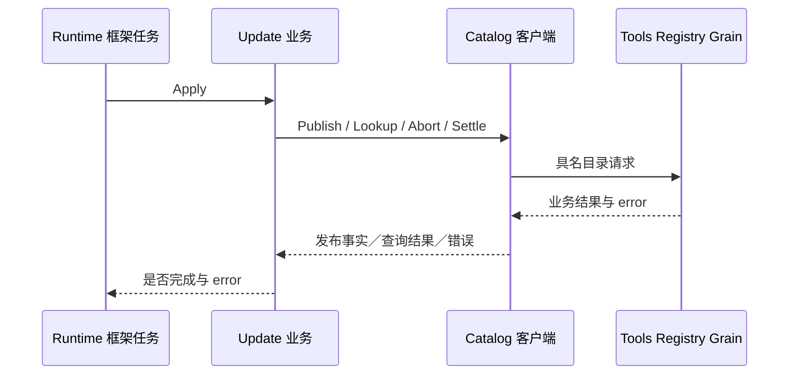
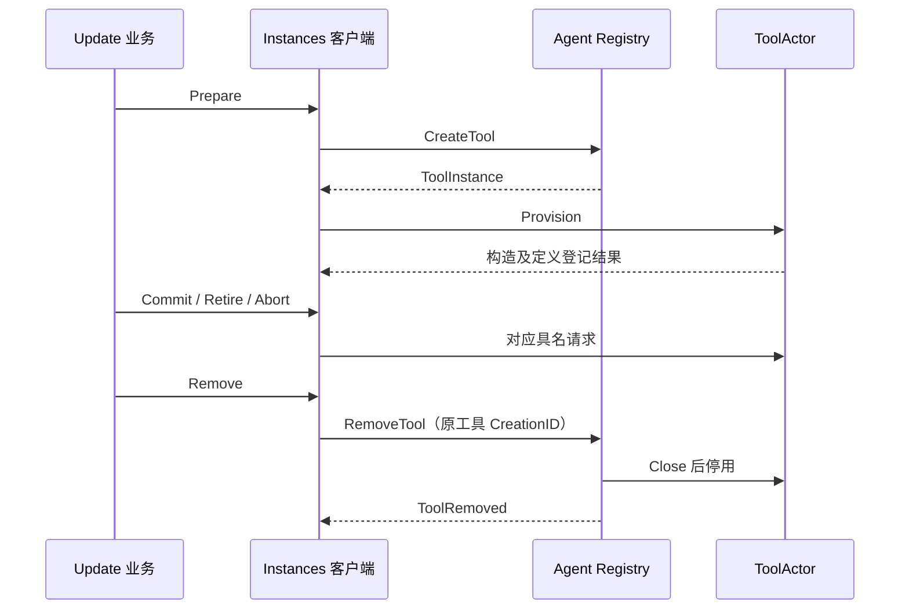

# Tool Runtime 的 Actor 端口

本包实现 `Catalog` 与 `Instances`，将更新业务的目录和实例端口接到已有 Actor owner；尚未实现 Tool Runtime Grain 或生产启动接线。设计见[工具方案](../../../zh-CN/actor-design/08-tools-implementation.md)，验证范围见[本轮集成记录](../../../zh-CN/actor-design/40-integration-findings.md)；[历史实施进度](../../../zh-CN/08-implementation-progress.md)不代表本次迁移完成度。

## 职责、依赖与交互

catalog.go 中的 Catalog 只保存 ActorSystem、共享目录地址和正请求超时，映射具名请求及回复，不创建 Actor、不保留业务状态。业务包 tools/runtime 拥有最小 Catalog 接口，不反向依赖本包。Tools Registry 管配置与已发布工具目录；Agent Registry 才负责 Actor 生命周期，不能把两种 Registry 的职责合并。

Catalog 是同步等待适配器，只供框架任务中的业务流程使用，不能在 Actor Receive 内调用。它不把超时视为未提交：Publish 保留已提交定义与通知错误，Update 在结果不确定时 Lookup 精确更新。ReadConfiguration 缺失返回错误，不回退到最新配置；取消前已结束的 context 不再投递请求。客户端自身没有资源，无需单独关闭。

catalog_test.go 使用真实 Registry Grain，验证配置读取、未完成目录拒绝发布、PubSub 故障下仍保留提交事实、发布后禁止撤销、结算清理，以及取消请求不改变批次。不以这些端口测试宣称完整 Tool Runtime 已接通。

instances.go 的 Instances 绑定单个 Agent Creation，串行更新任务独占使用。Prepare 先向 Agent Registry 请求 CreateTool，再向 ToolActor 请求 Provision；Commit、Retire、Abort 分别调用对应工具操作，Remove 委托 Agent Registry 关闭并停用。客户端不启动 Actor、不构造工具业务、不发布目录。名称到 ToolInstance 的记录用于保留准确的工具生命周期，移除成功后删除；错误和不确定回复保留记录用于重试。

instances_test.go 使用实际更新业务、两个 Registry 和 ToolActor，覆盖首次发布、替换释放旧实现、失败回滚保留当前实现及删除资源。Provider 以具名测试对象注入构造失败，未执行真实外部工具操作。此测试不覆盖 AgentLoop 更新屏障和生产 CreateAgent 初始化。

生命周期消息归 agent/actor；本包生产代码不导入 agent/registry 实现包。Agent Registry 因此可以在后续生命周期接线中启动 Runtime Grain，而不形成包依赖环。实例更新测试还覆盖删除阶段资源关闭失败：保留更新和原实例身份，清理重试不重新 Open，Schema 版本与回滚行为均读取实际 Registry 验证。

Configure 按准确更新 ID 登记完整覆盖配置，不读取或提交目录版本。通知失败仍保留成功登记的配置及错误，不自动重试登记。空集合通过 Registry 的 ReadDefinitions.Found 与未发布区分。`TestCatalogConfigurationPreservesRegistrationAndEmptyPublication` 覆盖有无 PubSub、空集合发布、未结算时拒绝下一次更新和结算后继续登记；该测试已随 Runtime 契约迁移，并通过真实 Actor 的 race 检查。
