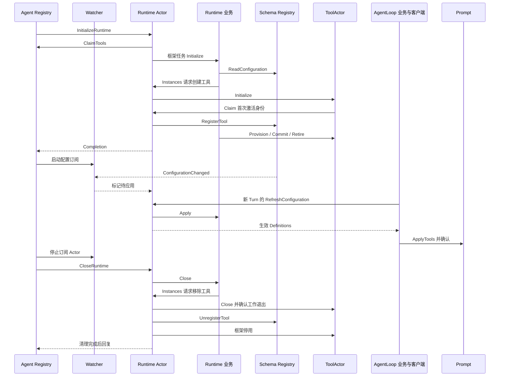

# Tool Runtime Actor 适配

本包把 [Runtime 业务](../README.zh-CN.md) 接入 GoAkt；设计由 [Tools 实现方案](../../../zh-CN/actor-design/08-tools-implementation.md)拥有。[历史进度](../../../zh-CN/08-implementation-progress.md)不代表当前 Actor 接线完成度。

## 模块内职责

| 对象 / 文件 | 职责 |
| --- | --- |
| Runtime / runtime.go | 绑定 Agent 生命周期，调度业务初始化、关闭、快照读取 |
| runtime_configuration.go | 接收配置失效通知，在调用方指定的 Turn 边界调度更新并发布生效定义 |
| Watcher | 订阅 Registry 配置事件，只转发本 Agent 或全局的变更通知 |
| Catalog / catalog.go | 读取 Registry 的 Global / Custom；仅在显式提供初始自定义配置时保存它 |
| Instances / instances.go | 向本 Runtime Actor 请求创建或移除 ToolActor，调度工作准备、切换和释放 |
| runtime_tools.go | 管理单工具激活身份、地址登记、关闭及失败后的原实例清理责任 |
| instances_execution.go | 按名称查询工具地址，捕获 Descriptor 和实现身份，适配执行端口 |
| runtime_calls.go | 按 CallID 保留 Call 与当前取消/回复句柄，调度执行阶段 |

业务 Runtime、Update、Call 分别拥有配置合并、替换清理和单次执行规则。Actor 不合并 Schema，不执行 policy 决策；Runtime Actor 负责创建、登记和关闭具体 ToolActor。

Runtime.tools 的 key 是工具名，value 是该工具的生命周期责任，包括 CreationID、首次激活身份、地址和清理进度；Instances 不重复保存实例表。Provider 由 ToolActor 初始化时从框架不可变扩展按名称取得，本包不保存构造器表。bodies.implementations 的 key 是工具名，value 是执行准备时读取的实现 Identity，不缓存 Actor 地址。Runtime.calls 的 key 是模型 CallID，value 是尚未释放的业务调用及传输句柄。

## 上下游与生命周期

Watcher 由生命周期启动并关闭，使用长驻策略。初始化和订阅确认各触发一次核实；正在刷新的后到通知不会被清除。Snapshot 与新执行请求不能读取半完成更新。配置更新失败保留清理进度；取消只传播意图，原请求等待业务处理结果。

Call 的 Prepare、Dispatch、Finalize、Release 分别有具名请求。准备与结果策略调度串行，工具体任务可重叠；同一调用不同时执行两个阶段。等待不因调用 context 取消伪造工具退出。Release 要求最终结果已结算；关闭前仍有调用责任则明确拒绝。

## 验证边界

生产创建验收覆盖空配置、真实工具、初始化失败自动清理、执行取消与释放。`internal/server/server_tools_test.go` 验证 HTTP → AgentLoop → Tool Runtime → ToolActor，并确认当前 Turn 保持旧 Schema、下一 Turn 的 Prompt 和工具切换一致。模型为可控测试服务。

前置策略的审批续接由 Scheduler 业务完成，Runtime Actor 不处理审批分支。真实 Actor 测试 `TestRuntimePreparationUsesNamedToolAndWaitsForApprovalExit` 验证通过 Registry 查找隐藏 approval ToolActor、允许/拒绝/取消，以及等待期间禁止配置切换；不使用专属 ApprovalActor。该测试提供可控审批工具结果，审批 Service 审计及 Interaction 的生产接线、AgentLoop 并行工具批次仍待验收。
