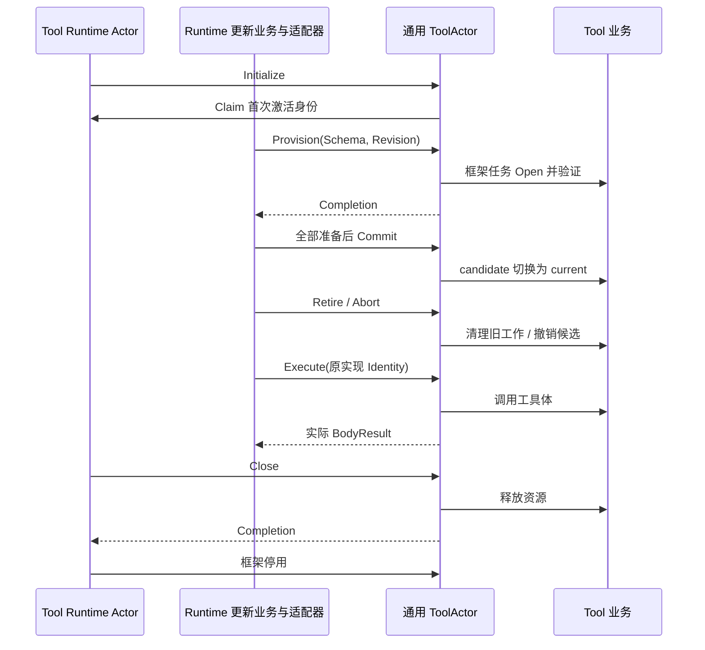

# 通用 ToolActor

本包适配 [单工具业务](../README.zh-CN.md)，所有具体工具共用 Grain；每 Agent 每工具独立实例。设计与上下游契约见 [Tools 实现方案](../../../zh-CN/actor-design/08-tools-implementation.md)，[历史进度](../../../zh-CN/08-implementation-progress.md)不代表当前迁移完成度。

## 模块内职责与数据

| 对象 / 文件 | 职责 |
| --- | --- |
| Grain / grain.go | 调度单工具准备、切换、释放及关闭；业务状态归 Tool |
| grain_initialize.go | 核对 CreationID 和生命周期授权，不创建其他 Actor |
| grain_execute.go | 调度工具体，等待实际退出，转发取消 |
| messages.go | 定义生命周期、工作操作和工具体执行请求；失败使用 error |
| operation | 保存当前资源操作的回复及取消句柄 |
| Grain.calls | key 为模型 CallID；value 为当前工具体调用的取消和回复句柄 |

Grain 不保存 Schema Registry、Provider 注册表或策略快照。组合入口通过 GoAkt WithExtensions 安装 Providers，在 HTTP / Agent 准入前一次性 Install 完整实现表，此后不可变；ToolActor 在 Initialize 按名称取得并绑定 Provider，Provision 只携带有效 Schema，由框架任务把绑定的 Provider 与 Schema 交给 Tool 业务。策略和中间件归执行业务，Actor 不直接承担审批。生产调用端口位于 Runtime 的 Instances；已删除仅测试使用的固定地址 Client。

## 身份、失败和取消

CreationID 区分工具生命周期；Revision 标识一次替换；Identity 标识真正生效的实现。Describe 返回实际实现身份和 Descriptor，Schema Version 不充当执行地址。调用准备后如果实现被替换，Execute 拒绝旧身份。

Provision 不修改 current，失败或取消先清理返回的部分资源。清理失败仍由 Tool 保留，后续 Abort / Close 继续。开始切换后由 Runtime 完成旧资源释放，不经 Registry 查询或发布候选。Provider panic 不能证明其未返回资源已经释放。

执行存在时拒绝资源修改和关闭。CancelCall 只取消指定工具体，Execute 等实际退出后返回；并发调用各自保留取消句柄。BodyResult.Err 是真实工具业务错误，独立请求 error 不能当作已完成结果。生命周期先确认 Close，再撤回地址和停 Actor；强制停止不能代替业务释放。

行为测试覆盖实现替换、旧身份拒绝、重复调用拒绝、取消等待真实退出、并发调用取消隔离和关闭。生产接线与 Turn 更新边界由 `internal/server` 验收，审批完整链路不在本包测试的证明范围内。
