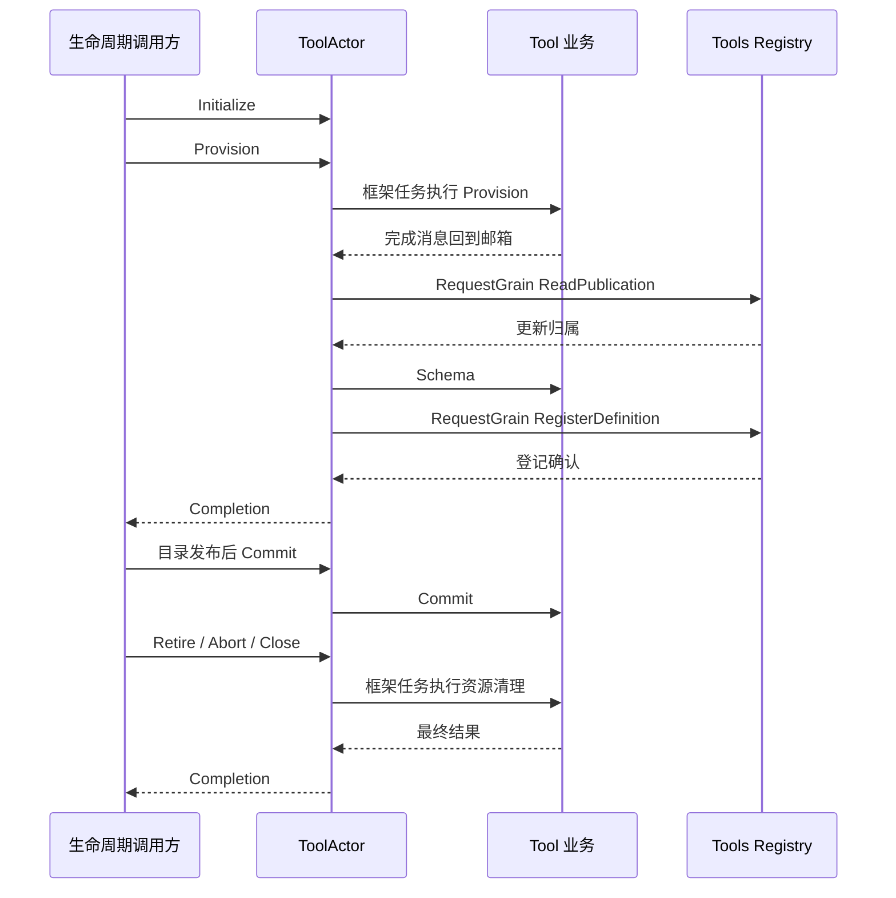

# 单工具 Actor

集成测试 `grain_questions_test.go` 将真实 ToolActor 接到 UserQuestions Actor，验证问题身份、答案返回、跨 Actor 取消及退出前禁止资源释放。工具配置和发布由测试协调，尚不代表生产 Agent 生命周期接线完成。

本包调度单工具实现的构造、登记、切换、工具体执行和资源释放。业务规则由 [tool.Tool](../README.zh-CN.md) 实现；本包依赖 GoAkt 及 [Tools Registry 消息](../../registry/actor/README.zh-CN.md)，业务包不反向依赖本包。设计见[工具方案](../../../zh-CN/actor-design/08-tools-implementation.md)，集成缺口见[集成记录](../../../zh-CN/actor-design/40-integration-findings.md)；[历史进度](../../../zh-CN/08-implementation-progress.md)不代表当前迁移完成度。

## 对象与职责

messages.go 定义具名请求和 Completion。`Provision` 表示配置更新时的实现构造，不是每次调用前的 policy 检查。执行中间件、审批和前后策略仍归 Tool Runtime 业务流程。

grain.go 中 `Grain` 保存当前创建身份、Registry 地址和 Tool 业务对象。`operation` 只保存一个在途请求的回复句柄、任务取消和登记输入，不保存业务目录或工具执行策略。构造与清理任务运行期间，业务对象由该任务独占，其他操作返回调度忙错误。生命周期调用方负责先排空工具调用，再请求更新或关闭。

grain_execute.go 中 Execute 调度 Tool.Execute，工具名称、版本和实现可用性由业务对象校验；调用前的策略、审批和中间件由 Tool Runtime 完成。本包返回 BodyResult，不能直接作为已规范化工具结果或 Session 提交确认。calls 表只保存在途调用的取消和回复，允许独立调用任务并行；工具调用并发策略仍由 Runtime 决定。CancelCall 只取消指定调用，原 Execute 等工具体退出后回复。在途调用存在时拒绝配置与资源修改，不自建等待队列。

## Actor 客户端

client.go 中 Client 绑定现有工具身份、创建 ID 和版本，通过 RequestGrain 发起 Execute／CancelCall。调用结果由框架任务送回调用方邮箱，再通过本轮传入的 ExecutionReceiver／CancellationReceiver 处理。Client 不持有调用方 Actor 或业务 policy；调用方 OnDeactivate 必须 Dispose，以结束等待回复的任务。

CallResult.Body 表示实际工具体结果；CallResult.Err 表示请求失败或无效回复，不能据此确认工具体退出。Execute 不设置等待超时，取消通过 context 或 CancelCall 到达工具体；Cancellation 只是取消消息处理结果。客户端不重试工具副作用。

## 生命周期与失败

生命周期 owner 创建长驻 Grain，再通过 Initialize 绑定资源；Grain 不启动其他 Actor。CreationID 不匹配的请求被拒绝。调用 Provider 前通过 ReadPublication 检查更新属于当前 Agent；不存在、已结算或其他 Agent 的更新不得构造资源。回复通过邮箱恢复编排，后续请求使用当前 GrainContext。构造成功而登记失败时保留候选，重试相同 Revision 只重试登记，不重新 Open。调用方必须保证同一 Revision 始终代表同一份配置。

Initialize 重试仅在 CreationID、AgentID、工具名称、目录身份和生命周期 Authority 身份全部相同时确认原绑定，不替换业务对象或资源。该确认不表示工具可执行，也不重新开放已关闭实例；绑定冲突明确失败。grain_initialize_test.go 验证回复重试、配置不被重置、五项身份冲突和关闭后不复活。

Provision 的 context 传播到构造，回复等待失败清理结束。已经取消的重试不会继续登记。清理失败的资源由业务对象保留；任务 panic 返回明确错误并解除调度占用，但 Provider 仍负责未能通过返回值交出的资源，不允许依赖 panic 自动恢复副作用。普通工具资源释放通过 Close 完成，强制停 Grain 只取消在途任务并失败回复，不证明业务资源已关闭。

真实框架测试使用 Tools Registry Grain 和 ask_user_question 的真实工具定义，覆盖自注册、登记失败后重试不重新构造、旧创建请求拒绝、跨 Agent 更新拒绝、取消等待清理、任务 panic 返回和关闭幂等。新增工具体调用测试覆盖创建／Session／名称／实现身份拒绝、重复在途调用拒绝、取消等待工具体退出、在途调用禁止关闭、并发调用取消隔离。尚未实现调用中间件的 Actor 接线、统一命名及生产生命周期装配；本包测试不能代替 INT-23 的 Agent 创建验收。

Schema 版本不作为执行路由。Client 和 Execute 绑定工具 CreationID 与已提交 Revision，同一 Schema 的实现替换也会使旧 Revision 执行被拒绝。TestSettledUpdateCannotConstructAnotherToolCandidate 验证迟到更新不构造资源、不影响现有执行及关闭；取消和 panic 测试均先登记有效更新，panic 测试额外确认 Open 实际执行。
