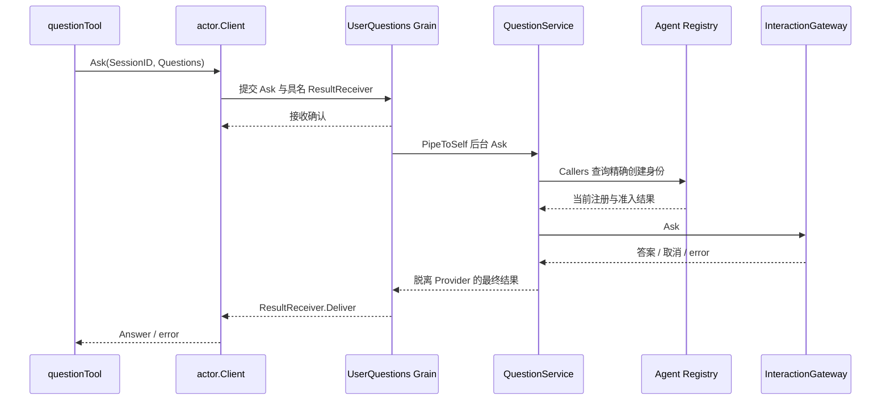

# UserQuestions

本模块负责结构化问题校验、调用者资格检查，以及输入与答案的隔离复制。实现设计见[Workspace 与用户问答](../zh-CN/actor-design/36-workspace-userquestions.md)。浏览器 RPC 关联、重连、答案匹配、取消帧由 API Proxy 的 InteractionGateway 提供；本模块不写 Session。

## 对象与依赖

| 对象 | 职责 |
| --- | --- |
| QuestionService | 无状态业务实现，检查空问题、展示意图、live 与 delegated 资格，并调用不可变 Provider |
| Request | Questions 与 SessionID，不包含 Agent 活对象或框架身份 |
| Callers / Eligibility | 业务拥有的实时调用资格端口和返回值 |
| Provider | 收集一批用户答案；必须响应 context 取消并在返回前释放等待资源 |
| actor.Callers | 绑定 Agent 的精确创建身份，查询 Registry，隔离关闭或重建后的旧请求 |
| actor.Grain | 调度后台 Ask，保存待回复与取消句柄，转发最终结果 |
| actor.Client | 在工具执行任务中桥接 Grain；不在 Receive 内同步等待 |

Provider 由 composition 显式传入，每次 Grain 初始化固定，替换需关闭旧实例后重新初始化；不再保留 Plugin 的 RegisterProvider、ProviderHandle 或重新 Apply 生命周期。无 Provider 时仍返回 NO_PROVIDER。QuestionService 的依赖不可变，可以并发服务相互独立的请求。

## 调用与生命周期

每 Agent 的工具客户端绑定对应 UserQuestions Grain；Callers 保留 creation 身份只在 Actor 适配层使用。未 claim、非当前 creation、关闭中的 Agent 不可提问。当前注册存在 ParentID 时由业务拒绝交互；持久化 Origin 不决定当前运行时是否为根 Agent。

取消可以发生在等待回答期间。工具 context 直接进入后台任务，Grain 调用方也可发送 Cancel(ID, Cause)。取消确认不结束原请求；Provider 退出后才返回，迟到的正常答案不能覆盖取消。Close 在仍有待完成问题时返回错误；强制框架停止会取消所有等待并返回技术失败，不宣称浏览器已完成清理。

真实 Grain 测试覆盖中途取消、等待 Provider 清理、关闭拒绝和创建身份替换；业务测试覆盖错误码、意图和对象复制。API Proxy 的问答输入已改为 SessionID；服务器整体装配仍在独立迁移中。
