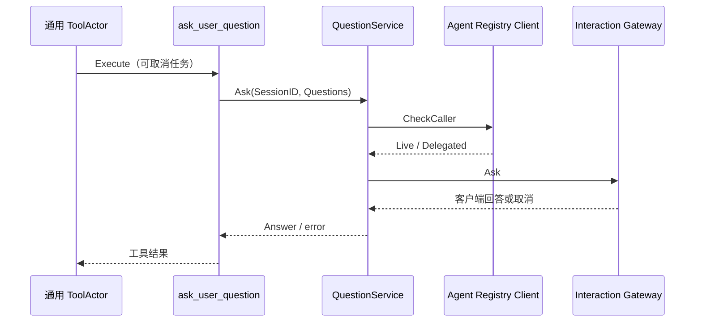

# UserQuestions

本包拥有结构化提问的业务校验，不管理工具生命周期、Actor 消息或浏览器请求表。设计见 [Workspace 与 UserQuestions](../zh-CN/actor-design/36-workspace-userquestions.md)。

## 主要对象与职责

| 对象 | 职责 |
| --- | --- |
| UserQuestions | 唯一 Ask 契约，输入问题及 SessionID，返回答案或 error |
| QuestionService | 校验问题、展示意图和调用者资格，调用回答端并复制输入输出 |
| Callers / Eligibility | 查询当前 Agent 是否存活、是否受父 Agent 管理 |
| Question / Answer | 结构化问题与答案，不包含 Agent 或框架对象 |

QuestionService 持有不可变的回答能力与 Callers。接口相同不代表实现职责相同：QuestionService 负责校验，Interaction Gateway 负责客户端请求关联。已删除重复的 Provider 接口，不保留别名。

## 交互流程与生命周期

不启动独立 UserQuestions Actor；通用 ToolActor 已负责调度、取消和等待执行退出。QuestionService 无状态，不需要第二层 pending 表或关闭协议。共享 Interaction Gateway 由 API 关闭，工具实现只借用它；随后 Agent Registry 等待 Tool Runtime 排空，最后关闭 Session。

当前调用者的 parent 关系由 Agent Registry 决定，历史 Session 的 Origin 不决定提问资格。取消在回答等待期间生效；回答端释放等待资源后才返回，晚到的正常答案不能覆盖取消。无回答端仍返回 NO_PROVIDER；非法意图、空问题和 delegated caller 在发出客户端请求前拒绝。

业务测试覆盖准入、意图、复制和错误码；通用 ToolActor 测试覆盖取消传递与等待回答端退出。生产装配与 HTTP 验收见 [服务装配](../zh-CN/actor-design/41-server-composition.md)。
