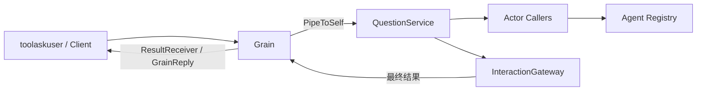

# UserQuestions Actor

完整职责见[模块说明](../README.zh-CN.md)与[设计方案](../../zh-CN/actor-design/36-workspace-userquestions.md)。

Grain 只拥有后台任务的回复与取消句柄。业务校验、调用资格解释和复制归 QuestionService；Callers 适配器在后台任务中查询 Agent Registry，检查精确 creation 与当前父子关系。它不把 GrainIdentity 或 CreationID 放进业务 Request。

本地工具 Client 使用 TellGrain 的短接收确认和具名 ResultReceiver 等待用户答案，避免用外部 AskGrain 的超时充当业务期限。直接 Actor 请求使用框架延迟回复；Cancel 可在等待期间处理。请求 ID 只匹配本次调用，不能复用为另一问题；重复待处理 ID 被拒绝。

普通 Close 仅在已接受的问题全部退出后成功。强制 OnDeactivate 取消等待并报告失败。ResultReceiver.Deliver 必须非阻塞；它不拥有业务状态，也不接收 any。
