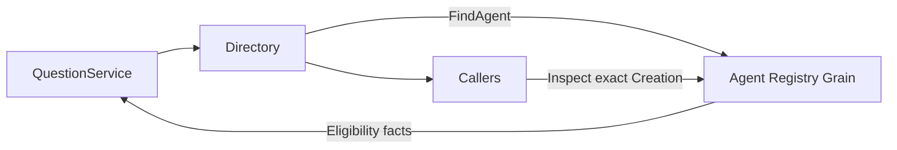

# UserQuestions Actor Client

本目录只有 Agent Registry 消息适配，不定义 UserQuestions Actor。业务规则由上层 QuestionService 执行；设计见 [模块方案](../../zh-CN/actor-design/36-workspace-userquestions.md)。

- Directory 为共享提问能力查找当前 Ready Agent，再按固定 Creation 查询准入。
- Callers 为已选定的 Agent 生命周期执行 Inspect，拒绝旧身份、未绑定实例和关闭中的 Agent。
- 两者仅返回 Eligibility，不判断问题内容、不联系浏览器、不维护 pending map。

这些同步客户端运行在通用 ToolActor 的异步工具任务中，不占用 Grain dispatcher。Tool Runtime 保留发起调用的 Agent 生命周期直到工具退出；调用不会跨到同名的新 Agent。客户端借用 ActorSystem，无独立 Close。
