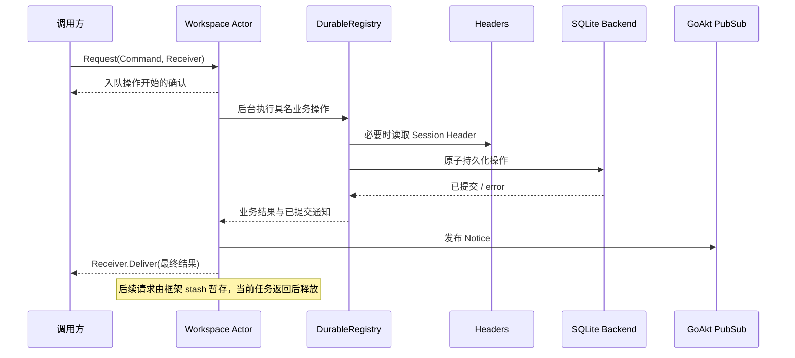

# Workspace

Workspace 拥有项目目录注册、展示顺序、Session 归属和归档集合。它不管理目录内容，不删除 Session 日志。实现方案见 [Workspace 与用户问答](../zh-CN/actor-design/36-workspace-userquestions.md)。

## 模块内职责

| 对象 | 职责与依赖 |
| --- | --- |
| DurableRegistry | 独占注册与排序业务状态；依赖 Backend、SessionHeaders、时钟和 ID 生成器；无框架、锁或服务定位器 |
| entity | 通过 ID 访问 Registry 的进程内业务视图；不跨 Actor 传递，Registry 不保存 entity |
| StoredRegistry / StoredWorkspace | 保持 SQLite 已有持久化形状 |
| WorkspaceState | 脱离 owner 的消费者快照 |
| Backend / sqlite.Adapter | 前者定义业务要求的原子存储操作，后者只执行 SQL、编解码和技术校验 |
| actor.Actor | 串行调度业务 I/O，发布已提交通知，停止时关闭 Backend |
| actor.Headers | 将 Session Registry 的实时 Header 与 Persistence 的持久化 Header 合并；live 优先 |
| actor.Client | 非 Actor 调用方的具名操作入口；Actor 调用方使用 Request 异步提交 |

Registry 直接提供按 Workspace ID 操作的 SetTitle、AttachSession、InsertSessionBefore、DetachSession。Actor 不以回调重新实现查询、未知 ID 判断或归属规则。

## 依赖与交互

每个进程使用一个 Workspace Actor。通过 actor.Spawn 启动，统一启用框架 stashing。业务对象交给该 Actor 独占，不能同时被其他 goroutine 访问。Registry 初始化失败时 Backend 仍归调用方；启动成功后由 Actor 在停止时关闭。

初始化按原规则从 Session Header 引导注册；目录 canonical 化、cwd 归属校验、幂等附加、无效移动拒绝、排序和归档行为保留。Backend 失败不会安装新的记录或生成成功通知。通知是非持久化事实，名称仍为 workspace/changed、workspace/removed、workspace/order-changed、workspace/archived-sessions-changed；启用系统 PubSub 后在 workspace/notices topic 发布。客户端重连以完整 List 为准。

取消通过 Request.Context 到达后台 I/O；已经提交的写入不回滚。停止会取消并等待正在执行的任务，随后关闭 Backend。业务事件由 Registry 产生，Actor 只传递；API Proxy 仍拥有 wire DTO 和 Host frame 映射。

原 Plugin、Factory 及旧 Session LiveStore 适配已删除。SQLite 配置由 sqlite.DecodeConfig 严格解析。模块验证包括原业务持久化/引导测试、真实 Actor 并发附加、失败不发布事件和配置校验；全局服务器装配迁移不由本模块完成。

## CWD 的记录方式

Session 的 CWD 由创建用例通过 `session.CreateOptions.Metadata.CWD` 写入 Header；Workspace 不通过 Notice 写入或修改它。按本地最新 DSH 对照，Header.CWD 和 Workspace.path 都不可变；AttachSession 只校验已有 Header 的 cwd 与 path 一致。相同 Session ID 使用不同 cwd 是冲突，不是更新。证据与最新 DSH 通知机制的差异见[设计对照](../zh-CN/actor-design/36-workspace-userquestions.md#本地最新-dsh-对照cwd-与-workspace-通知)。
