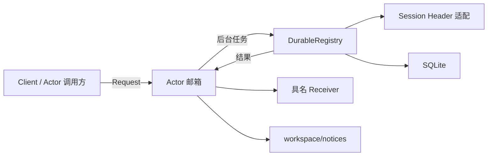

# Workspace Actor

业务边界、存储格式和实现设计见[模块说明](../README.zh-CN.md)与[Actor 方案](../../zh-CN/actor-design/36-workspace-userquestions.md)。

Actor 独占 DurableRegistry。Spawn 开启框架 stash；每次 Request 只启动一个后台任务。后续请求暂存，finished 返回后发布通知、交付最终结果并释放暂存请求。它不维护额外业务队列，不判定目录归属，不用回调包装业务方法。

Request 的框架回复只确认操作已开始，Receiver 才接收最终业务结果。Receiver.Deliver 必须非阻塞。Client 在普通调用 goroutine 等待结果；Actor 调用方应将结果投递回自己的邮箱。Context 仅是本进程运行契约，取消会传到 I/O；不能把接收确认当成持久化成功。

Headers 的 Actor 查询只发生在启动或后台任务内。存储和 Header 错误原样返回。PostStop 等待当前任务交回状态后再关闭 Backend；它不声称已经执行完尚未开始的暂存请求。
