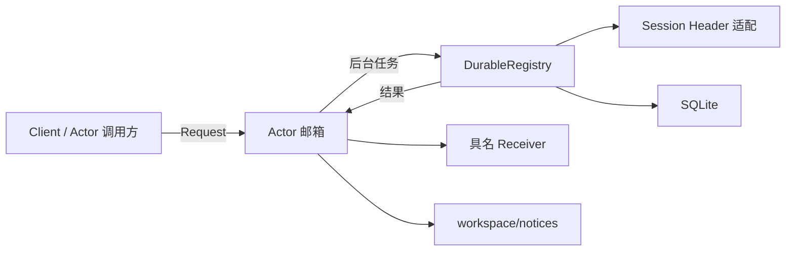

# Workspace Actor

业务边界、存储格式和实现设计见[模块说明](../README.zh-CN.md)与[Actor 方案](../../zh-CN/actor-design/36-workspace-userquestions.md)。

Actor 独占 DurableRegistry。Spawn 开启框架 stash；每次 Request 只启动一个后台任务。后续请求暂存，finished 返回后发布通知、交付最终结果并释放暂存请求。它不维护额外业务队列，不判定目录归属，不用回调包装业务方法。

Headers 实现 Workspace 的 SessionHeaders 端口，读取现有 Session Registry 和 persistence.Reader。单项优先实时 Header；列表合并分页持久化结果与实时登记，实时值覆盖同 ID，返回独立副本。缺失与读取失败严格区分。该同步客户端由 Workspace 后台任务调用，不在 Receive 中等待；它不拥有存储、Session 生命周期或 CWD 校验规则。

Request 的框架回复只确认操作已开始，Receiver 才接收最终业务结果。Receiver.Deliver 必须非阻塞。Client 在普通调用 goroutine 等待结果；Actor 调用方应将结果投递回自己的邮箱。Context 仅是本进程运行契约，取消会传到 I/O；不能把接收确认当成持久化成功。

Headers 的 Actor 查询只发生在启动或后台任务内。存储和 Header 错误原样返回。PostStop 等待当前任务交回状态后再关闭 Backend；它不声称已经执行完尚未开始的暂存请求。

actor_shutdown_test.go 使用真实 GoAkt 与 SQLite，阻塞在途写入，验证外部 PID.Shutdown 传播取消、等待操作退出、交付最终取消结果，然后才关闭存储。该用例连续 10 次非缓存 race 测试通过；它验证这条关闭流程，不代表所有外部关闭与邮箱交错都已覆盖。

Headers.Get 返回 `(*session.Header, error)`：命中返回独立副本，两处都不存在返回 nil、nil，Actor/持久化查询失败返回 nil、error。Workspace 自行把缺失转换成当前操作的业务错误，适配器不再额外返回 found。真实 Registry/SQLite 测试覆盖未落盘 Session、关闭后的持久化读取、缺失、取消与副本隔离。

Workspace Actor 使用常驻策略，存活到服务显式关闭；空闲不会释放 Registry 和存储句柄。API Workspace 订阅者同样随服务关闭，避免下次修改 CWD 时丢失通知。
