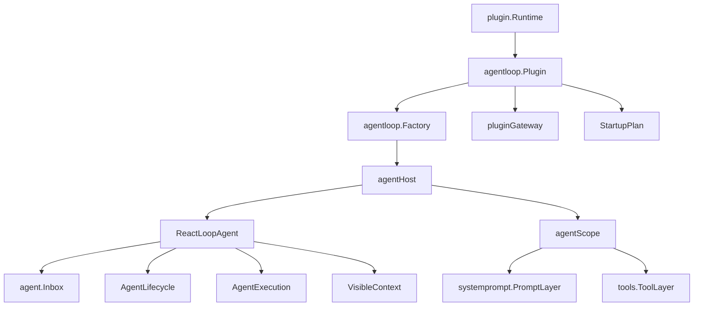
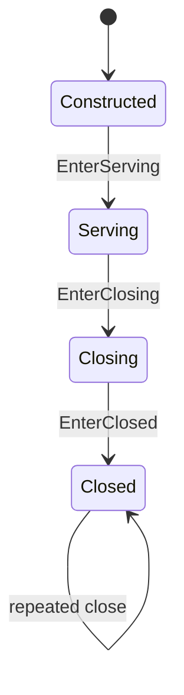
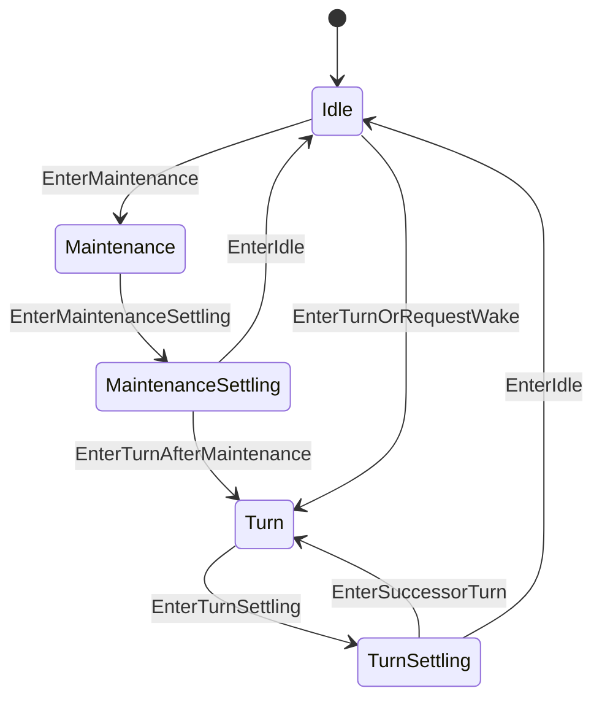
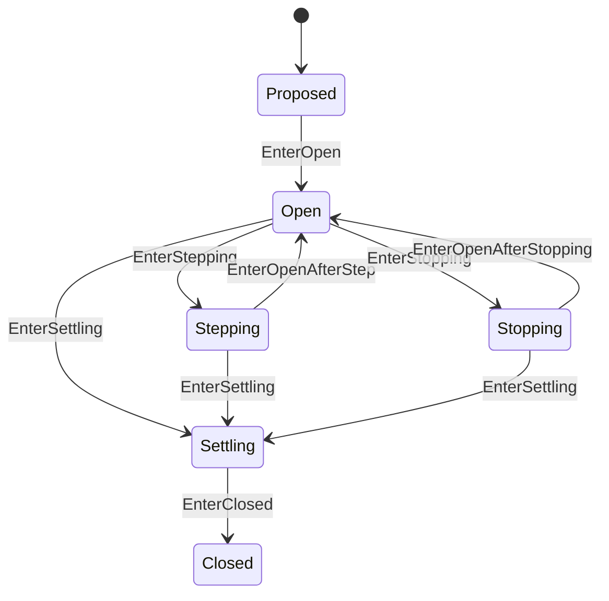
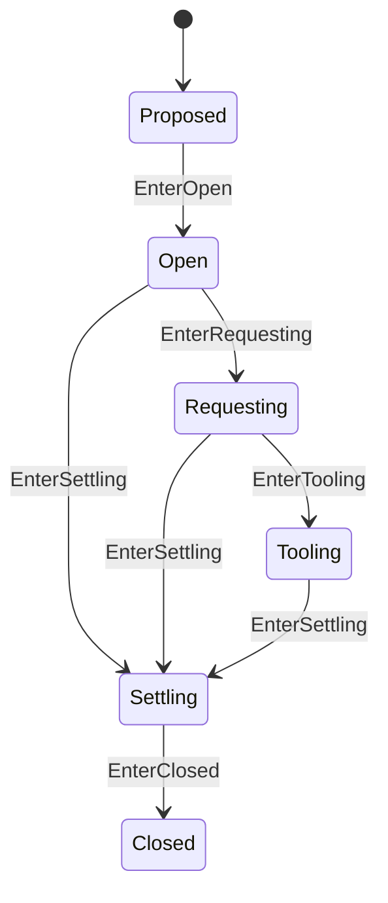
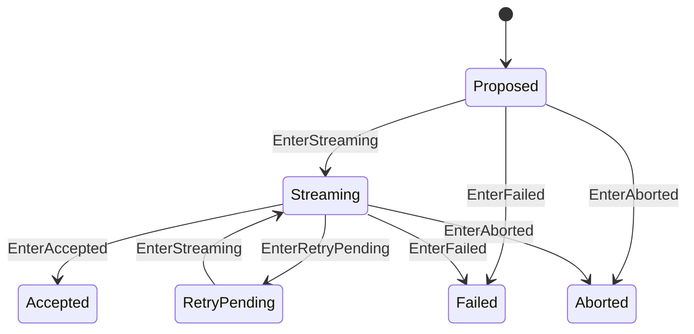
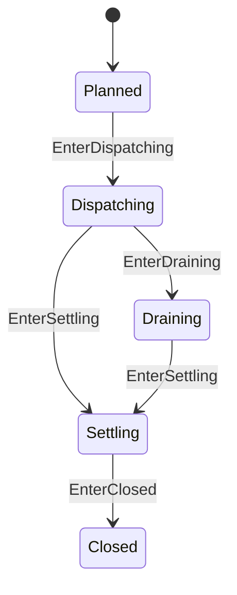

# 15 Agent Loop 与请求驱动模块设计

状态：Accepted / Implemented

本文拥有 `agentloop` Provider 的 concrete Agent 构造、执行编排、六个状态机、请求重建、模型流消费、Tool-call 调度、取消结算和动态 Prompt Context 可见视图。实现路径见[`agentloop` 模块说明](../agentloop/README.zh-CN.md)，实施与验证状态只见[08 实施进度](./08-implementation-progress.md)。

live Agent contract、Registry、Inbox 和 `agent/*` Event Definition 由[14](./14-agent-registry-inbox-and-events.md)拥有；Session fact、surface 与 persistence 由[Session Core 设计](../session/docs/design.zh-CN.md)拥有；System Prompt、Tools 与 LLM 分别由[11](./11-system-prompt-registry-and-assembly.md)、[12](./12-tools-registry-and-execution-pipeline.md)和[13](./13-harness-llm-runtime-and-deepseek-provider.md)拥有。Agent Loop 只编排这些 capability，不成为它们的第二个 owner。

## 1. 固定源与偏离理由

兼容权威是 DeepSeek Harness 固定基线 `47f943859bef60e4160492346772ded9b24f765a`。固定源 `packages/core/agent-loop/src/agent.ts` 由一个 `ReactLoopAgent` 直接执行 Turn、Step 和 request workflow；`packages/core/agent-loop/src/tool-calls.ts` 拥有 Tool-call 调度语义。Go 保留同一个 concrete Agent identity、Session fact、event ordering、cancel、retry 和 Tool result 语义，但不复制 TypeScript closure、`AbortController` 或单文件布局。

经允许对照的较新 DSH `origin/master` `cd5ef8148158c3a752a658978873241fdf8e2bbc` 仍使用单个 `ReactLoopAgent` 和直接 Turn/Step workflow，只作为职责与竞态测试的辅助证据，不自动修改固定基线。

旧 Go 私有对象图 `loop -> activityCoordinator <-> turnRunner -> stepExecutor -> toolCallExecutor` 同时存在双向持有、两阶段回填和多个状态权威。当前实现已一次性删除该对象图，没有 alias、wrapper、feature flag 或 old/new 双路径。可观察公共契约没有因此改变。

## 2. 术语与命名规范

名称必须先回答“这个对象是什么”，不得靠连续拼接关联对象、处理步骤或存储方式建立含义。名称需要叠加多个概念时，先拆分职责，再命名。

| 术语 | 规范含义 | 不得混同 |
| --- | --- | --- |
| `ReactLoopAgent`（RLA） | 一个 exact live Agent 的业务对象和唯一副作用编排者 | Plugin、Scope、状态机总和 |
| `AgentLifecycle` | Agent API invocation 的接纳、关闭 cutoff 和排空 | 当前是否在执行 Turn |
| `AgentInvocation` | cutoff 前已接纳的一次 Agent API 调用 | Action、Command、Session Event |
| `AgentExecution` | Agent 当前占用的唯一 Maintenance 或 Turn execution | Agent 整个生命周期 |
| `Turn` | `turn/start` 与 `turn/end` 包围的一次 conversation progression | execution、request attempt |
| `Step` | `step/start` 与 `step/end` 包围的一次模型边界 | retry attempt、整个 Turn |
| `ModelRequest` | 一个 Step 中从 proposal 到 accepted、failed 或 aborted 的请求 | 单次 Adapter stream |
| `RequestAttempt` | `ModelRequest` 内一次实际 Adapter stream | Step |
| `ToolBatch` | 一个 Assistant message 中按模型顺序出现的一组 Tool call | Tool Registry、整个 Step |
| `TurnResult` / `StepResult` | 状态机返回给 RLA 的领域结论 | 通用 `Outcome`、外部副作用 |
| `Settlement` | operation 停止后完成事实配对、Tool drain 和 Flush | 新业务执行、错误吞并 |
| `VisibleContext` | exact Agent 对 retained Prompt Context message 的派生视图 | Session surface owner、Plugin Context |
| `ContextSnapshot` | `VisibleContext` 指向的一次 model-visible snapshot 值 | 投影处理器、存储对象 |
| `AgentScope` | exact Agent 的 Tool、Prompt、local Event/Waterfall 和资源环境 | Plugin Runtime Scope、Agent Registry |
| `AgentHost` | 一个 RLA、AgentScope 和 Session membership 的单实例 owner | Registry、runtime parent 或 Plugin |

`Activity` 只用于描述已经删除的旧实现或引用上游原文，不能作为当前对象、状态、模块或字段。当前实现也不建立一个跨模块的总 `Phase`。

状态迁移方法统一使用 `Enter...` 表示“进入目标状态”。副作用方法使用真实动作名，例如 `Commit`、`Flush`、`Dispatch`；二者不能混写。RLA 是已接受的稳定缩写，RLA receiver 文件统一以 `rla` 开头。所有 AgentLoop Plugin 实现文件统一以 `plugin` 开头。

## 3. 职责与非职责

`agentloop` 拥有：

- `agent.Factory` 的 concrete 实现，以及 unpublished Session/Agent/Scope 的构造事务；
- `ReactLoopAgent`、Agent API invocation admission、独占 execution 与 idle convergence；
- Turn/Step boundary、Prompt assembly、Agent Waterfall 和 LLM/Tools 的调用顺序；
- 每个 dispatch 前从 Session facts 重建 `llm.GenerateOptions`；
- StreamChunk、Assistant、Tool call/result 的既定提交顺序与 provenance；
- operation cancellation 后的 Step、Turn、ToolBatch 和 Flush settlement；
- retained Prompt Context 是否需要 materialize 的 `VisibleContext` 判断。

`agentloop` 不拥有：

- Registry membership、Inbox mutation contract 或 Agent Event Definition；
- Session sequence、surface replacement、repair、JSONL/SQLite/sqlc 或 durability policy；
- Prompt registration、Tool definition/policy/body/result semantics或 LLM Adapter route；
- retry delay、jitter 和次数；这些由[`llmretry`](../llm/retry/README.zh-CN.md)拥有；
- Echo、RPC、WebSocket、Host frame、UI、SDK、Typert 或 credential。

## 4. Ownership DAG 与 Plugin 边界

所有 lifecycle ownership edge 必须构成 DAG。interface port 只表达调用权，不表达释放权；无法证明为非拥有引用时，按 ownership edge 处理。



关键规则：

- AgentLoop Plugin 只拥有 Factory 和全局 gateway，不保存 Agent map 或 exact Agent；
- Factory 每次构造一个 `agentHost`，不保存已经返回的 Host；
- `agentHost` 是 RLA shutdown 的唯一调用者，并拥有该实例的 Agent Scope 和 Session membership；
- `agentScope` 拥有 child `PromptLayer`、`ToolLayer` 和 committed `ScopeResources`，但不保存 Host 或 RLA back-reference；
- RLA 不保存 Plugin、Host、Registry、parent 或 children，只消费 Scope 暴露的窄端口；
- Registry 保存 Host 和 Scope 的结构所有权，AgentLoop 不反向保存 Registry。
- 禁止 struct 直接循环、间接循环、构造后反向指针回填和用共享 service locator 隐藏环。

Turn、Step、ModelRequest 和 ToolBatch 是 RLA 创建的调用期对象。RLA 按词法生命周期拥有它们，但状态机之间不保存字段、不互相 import，也不直接调用下一个状态机。

## 5. 六个独立状态机

六个状态机分别位于 `agentloop/internal/lifecycle`、`execution`、`turn`、`step`、`modelrequest` 和 `toolbatch`。它们属于同一个 AgentLoop 领域，但每个 package 只有一个状态权威。状态机只拥有状态、迁移和不变量，不 import Session、Inbox、Prompt、LLM、Tools、Plugin 或其他状态机 package。

### 5.1 `lifecycle.AgentLifecycle`



`AdmitInvocation` 在 `Serving` 中生成单调递增的 `AgentInvocation`；`FinishInvocation` 只结算 exact active invocation。`activeInvocations` 的 key 是 invocation identifier，value 是空 membership marker；存在表示该 invocation 已接纳但尚未完成。`EnterClosing` 是拒绝新 invocation 的线性化 cutoff，并返回旧 invocation 全部结束后关闭的信号。

### 5.2 `execution.AgentExecution`



它拥有唯一 execution slot、generation、operation context、首个 typed cancellation、wake latch 和 idle completion signal。`ExecutionSnapshot` 一次返回 State、Generation 和 Cancellation，不暴露 context 或 cancel function。逻辑相连的 successor Turn 直接取得下一 generation，共用 completion signal，因此 `WhenIdle` 看不到瞬时 idle。

### 5.3 `turn.Turn`



它拥有 Turn number、连续 Step number、`TurnResult` 和 `turn/start`/`turn/end` 配对状态。`TurnResultMaxTokens` 是 sticky result；后续 completed Step 不能降级，但 error 或 abort 可以覆盖。它不 claim Inbox、不调用 Waterfall、不 Commit、不 Flush。

### 5.4 `step.Step`



它拥有 exact Turn/Step position、`StepResult` 和 Step boundary。pre-step reject 或空 initial batch 不打开 Step。Tool continuation 关闭当前 Step，再由 Turn 打开 successor Step；retry attempt 不增加 Step number。

### 5.5 `modelrequest.ModelRequest`



它拥有 attempt count 和请求终态。pre-stream proposal/prepare 失败可以从 `Proposed` 直接进入 `Failed` 或 `Aborted`；`Accepted` 只能来自 `Streaming`。terminal state 不得重新打开。每个 attempt 都重新从 Session 派生消息，不保存 conversation 副本。

### 5.6 `toolbatch.ToolBatch`



它拥有 call count、parallel limit、started/settled/accepted 位置、next-to-start、next-to-accept、in-flight count、`DrainReason` 和是否停止模型 continuation。只有 `Dispatching` 可以开始 call；`Dispatching`/`Draining` 可以记录 settlement 与 model-order accepted result。`DrainCancellation` 要求未启动 call 形成 synthetic pair，`DrainFailure` 明确禁止伪造结果。

## 6. RLA 编排与文件职责

RLA 是 imperative shell，不是第七个总状态机。它长期拥有 `AgentLifecycle`、`AgentExecution`、Inbox 和 `VisibleContext`，并持有 Session、LLM、Tools、Prompt 等 consumer reference。它在调用期创建其他四个状态机，执行副作用，再将副作用结果映射为状态机 owner 自己的 Result。

| 文件前缀 | 职责 |
| --- | --- |
| `rla.go` | RLA identity、API invocation、execution、wake/cancel、maintenance、shutdown |
| `rla_turn.go` | Turn 创建、Step 迭代、`turn/end` 与 Flush |
| `rla_step.go` | pre-step proposal、Step boundary 与输入提交 |
| `rla_model_request.go` | request resolution、fresh reconstruction、stream、retry 与 Assistant assembly |
| `rla_tool_batch.go` | ToolBatch 分组及 RLA 提供给 Tool group 的窄接口 |
| `rla_events.go` | Agent/Inbox live event 发布与 observer failure containment |
| `tool_group_execution.go` | 短生命周期 Tool execution-mode group、rolling pool 与 model-order result acceptance |

`toolGroupExecution` 不依赖 concrete RLA。它消费自己定义的 `toolGroupAgent`：RLA 只暴露 `commitSession` 和固定写入 `next-step` 的 `appendNextStep`，不会把 RLA struct、Session 或 Inbox 暴露给 Tool group。Tool 调用没有用 callback/closure 替代模块；并发 body 由具名对象和显式方法驱动，defer closure 只用于 panic containment。

## 7. Invocation、关闭与执行并发

```text
caller
  -> RLA API
  -> AgentLifecycle.AdmitInvocation
  -> Inbox mutation / AgentExecution decision
  -> AgentLifecycle.FinishInvocation
```

`Followup` 写 `next-turn` 并 wake；`Steer` 写 `next-step` 并 wake；`Inject` 只写 `next-step`。waking input 若在线性化点看到当前 execution 已取消且原因不是 `disposed`，必须进入 `next-turn`，不能加入 aborted Step。

关闭先 `EnterClosing`，拒绝新 invocation 并等待已接纳 invocation 完成，再丢弃 wake、以 `disposed` 取消 active execution、清理 Inbox并等待 settlement。重复 shutdown 幂等。caller 的 close/wait context 只控制等待时间，不取得 execution cancellation ownership。

`Cancel(KeepInbox=true)` 保留 wake 与尚未 claim 的输入；取消 Maintenance 后，已锁存 wake 仍可在 maintenance settlement 后创建 successor Turn。一个 generation 的第一个 cancellation 是 durable authority，后续 cancel 不可改写。

## 8. Turn、请求与 Tool 流程

```text
RLA enters Turn execution
  -> create Turn; commit turn/start; EnterOpen
  -> claim Inbox + assemble Prompt + resolve agent/pre-step
  -> create Step only when admitted; commit step/start and messages
  -> create ModelRequest; rebuild and dispatch RequestAttempt
  -> optionally create ToolBatch and toolGroupExecution
  -> settle Step; commit step/end
  -> Turn decides successor Step or agent/turn-stopping
  -> settle Turn; commit turn/end; LiveStore.Flush
  -> AgentExecution enters successor Turn or Idle
```

每个 RequestAttempt 在 dispatch 前调用 `Session.DeriveMessages()`，经过 `agent/request` 和 `llm.PrepareCall` 得到 canonical header，然后提交必要的 `request/header` 与 `request/context`。任一 dispatch 的 Session 前缀交给全新 Session 后，可以重建同一份 `GenerateOptions`；`request/context` 是 route/capacity fact，不重复进入 options。

每个 chunk 先提交 `assistant/chunk`，再进入 assembler。明确 retry action 在同一 ModelRequest/Step 中创建下一个 attempt；失败 attempt 的 chunk 保留为非 surface fact，不伪造 Assistant message。

Tool 调度只允许 body/around-execute 并发；Prepare、Finalize、result commit 和 additional context acceptance 始终按模型 call 顺序。普通 Tool body/policy/schema failure 是规范 `ToolExecutionResult`，仍提交 `tool/result` 并允许模型 continuation。scheduler failure 停止补充并 drain 已启动 body，不为未启动或结果未知的 call 伪造结果。

取消停止新 dispatch、drain 已启动 body并提交真实结果。已经 committed call 但在 dispatch 前因取消失败的 preparation，提交 canonical aborted result；尚未开始的剩余 call 以原子 synthetic call/result pair 收口。`ToolExecutionSuccess.ConcludesTurn` 表示该 Tool 成功结束当前 Agent Turn，RLA 不自动发起消费其结果的下一个模型请求；它不表示 Agent disposal。

## 9. VisibleContext

`VisibleContext` 是 exact Agent 当前 retained Prompt Context message 的派生视图，不是状态机或 Session projection owner。它负责：

- 从 Session events 与 surface 恢复最后一个 retained `ContextSnapshot`；
- 去重完整文本相同的 snapshot；
- context 从非空变为空时 materialize canonical cleared marker；
- retained snapshot 被 surface replacement 移除后要求重新 materialize；
- 接受 exact Session 的 committed event。

每个 RLA 直接拥有一个 `VisibleContext`。RLA 在 Step 边界调用 `Refresh(exact Session)`，从当前 log 和 surface 重建 retained snapshot；不再使用全局 per-Agent Directory、Plugin listener registration 或反向 Session binding。`VisibleContext` 不拥有 Session，也不决定 surface replacement。

## 10. 三种 Context 与 settlement

- operation context：Prompt assembly、Waterfall、LLM stream 和未完成 Tool body，可被 user、parent、hook 或 disposed cancel。
- settlement context：使用 `context.WithoutCancel(operationContext)` 保留 values，但不继承同一次 Agent cancel；只用于 Tool drain/result、`step/end`、`turn/end` 和 `Flush` 等已经承担的边界。
- wait context：只控制 `WhenIdle`、Dispose caller 等等待者；取消它不会取消 Agent execution。

settlement context 不得启动新 Prompt、模型请求、Tool body 或 successor Turn。successor Turn 必须取得新的 generation 和新的 operation context。

## 11. 不变量与验证

- AgentLoop production struct ownership 必须匹配声明的 edge 且无环。
- 每个 committed `turn/start` 恰有一个 `turn/end`；每个 committed `step/start` 恰有一个 `step/end`。
- cancellation 不得因 operation context 已取消而阻止上述配对或 required Flush。
- 每个按取消规则需要结果的 committed `tool/call` 恰有一个关联 `tool/result`；scheduler failure 的不伪造规则单独成立。
- 所有 dispatch 都可从对应 fresh Session 前缀重建。
- successor work 不暴露 transient idle；waiter cancellation 不影响 execution。
- 状态/Result/常量必须逐项注释；map 必须说明 key、value 与 presence 语义。
- RLA receiver 文件使用 `rla` 前缀，Plugin 实现文件使用 `plugin` 前缀；keyed struct literal 每行一个字段。

`tests/architecture/agentloop_boundary_test.go` 使用 Go AST 验证状态机 import purity、旧符号禁入、concrete ownership DAG、RLA/Plugin 文件前缀和 keyed struct literal；全仓 naming audit 检查变量、参数、receiver 和 named return 不与 type/function 名发生大小写无关冲突。状态机 package 各自拥有迁移矩阵与 property-style sequence tests。

兼容测试冻结 fresh、blocked、completed、max-tokens、retry、LLM failure、Tool failure 和 canceled Turn 的事件序列，并覆盖 Session 前缀重建、VisibleContext restore/dedupe/clear/replacement、Send/Cancel/Dispose 线性化、maintenance wake/cancel、Tool settlement 与 Flush。

## 12. 上下游进入规则

```text
Connection / session.* API
  -> agent.Registry / agent.Agent
  -> ReactLoopAgent
  -> Session facts
  -> API Proxy live projection
```

- `session.*` API 只把 wire request 映射为 Registry/Agent capability，不得让 Agent Loop 依赖 transport DTO。
- Persistence 由 Session owner 提供 prepare/load/repair；Agent Loop 不导入 SQLite 或 Backend。
- Retry、Guard、Approval、Subagent、Workflow 和 Compaction 必须沿现有 owner-defined Service/Event/Waterfall seam 接入。
- capability 若要求 Agent Loop 认识数据库表、Provider credential、Host frame 或页面状态，应先修正依赖方向。
