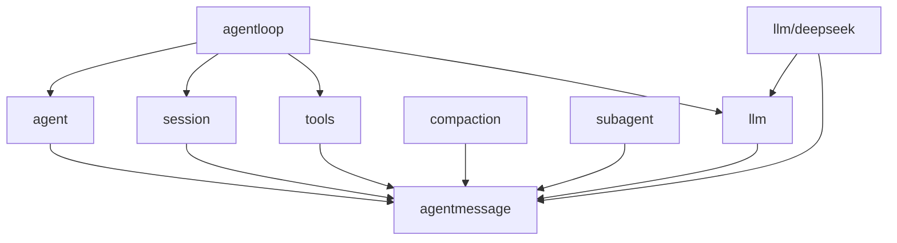

# Agent Message 协议重构设计方案

状态：Accepted / Implemented

决策日期：2026-08-27

## 1. 文档职责

本文定义 Goren Agent Message 协议的最终 owner、职责边界、依赖方向、兼容性约束和验收标准，回答“重构完成后代码应该是什么”。

- 当前完成状态、代码证据和验证证据见[08 实施进度](./08-implementation-progress.md)。
- 全仓协议兼容关系见[03 协议与 API 兼容设计](./03-protocol-and-api-compatibility.md)。
- LLM Runtime、Stream 和 Provider adapter 见[13 Harness LLM Runtime 与 DeepSeek Provider 模块设计](./13-harness-llm-runtime-and-deepseek-provider.md)。
- Agent Inbox、事件与 Agent Loop 分别见[14](./14-agent-registry-inbox-and-events.md)和[15](./15-agent-loop-and-request-driver.md)。

本文只定义稳定目标边界，不重复实施完成比例。该边界已经由真实 `agentmessage` package 落地；当前证据、验证命令和未执行项只见[08 实施进度](./08-implementation-progress.md)。

## 2. 最终决策

Goren 新建公开根 package `agentmessage`，作为唯一 Agent Message 公共契约 owner。现有 canonical 类型名保持不变，迁移后使用：

```go
agentmessage.Message
agentmessage.UserMessage
agentmessage.AssistantMessage
agentmessage.ToolResultMessage
agentmessage.ContentBlock
agentmessage.MessageSource
agentmessage.MessageID
agentmessage.CallID
```

`llm` 不再声明、别名导出或包装这些类型。它作为下游消费者，在 `GenerateOptions`、Stream assembly 和 Provider serialization 中依赖 `agentmessage`。

这里的“package”是现有 `github.com/gorenx/goren` Go module 内的新根 package，不新建第二个 `go.mod`。选择 `agentmessage` 而不是宽泛的 `message`，是为了让 import path 直接表达 owner，并减少它与代码中大量 `message` 局部变量发生遮蔽或被迫改名；公开类型本身仍保留 `Message` 等 canonical 名称。

这里的 Message 只表示能够进入 Agent Inbox 或 Session surface、具有稳定 identity/provenance，并可参与模型上下文重建的不可变交互事实。它不是：

- Plugin Event、Waterfall 或跨进程消息总线；
- Approval、UserQuestions、Stop、Turn、Step 或 Inbox mutation 命令；
- Provider HTTP/SSE DTO；
- Web/API Proxy 的展示模型；
- 任意业务模块都可以堆放 DTO 的通用 `message` 容器。

## 3. 固定源、当前实现与 Go 偏离依据

固定 DeepSeek Harness 基线为 `47f943859bef60e4160492346772ded9b24f765a`。源实现将 Message value 放在 `packages/llm/llm/src/message.ts`，并通过 `@deepseek-ai/dsh-llm` 导出。源注释同时明确它是 delivery、durable history 和 model request 共用的唯一表示。

Goren 保留源的 observable semantics，但不继续照搬其物理 package owner，原因是 Go 侧已经出现明确的依赖缺陷：

1. `agent.Inbox` 主动接收、替换、领取 `agentmessage.UserMessage`，此时尚未发生 LLM 调用。
2. `agent/pre-step` 在 Agent scoped waterfall 中交换 UserMessage batch。
3. Session 把 `user/message`、`assistant/message`、`tool/result` 作为 durable facts 保存和恢复。
4. Tools、Compaction、Subagent、Approval 等生产或变换 Message，却因此依赖包含 Runtime、Adapter Registry 和 Plugin Service 的整个 `llm` package。
5. Agent Loop 先从 Inbox 取得 Message、提交 Session，再由 `Session.DeriveMessages()` 生成请求输入；`llm.Stream` 是该链路的后续消费者。

因此，当前物理归属把下游 LLM consumer 写成了上游交互协议 owner。把 Agent Message 抽离为 Go package 是对已证明依赖缺陷的修正，不改变 TypeScript Client、Session Event 或 Provider wire compatibility。

## 4. 统一术语

### 4.1 Agent Message

Agent Message 是一个有稳定 ID、role、source 和 content blocks 的不可变交互事实。它可以被 Inbox 排队、由 Session 持久化和投影，并在被选入当前 surface 后成为模型请求输入。

“Agent Message”不表示 Agent 之间才可使用；直接用户输入、Plugin context、模型回复和 Tool result 都属于该协议。

### 4.2 Message Source

Message Source 回答“谁生产了该 Message”，保留 `user`、`plugin`、`model`、`tool` 以及合法的 opaque extension。Plugin context 的 `form` 回答内容语义，不表达 UI 样式。

### 4.3 Content Block

Content Block 是 Message 内可持久化、可投影、可由 Provider adapter 消费的内容单元。核心 discriminant 保留 `text`、`reasoning`、`image`、`tool-call` 和 `tool-result`。

### 4.4 LLM Generation Contract

LLM Generation Contract 是从一个已经组装完成的调用配置到 provider-neutral StreamChunk 的请求/响应协议，包括 `GenerateOptions`、`CallConfig`、`ToolSchema`、`StreamChunk`、`FinishReason`、`TokenUsage` 和 `LlmFailure`。它仍由 `llm` 拥有。

## 5. 目标与非目标

### 5.1 目标

1. 让 Agent Message 的代码 owner 与真实生产、排队、持久化、回放和消费链一致。
2. 让 Agent、Session、Tools、Compaction 和 Subagent 不再为 Message value 依赖 LLM Runtime package。
3. 保留一个 canonical Message/Content representation，不增加 Agent DTO 到 LLM DTO 的同构复制层。
4. 保持 stable ID、JSON shape、discriminant、field presence、opaque extension 和 replay semantics 不变。
5. 让 `llm` 只拥有模型调用、流、Adapter、route、retry 与 Provider 语义。
6. 用 architecture tests 固定 `agentmessage` 不反向依赖 Agent、Session、Tools、LLM 或 Plugin Runtime。

### 5.2 非目标

- 不改变 TypeScript Client 或 Host API wire schema。
- 不改变 Session event name、payload JSON、surface/replacement 或 recovery 语义。
- 不把 System Prompt 改造成普通 Session Message；主流程仍通过 `GenerateOptions.System` 传递 system header。
- 不重构 LLM Runtime、Adapter Registry、RetryPolicy 或 DeepSeek transport。
- 不合并 Agent Message、Plugin Event 和 Subagent control message。
- 不引入版本协商、Schema Registry、Protobuf 或生成代码。
- 不保留 `llm.Message` alias、facade、双写或运行期兼容分支。

## 6. 最终职责边界

### 6.1 `agentmessage`

`agentmessage` 拥有：

- `MessageID`、`CallID`、`MessageRole`；
- `Message`、`UserMessage`、`AssistantMessage`、`ToolResultMessage`；
- 构造输入、stable identity、detached clone 和不可变发布边界；
- `MessageSource`、全部 source variant、`ContextForm` 和 `ContextSnapshotSection`；
- `ContentBlock`、核心 block variant、plain-text capability 和 opaque content；
- Message、source、content 的严格 durable JSON codec；
- source/content extension 的 panic containment、clone 和 discriminant 不变量。

`agentmessage` 不拥有：

- Agent Inbox 队列、wake、claim 或 mutation；
- Session append、Surface、Event codec、持久化或 Projection；
- Tool schema、执行、policy 或结果调度；
- LLM request config、stream、finish、usage、adapter 或 retry；
- Provider replay state 的解释、保留判定或清理规则；
- Plugin lifecycle、Service、Event 或 Factory。

### 6.2 `agent`

`agent` 拥有 Inbox、Message admission/ordering、next-turn/next-step、stable ID 唯一性和 Agent scoped events。它消费 `agentmessage.UserMessage`，但不重新定义 Message、source 或 content。

### 6.3 `session`

`session` 拥有 append-only Event、Surface、replace、durable ordering、recovery 和 `DeriveMessages` 投影。Session 保存 `agentmessage` 的完整 JSON，并返回 detached `[]agentmessage.Message`；它不拥有 Message 的字段和 codec。

### 6.4 `tools`、`compaction` 与 `subagent`

这些模块可以生产、检查或变换 Agent Message：

- Tools 生成 `ToolResultMessage` 和 additional context；
- Compaction 选择 Message region 并生成 replacement Message；
- Subagent 生成 relay/recall/notice 等带来源的 Message。

它们只能依赖 `agentmessage` 公共契约，不得创建平行 content union 或把自己的 lifecycle/control state 塞进 Message。

### 6.5 `llm`

`llm` 继续拥有：

- `LlmRuntime`、`Adapter`、registration、provider directory 和 model discovery；
- `CallConfig`、`GenerateOptions`、`ToolSchema` 与 model metadata；
- `StreamChunk`、`ChunkStream`、`FinishReason`、`TokenUsage` 和 failure；
- `BlockAssembler`、prepared call、waterfall、replay-state filter 和 terminal normalization。

`GenerateOptions.Messages` 使用 `[]agentmessage.Message`。`BlockEndChunk.Block` 使用 `agentmessage.ContentBlock`；Tool-call stream correlation 使用 `agentmessage.CallID`。`BlockAssembler` 只组装 blocks、finish、usage 和 replay state；Agent Loop 在取得完整结果后创建 `agentmessage.AssistantMessage`。当前未被生产调用的 `BlockAssembler.AssembleMessage` 随重构删除，避免 LLM owner 反向创建 Agent 交互事实。

`ModelMessageSource.ReplayState` 作为 Message provenance 的 opaque durable bytes 由 `agentmessage` 保存和校验 JSON；只有 `llm.Runtime` 可以根据 Adapter identity 决定是否把它交给目标 Provider。

### 6.6 Provider adapter

Provider adapter 只执行单向 anti-corruption mapping：

```text
agentmessage.Message + llm.GenerateOptions
  -> provider-private request DTO

provider response/SSE
  -> llm.StreamChunk
  -> llm.BlockAssembler
  -> assembled blocks/finish/usage/replay
  -> Agent Loop creates agentmessage.AssistantMessage
```

DeepSeek wire DTO 继续留在 `llm/deepseek`，不得移动到 `agentmessage`。

## 7. 类型归属

| Contract family | 最终 owner | 说明 |
| --- | --- | --- |
| Message ID、role、构造与 clone | `agentmessage` | Agent 交互 identity |
| User/Assistant/ToolResult Message | `agentmessage` | Inbox/Session/surface 共用事实 |
| Message source、context form | `agentmessage` | producer provenance |
| ContentBlock 与 block variants | `agentmessage` | Message payload |
| CallID | `agentmessage` | tool-call/result 的跨步骤相关 identity |
| ContextSnapshotSection | `agentmessage` | Plugin-authored Message source payload |
| ToolSchema | `llm` | 模型调用 request schema |
| GenerateOptions、CallConfig | `llm` | 一次 LLM 调用 |
| StreamChunk、finish、usage | `llm` | Provider-neutral generation stream |
| BlockAssembler | `llm` | Stream 到 AssistantMessage 的消费方 |
| DeepSeek wire DTO | `llm/deepseek` | Provider 私有协议 |

`RoleSystem` 保持在 `agentmessage.MessageRole` 中以维持固定源和 durable codec 的 accepted union；当前主会话仍不把 system prompt 追加为 Session surface Message。此次重构只改变 owner，不顺便收窄协议。

## 8. 依赖方向



禁止的反向依赖：

```text
agentmessage -X-> agent
agentmessage -X-> session
agentmessage -X-> tools
agentmessage -X-> llm
agentmessage -X-> plugin
agentmessage -X-> apiproxy / connection / storage adapter
```

`agentmessage` 可以依赖它直接承载的 Attachment public contract 和 repository-private lossless JSON helper；不得因此取得 Attachment storage、Plugin 或 transport dependency。

## 9. 端到端交互

### 9.1 用户或 Plugin 输入

```mermaid
sequenceDiagram
    participant Producer as User/Plugin/Subagent
    participant Inbox as agent.Inbox
    participant Loop as agentloop
    participant Session as session.Context
    participant LLM as llm.LlmRuntime

    Producer->>Inbox: Append(agentmessage.UserMessage)
    Loop->>Inbox: Claim(next-step + one next-turn)
    Loop->>Session: Commit user/message facts
    Loop->>Session: DeriveMessages()
    Session-->>Loop: []agentmessage.Message
    Loop->>LLM: Stream(GenerateOptions{Messages})
```

### 9.2 模型输出

```mermaid
sequenceDiagram
    participant Adapter as Provider Adapter
    participant LLM as llm Runtime/Assembler
    participant Loop as agentloop
    participant Session as session.Context

    Adapter-->>LLM: llm.StreamChunk
    LLM-->>Loop: assembled blocks/finish/usage
    Loop->>Loop: New agentmessage.AssistantMessage
    Loop->>Session: Commit assistant/message
```

### 9.3 Tool continuation

Model 输出的 `agentmessage.ToolCallBlock` 提供 CallID、name 和 raw arguments。Agent Loop 调用 Tools；Tools 返回 canonical value 和 model-facing content；Agent Loop 创建 `agentmessage.ToolResultMessage` 并提交 `tool/result`。下一 Step 再由 Session surface 派生完整 Message 序列。Tool failure metadata 仍由 Session/Tools owner 持有，不扩展 Agent Message 公共字段。

## 10. 协议不变量

1. 全仓只有一个 Message、MessageSource 和 ContentBlock contract family。
2. Message ID 在 Inbox、Session、API projection 和 LLM request 边界保持不变。
3. package 迁移不得改变 JSON key、omission/null、discriminant 或 opaque extension 的 lossless round-trip。
4. UserMessage 必须是 user role；AssistantMessage 必须具有 model source；ToolResultMessage 必须是一个带同一 CallID 的 tool-result block。
5. Plugin-authored Message 必须记录 canonical plugin name；context form 的 required/forbidden fields 保持不变。
6. Model replay state 是 opaque JSON；`agentmessage` 只保存，`llm` 只在 Adapter identity 满足时解释或转发。
7. Session Event 是事实 envelope，Agent Message 是 payload contract；两者不得合并。
8. StreamChunk 是尚未形成 Message 的 LLM 过程事实，继续由 `llm` 拥有。
9. 迁移后不允许 `llm.Message` type alias、wrapper constructor、双 codec 或双向同构 mapper。
10. 任何调用链都不能绕过 Session log 向 LLM 注入不可重建的隐藏 Message。

## 11. 兼容性影响

### 11.1 不变的 observable semantics

- TypeScript Client HTTP/WebSocket/RPC schema；
- Session event names 和 payload JSON；
- stable message/call identity；
- content/source discriminant、field presence 和 ordering；
- Agent Inbox、pre-step、surface、compaction 和 replay 行为；
- DeepSeek request、SSE、finish、usage、error 和 cancellation；
- persisted JSONL/SQLite facts。

### 11.2 有意改变的 Go API

仓库内和外部 Go 调用方从 `llm.Message` 等迁移到 `agentmessage.Message` 等。该 import-path 变更以及删除未使用的 `llm.BlockAssembler.AssembleMessage` 是破坏性的公开 Go API 迁移，必须一次性更新实现、测试、fixture 和文档。

不提供兼容 alias。保留 alias 会让错误 owner 继续可用、形成双入口，并使 architecture test 无法证明迁移完成。

## 12. 验证与完成定义

重构只有同时满足以下条件才可标记 Completed：

1. `agentmessage` 包含全部目标 contract family，并有包内 `README.zh-CN.md`。
2. `llm` 不再声明或转发 Message、MessageSource、ContentBlock、MessageID、CallID 和 ContextSnapshotSection。
3. 所有生产调用方迁移到 `agentmessage`；`llm` 只作为真实 Runtime/stream/config consumer 被导入。
4. architecture test 固定依赖方向和零兼容层。
5. Message/source/content strict round-trip、opaque extension、panic containment 和 clone 测试在新 owner 下通过。
6. Session replay、Inbox、Compaction、Subagent、Tool continuation 和 request reconstruction 测试通过。
7. DeepSeek serialization 和跨语言 differential fixture 证明 wire 未改变。
8. `go test ./...`、`go test -race ./...`、`go vet ./...`、`go build ./...` 与 `git diff --check` 通过。
