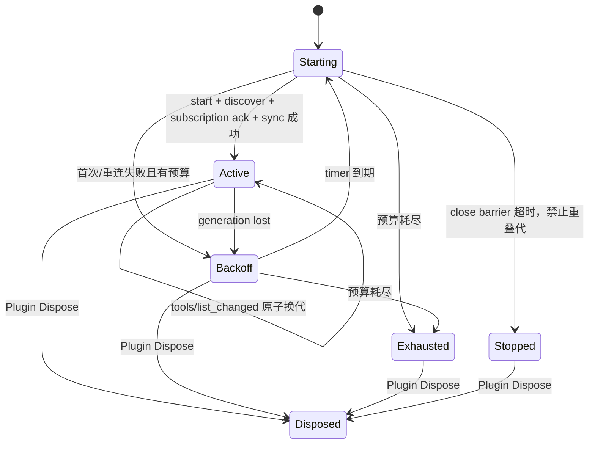
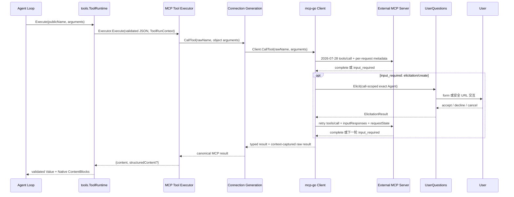
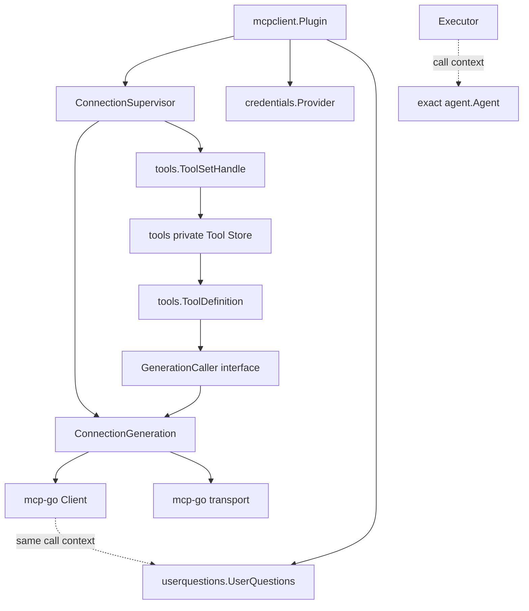

# MCP Client Bridge 设计方案

状态：Accepted / Planned

设计日期：2026-09-04

## 1. 文档职责

本文根据固定 DeepSeek Harness 基线
`47f943859bef60e4160492346772ded9b24f765a`，定义 Goren 首期 MCP Client
Bridge 的目标职责、对象 owner、依赖方向、配置、连接代际、Tool 映射、失败语义和验收标准。

本文是独立设计方案，不是当前已实现行为。外部 MCP Tool 接入已经进入默认 Server
composition 的计划范围；在代码完成前仍只能标记为 Planned，不能写成已实现。以下文档只作为边界和状态
引用；后续 MCP 实现细节集中维护在本文，不继续扩散更新全局文档：

- [01 移植范围与固定基线](./01-porting-scope-and-baseline.md)中的 Deferred 范围；
- [03 协议与 API 兼容设计](./03-protocol-and-api-compatibility.md)中的 MCP 契约；
- [04 Go 技术架构决策](./04-go-technology-decisions.md)中的 SDK 选择；
- [05 移植路线图与验收](./05-porting-roadmap-and-acceptance.md)中的实施阶段；
- [08 实施进度](./08-implementation-progress.md)中的真实代码与验证证据；
- [设计索引](./README.md)中的文档顺序和 owner 映射。

本文明确把 [04 Go 技术架构决策](./04-go-technology-decisions.md)中的未来 SDK 候选改为
[`github.com/mark3labs/mcp-go`](https://github.com/mark3labs/mcp-go)，并记录这是相对固定 DSH
基线的显式协议升级，不把新版 MCP 行为伪装成固定源原样兼容。

## 2. 最终决策摘要

1. 新建公开根 package `mcpclient` 和 `mcpclient/factory`；它是可静态链接、可重复实例化的
   Runtime Plugin，不是 Agent、Session、Tools 或 MCP Server。
2. 每个 `mcpclient.Plugin` 只连接一个外部 MCP Server，Plugin 名保持
   `@deepseek-ai/dsh-mcp-client`；同一个 Factory 可以从多条 PluginSpec 创建多个实例。
3. 首期闭环是外部 MCP tools，以及 Tool 调用期间的 MRTR elicitation：配置、连接、发现、原子注册、
   Agent 调用、form/URL 用户输入、结构化结果、取消、动态同步、重连和卸载都必须可运行；resources、
   prompts 和扩展能力不作为该闭环的未完成部分。
4. 使用 `github.com/mark3labs/mcp-go v1.0.0`，并显式锁定 MCP 协议
   `2026-07-28`；不得接受 SDK 自动回退到 legacy `initialize` 会话协议。
5. `mcp-go` 只拥有 MCP `server/discover`、每请求 metadata、标准类型和 transport；Goren Tool 定义、Tool 执行结果、Plugin
   lifecycle 和重连状态均由 Goren owner 定义。
6. 一个具名 `ConnectionSupervisor` 管理连接代际、通知重同步、重连预算和关闭屏障。每次连接都创建
   全新的 `mcp-go` Client 和 transport。
7. 外部工具公开名为 `mcp__<serverName>__<rawName>`。公开名只用于 Goren；向 MCP Server
   调用时始终使用保存的 raw name，禁止从公开名反向解析。
8. 扩展 `tools` 的公共 mutation 边界，增加 `ToolSetCatalog` 和 `ToolSetHandle`，以一次原子提交
   替换一个 MCP Server 的完整工具集合；现有逐个 `ToolCatalog.AddTool` 不变。
9. MCP 成功结果在 Goren 中保存为 canonical JSON：`content` 完整数组加可选
   `structuredContent`；Native 模型视图只做有损文本投影，不丢弃 canonical value。
10. 凭证只以 `credentials.Ref` 出现在配置中。HTTP 请求按操作解析；stdio 环境变量在创建新连接代时解析。
11. 初次连接失败、连接丢失、工具发现失败、注册冲突、重连耗尽和 Dispose 的状态转换必须与固定源语义一致，
    不允许部分工具代、重叠子进程或卸载后新调用。
12. 默认 Server composition 读取 typed `mcp.servers`；每个配置项展开为一个 MCP Client PluginSpec。
    空列表创建零个实例，但 Catalog 仍静态注册 Factory，普通 `cmd/goren` 启动不需要另一套 MCP 专用部署入口。

## 3. 固定源证据

### 3.1 DeepSeek Harness owner

固定源 package 为 `packages/mcp/mcp-client`，主要证据如下：

| 源文件 | 证据 |
| --- | --- |
| `src/index.ts` | 一个 Plugin 实例对应一个 MCP Server；依赖 `tools`；严格校验 config 和唯一 `serverName`；Apply 等待首次连接与工具同步 |
| `src/connection.ts` | `ConnectionHandle` 管理新旧 Client/transport generation、串行同步、指数退避、关闭屏障和 Dispose quiescence |
| `src/transport.ts` | stdio 与 Streamable HTTP transport；stdio 不通过 shell，使用清理后的父进程环境 |
| `src/tools.ts` | 工具命名、分页发现、两阶段换代、raw `tools/call`、canonical result 和 Native 文本投影 |
| `src/*.test.ts` | 命名冲突、分页、陈旧通知、重连预算、关闭超时、取消、异常 content 和卸载的 observable semantics |

本文不跟随相邻 `../deepseek-harness` 工作树的更新版本。实现和 differential fixture 必须从上述固定 commit
提取，不能把当前 checkout 的后来行为无说明地纳入。

### 3.2 固定源的不变量

- `serverName` 匹配 `[A-Za-z0-9_-]{1,32}`，且在同一 Host 的存活 MCP Plugin
  实例中唯一。
- 初始 tool call timeout 为 60 秒。
- reconnect 默认启用，`initialDelayMs=500`、`maxDelayMs=30000`、
  `maxAttempts=10`。
- 一个连接稳定存活至少 `maxDelayMs` 后，下一次断线开启新的重连预算；短暂连接成功仍属于同一个
  crash loop，不能无限重置预算。
- 连接中断期间保留上一正常工具代，但旧代调用必须失败；重连预算耗尽后移除这些工具。
- 工具列表 fetch/build 失败保留上一正常工具代；进入 registry swap 后发生冲突，则该 MCP Server
  最终为零工具，不能留下部分新代。
- `notifications/tools/list_changed` 触发重同步；旧连接代的通知不得改变当前工具集。
- Dispose 停止 timer、关闭当前连接、等待正在进行的连接和同步退出，再注销工具。

## 4. 首期闭环与边界

### 4.1 外部 MCP Tool 接入闭环

- MCP Client 的可选 `server/discover` 与严格 `2026-07-28` 协议确认；
- 每个请求携带协议版本、client identity 和已声明能力的 `_meta`；
- stdio transport；
- Streamable HTTP transport 的 request-scoped response/SSE；
- 分页 `tools/list`；
- `subscriptions/listen` 订阅 `notifications/tools/list_changed`，并以订阅流结束作为连接异常信号；
- 同步 `tools/call`；
- `tools/call` 返回 `input_required` 时，由 `mcp-go` 驱动 MRTR，并由 Goren 把 form/URL elicitation 路由到
  发起该 Tool call 的准确 Agent 和 `UserQuestions` Provider；
- elicitation 的 `accept`、`decline`、`cancel`、多轮 `requestState` 回传和用户等待期间取消；
- stdio caller cancellation 到 `notifications/cancelled`，以及 HTTP response stream 关闭；
- 工具 input/output schema 的 anti-corruption mapping；
- Tool generation 原子换代；
- bounded reconnect、Plugin rollback 和 Dispose quiescence；
- credential reference、环境清理、header 注入和安全日志；
- 默认 Server composition 的 typed `mcp.servers` 配置入口和多 Server 实例展开；
- keyless stdio、Streamable HTTP 与真实外部 MCP Server smoke test。

只有上述链路从配置到 Agent 可观察结果全部通过，MCP Client Bridge 才能标记 Completed。只注册 Factory、
只连通 transport、只列出 tools 或只完成 SDK demo 都不构成闭环。

### 4.2 不属于外部 Tool 接入闭环的方向

- Goren 对外提供 MCP Server。该方向中 Goren 是 capability provider；本设计中 Goren 是 Host 内的
  MCP Client，两者协议方向、认证、暴露边界和生命周期 owner 都不同；
- MCP resources、resource templates、prompts；
- MRTR 中的 sampling 与 roots 输入请求；
- 脱离一个 Goren 已发起且仍在处理的 MCP 请求，由外部 MCP Server 主动创建用户交互；
- `io.modelcontextprotocol/tasks` 等扩展能力；
- OAuth discovery、动态登录 UI 或 token refresh workflow；
- Client 侧 Plugin Runtime、远程代码下载、Go `plugin` 或动态 Factory；
- 把 MCP content block 直接加入 `agentmessage.ContentBlock` union；
- 把 MCP Client、transport 或 wire DTO 暴露为 Goren Service。

这些边界不是“留下半套 MCP”：resources/prompts 是其他 Server feature，Tasks 是显式 opt-in extension，
Goren 作为 MCP Server 则是反向产品能力。首期 Client 声明 elicitation 的 form 与 URL mode，不声明
sampling、roots 或 extensions。2026-07-28 的 elicitation 只能嵌入 Goren 已发起请求返回的
`input_required`，不是 Server 可任意触发的反向入口；外部 Server 若要求未声明的 client capability 或
extension，该 tool 不得进入可调用 Tool Set，并记录明确的 admission error。

## 5. 统一术语与对象身份

### 5.1 MCP Client Plugin

一个 MCP Client Plugin 是一个可撤销模块安装器。它拥有一个 `serverName` 的本地 namespace、一个
Tool Set 和一个 Connection Supervisor，不拥有外部 MCP Server 的业务数据。

### 5.2 Connection Supervisor

Connection Supervisor 是一个 MCP Plugin 实例内唯一的连接生命周期 owner。它拥有：

- 当前连接 generation；
- 串行 tool sync 队列；
- reconnect timer、attempt budget 和 stability window；
- Tool Set 当前内容；
- startup ready 结果和 Dispose quiescence。

它不注册 Runtime Service，也不被 Agent、Session 或 Tools 直接调用。

### 5.3 Connection Generation

Connection Generation 是一次不可复用的本地 transport/lifecycle generation；它不是 2026-07-28
protocol session。它包含：

- 单调 generation ID；
- 一个 `mcp-go` Client；
- 一个 stdio 或 Streamable HTTP transport；
- generation context/cancel；
- active 标志；
- coalesced tool-list-change channel；
- subscription acknowledged channel；
- subscription completion channel。

Generation 一旦 inactive，永不恢复 active。重连总是创建新 Generation，不复用已关闭 Client 或
transport。

### 5.4 Tool Set

Tool Set 是 Tools Registry 中由一个外部 MCP Server 共同拥有的一组 ToolDefinition。它有独立的
identity、原子替换不变量和生命周期，因此不是一组无关 `ToolHandle` 的便捷包装。

MCP Tool Set identity 为 `mcp:<serverName>`。`ToolSetCatalog.OpenToolSet` 在当前 Tools layer
内原子保留该 identity；重复 `serverName` 因而在任何网络 effect 前失败。

### 5.5 Tool Identity

一个外部工具的稳定身份是 `(serverName, rawName)`：

- `serverName` 来自 Goren typed config；
- `rawName` 来自 MCP `tools/list`；
- public name 是二者的确定性投影；
- executor 永久保存 raw name，不解析 public name。

## 6. Package 与职责边界

### 6.1 `mcpclient`

公开根 package `mcpclient` 拥有：

- `PluginName`；
- `Plugin` 及其 Manifest/Apply/Dispose；
- owner-defined `Config`、`StdioConfig`、`StreamableHTTPConfig`、`ReconnectConfig`、
  `ValueSource` 和 validated config；
- `ConnectionSupervisor` 和连接状态机；
- MCP Tool 到 `tools.ToolDefinition` 的映射；
- public tool name 算法；
- raw MCP result 到 canonical JSON 与模型文本的映射；
- MCP elicitation 到 `userquestions.UserQuestions` 的防腐映射，以及调用级 Agent identity 传递；
- consumer-owned transport/credential seams；
- 对 `mcp-go` 的私有隔离层。

仅 `PluginName`、配置类型和构造入口需要导出。Connection Supervisor、Generation、raw wire DTO、
renderer 和 transport 构造器保持 private，避免形成第二套 MCP SDK。

### 6.2 `mcpclient/factory`

`mcpclient/factory` 拥有：

- Factory 静态注册；
- discriminated config 的严格 JSON 解码；
- unknown-field 拒绝；
- 默认值解析和跨字段验证；
- OS process/HTTP adapter 的组合。

Factory 创建完成后，Plugin 只接收 validated config，不接收 `json.RawMessage`。

### 6.3 `tools`

`tools` 继续拥有所有 Goren Tool 领域契约和执行 pipeline。为表达 MCP generation 的真实需要，新增：

```go
type ToolSetCatalog interface {
	plugin.Service
	OpenToolSet(context.Context, string) (*ToolSetHandle, error)
}

type ToolSetHandle struct {
	// private owner state
}

func (owner *ToolSetHandle) Replace(
	context.Context,
	[]ToolDefinition,
) error

func (owner *ToolSetHandle) Close(context.Context) error
```

API 含义：

- `OpenToolSet` 只创建空集合并保留 set identity，不发布无意义的 `tools/change`；
- `Replace` 先编译全部定义，再在一个 `toolStore` write lock 内替换该 set 的全部条目，只重建一次
  snapshot；
- 同一个 set 内的重复 public name 属于候选代构建失败，旧代不变；
- 与其他 owner 的 Tool 冲突属于 swap failure：原 set 被清空并返回错误，不能保留部分新代；
- 实际 snapshot 改变只发布一次 `tools/change`；
- 若 `tools/change` observer 返回错误，Tools owner 回滚到替换前 snapshot 并把错误返回调用方；这延续
  Goren 已有 mutation 的 observer 原子性，不把事件失败解释成 MCP registry 冲突；
- `Close` 幂等地移除当前 set 并释放 identity，允许同名 Plugin 后续重新挂载。

现有 `ToolCatalog.AddTool`、`ToolHandle` 及单 Tool Plugin 行为不改变。不能用循环调用 `AddTool` 模拟
Tool Set，因为并发 reader 会观察部分代、会发布多次 change，且失败后无法同时表达“fetch 失败保留旧代”和
“swap 冲突清空本代”。

### 6.4 `credentials`

`mcpclient.Plugin` 依赖 `credentials.Provider`，只调用 `Resolve`。它不得 Set/Unset MCP 凭证，也不得把
`credentials.Resolved` 保存到 Plugin 长期状态、ToolDefinition、错误、Session Event 或日志。

### 6.5 `mcp-go`

`mcp-go` 只负责：

- Client 构造、`server/discover` compatibility facade 和严格版本结果；
- 每请求 `_meta`、HTTP protocol/method/name headers；
- stdio 和 Streamable HTTP transport；
- JSON-RPC 基础 envelope；
- `subscriptions/listen` 与 notification dispatch；
- `tools/call` 的 MRTR retry、`inputResponses` 与 opaque `requestState` 回传；
- transport-specific cancellation；
- transport close；
- MCP 标准常量和不进入领域层的临时 DTO。

以下内容仍由 Goren 拥有：

- typed config 与 credential semantics；
- Plugin/Runtime lifecycle；
- reconnect policy 和 generation state；
- Tool identity、ToolDefinition、schema admission 和执行结果；
- elicitation schema、用户展示、answer validation 与 accept/decline/cancel policy；
- 外部异常 JSON 的信任边界；
- Agent/Session/LLM interaction。

## 7. 依赖版本与 SDK 隔离

### 7.1 版本锁定

实现固定使用：

```text
github.com/mark3labs/mcp-go v1.0.0
MCP protocol 2026-07-28
```

Wire authority 是官方 [MCP 2026-07-28 specification](https://modelcontextprotocol.io/specification/2026-07-28)
和 [transport requirements](https://modelcontextprotocol.io/specification/2026-07-28/basic/transports)；版本的
breaking changes 由官方 [2026-07-28 release note](https://blog.modelcontextprotocol.io/posts/2026-07-28/)
交叉核对。

选择 [v1.0.0](https://github.com/mark3labs/mcp-go/releases/tag/v1.0.0) 是因为它是本设计日的稳定
1.0 release；其 [go.mod](https://github.com/mark3labs/mcp-go/blob/v1.0.0/go.mod) 要求 Go
1.25.5，低于 Goren 当前 Go 1.26.6。依赖使用
[MIT License](https://github.com/mark3labs/mcp-go/blob/v1.0.0/LICENSE)，发布清单需保留对应
copyright/license。

Client 构造必须使用
[`client.WithProtocolVersion`](https://github.com/mark3labs/mcp-go/blob/v1.0.0/client/client.go)
写出 `2026-07-28`。`mcp-go v1.0.0` 的 `Client.Initialize` 是兼容 facade：现代路径尝试
`server/discover`，失败时可能回退到 legacy `initialize`。Goren 可以调用该 facade，但必须检查返回的
`ProtocolVersion == "2026-07-28"`；任何 legacy negotiation 都关闭 candidate generation 并返回
`unsupported protocol version`，不得为了“能连上”而静默降级。更新 SDK 或协议版本必须单独形成依赖审查，
不得只运行 `go get -u`。

2026-07-28 是相对固定 DSH 基线的明确升级：旧源仍提供命名、原子 Tool generation、结果投影、重连和
Dispose 等业务语义证据；wire lifecycle 以当前 MCP 规范为 authority。新协议没有
`initialize/initialized`、`Mcp-Session-Id` 或有意义的 `ping` liveness，每个请求都自描述并携带 `_meta`。

### 7.2 为什么不能直接把 `mcp.CallToolResult` 当领域结果

固定 DSH source 有意用 raw `tools/call` 响应，以容忍外部 Server 返回 primitive、未知 block 或缺字段
block，并保留完整 JSON。`mcp-go v1.0.0` 的 `Client.CallTool` 会把 `content` 解码成 SDK 的 closed
`mcp.Content` union；若直接使用，会在到达 Goren mapper 前丢失或拒绝固定源允许处理的数据。

因此 private `protocolSession` 采用一个只观察、不改写协议的 `capturingTransport`：

1. `capturingTransport` 完整实现并委托 `mcp-go` transport interface，再交给 `client.NewClient`；
2. Goren 始终调用 `Client.ListToolsByPage`、`Client.CallTool` 和 `Client.Listen` 等高层 API；
3. SDK 高层 Client 继续负责注入 2026-07-28 每请求 `_meta`、HTTP headers、request ID、取消和 MRTR
   协议行为；Goren 禁止绕过 Client 直接调用 raw `transport.SendRequest`；
4. wrapper 在交给 SDK typed decoder 前，按调用 context 捕获对应 response 的 raw `result` 并复制为
   Goren-owned `json.RawMessage`；
5. typed decode 成功时优先使用 SDK 明确字段并与 raw fixture 对照；若 closed content union 因 primitive、
   unknown block 或缺字段 block 失败，而 raw result 满足 Goren private DTO，则只恢复 Tool result；
6. transport/JSON-RPC error 不得被 raw capture 覆盖，仍先映射为普通 Go error，再进入 Tools Runtime 的
   canonical failure path。

wrapper 不能隐藏 SDK Client 依赖的 optional transport interface。实现使用 transport-specific wrapper：
stdio wrapper 只实现实际底层能力；Streamable HTTP wrapper 必须转发 `transport.HTTPConnection` 的
`SetProtocolVersion`，并转发底层 `RequiresLegacyProtocol`。若底层支持 bidirectional 或 connection-lost
callback，也只能原样转发，不得在 wrapper 中发明第二套状态。否则 Client 无法设置现代 HTTP protocol
header，或可能错误绕过 legacy transport 检查。

每次 Tool call 在传入 SDK 前把一次性 `rawResultCollector` 放进 call context；wrapper 只对该 context 且
`request.Method == "tools/call"` 的 response 做 bounded copy，不维护按 request ID 的全局旁路表。fallback
只接受 `resultType` 缺省或 `complete` 且没有 `inputRequests`/`requestState` 的结果；`input_required`、task
handle、JSON-RPC error 或 transport error 不能被 raw capture 伪装成同步成功。collector 在高层调用返回后
立即释放，不把 remote payload 留在 generation 状态中。

这不是第二套 MCP transport 或 Client：所有请求都必须穿过 SDK Client，Goren wrapper 只复制 response
payload 以保留固定 DSH 允许的宽容 result 语义。若 SDK v1.0.0 的 transport seam 无法可靠关联并捕获 raw
result，实施必须暂停并选择向上游补充窄 hook、使用 SDK 支持的 raw result，或重新评估依赖版本；不得退回
直接 `SendRequest` 而丢失新协议 metadata。

### 7.3 SDK admission spike

实施第一个 commit 必须先用 fake stdio 和 `httptest.Server` 锁定以下事实：

- capturing wrapper 不生成第二套 request ID，也不直接发送 JSON-RPC request；
- `WithProtocolVersion("2026-07-28")` 的 discover、list、call 和 listen 都携带正确 `_meta`；
- Streamable HTTP 自动带 `MCP-Protocol-Version`、`Mcp-Method` 和 tool call 的 `Mcp-Name`；
- compatibility facade 回退到 legacy version 时能被 Goren 检出并拒绝；
- context cancel 在 stdio 发送 `notifications/cancelled`，在 HTTP 关闭 request response stream；
- `Client.Listen` 能收到 subscription acknowledgement 与 `notifications/tools/list_changed`，并在 stdio child exit/HTTP stream
  终止时稳定返回可分类错误；
- wrapper 不隐藏 `HTTPConnection` 或 `RequiresLegacyProtocol`，现代 HTTP header 和 legacy rejection 保持有效；
- `capturingTransport` 能在不改变 request metadata、ID、MRTR 和 error 的条件下保留 raw Tool result；
- `Close` 的最坏时延和子进程回收行为可由测试约束。

任一事实不成立时暂停完整实现：优先向上游补充窄能力或重新评估依赖版本，不复制 `mcp-go` 私有读写循环。

## 8. Typed Config 与凭证

### 8.1 Discriminated config

默认 Server deployment config 拥有 `mcp.servers` 列表：

```json
{
  "mcp": {
    "servers": [
      {
        "transport": "stdio",
        "serverName": "filesystem",
        "command": "mcp-filesystem",
        "args": ["--root", "/workspace"]
      }
    ]
  }
}
```

`cmd/goren` 对 deployment config 做严格解码，composition root 把每个 `mcp.servers[i]` 转成一个
`mcpclient` PluginSpec。列表顺序只决定稳定装配顺序，不形成 Server 之间的依赖；`serverName` 冲突在任何
network/process effect 前失败。字段缺失或空列表表示创建零个 MCP Client Plugin，而不是创建一个空 Plugin。

首期通过可选 `cmd/goren --mcp-config <path>` 读取上述严格 JSON 文件；未传 flag 等价于空列表。这个文件只承载
MCP deployment config，不复制 `--listen`、storage 等现有 CLI owner。未来若 Goren 形成统一 config file，
可以在不改变 `mcp.servers` shape 和 composition 输入类型的前提下迁移 carrier。文件中只能保存
credential reference，不能保存 secret value。

这里的“默认 Server composition 接管”具体指现有
`cmd/goren -> internal/assembly.DefaultSpecs -> BuildServer` 启动链负责这次展开。Factory 总是静态注册进
Catalog；配置项决定实例数量。用户不需要启动另一套 `goren-mcp` 进程，也不需要手写 Runtime 装配代码。
`DefaultSpecs` 的输入改为包含现有 server 参数和 `MCPServers` 的具名 assembly config，避免继续增长位置参数；
它在 `tools` 和 `credentials` capability 已提供、Agent/AgentLoop 开始消费 Tool Store 之前插入所有 MCP
PluginSpec。运行期真正的 Tool 可见性仍由 Tools Registry 决定，spec 顺序不代替 Service dependency。

每个列表项是一个 Plugin 的 owner-defined config。Factory 以 `transport` discriminator 分两次严格解码；
item JSON shape 保持固定源的 flat union：

```json
{
  "transport": "stdio",
  "serverName": "filesystem",
  "command": "mcp-filesystem",
  "args": ["--root", "/workspace"],
  "env": {
    "SERVICE_TOKEN": {
      "credentialRef": "MCP_FILESYSTEM_TOKEN"
    }
  },
  "cwd": "/workspace",
  "toolCallTimeoutMs": 60000,
  "elicitationTimeoutMs": 600000,
  "failOnStartupError": false,
  "reconnect": {
    "enabled": true,
    "initialDelayMs": 500,
    "maxDelayMs": 30000,
    "maxAttempts": 10
  }
}
```

```json
{
  "transport": "streamable-http",
  "serverName": "search",
  "url": "https://mcp.example.test/mcp",
  "headers": {
    "Authorization": {
      "credentialRef": "MCP_SEARCH_TOKEN",
      "prefix": "Bearer "
    }
  },
  "toolCallTimeoutMs": 60000,
  "elicitationTimeoutMs": 600000,
  "failOnStartupError": true
}
```

`ValueSource` 是以下互斥 union：

- `{ "value": "non-secret literal" }`；
- `{ "credentialRef": "POSIX_ENV_STYLE_NAME", "prefix": "optional safe prefix" }`。

Validation 规则：

- 必须且只能选择 `value` 或 `credentialRef`；
- `prefix` 只能与 `credentialRef` 同时出现；
- header/env name、credential ref、URL、duration 和 reconnect 边界全部显式校验；
- `Authorization`、`Cookie` 及名称匹配 `KEY|PASSWORD|SECRET|TOKEN` 的键禁止 literal；
- URL 禁止 userinfo；日志不得输出 query、headers 或 resolved values；
- stdio `command` 为空、HTTP URL 非 http/https、`initialDelayMs > maxDelayMs` 均拒绝；
- config unknown field 一律拒绝。

`toolCallTimeoutMs` 约束每一次发往外部 Server 的 `tools/call` 网络回合，默认 60 秒；
`elicitationTimeoutMs` 约束包含全部 MRTR 与用户等待的完整本地 Tool execution，默认 10 分钟，且不得小于
`toolCallTimeoutMs`。二者必须拆开：用户思考时间不能占用单次网络回合 timeout，Server 停止响应也不能借
elicitation 把一次网络请求延长到整个人类交互时限。transport wrapper 只为每次 `SendRequest` 派生网络回合
deadline；Tools execution 与上游 Agent cancellation 约束整个 MRTR。

这相对固定源的 `Record<string,string>` 是有意的安全收紧：源允许直接把 secret 写进 config，而 Goren
已经确立“凭证不是 Settings value”的边界。字段名称保持 `env`/`headers`，value 变成显式来源对象。

### 8.2 stdio credential 时点

stdio 环境变量是子进程启动参数，无法在存活进程内轮换。因此每个新 Connection Generation 在 spawn 前：

1. 从进程环境构造 scrubbed base；
2. 删除名称匹配 `KEY|PASSWORD|SECRET|TOKEN` 的项；
3. 删除所有 `DSH_*` 和 `GOREN_*` 项；
4. 逐项解析 config `env` 的 literal/ref；
5. 把显式值覆盖到 scrubbed base；
6. 用 `transport.WithCommandFunc` 构造 `exec.CommandContext`，直接传 args，不经过 shell。

credential rotation 在下一次 generation/reload 生效。stderr 由 `mcp-go` 持续 drain，但默认丢弃；若接入
诊断，只能输出 bounded、redacted 摘要，不得原样写入常规日志。

### 8.3 HTTP credential 时点

HTTP header credential 必须按每个 outbound request 解析，使已提交的 rotation 对下一次请求生效。由于
`mcp-go` header callback 不能返回解析错误，Goren 使用 `transport.WithHTTPBasicClient` 注入带私有
`http.RoundTripper` 的 `http.Client`：

1. clone request/header；
2. 解析每个 `credentials.Ref`；
3. 缺失或解析失败时在发送前返回 error；
4. 注入 header 后调用下游 RoundTripper；
5. 不缓存、不记录 resolved value。

注入的 `http.Client.Timeout` 必须为零，避免统一 timeout 主动切断长期 `subscriptions/listen`；discover、
list、call 和关闭分别由 operation/generation context 设置 deadline。redirect policy 必须在 origin 改变时
剥离 credential-derived headers。

Streamable HTTP 不启用 legacy `transport.WithContinuousListening`。Generation 在 discover 成功后用独立
goroutine 调用阻塞式 `Client.Listen` 打开 `subscriptions/listen`，请求 tools list-change notification；
不使用 `ListenAsync`，因为 Supervisor 必须观察 stream 正常或异常返回。每个普通请求仍使用 request-scoped
response/SSE。subscription stream 的关闭、错误和取消归当前 generation，不形成 connection-scoped MCP
session。

## 9. Plugin 与连接生命周期

### 9.1 Manifest

`mcpclient.Plugin`：

- Manifest Name：`@deepseek-ai/dsh-mcp-client`；
- Requires：`tools.ToolSetCatalog`、`credentials.Provider`、`userquestions.UserQuestions`；
- Provides：无；
- Children：无。

它是纯 consumer Plugin。外部 MCP Server 不能取得 Runtime、Tool Store、Agent、Session 或 credential
Provider 对象。

### 9.2 Apply

Apply 顺序固定为：

1. 检查 request context 和 validated config；
2. Resolve `ToolSetCatalog`、`credentials.Provider` 与 `UserQuestions`；
3. `OpenToolSet("mcp:" + serverName)`，先锁定唯一 namespace；
4. 创建 Connection Supervisor，并把 goroutine 生命周期绑定到 `plugin.Lifetime(owner)`；
5. 启动第一 Connection Generation；
6. 等待第一次 transport start + discover/version check + subscription acknowledgement + full tool sync 完成；
7. 成功则 Apply 返回 nil；
8. 失败且 `failOnStartupError=false` 时记录去敏诊断、保留空 Tool Set、进入重连并返回 nil；
9. 失败且 `failOnStartupError=true` 时返回带 cause 的错误，由 Runtime rollback；Dispose 必须关闭
   Supervisor 和 Tool Set。

Apply 的 request context 只控制等待；长期连接必须使用 Plugin lifetime，不能在 Apply 返回后继续依赖
可能被取消的 startup context。

### 9.3 状态机



状态与 Tool Set：

| 状态 | Tool Set |
| --- | --- |
| 首次 `Starting` | 空 |
| `Active` | 当前正常 generation 的完整工具 |
| `Backoff` | 保留上一正常工具定义，但 caller 已 inactive，调用明确失败 |
| candidate connect/list 失败 | 保留上一正常工具定义 |
| swap registry conflict | 清空本 Server Tool Set |
| `Exhausted` | 清空本 Server Tool Set |
| `Stopped` | 清空本 Server Tool Set；必须 reload/restart 才重试 |
| `Disposed` | 清空并关闭 Tool Set，释放 namespace |

### 9.4 Subscription liveness 与关闭屏障

2026-07-28 没有 connection-scoped session，`Ping` 在 `mcp-go v1.0.0` 的现代协议路径上不提供有效
liveness。Generation 在 discover/version check 后注册 notification handler，再用独立 goroutine 执行一个
阻塞式 `Client.Listen` 长请求：

- filter 请求 `notifications/tools/list_changed`；首条
  `notifications/subscriptions/acknowledged` 给出 Server 实际接受的 filter。Apply 必须等待该 ack，不能把
  “goroutine 已启动”当成 subscription ready；
- ack 未接受 list-change 时 Tool Set 保持首次快照，诊断记录“动态同步不可用”，但 subscription stream
  仍作为 transport liveness 信号，普通 tool call 继续闭环；
- subscription request 在 stdio 上等待 response，在 HTTP 上持有 request-scoped SSE；它正常结束、返回
  transport/closed error 或被远端断开时，generation 判定 lost；
- 任意 `tools/list`/`tools/call` 的 transport-closed error 也使 generation inactive；普通 JSON-RPC
  application error 不触发重连；
- generation 自己关闭 `Done()`，Supervisor 只读取 channel，不由 generation 反向持有 Supervisor；
- ack 前返回或 SDK/Server 拒绝 `subscriptions/listen` 时，candidate 视为不满足 Goren 2026-07-28 admission，不能退回 legacy
  continuous listening 或定时 `ping`。

连接代关闭时先把 active 原子置 false、取消 generation context，再调用 `Client.Close`。`mcp-go v1.0.0`
stdio close 自带 graceful/terminate/kill 的有界过程；外层仍必须设置大于 SDK 最坏正常关闭时延的 barrier。
Barrier 超时后进入 `Stopped`，禁止启动下一子进程，直到 Plugin reload 或 Host restart，避免重叠 Server
进程。具体 barrier 数值由 SDK admission spike 测得并固定，不机械照抄 DSH 针对另一个 SDK 的 5 秒常量。

## 10. Tool 发现、命名与原子换代

### 10.1 两阶段同步

所有初次同步、notification 同步和重连同步都进入 Supervisor 的同一个串行队列。

第一阶段 Fetch/Build：

1. 从 cursor 为空开始调用 `Client.ListToolsByPage`；
2. 持续读取 `nextCursor`，直到为空；
3. 对每项保存 raw name，计算 public name；
4. 检查重复 raw/public identity；
5. clone input/output schema；
6. 构造全部 `tools.ToolDefinition`，但不触碰 Tool Store；
7. 任一步失败则返回，原 Tool Set 不变。

第二阶段 Swap：

1. 再次确认 generation 仍是 current 且 active；
2. 调用一次 `ToolSetHandle.Replace`；
3. Tools owner 原子替换 set 并发布一次 `tools/change`；
4. swap conflict 后 set 为零；首次 strict sync 向 Apply 传播，普通 resync 只记录并保持零工具；
5. stale generation 的排队同步在进入 Fetch 前或 Swap 前被 generation ID guard 丢弃。

`tools/list_changed` notification 使用容量为 1 的 coalescing signal。高频通知只保证“当前状态最终同步”，
不按通知次数重复 fetch。

### 10.2 Public name

算法保持固定源：

```text
joined = "mcp__" + serverName + "__" + rawName
```

- `joined` 已满足 `[A-Za-z0-9_-]` 且长度不超过 64 时原样使用；
- 否则把非法字符替换为 `_`；
- 计算 `sha256(serverName + "\x00" + rawName)` 的前 12 个十六进制字符；
- 截断 normalized prefix，使最终值为 `<prefix>_<hash>` 且不超过 64 字符。

hash 只在发生 replacement/truncation 时添加，避免两个不同 raw identity 经有损归一化后碰撞。测试必须使用
固定源 vectors，而不是只验证正则。

### 10.3 Schema mapping

输入：

- MCP `inputSchema` clone 为 `ToolDefinition.Parameters`；
- 必须满足 Goren 当前 object-root Tool parameter contract；
- 缺失、非法 JSON 或无法编译的 schema 属于 Fetch/Build failure，保留上一正常代。

输出：

```json
{
  "type": "object",
  "properties": {
    "content": {
      "type": "array",
      "items": {}
    },
    "structuredContent": {}
  },
  "required": ["content"],
  "additionalProperties": false
}
```

- MCP advertised `outputSchema` 能被 Goren Tool schema validator 接受时，用它替换
  `structuredContent` 的 `{}`，并把 `structuredContent` 加入 `required`；
- 不支持的 vocabulary 退回 unconstrained `{}`，不能让整个 Tool discovery 失败；
- output schema 只是成功结果验证，不改变 MCP wire DTO owner。

## 11. Tool 调用与结构化结果

### 11.1 调用路径



调用不变量：

- Executor 持有窄 `GenerationCaller`，不持有 Plugin、Supervisor、Tools Service 或 Runtime；
- Generation inactive 时在发出请求前返回 connection unavailable；
- 模型 arguments 若不是 JSON object，按固定源降级为 `{}`，让 MCP Server 返回具体参数错误；
- 每个远端 call round 受 `toolCallTimeoutMs` 约束，整个 MRTR 受 `elicitationTimeoutMs` 和上游
  cancellation 中更早者约束；
- 上游取消时由 SDK/transport 按绑定执行：stdio 发送 `notifications/cancelled`，Streamable HTTP 关闭该
  request 的 response stream；然后等待本地调用退出；
- MCP `isError=true` 转为 Go error，使现有 Tools Runtime 生成 canonical Tool failure；
- tool 若声明 Goren 未启用的 required extension/client capability，则 discovery admission 失败，不注册成
  一个“看得见但调用必失败”的 Tool。

### 11.2 Elicitation 与准确调用者

`mcp-go.Client` 是 generation 级共享对象，但“当前 Agent”是一次 Tool execution 的事实，不能写入 Client、
Generation 或 Elicitation handler 的可变字段。MCP Executor 在调用 `Client.CallTool` 前，从
`tools.ToolRunContext.Execution.Subject` 取得实际 `agent.Agent`，通过 private context value 只传给本次
调用；`WithElicitationHandler` 从收到的同一个 context 中读取它。

因此对象关系保持单向：Tool execution 借用 Agent identity，Client 不拥有 Agent，Agent 也不回指 MCP。
handler 找不到准确 live root Agent、调用来自 delegated subagent，或者没有可用 UserQuestions Provider 时，
返回 `action: "decline"`，不把问题路由给其他 Session，也不把策略性拒绝伪装成 transport failure。

Form mode 分为两个用户步骤，避免扩张 `userquestions.Answer` 或发明第二套交互协议：

1. 展示 `serverName`、Server message 和将要提供的字段，询问“提供”或“拒绝”；取消现有 Question UI 映射为
   `cancel`；
2. 用户选择提供后，把受限 flat object schema 映射为一批 `userquestions.Question`：string、number、integer、
   boolean、single enum 和 multi-select enum 分别映射到现有 option/custom answer；
3. adapter 把答案转回 typed primitive object，并使用收到的 schema 再验证；只有验证成功才返回
   `accept + content`，否则保持在 Goren 交互内要求用户修正，不把非法 content 发给外部 Server；
4. 用户明确拒绝返回 `decline`，UI dismiss、Agent cancel 或 interaction timeout 返回 `cancel`。

URL mode 不把第三方页面嵌入 Goren，也不读取页面内容。`userquestions.Question` 增加一个窄的可选
`ExternalLink` 展示值，只包含完整 URL 与解析后的 host；API Proxy 和 Web 原样投影，Web 必须展示完整 URL、
突出 host，并只在用户点击后以隔离的新浏览器上下文打开。用户随后选择继续即返回 `accept`，明确拒绝返回
`decline`，关闭交互返回 `cancel`。`accept` 只表示同意外部交互，不表示外部流程已完成；Server 可在下一轮
MRTR 再次返回 `input_required`。

多个 `inputRequests` 的 ID 由 `mcp-go` 保留并可并行履行。每个 handler invocation 都使用自己的 call
context 和 UserQuestions request，不建立全局 pending map；API Proxy 已拥有 pending question correlation。

### 11.3 Canonical structured value

正常 MCP 结果映射为：

```json
{
  "content": [
    {
      "type": "text",
      "text": "example"
    }
  ],
  "structuredContent": {
    "count": 3
  }
}
```

规则：

- `content` 中每个 JSON value 原样 clone；primitive、unknown block 和缺字段 block 仍保留；
- `structuredContent` 存在时原样 clone；不存在时不输出该字段；
- legacy `toolResult` 在缺少 array `content` 时转成一个 text block；完全无输出时使用
  `(no output)`；
- 返回值必须是有效 JSON value，不能携带 `mcp-go` interface value 或 pointer；
- `ToolExecutionSuccess.SuccessValue()` 保留整个 canonical object，供 Tool event、observer 和未来
  Code Mode 使用；
- Native 模型视图由 OutputRenderer 生成一个 `agentmessage.TextBlock`，不把 MCP block 并入
  Agent Message 协议。

### 11.4 Native 文本投影

- text：取存在的 `text`，多个 block 用换行连接；
- image：`[image: <mimeType-or-unknown>, content discarded]`；
- audio：`[audio: <mimeType-or-unknown>, content discarded]`；
- resource / resource_link：`[resource: content discarded]`；
- primitive 或无 `type`：`[unsupported content type: unknown]`；
- 其他 type：`[unsupported content type: <type>]`；
- 最终为空：`(<rawName> returned no text content)`。

当 `isError=true` 时，以相同文本作为 error message；canonical success value 不发布为成功。错误和日志不得
附带完整 remote payload，以免外部 Server 把 secret 注入诊断。

## 12. 对象关系与禁止循环嵌套



图中 `ToolStore -> Definition -> Caller -> Generation` 是执行能力引用，不形成反向 owner：

- Generation 不引用 ToolStore、ToolSetHandle、Supervisor 或 Plugin；
- Generation 只暴露 `CallTool`、`ListTools`、`ToolListChanged()`、`Done()` 和 `Close()` 的窄行为；
- Supervisor 读取 generation-owned channels，不把 callback/sink 注入 Generation；
- ToolSetHandle 不引用 MCP 对象；
- Runtime 不保存在任何 MCP DTO 中。
- Agent 只作为一次调用的 borrowed identity 放在 context 中，Plugin、Supervisor、Generation、Client、
  ToolDefinition 和 UserQuestions Request 都不反向拥有彼此；

因此所有权仍是单向的：Plugin -> Supervisor -> Generation；Tools 只持有可失效的调用 capability。

## 13. Failure semantics

| 场景 | 对外结果 | Tool Set | 后续动作 |
| --- | --- | --- | --- |
| config 非法 | Factory Create 失败 | 未创建 | 不挂载 Plugin |
| duplicate `serverName` | `OpenToolSet` 失败 | 已有实例不变 | 新实例 Apply 失败 |
| 首次 connect/init/list 失败，strict | Apply 失败并 rollback | 空且 identity 释放 | 无重连残留 |
| 首次失败，non-strict | Apply 成功，诊断可见 | 空 | 按 policy 重连 |
| active connection lost | 当代 caller 立即失效 | 保留旧定义 | bounded reconnect |
| resync fetch/schema 失败 | 调用返回/记录 sync error | 上一正常代不变 | 等下次通知/重连 |
| registry swap conflict | 明确 registration error | 本 Server 为零工具 | strict 传播；普通 resync contain |
| stale notification | 丢弃 | 不变 | 无 |
| reconnect disabled after loss | 调用明确 connection unavailable | 保留旧定义 | reload/restart 才恢复 |
| reconnect attempts exhausted | 记录 exhausted | 清空 | reload/restart 才恢复 |
| old generation close 超时 | fail closed | 清空 | 禁止新 generation，避免重叠进程 |
| Tool call timeout/cancel | 现有 Tools failure/abort contract | 不变 | best-effort MCP cancel |
| form elicitation accept | validated `inputResponses` 后续调原 call | 不变 | 继续 MRTR |
| elicitation 明确拒绝 | `action=decline` 后续调原 call | 不变 | Server 决定替代路径或最终结果 |
| elicitation dismiss/取消/超时 | `action=cancel`；上游已取消时结束 call | 不变 | 不把未授权内容发给 Server |
| delegated/no-provider elicitation | `action=decline` | 不变 | 不路由到错误 Agent |
| MCP `isError=true` | Tool execution failure | 不变 | 不触发 reconnect |
| Plugin Dispose | 等待 connection/sync quiesce | 清空并释放 identity | 无 timer/goroutine/请求残留 |

日志只能包含 plugin name、serverName、transport kind、generation ID、attempt、public/raw tool name 和错误类别；
不得包含 args、result、URL query、headers、environment value 或 resolved credential。

## 14. Reconnect 算法

一个 outage 共用一个失败计数：

```text
delay(attempt) = min(maxDelayMs, initialDelayMs * 2^(attempt-1))
```

- attempt 从 1 开始，最多 `maxAttempts`；
- timer 不得独自阻止进程退出；
- 连接成功并完成第一次 tool sync 后记录 `connectedAt`；
- generation 存活时间达到 `maxDelayMs` 才重置 outage budget；
- 短暂成功后再次断线继续原 failed-attempt count；
- 建连后的首次 Fetch/Build failure 计入当前 candidate failure；已 Active generation 的
  notification resync failure 只保留旧代并等待后续通知，不消耗 reconnect budget；
- Dispose 取消 timer、当前 attempt、liveness loop 和 sync queue；
- exhausted/stopped 都是终态，只有 Plugin reload 或 Host restart 能重新进入 Starting。

所有 delay 计算必须防整数溢出，直接在上限处饱和，不能先计算巨大指数再 clamp。

## 15. 安全边界

### 15.1 stdio

- command/args 直接交给 `exec.CommandContext`，禁止 shell interpolation；
- `args`、`cwd` 和 URL 都是非 secret 配置；需要凭证的 CLI 参数必须改用受支持的 env
  credential ref，URL 不得通过 userinfo 或 query 携带凭证；
- cwd 在 spawn 时显式设置；
- 每次 spawn 都重建 scrubbed environment；
- process 与 pipes 完全属于 Connection Generation；
- Plugin Dispose 必须回收 child，不接受 orphan process；
- 首期只继承 OS identity，不额外声称 filesystem/sandbox 隔离；若需 sandbox，必须在执行 effect 的
  CommandFunc 中实现并单独设计 policy。

### 15.2 Streamable HTTP

- 仅允许 http/https endpoint；生产配置是否允许明文 http 由 composition policy 决定；
- custom RoundTripper 保留系统 proxy/TLS 行为，但在发送前注入凭证；
- redirect 时不得把敏感 header 转发给不同 origin；
- response body、SSE listener 和 idle connection 均随 generation 关闭；
- 不把 OAuth 或浏览器登录静默塞进 transport adapter。

### 15.3 外部数据

MCP Server 的名称、description、schema、content 和 error 都是不可信输入：

- 限制 tool list page/总数量、name/description/schema/result 的 byte budget；
- cursor cycle 和无界 pagination 必须失败；
- JSON clone 后才进入 ToolDefinition；
- diagnostics 截断并去除 control character；
- schema compile panic、renderer panic 和 SDK callback panic 必须 containment；
- remote text 只能作为 Tool result，不提升为 Host log fields 或 system prompt。

### 15.4 Elicitation

- 每个问题必须同时显示本地 `serverName` 和 Server message，不能只显示外部文案；
- form schema 只接受规范允许的 flat primitive object；禁止 nested object、任意对象数组和未支持的 schema
  vocabulary；
- 属性名或说明明显请求 password、API key、access token、cookie、private key 或 payment credential 时，
  form 请求直接 `decline`，不得展示可填写 secret 的普通文本框；
- form 回答在 Goren 内验证并允许用户复核，日志、Session、diagnostics 和 Tool result 不记录提交内容；
- URL mode 禁止自动预取；只接受 HTTPS，开发环境仅允许 loopback HTTP；拒绝 userinfo，展示完整 URL 并突出
  host，对 Punycode 或可疑 host 给出警告；
- URL 在明确用户动作前不得打开，必须使用 `noopener,noreferrer` 的外部上下文，Goren 不嵌入、不读取、
  不记录页面内容；
- `requestState` 视为不可信 opaque string，只由 SDK 在当前 MRTR 中逐字回传；response/result byte budget
  同时限制其大小，不持久化、不记录、不跨 Tool execution 保存。

具体 budget 在实施前由固定源 fixture 和 Goren 现有 Tool 限制定值，并写入测试；不得无界读取。

## 16. 实施切片

### M0：SDK admission 与 fixture

- 引入 `mcp-go v1.0.0`；
- 建立 2026-07-28 protocol pin、legacy fallback rejection 与 per-request metadata test；
- 验证 capturing transport、subscription、transport-specific cancel、close，以及
  `WithElicitationHandler` 使用原始 `CallTool` context 自动完成多轮 MRTR 的行为；
- 从固定 DSH commit 提取命名、tool list、result 和 reconnect golden；
- 更新第三方 license inventory。

Gate：admission spike 全通过，确认不需 fork/vendor SDK。

### M1：Tools 原子 Tool Set

- 新增 `ToolSetCatalog` / `ToolSetHandle`；
- toolStore 支持 expected-owner 原子 replace/clear；
- Service 提供新 capability；
- 覆盖 duplicate set、compile failure、foreign conflict、observer rollback、single change event、并发 reader、
  stale handle 和 idempotent Close。

Gate：现有单 Tool contract 零回归，race test 证明 reader 不见 partial generation。

### M2：MCP mapping 与 transport

- typed config/value source；
- public name 与 schema mapper；
- SDK Client list/call/listen 与 raw result capture；
- structured result 和 renderer；
- stdio env scrub/command builder；
- HTTP credential RoundTripper；
- form/URL schema 与 `UserQuestions` 防腐映射、准确 Agent context、accept/decline/cancel；

Gate：TypeScript-to-Go golden 与恶意/异常 JSON fixture 通过，不泄漏 secret。

### M3：Connection Supervisor 与 Plugin

- generation state、liveness、serial sync、backoff、stability window；
- Apply startup semantics；
- stale notification guard；
- close barrier、exhaustion 和 Dispose quiescence；
- `mcpclient/factory` 与 assembly Factory Catalog 注册；
- UserQuestions dependency、用户等待/网络回合双层 timeout 和调用取消的 quiescence。

Gate：fake clock/fake generation 确定性测试和 `go test -race` 通过。

### M4：集成与文档

- 使用一个 keyless stdio fixture Server 做包含 form/URL MRTR 的端到端 test；
- 使用 `httptest.Server` 覆盖 Streamable HTTP metadata、list-change subscription 和 cancellation；
- `cmd/goren --mcp-config` 严格读取 `mcp.servers`，`DefaultSpecs` 按配置展开实例；
- 添加 `mcpclient/README.zh-CN.md` 与 `mcpclient/factory/README.zh-CN.md`；
- MCP Factory 静态链接进 Catalog；默认 Server spec 在 `mcp.servers` 非空时创建对应实例；
- 以相邻 `../meking` 的 `go run ./cmd/meking mcp --root <fixture-project>` 和默认 HTTP
  `/api/v1/mcp` 作为真实 `mcp-go v1.0.0` Server，覆盖 stdio 与 Streamable HTTP 互操作；测试只通过其公开
  CLI/HTTP 契约启动，不导入 Meking 内部 package。

Gate：未配置 MCP 时默认 Server 创建零个 MCP Client 实例；配置后不更换 executable/composition，现有 Agent
Loop 可发现并调用 MCP Tool，得到 canonical structured result，并覆盖 list-change、cancel、reconnect 和
Dispose、form/URL elicitation 和多轮 MRTR。真实外部 Server 验收固定使用相邻 `../meking`；若 checkout
不存在则测试明确 skip，存在时不得以 mock 结果代替。

代码/测试/dependency 与设计/索引必须分别提交。

## 17. 验收矩阵

### 17.1 Source compatibility

- clean、非法字符、超长、碰撞 public-name vectors；
- 两个 server 同 raw name 共存；native Tool 与 MCP raw name 共存；
- duplicate serverName 失败且不影响已有实例；
- paginated list、duplicate list、cursor cycle；
- fetch failure 保留旧代；registration conflict 为零代；
- notification resync、stale notification、并发通知 coalescing；
- initial strict/non-strict；reconnect disabled/enabled/exhausted；
- short crash loop 不重置 budget；stable generation 重置 budget；
- close barrier 禁止 overlapping children；
- Dispose 等待 connect/sync/call/timer 全部退出。

### 17.2 Result compatibility

- text/image/audio/resource/resource_link；
- unknown、primitive、missing field、empty content；
- structuredContent present/absent；
- legacy toolResult；
- `isError=true`；
- required extension/client capability 在 discovery 时拒绝；
- non-object arguments；
- caller cancel 与 timeout；
- form/URL elicitation 的 accept、decline、cancel；
- 多轮 MRTR、多个并行 input request、byte-exact `requestState` 回传和 round limit；
- exact root Agent、delegated subagent 与无 Provider 路由；
- unsupported advertised output schema fallback。

### 17.3 Security

- ambient secret-shaped env 被 scrub；
- explicit credential ref 能注入且不会出现在 log/error/session fixture；
- HTTP credential rotation 对下一请求生效；
- redirect 不泄漏 Authorization；
- unknown config field 和 literal secret 拒绝；
- oversized list/schema/result 和 pagination cycle 有界失败；
- child stderr 持续 drain 且不进入普通日志；
- form secret request 拒绝，URL 不预取、完整 URL/host 展示、显式 consent 和安全外部打开。

### 17.4 Verification commands

实施完成后至少运行：

```bash
go mod tidy
go fmt ./...
go test -count=1 ./...
go test -count=1 -race ./...
go vet ./...
go build ./...
git diff --check
```

依赖下载、fixture 生成、protocol differential test 和真实外部 Server smoke test 分别记录。缓存命中的测试不能
作为 fresh evidence；真实 Provider 测试必须无 credential 自跳过，不能成为默认 CI 前提。

## 18. 与现有设计的变化

本文按当前要求产生五项权威变化：

1. MCP Client Bridge 从 Deferred 进入默认 Server composition 的可配置能力；
2. MCP SDK 候选从 `github.com/modelcontextprotocol/go-sdk` 改为固定
   `github.com/mark3labs/mcp-go v1.0.0`；
3. MCP wire protocol 从固定 DSH 的旧 revision 显式升级到 `2026-07-28`，并拒绝 legacy fallback；
4. `tools` 公共边界从单 Tool `ToolCatalog` 增加独立的原子 `ToolSetCatalog`，用于任何真实拥有完整
   动态 Tool generation 的 Provider，不把 MCP lifecycle 放进 Tools owner。
5. Tool 调用闭环包含 MCP 2026-07-28 MRTR，以及通过现有 UserQuestions/InteractionGateway 完成的
   form 与 URL elicitation；外部 Server 不能脱离 Goren 已发起请求主动创建交互。

权威范围、协议、技术选型、路线图、进度矩阵和设计索引同步标记为 Planned；代码只有在对应切片和 Gate
完成后才能把状态提升为 Implemented/Verified。

## 19. 已锁定决策与剩余实施 Gate

当前任务已锁定：

1. 使用 `github.com/mark3labs/mcp-go v1.0.0`；
2. 只接受 MCP `2026-07-28`，不静默回退到 legacy revision；
3. 默认 Server composition 读取并展开 `mcp.servers`；
4. 外部 Tool 接入必须从配置到 Agent 结果、动态同步、取消、重连和卸载形成闭环；
5. Tool call 的 MRTR 与 form/URL elicitation 属于同一闭环，准确 Agent identity 只通过调用 context 传递；
6. 真实 Server 验收使用相邻 `../meking` 的 stdio 与 Streamable HTTP endpoint；
7. Goren 对外提供 MCP Server 是反向能力，不混入本 Client Bridge。

实现开始前仍必须通过 M0 证明 capturing transport seam 和 `subscriptions/listen` liveness 可用，并由代码评审
确认 `ValueSource` 与 `ToolSetCatalog` 的具体 API。若 spike 否定任何前提，必须回到本文记录证据和影响，
不能在代码中静默降级协议、复制 SDK Client 或牺牲结构化结果。
