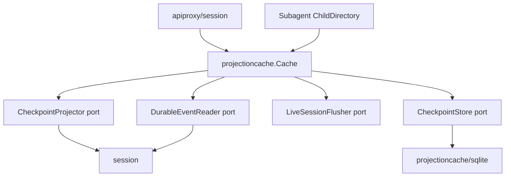

# Session Projection Cache 最终设计方案

状态：Implemented；显式事件驱动的 checkpoint lifecycle 已完成实现与全量验收

## 1. 文档职责

本文定义 Goren `Session Projection Cache` 的最终职责、模块边界、对外契约、关键数据、写入与冷恢复算法、并发与关闭语义，回答“最终代码应该是什么”。

- 全局项目进度和跨能力验证证据见[08 实施进度](./08-implementation-progress.md)。
- 通用 Projection Registry 与 Session Title 的既有设计见[18 Session Projection 与 Session Title](./18-session-projection-and-title.md)。
- Session 事实持久化与 SQLite Backend 见[19 Session Persistence 与 SQLite](./19-session-persistence-and-sqlite.md)。

本文只记录本专项设计及第 9.7 节的状态机验收，不维护整个项目的实施完成比例；checkpoint 始终不是 Session 事实。

## 2. 固定源与 Goren 取舍

固定 DeepSeek Harness 基线为 `47f943859bef60e4160492346772ded9b24f765a`，源 owner 为：

- `packages/session/session-projection-cache/src/index.ts`；
- `packages/session/session-projection-cache/src/spec.ts`；
- `packages/session/session-projection-cache/tests/cache.spec.ts`；
- `packages/session/session-projection/src/index.ts`；
- `packages/session/session-persistence/src/index.ts`；
- `packages/host/apiproxy/src/api-proxy.ts`；
- `packages/subagent/subagent/src/list-children.ts`。

源实现的核心语义保留如下：

1. `SessionProjectionCache` 是独立 Service，不属于 Projection Registry 或 Session Persistence。
2. checkpoint 只是可从 Session Event Log 重建的加速数据，不是事实。
3. 缓存可以落后于 durable log，不允许领先 durable log。
4. `turn/end` 与 Session detach 是强制 checkpoint 点；事件数量和时间是辅助触发条件。
5. Unit `StateVersion` 不匹配时丢弃该 row，不迁移内部 state。
6. 同一 Session ID 的不同生命周期不得共用 checkpoint。
7. cold read 使用 checkpoint + `ReadFrom` suffix + Registry `Restore`，失配时从 `seq=0` 全量重放。
8. 缓存写失败 fail-soft；事实日志或 Projection fold 本身失败不被缓存层吞掉。

Goren 不复制 TypeScript 的 `storage-domain`/JSON medium，而是使用独立 SQLite/sqlc adapter。这是实现语言和当前存储基建的差异，不改变 Service 职责。

固定源的 `coldSnapshot` 已实现并有完整测试，但未接入固定基线 API Proxy 的 detached history 生产路径。Goren 已实现从日志尾部反向分页，因此明确把 `ColdSnapshot` 接入 `session.history` 首页，避免为 Projection 再次全量 `Inspect`。这个差异不改变 wire shape，只改变冷读的 I/O 与 fold 规模。

## 3. 目标与非目标

### 3.1 目标

1. 为每个 Session 持久化一份完整 Projection checkpoint。
2. `session.list` 不再为每个 cold Session 读取完整事件日志。
3. `session.history` 首页在只读最近消息的同时，用 checkpoint + suffix 得到日志末尾 Projection。
4. Subagent ChildDirectory 在缓存足以证明 child identity 时避免全量 `Inspect`。
5. 保持 Session Event Log 是唯一事实源，缓存丢失或损坏只影响性能。
6. 在并发 append、timer、`turn/end`、detach 和 Plugin shutdown 下保持单 Session 写入串行与可排空。

### 3.2 非目标

- 不保存 checkpoint 历史版本。
- 不把 checkpoint 变成 Event Log、Snapshot Store 或 CQRS 事实库。
- 不让 Session Persistence 保存 Projection 业务数据。
- 不让 Projection Registry 依赖 SQLite、Plugin Factory 或 API Proxy。
- 不改变 Agent、AgentLoop、Session Event 名称、Host wire 字段或客户端 higher-seq-wins 规则。
- 不在首期实现跨进程同 Session 并发写、checkpoint GC 或缓存容量驱逐。

## 4. 统一术语

### 4.1 Projection Unit

Projection Unit 是业务 owner 定义的确定性 fold。Unit 拥有 key、state version、initial state、event transition 和 view。Unit 不拥有数据库、timer 或 Session 生命周期。

### 4.2 Projection Checkpoint

Projection Checkpoint 是一个 Session 的可重建 Projection state cut。它包含所有已注册 Unit 在某一 Session Event 位置的内部 state，不是对客户端的 view。

### 4.3 Checkpoint Record

Checkpoint Record 是缓存中“一个 Session 的当前 checkpoint”。每个 Session ID 最多一个 record，每次成功写入完整替换，不对单个 Unit row 做局部 patch。

### 4.4 Checkpoint Row

Checkpoint Row 是 record 中一个 Unit 的 state：

```go
type CheckpointRow struct {
    Version int64
    Seq     int64
    Value   json.RawMessage
}
```

`Seq` 表示该 Unit 已经处理到的最后一个 Session Event，不是该 Unit 最后一次产生变化的事件。

### 4.5 Log Identity

Log Identity 用 Session Header 中的 `{createdAt, cwd}` 绑定 checkpoint 所属的 Session 生命周期。Session ID 只是可重用的槽位，不单独证明生命周期相同。

## 5. 模块职责与依赖方向

### 5.1 `session/projection`

拥有：

- Unit 注册与引用计数；
- live cell 和 `observedSeq`；
- `Snapshot`、`Checkpoint`、`RestoreFloor`、`ViewCheckpoint`、`Restore`；
- `session/projection` whole-value change 通知。

不拥有：

- checkpoint 持久化；
- 写入节流、timer 和 SQLite；
- `session.list` 或 `session.history` 用例。

### 5.2 `session/projectioncache`

拥有以下普通 Go 业务/application 对象：

- `ProjectionCache`：`created/opening/open/closing/closed` 生命周期、公开调用准入、组件装配和关闭顺序；
- `liveCheckpointer`：exact `session.Context -> checkpointLifecycle` 索引、触发策略和 checkpoint attempt I/O；
- `checkpointLifecycle`：一个 exact Session 从 clean、dirty、active、final 到 closed 的 checkpoint 生命周期；
- `snapshotReader`：cached snapshot、cold suffix restore、全量 fallback 和 write-back；
- `checkpointRecords`：Session ID record index、identity/dominance/merge 与 durable Replace；
- `recordEntry`：一个 Session ID slot 的 per-ID replace 串行边界。

`ProjectionCache` 不实现 Plugin lifecycle，也不依赖 Plugin Runtime 的 Scope、Fiber 或 Registry。子对象不回指 `ProjectionCache`；`recordEntry` 不持有父集合、live writer 或 `CheckpointStore`。

### 5.3 `session/projectioncache/plugin`

Plugin adapter 只：

- 在 Manifest 声明 `session.LiveStore`、`session/persistence.Persistence` 和 `session/projection.Registry`；
- 发布 `projectioncache.Cache`；
- Apply 时打开 CheckpointStore 并激活 `ProjectionCache`；
- 把 `session/event` 和 `session/disposed` 翻译为缓存对象的业务输入；
- Dispose 时关闭 `ProjectionCache`。

Plugin adapter 不实现 checkpoint restore、SQLite 或 API 业务规则。

### 5.4 `session/projectioncache/sqlite`

SQLite adapter 只实现 consumer-owned `CheckpointStore`：

- schema 与 application identity；
- sqlc query 与 transaction；
- record 完整读取和替换；
- owner-defined record 与 SQL row 映射；
- 数据库关闭。

adapter 不判断什么时候写、哪个 row 版本有效、是否全量重放或如何处理 Session 生命周期。

### 5.5 跨模块方向



Agent 和 AgentLoop 不在该依赖图中，其职责不变。

## 6. 对外契约与关键对象

### 6.1 Cache Service

```go
type Cache interface {
    CachedSnapshot(
        session.Header,
    ) (*projection.Snapshot, error)

    ColdSnapshot(
        context.Context,
        session.SessionID,
    ) (projection.Snapshot, error)
}
```

`CachedSnapshot` 只读内存 index，不接受 Context，不执行 SQLite 或 Session log I/O。非空结果表示命中，`nil, nil` 表示正常未命中，`nil, err` 表示读取或 Projection view 失败。

`ColdSnapshot` 是可取消的权威读组合：缓存可以加速，最终结果必须由当前 Persistence log 证明。

`EventAppended`、`SessionDisposed`、`Open`、`Close` 不进入只读 Cache Service 消费者契约，只由 Plugin adapter 驱动 concrete `ProjectionCache`。

### 6.2 CheckpointStore

```go
type CheckpointStore interface {
    LoadAll(
        context.Context,
    ) (map[session.SessionID]CheckpointRecord, error)

    Replace(
        context.Context,
        session.SessionID,
        CheckpointRecord,
    ) error

    Close(context.Context) error
}
```

Store 没有 `AppendRow`、`UpdateUnit` 或历史查询；这些方法会破坏整个 checkpoint cut 的替换语义。

### 6.3 Checkpoint Record

```go
type LogIdentity struct {
    CreatedAt int64
    CWD       *string
}

type CheckpointRecord struct {
    Identity LogIdentity
    Rows     projection.Checkpoint
}
```

最终设计不增加顶层 `AsOfSeq`。理由是：

- `Rows[key].Seq` 已经是 Restore 契约的 watermark；
- 新生成的完整 checkpoint 中，所有已注册 Unit row 必须位于同一 event cut；
- 再保存一个顶层 seq 会形成两个需要保持一致的事实字段；
- `CachedSnapshot` 仍按实际选中的版本兼容 rows 取最小 `Seq`，得到对客户端安全的 under-claim cut。

## 7. 每 Session 一个 Record 的不变量

1. 每个 Session ID 最多一个 `CheckpointRecord`。
2. 每个已注册 Unit 最多一个 row，row key 等于 Unit key。
3. Store 每次完整替换 record，不保存旧版本或历史 record。
4. `row.Seq` 是 Unit 已消费的最后事件 seq。`Transition.Changed=false` 仍必须推进 `observedSeq`。
5. 对同一次 `Registry.Checkpoint(session)`，所有 row 必须具有相同 `Seq`；空日志为 `-1`。
6. cold `Restore` 刷新的所有 row 必须使用本次 suffix 证明的 `endSeq`。
7. 旧 record 可能缺失新 Unit row，或包含已卸载 Unit row；Registry 只选择当前已注册且版本匹配的 row。同一生命周期写入新 checkpoint 时，当前未注册 Unit 的旧 row 原样保留，避免 Unit 注销与异步 detach write 竞态抹掉仍可复用的 state；这些 row 不属于本次 checkpoint cut。
8. record identity 不匹配当前 Header 时，整个 record 失效，不逐 row 复用。

示例：

```text
session-123
└── CheckpointRecord
    ├── identity: {createdAt, cwd}
    └── rows
        ├── title               -> {ver: 1, seq: 100, val: ...}
        ├── subagent            -> {ver: 2, seq: 100, val: ...}
        └── sessionListMetadata -> {ver: 1, seq: 100, val: ...}
```

`title` 可能在 `seq=20` 后从未变化，但它已经处理了 `21...100`，因此其 checkpoint row 仍为 `seq=100`。

## 8. SQLite 持久化

默认文件：

```text
<session-database-directory>/session-projection-cache.sqlite
```

该文件只保存可丢弃 checkpoint，不与 Session facts 或 Session Query FTS 共用数据库。

表模型：

```sql
CREATE TABLE session_projection_checkpoints (
    session_id TEXT PRIMARY KEY,
    created_at INTEGER NOT NULL,
    cwd TEXT,
    rows_json BLOB NOT NULL CHECK (json_valid(rows_json))
);
```

`rows_json` 保存完整 `projection.Checkpoint`。选择单行 JSON 而不是每 Unit 一行，是因为业务写入单位是一个 Session 的完整 checkpoint cut。

SQLite adapter 必须：

- 使用独立 `application_id`；
- 使用 cache schema `user_version`；
- 仅对已证明属于本 cache 的旧 schema 执行可丢弃重建；
- 对外来 application identity 或无法确认归属的数据库拒绝启动，不自动删除；
- 使用 sqlc 生成私有 query package；
- 在 Apply 时一次加载所有 record 到内存 index；
- 在 durable `Replace` 成功后才更新内存 index。

## 9. 写入状态与并发

### 9.1 重构前问题与收敛原则

重构前的实现虽然已使用单一 phase，但仍有四个问题：

1. 一次迁移分散在 `beginAttempt`/`finishAttempt`/`retryTimer` 中，调用者需要自行拼接同一业务过程。
2. I/O worker 会根据 `session.ErrNotAttached` 自行决定是否报错及如何继续，写入结果的业务含义泄漏到执行器。
3. `session/disposed` 与 live Flush 竞争时，结果、状态和后续命令由不同方法解释，无法用一张迁移表验证闭环。
4. 未知 phase 若由 default 分支收敛为 stopped，会隐藏内部不变量破坏。

收敛原则是：`checkpointLifecycle` 成为唯一迁移权威，在一次加锁内完成“校验输入 -> 更新状态与计数 -> 产出下一条命令”。其他对象不得直接改写状态，也不得根据状态二次推导后续行为。

重构不引入通用 event bus，也不更改 Plugin 的现有事件投递。本节的“事件”是 `checkpointLifecycle` 上具有业务含义的直接方法输入。

### 9.2 组件职责与调用闭环

`checkpointLifecycle` 只拥有一个 exact Session 的 checkpoint 生命周期：

- 状态、dirty event 计数和 timer generation；
- 输入合法性与 attempt 匹配性校验；
- 原子状态迁移与下一条执行命令。

`checkpointLifecycle` 不持有 port，不执行 Projection、Flush、SQLite I/O 或 goroutine，不直接报告外部故障。

`liveCheckpointer` 只拥有运行时协调：

- 管理 exact `session.Context -> checkpointLifecycle` 映射；
- 执行 timer、goroutine 和状态机返回的命令；
- 调用 Registry、LiveStore 和 CheckpointStore port；
- 把 port 的 raw error 翻译为 typed outcome，再原样送回状态机。

worker 可以做反腐化映射，但不能决定 retry、final、remove 或忽略。是否报告故障由 typed outcome 的分类契约给出，worker 只机械执行，不再重新解释 error。

调用链固定为：

```text
Plugin / timer / checkpoint goroutine
  -> checkpointLifecycle 命名输入
  -> checkpointLifecycle 在锁内完成迁移
  -> 返回一条 checkpointLifecycleCommand
  -> liveCheckpointer 执行命令，锁外做 I/O
  -> I/O 完成后翻译为 checkpointOutcome
  -> CheckpointCompleted 作为新输入再次进入 checkpointLifecycle
```

异步 I/O 天然存在“启动”与“完成”两个时间点，不能把它们伪装成一次持锁 I/O。要消除的是调用者手工配对 `beginAttempt`/`finishAttempt` 的半事务：启动时的全部状态变更由原始输入一次完成，completion 是带 attempt 快照的新业务输入，不是同一迁移的“后半段”。

### 9.3 状态与数据

每个 exact live Session object 使用一个 `checkpointLifecycle`，不按 Session ID 合并不同生命周期。状态机使用单一枚举，不叠加 `active`、`dirty`、`detached` 等会形成非法组合的 bool：

| 状态 | 业务含义 |
| --- | --- |
| `checkpointLifecycleClean` | 无 timer、无 active attempt，已观察输入全部已 checkpoint |
| `checkpointLifecycleDelayed` | 存在 dirty prefix，已保留或安装 interval timer |
| `checkpointLifecycleRunning` | 一个 live attempt 正在执行，其覆盖范围之后的输入尚未满足再次写入条件 |
| `checkpointLifecycleQueued` | 一个 live attempt 正在执行，其覆盖范围之后的输入已满足再次写入条件；只记录一次合并请求，尚未启动第二个 attempt |
| `checkpointLifecycleFinalQueued` | live attempt 正在执行，已收到权威 `session/disposed`，完成后必须衔接 final attempt |
| `checkpointLifecycleFinalRunning` | final detached attempt 正在执行 |
| `checkpointLifecycleClosed` | 终态，不再接受新输入；exact Session 映射已移除或由本次命令移除，迟到 completion 只用于释放 inflight barrier |

`Queued` 是一个合并 latch，不是 task queue：当前 attempt 覆盖到 event 100，I/O 期间 event 101...105 又满足 threshold 或出现 `turn/end` 时，只记住“当前 attempt 完成后再写一次”。此时没有第二个 writer；当前 attempt 完成后才创建覆盖最新前缀的后续 attempt，期间的多次触发仍只合并为一次。`FinalQueued` 同理取代 `FinalPending`。七个状态已是业务需要的七种合法组合，再拆成多个状态轴只会重新引入非法组合。

```go
type checkpointLifecycle struct {
    state              checkpointLifecycleState
    observedEvents     uint64
    checkpointedEvents uint64
    nextAttemptID      uint64
    activeAttempt      checkpointAttempt
    timerGeneration    uint64
    timer              *time.Timer
}
```

- `observedEvents-checkpointedEvents` 表示本次 exact live 期间尚未被成功 attempt 覆盖的输入数，不把 resume 前历史误计为新事件。
- `activeAttempt` 是 `Running`、`Queued`、`FinalQueued` 和 `FinalRunning` 的关联数据，记录当前 I/O 的 ID、kind 和 `coveredEvents`；其他状态必须为零值。它与 state 组成一个不变量，不是可独立变化的第二状态轴。
- `nextAttemptID` 为每次启动分配非零 ID，使 completion 只能完成它所属的 active attempt；重试覆盖相同 event prefix 时也不会误接受旧 completion。
- `timerGeneration` 拒绝已取消或已替换 timer 的迟到 callback，不能由状态本身推导。
- `timer` 是待取消的运行时资源句柄，`Delayed` 才是调度事实；不能以 `timer != nil` 替代状态。

进入 active state 时，状态机在同一次迁移中创建 `activeAttempt`，并把它的不可变副本交给 `StartCheckpoint` 命令。这样 worker 不再通过 `beginAttempt` 二次修改 state。`EventAppended` 在 active state 下以 `observedEvents-activeAttempt.coveredEvents` 计算当前 attempt 启动后的新输入；`CheckpointCompleted` 必须先校验 attempt ID 与 kind，再推进 `checkpointedEvents` 或产生后续命令。

### 9.4 命名输入、结果与命令

`checkpointLifecycle` 向 `liveCheckpointer` 提供命名方法，而不暴露可任意构造的通用 event envelope：

```go
eventAppended(forceCheckpoint bool, writeEveryEvents int)
timerElapsed(generation uint64)
sessionDisposed()
checkpointCompleted(attempt checkpointAttempt, outcome checkpointOutcome)
cacheClosing()
```

这些方法内部共用一个受锁保护的迁移入口，只有该入口可改写 state、计数和 timer identity。`forceCheckpoint=true` 表示 `turn/end`。timer 安装是执行 `ArmTimer` 命令后的技术确认，不是可任意调用的业务迁移。

checkpoint 执行结果在 port 边界翻译为：

| 结果 | 含义 |
| --- | --- |
| `checkpointSucceeded` | Projection cut 已按对应耐久性顺序成功写入 |
| `checkpointFailed` | 需要报告的普通 checkpoint 故障 |
| `checkpointUnavailable` | live Flush 返回 `session.ErrNotAttached`，该 live attempt 已无法在 LiveStore 上完成 |

`checkpointUnavailable` 不报告缓存故障，但也不能授权 final attempt。`ErrNotAttached` 还可以表示 foreign、stale 或从未挂入的 Context，不能证明 Session final Flush 已完成。只有 `SessionDisposed()` 是 final checkpoint 的授权事实。

每个输入在锁内完成迁移后，返回恰好一个 tagged command：

| 命令 | 携带数据 | 执行行为 |
| --- | --- | --- |
| `checkpointLifecycleNoop` | 无 | 不执行外部效果 |
| `checkpointLifecycleArmTimer` | generation | 安装 interval timer |
| `checkpointLifecycleStartCheckpoint` | checkpoint attempt | 根据 attempt kind 启动 live 或 detached final checkpoint |
| `checkpointLifecycleRemove` | 无 | 从 exact Session 映射移除该对象 |

command 是状态机的判定结果，不是容纳任意可选字段的通用 request。live 与 final 共用 `StartCheckpoint`，耐久性路径由状态机原子创建的 attempt kind 确定，避免重复命令分支。`liveCheckpointer` 只按 tag 执行，不根据 state 补充业务判断。

### 9.5 迁移表

| 输入 | 当前状态 | 下一状态 | 命令 |
| --- | --- | --- | --- |
| EventAppended，未满足写入条件 | Clean | Delayed | ArmTimer |
| EventAppended，满足 threshold 或为 `turn/end` | Clean/Delayed | Running | StartCheckpoint(live) |
| EventAppended，尚未满足再次写入条件 | Running | Running | Noop |
| EventAppended，已满足再次写入条件 | Running | Queued | Noop |
| EventAppended | Queued | Queued | Noop |
| TimerElapsed，generation 匹配 | Delayed | Running | StartCheckpoint(live) |
| TimerElapsed，迟到或状态不匹配 | 任何 | 不变 | Noop |
| SessionDisposed | Clean/Delayed | FinalRunning | StartCheckpoint(final) |
| SessionDisposed | Running/Queued | FinalQueued | Noop |
| SessionDisposed | FinalQueued/FinalRunning/Closed | 不变 | Noop |
| CheckpointCompleted，success 且无新 dirty input | Running | Clean | Noop |
| CheckpointCompleted，failure/unavailable，或 success 后仍 dirty 但未满足立即再写条件 | Running | Delayed | ArmTimer |
| CheckpointCompleted，success/failure | Queued | Running | StartCheckpoint(live) |
| CheckpointCompleted，unavailable | Queued | Delayed | ArmTimer |
| CheckpointCompleted，任何 live outcome | FinalQueued | FinalRunning | StartCheckpoint(final) |
| CheckpointCompleted，final success/failure | FinalRunning | Closed | Remove |
| CacheClosing | Clean/Delayed | Closed | Remove |
| CacheClosing | Running/Queued/FinalQueued/FinalRunning | Closed | Remove；已启动 attempt 由 checkpointer 的 inflight barrier 等待 |
| CheckpointCompleted，关闭时的 active attempt | Closed | Closed | Noop |

`FinalQueued` 中 live attempt 的 outcome 不影响 final 命令：`SessionDisposed` 已经提供更强的耐久性事实。`Queued` 中的普通 failure 仍按 outcome 契约报告，然后执行合并后的下一次 live write；`checkpointUnavailable` 说明 LiveStore 当下不能执行 live attempt，不做无意义的立即重试，而是保留 dirty prefix 并等待 timer 或权威 `SessionDisposed`。

`FinalQueued`、`FinalRunning` 和 `Closed` 不再接受新 Session event。attempt kind 必须与当前状态期待一致。除表中明确定义的幂等输入外，其他 state/input/attempt 组合都是内部不变量破坏，必须返回明确错误，不得用 default 分支静默收敛。

Cache shutdown 不把 dirty state 升级为 final write。

### 9.6 耐久性顺序

普通 live 写入必须保持：

```text
Registry.Checkpoint(session)
  -> LiveStore.Flush(session) in the same Session FIFO
  -> CheckpointStore.Replace(record)
  -> update in-memory record index
```

checkpoint 先取 cut，再调用唯一 `LiveStore.Flush`。禁止先 `LiveStore.Get` 判断 live 再调用 Flush；两次独立检查不能拥有同一个生命周期事实。Flush 可以把比 checkpoint cut 更新的 event 一并持久化，这只会让 cache 落后，不会让 cache 超前。

final attempt 使用：

```text
Registry.Checkpoint(session)
  -> CheckpointStore.Replace(record)
  -> update in-memory record index
```

它不调用 LiveStore，因为启动它的唯一输入 `SessionDisposed` 已经证明 final Flush 完成且 exact Session 已从 LiveStore 移除。

### 9.7 实施与验收

实现未保留过渡性双路径：

1. table-driven test 固定全部 state/input/outcome 迁移和非法组合；
2. `checkpoint_lifecycle.go` 定义 state、outcome、attempt 和 command，枚举值与状态字段注释说明不变量；
3. 命名输入取代 `beginAttempt`/`finishAttempt`/`retryTimer` 式半事务，旧 phase 和 action 路径已删除；
4. `liveCheckpointer` 集中执行 command，并集中完成 raw error -> outcome 翻译，worker 不读 state 做二次决策；
5. 确定性门闩覆盖 `ErrNotAttached` 先于 `SessionDisposed` 和 `SessionDisposed` 先于 live completion 两种时序；
6. threshold、timer、`turn/end`、Dispose、Close、同 Session 串行与不同 Session 并行均有测试覆盖。

验收矩阵包括：

- threshold、timer、`turn/end` 触发与 stale timer generation；
- running 期间连续 event 的合并；
- Dispose 分别发生在 Clean、Delayed、Running 和 Queued；
- `ErrNotAttached` 先于/后于 Dispose，不误报 failure，不由 error 冒充 final 授权，最终恰好一次 final attempt；
- 普通 live failure 报告并重试，final failure 报告后移除；
- Close 发生在每个状态，不强制 dirty write；
- 同 exact Session 最多一个 active attempt，不同 Session 可并行；
- live Session detach 与异步 checkpoint 竞争不产生虚假故障，权威 `SessionDisposed` 到达后由 final checkpoint 收敛。

本次已通过 focused tests、Projection Cache 20 次 race 重复测试、`go test ./...`、`go test -race ./...`、`go vet ./...`、`go build ./...`、Markdown 本地链接检查和 `git diff --check`。

## 10. Detach 与 Plugin 关闭

### 10.1 Session detach

Session Handle Release 在从 LiveStore 移除前已经通过同一个 operation FIFO 发布并等待最终 `session/flush`。`session/disposed` 到达 Cache 时：

1. 把 `checkpointLifecycle` 转为 `FinalRunning`，或在 active attempt 后转为 `FinalQueued`；
2. 如果普通 live writer 在运行，它完成后无论成功或失败都再执行一次 final detached attempt；
3. final attempt 直接 `Registry.Checkpoint -> CheckpointStore.Replace`，不调用 `LiveStore.Get` 或 `LiveStore.Flush`；
4. final attempt 成功或失败后删除 live write state；
5. detach write 失败不无限保留 timer，由下次 cold read 全量或 suffix 自愈。

这里依赖的不是“Session 大概已经不 live”，而是 `session/disposed` 的前置保证：同一 Session FIFO 已排空，final barrier 已由 Persistence 满足，exact Session 已从 LiveStore 移除。Projection Cache 不再自行重建这段生命周期判断，也不把 `ErrNotAttached` 解释为等价事实。

Projection Registry 的 `session/disposed` Observer 可能并行删除 live cell。Cache 不依赖该 cell 存活；`Checkpoint` 可从 detached Session events 重建。

### 10.2 Cache Plugin Dispose

Plugin Dispose 顺序固定为：

1. 如果 `Open` 正在加载 record，等待该次装配成功或回滚；
2. `ProjectionCache` 进入 `closing`，拒绝新的 event、snapshot 和 write-back 准入；
3. 等待已准入的 facade 调用退出；
4. `liveCheckpointer` 停止全部 timer，并等待已经启动的 checkpoint goroutine；
5. 关闭 `CheckpointStore`；
6. 进入 `closed` 并向并发 Close caller 发布同一个结果。

缓存是可丢弃数据，Plugin shutdown 不为未达到阈值的普通 dirty state 强制创建新写入。

上述顺序由 `ProjectionCache` 自己保证，不能依赖 Plugin Runtime 或某个 composition root 恰好串行调用 `Open/Close`。`Open` 的 record load 失败时没有发布任何组件，状态从临时 `opening` 回滚到 `created`，Store 仍由调用方负责关闭，并允许使用新 Store 重试。

## 11. `CachedSnapshot`

`CachedSnapshot(header)` 是零 Session-log I/O、零 SQLite I/O 的内存读：

1. 按 `header.ID` 查找 record；
2. 比较 record identity 与 `{header.CreatedAt, header.CWD}`；
3. identity 不同时返回 absent；
4. 调用 `Registry.ViewCheckpoint(rows)`；
5. Registry 只返回当前已注册且 `Version == StateVersion` 的 values；
6. 没有可用 value 时返回 absent；
7. `Snapshot.AsOfSeq` 取已返回 rows 的最小 `Seq`。

取最小 seq 是客户端 higher-seq-wins 的安全 under-claim：它可以让值看起来比实际更旧，不能让旧值冒充更新 cut。

## 12. `ColdSnapshot`

### 12.1 正常 suffix 路径

```text
load memory record
  -> Registry.RestoreFloor(rows)
  -> Persistence.ReadFrom(sessionID, floor)
  -> validate LogIdentity
  -> Registry.Restore(rows, suffix, floor)
  -> fail-soft durable write-back
  -> return Snapshot
```

`RestoreFloor` 按所有当前 Unit 计算最低需求：

- row 存在且版本匹配：需求从 `row.Seq+1` 继续；
- row 缺失或版本失配：需求从 `0` 重放；
- 实际 read floor 再向前保留一个 anchor，用于证明日志没有缩短到 checkpoint watermark 之前。

### 12.2 全量回退

以下情况丢弃整个已读 record，重新 `ReadFrom(id, 0)` 并以空 checkpoint Restore：

- Log Identity 不同；
- checkpoint row 版本不匹配且 suffix 不是从 `0` 开始；
- row seq 超过当前日志末尾；
- 日志缩短、anchor 无法证明 watermark；
- record/row state 不是合法 plain JSON；
- Registry 判断该 suffix 不足以从当前 checkpoint 恢复全部 Unit。

全量 Restore 仍失败时，失败来自 Session log 或 Unit fold，必须返回调用者，不伪装为 cache miss。

### 12.3 零 Unit

Registry 没有任何 Unit 时，`RestoreFloor` 返回 nil。Goren 不使用 `ReadFrom(id, 0)` 读完整日志，而是调用：

```text
ReadEventsBefore(id, nil, 1)
```

它同时保持 Session-not-found 契约。返回的 `Snapshot.Values` 为空，但 `Snapshot.AsOfSeq` 仍表示这次快照覆盖到的 durable log 位置：有事件时取最新事件 seq，空日志取 `-1`。cut 属于整个 Snapshot，不是给空 `Values` 添加标记。

### 12.4 Cold write-back

Restore 成功后用返回的完整 refreshed checkpoint 替换 record。write-back 失败只报告诊断，已计算的 Snapshot 仍返回调用者。

首期不对并发 `ColdSnapshot(id)` 做 singleflight。Session Persistence 已在 per-ID operation gate 上序列化存储操作，同一日志 cut 的后写 record 仍是可重建等价状态。如果未来证明存在读放大，再以独立性能证据引入 deduplication。

## 13. `session.list` 接入

API Proxy 拥有 `sessionListMetadata` Projection Unit，不把 list 字段塞进 Session 核心。

```text
key: sessionListMetadata
stateVersion: 1
state:
  blank
  lastPromptAt
```

transition：

- `turn/start` 使 `blank=false`；
- direct `user/message` 更新 `lastPromptAt`；
- 其他事件只推进 row seq，不改变 state。

cold list 流程：

1. `Persistence.List` 读 Header；
2. `Cache.CachedSnapshot(header)` 读内存 checkpoint；
3. 解码 `sessionListMetadata`；
4. cache 缺失、损坏或只能证明 `blank=true` 时，按保守语义返回 `blank=false`，不用滞后缓存隐藏可能已开始的会话；
5. `blank=false` 是单调事实，可直接采用；
6. `updatedAt` 用 `max(header.CreatedAt, lastPromptAt)`；
7. 不再为每个 cold row 调用 `Persistence.Inspect`。

live row 仍使用 `Registry.Snapshot(session)`。list 的 Projection 列失败对单 row fail-soft，不使整个 list 失败。

## 14. `session.history` 接入

### 14.1 首页一致 cut

`session.history` 首页的 events 与 projections 必须属于同一 `asOfSeq`。不允许先读最新页，再无约束地读一个可能更新的 Projection Snapshot。

cold 流程：

```text
Cache.ColdSnapshot(id) -> E
  -> ReadEventsBefore(id, E+1, batch)
  -> 向前扫描到完整 message group 边界
  -> 校验页面末尾 seq == E
  -> 返回 events + projections(asOfSeq=E)
```

增长日志不会越过 exclusive `E+1` cursor。如果日志修复或缩短使页面末尾小于 `E`，重新执行 cold snapshot/page 收敛，不返回错位 cut。

live 流程同样先取 `Registry.Snapshot(session)` 的 `E`，再从 Session events 中选择 `seq <= E` 的尾页。

### 14.2 Older page

`beforeSeq` 非空的 older page 不携带 Projection block，不调用 Cache，只按现有完整 message group 规则反向分页。

### 14.3 可选 Service

Cache 对扩展组合是可选加速能力，默认 Goren Server 必须装配。扩展组合没有 Cache 时，首页使用全量 `Inspect + Restore` 作为永久 correctness fallback，不是临时兼容分支。

## 15. Subagent ChildDirectory 接入

ChildDirectory 在消费端定义只需 `CachedSnapshot` 的窄接口，Subagent Plugin 解析全局 `projectioncache.Cache` 后传入，业务包不依赖 Cache Plugin 类型。

cold child 流程：

1. 读取 identity-matching cached snapshot；
2. 解码 `subagent` Projection value；
3. 只有 `identity.Seq >= header.SeedLength` 时才采用，以证明它是 child 自己的 descriptor，不是 fork seed 中的 ancestor descriptor；
4. 命中后直接返回 inactive child row；
5. cache miss、decode failure、null 或 seq gate 不满足时，回退当前 `Inspect + Restore`；
6. 缓存损坏只降级当前 child，不使整个 children/descendants 列表失败。

## 16. 错误、取消与诊断

### 16.1 启动失败

以下错误使 Cache Plugin Apply 失败：

- SQLite 路径或权限错误；
- 外来 application identity；
- 无法打开或加载 checkpoint store；
- 必需 Service 缺失；
- Factory config 非法。

“cache 可丢失”不等于“配置或数据库异常静默忽略”。

### 16.2 Fail-soft 操作

以下错误通过 Cache 自己的 `FailureReporter` 报告，不使 Session Event publication 或已成功 cold read 失败：

- threshold/interval/`turn/end`/detach checkpoint 写失败；
- cold read 成功后的 checkpoint write-back 失败；
- 已识别为可丢弃 checkpoint row 的验证失败。

live Flush 返回 `session.ErrNotAttached` 映射为 `checkpointUnavailable`，不属于需报告的 checkpoint failure。状态机保留 dirty prefix，并且只在收到权威 `session/disposed` 后启动 final attempt。

### 16.3 必须向调用者返回的错误

- request Context 取消；
- Session 不存在；
- Session Persistence 权威读失败；
- 从 `seq=0` 完整重放仍无法验证 Session log；
- Projection Unit 在完整事实上仍无法 fold/view。

## 17. 不变量与验收契约

| ID | 不变量 |
| --- | --- |
| PC-I01 | Session Event Log 是唯一事实源，cache miss 不影响结果正确性 |
| PC-I02 | 每 Session ID 最多一个当前 CheckpointRecord |
| PC-I03 | 一次 checkpoint 新生成的当前已注册 Unit row 位于同一 event cut；原样保留的未注册 Unit row 维持旧 seq |
| PC-I04 | row seq 表示已处理事件位置，不是最后变化位置 |
| PC-I05 | cache 可以落后 durable log，不能领先 durable log |
| PC-I06 | Log Identity 不同时整个 record 失效 |
| PC-I07 | StateVersion 不同时丢弃 row，不迁移 Unit state |
| PC-I08 | 同一 exact `session.Context` 同时最多一个 active checkpoint attempt；不同 exact Session 可以并行 |
| PC-I09 | `session.list` 的 cold rows 不为 Projection 执行全量 `Inspect` |
| PC-I10 | history 首页的 `projections.asOfSeq` 与页面末尾 event seq 相同 |
| PC-I11 | older history page 不调用 Cache，不携带 Projection block |
| PC-I12 | Cache Plugin Dispose 先关闭准入并排空，再关闭 CheckpointStore |
| PC-I13 | Cache Plugin、`ProjectionCache` 业务对象与 SQLite adapter 是三个独立职责 |
| PC-I14 | Agent、AgentLoop 和 Session core 不依赖 Projection Cache |
| PC-I15 | `checkpointLifecycle` 的所有状态变化只能由命名输入显式触发，worker 不得越过状态机决定后续写入 |
| PC-I16 | `session/disposed` 是 final checkpoint 的唯一授权事实，`ErrNotAttached` 不与之等价 |
| PC-I17 | 非法 state/input/attempt 组合必须显式失败，不得以默认分支静默关闭或恢复 |

## 18. 文档同步

显式状态机完成验收后，稳定职责与证据已同步到现有文档体系，不创建第二份进度来源：

- `zh-CN/16-session-api-gateway-and-live-frames.md` 记录 list/history 的 Cache 消费边界；
- `zh-CN/18-session-projection-and-title.md` 链接本文并区分 Registry、Cache 与 SQLite adapter；
- `zh-CN/19-session-persistence-and-sqlite.md` 明确 Session fact DB 不是 Projection Cache DB；
- `zh-CN/08-implementation-progress.md` 只记录总体完成状态和公共验证证据；
- `zh-CN/README.md` 及相关 package `README.zh-CN.md` 提供索引和近邻职责说明。

第 9.7 节记录本专项实现和验证的实际完成情况；全局文档只保留稳定职责和汇总证据。
