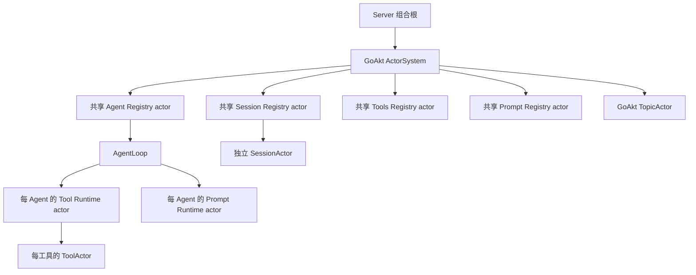
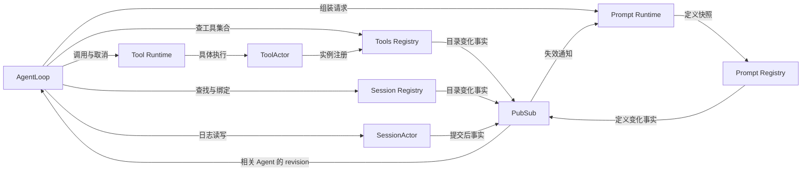

# Actor、Registry 与 Runtime 所有权

业务对象、状态及消息的完整实现定义统一见[11](./11-actor-implementation.md)。本文保留整体所有权视图；
通信由[06](./06-messaging-and-tasks.md)、初始化由[10](./10-runtime-and-initialization.md)、关闭由[07](./07-lifecycle-implementation.md)、
工具更新由[08](./08-tools-implementation.md)定义。Agent 是身份，AgentLoop 是唯一执行 owner。

## 1. 统一术语

| 术语 | 含义 | 禁止混用 |
| --- | --- | --- |
| Actor | 独立状态、消息处理和生命周期的 owner | 不等于每个 DTO、函数或 goroutine |
| Registry | 共享目录，拥有注册身份、可见信息、集合版本和目录变化事实 | 不拥有已注册对象的业务执行状态 |
| Runtime | 一个能力的运行实例，协调该范围内的执行与资源 | 不泛指第二套通用 actor framework |
| AgentLoop | 单个 Agent 的执行 owner | 不拥有 Session 日志、全局目录 |
| Tool Runtime | 每 Agent 独立的工具运行 owner | 不是每 Agent 独立 Tools Registry |
| ToolActor | 该 Agent 的一个工具实例 | 不等于一次工具调用 |
| Prompt Runtime | 每 Agent 独立的 Prompt 配置应用与组装 owner | 不拥有全局 Prompt 定义或 Session 日志 |
| SessionActor | 独立于 Agent 的 Session 运行实例 | 不再额外包一层无独立状态的 Session Runtime actor |
| incarnation | 同一逻辑身份的一次 actor 实例生命期 | 不等于业务 Agent ID、Session ID |
| generation / revision | 分别标识执行代际、目录或快照版本 | 不共用一个无范围的全局版本计数 |

以上是架构术语，不提前确定 exported Go 声明、消息字段或 package 重命名。
运行期对象使用具名 struct；纯校验、映射、编解码和存储 adapter 仍是普通 Go 对象。
消息传递只转交值或地址，不转交具体 actor 对象。slice/map/pointer 必须复制或保持不可变。

Grain 载体和代码落点的新增实现提案见[05](./05-implementation-overview.md)与[09](./09-module-implementation.md)。
下图表达业务生命周期所有权，不要求把 Grain 嵌入普通 Actor 的框架父子树。

GoAkt 运行时 提供组件寻址与异步消息入口，AgentLoop 不持有组件地址；与每 Agent 的 Tool Runtime 区分。
AgentLoop 创建后经 GoAkt 运行时请求组件配置及版本，必要项全部就绪再执行用户消息，见[10](./10-runtime-and-initialization.md)。
下文业务交互箭头表示逻辑 owner，实际寻址通过GoAkt 运行时。

## 2. 已确认的所有权模型

实线表达生命周期责任；注册、读写和发布订阅不是这些线。多个 Agent 各有一组 TR/PR/T。
图只覆盖当前讨论完成的主干，不是全部 Goren capability 清单，也不固定 GoAkt supervision 配置。
Agent Registry 按 SessionID 协调 Agent/Session 这一对实例的创建与关闭；AgentID = SessionID。
Session Registry 负责 SessionActor 的实际创建/恢复与关闭。两者是独立状态 owner，但生命周期有明确先后：
先构造未就绪 Agent，再绑定 Session；Agent 完成处理、结算并关闭后才能关闭 SessionActor。
首期使用显式绑定/解绑，不引入 lease。失败恢复细节见[待决项](./03-migration-and-validation.md#5-待决项)。

- ToolActor 新增时由 Tool Runtime 创建，删除时关闭；普通更新在同一稳定 ToolActor 内切换实现，自行向 Tools Registry 登记候选定义。
- Tools Registry 的目录身份包含 Agent ID；不同 Agent 的同名工具不会互相覆盖。
- Tool Runtime 持有本地实例地址和调用关联；Registry 持有目录记录，二者各管不同状态。
- Prompt Runtime 随 Agent 创建与关闭；Prompt Registry 维护共享定义、适用范围和版本。
- SessionActor 在对应 Agent 关闭后释放内存资源；Session 身份与持久化数据保留，后续消息可再次创建/恢复同 ID 实例。
- Subagent 创建时复制 parent 有效配置快照，应用自定义覆盖并校验，再创建自己的 Tool Runtime、Prompt Runtime 和 ToolActor；不继承执行实例地址，parent 后续配置变化不自动传播。
- 父子生命周期保持不变，Agent Registry 继续协调 child-first 关闭；配置独立不等于脱离 parent 生命周期。
- 目标架构移除 Scope，配置解析、资源释放、策略和订阅分归具体 owner，详见[04](./04-subagent-configuration.md)。
- 反向联系用 ID、reply address 和事件表达，不在 Go struct 中回填 Registry/父对象形成循环嵌套。

## 3. 职责与权威状态

| Owner | 权威状态 / 操作 | 不负责 |
| --- | --- | --- |
| Agent Registry | Agent 身份、活动实例、成对创建/关闭协调、业务父子关系 | Turn/Step、工具调用、Session 提交 |
| GoAkt 运行时 | 组件寻址和消息投递 | 组件配置、Agent 业务顺序、工具目录权威 |
| AgentLoop | 用户消息与工具更新的业务顺序、Turn/Step 编排、执行代际、取消与结算 | 工具目录写入、Prompt 定义、日志存储 |
| Tools Registry | `(AgentID, ToolName)` 注册、实例代际、schema、有效集合、集合 revision | 创建 ToolActor、执行工具、调用级取消表 |
| Tool Runtime | 本 Agent 的实例生命周期、调用路由、Agent 范围并发预算、policy pipeline、结果结算 | 全局注册权威、跨 Agent 共享配额 |
| ToolActor | 具体工具行为、工具级活动调用、操作取消、工具自有资源 | Agent Turn、Session 日志、其他工具的执行状态 |
| Prompt Registry | 定义注册、顺序、适用范围、定义 revision | 执行组装、运行期变量求值、存储每次组装结果 |
| Prompt Runtime | 本 Agent 的有效配置、已应用 revision、组装与取消、输出快照 | 反向改写全局定义、独立改写 Session 历史 |
| Session Registry | Session 身份、元数据目录、活动地址、绑定/回收协调 | 日志 append、事务、持久化 flush |
| SessionActor | 日志序列、写队列、commit barrier、flush、可查询的已提交快照 | Agent 是否继续运行、Tool 重试与权限决定 |

Session metadata 的原始更新由 Session 用例 owner 提交；Registry 维护版本化目录投影，
不与 SessionActor 各自独立修改同一份 metadata。cold Session 查询继续经既有 query/persistence 能力，
不因列出历史会话而启动所有 SessionActor。

Runtime 与 ToolActor 的并发职责分层：Runtime 管整个 Agent 的调度预算，ToolActor 管具体工具的
串行/并行约束。一次调用只有一个调用协调记录；跨 actor 仅保存所需的阶段或关联信息，不复制完整状态机。

## 4. 发现、调用与变化通知

图中的跨 actor 请求均为异步通信：需要结果使用 GoAkt `Request + Then`，无需回复使用 `Tell`，
变化事实使用 PubSub；等待响应不阻塞 Receive。具体规则见[通信协议](./02-capability-protocols.md#1-消息分类与-pubsub)。

工具执行主路径固定为 `Agent → Tool Runtime → ToolActor`，不绕道 Tools Registry。
具体 ToolActor 完成先回 Tool Runtime 做公共 post-policy/结果处理，再由 Runtime 向 Agent 返回最终结果。
Agent 决定如何写入 Session，ToolActor 不直接提交 Agent 的工具结果事件。
普通工具注册、更新和撤销都必须经过该 Agent 的业务队列，在前序消息完整结算后的屏障内修改有效集合。
ToolActor 自注册只能提交当前获准更新的候选信息，不能绕过屏障直接改动模型可见工具。

Prompt 定义查询由 Prompt Runtime 发起；Agent 可以订阅目录变化，但必须使用 Runtime 已应用的组装结果，
不能把收到通知当成 Runtime 已完成更新。Session 读写直接发给绑定实例，不由 Registry 转发每次日志操作。

Registry 是每种能力的共享逻辑 owner；首期一个进程内各一个。以后如需分片，要在同一目录契约下演进，
不回退成每 Agent 一份各自决定注册规则的 Registry。

## 5. 隔离与共享资源

每 Agent 独立 ToolActor 不意味着复制每个 HTTP 连接池、不可变 schema 或外部 MCP 连接。
共享有状态资源必须有自己的 owner，并由更上层生命周期管理；普通 adapter 不能暗中承担共享业务状态。

候选 MCP 结构：每 Agent 的 MCP ToolActor 消费独立 MCP ConnectionActor 的协议能力；
后者由进程级 MCP 组件管理。是否允许共享连接取决于 server 配置、凭证、工作目录、权限与协议状态，尚未锁定。
Agent 退出只释放自己的工具实例和绑定，不关闭其他 Agent 正在使用的共享连接。

LLM、Credentials、Workspace、Approval、Interaction、Compaction、Subagent 和 Query/Projection
保留原有业务 owner，按[迁移清单](./03-migration-and-validation.md)逐项映射。不得创建全局 services actor
吸收它们，也不预设每个现有 package 都对应一个 actor。
