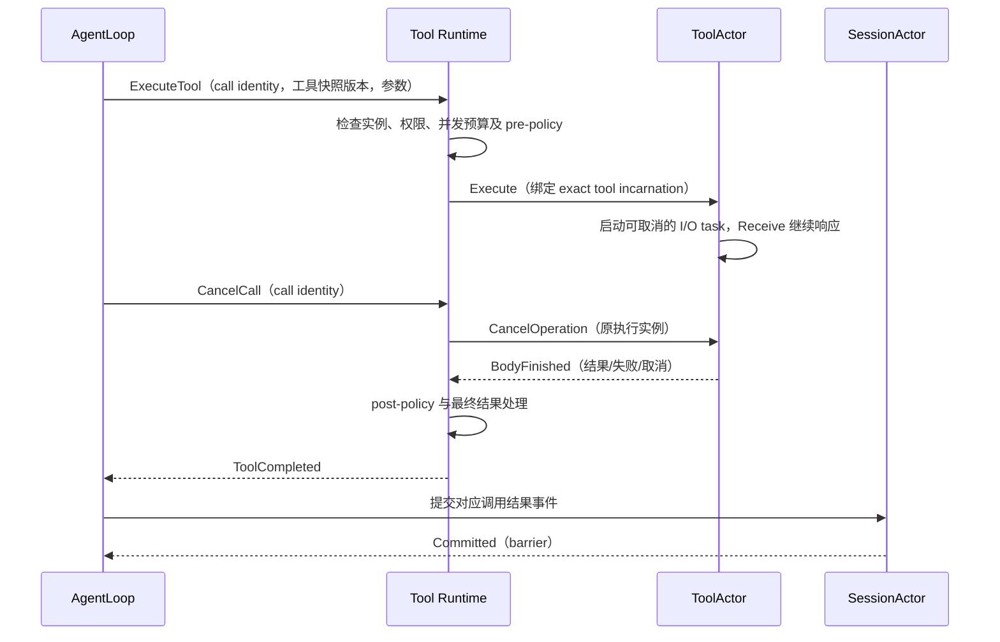

# 注册、快照与运行协议

状态：异步 Request/Tell/PubSub 分工、Session 生命周期顺序和工具更新屏障已确认；普通 Actor 延迟回复机制存在验证阻塞，具体事务机制待契约验证。
所有权见[01](./01-ownership.md)，迁移验收见[03](./03-migration-and-validation.md)。

## 1. 消息分类与 PubSub

| 消息语义 | 路径 | 确认与错误 |
| --- | --- | --- |
| 注册、查询、提交、执行、组装、更新、取消确认、业务关闭 | Request 定向到唯一 owner，调用方用 Then 接续 | 明确成功/失败的业务边界；框架关联请求与响应 |
| Committed、OperationFinished、业务已排空 | 对应 Request 的结果 | 推进状态机，不依赖 PubSub 订阅在线 |
| 无需回复的单向消息 | Tell 定向到目标 actor | 发送返回不表示对方已完成业务 |
| 工具集合、Prompt 定义、Session 目录变化 | Registry → PubSub → 相关 Agent/Runtime | 带作用域及 revision，通知消费者更新快照 |
| Session 追加、Agent 状态变化 | 业务 owner → PubSub → 观察者 | 先有事实，再通知；不由 Registry 冒名发布 |

### 1.1 异步请求与业务顺序

Actor 之间需要结果的操作统一使用 GoAkt v4.5.3 `ReceiveContext.Request` 和 `RequestCall.Then`。
Request 不等待响应；调用方记录当前阶段，在本次 Receive 内注册 Then 后返回。响应经调用方 mailbox
处理，由 Then 校验当前操作身份和阶段，再推进状态。不得在 Receive 中使用同步 Ask/SendSync，
也不得通过等待 channel、Future 或任务 join 阻塞消息处理。

使用 Request 的 actor 启用 Reentrancy；需要持续接收控制消息的 Agent/Runtime 使用 `AllowAll`。
这里允许的是消息交错处理，不是并行修改 actor 状态，也不允许下一条用户业务提前执行。
Agent 将后续用户消息和工具更新放入自己的业务有序队列，只有当前业务完整结算才推进队列。
Then 在发起 Request 的同一次 Receive 中注册，不交给外部 goroutine 注册或修改 actor 状态。
发起失败时 Request 可能返回 nil 并在 ReceiveContext 记录错误，不能无条件调用 Then。

本规则适用于工具执行、Registry 注册与查询、Prompt 组装、Session 提交/flush，以及创建、更新、
关闭和子 Agent 生命周期协调中需要结果的跨 actor 操作。框架请求关联不替代业务 operation ID、
incarnation、revision 与阶段检查；这些身份用于取消、状态查询及拒绝过期结果，不重建通用请求表。
一次 Request 的响应代表该操作约定的业务完成边界；如需要报告进度，应使用独立消息，不能提前响应成功。

### 1.2 请求结束与业务执行结束

Request 的超时、发送失败或 RequestCall.Cancel 不证明目标操作未执行、已停止或已回滚。
框架 Cancel 结束调用方的请求等待，不替代发送给执行 owner 的业务取消命令。
取消需指向原 operation 和实例，并等待实际执行退出与收尾；取消接纳确认不能冒充执行完成。
若原 Request 已超时或被取消，owner 保留未结算的业务关联，通过定向 Request 查询/确认最终状态，
不能依赖已经结束的请求再接收迟到响应，也不能因 Then 收到错误就释放执行资源或越过更新屏障。
Session 提交、工具更新和关闭结果未知时同样保留事务身份，不盲目重试副作用或假称回滚成功。
具体未知结果恢复策略见[待决项 O1–O3](./03-migration-and-validation.md#5-待决项)。

### 1.3 Grain 实验补充

Grain 的 RequestGrain + DeferResponse 已通过多层最终回复实验；其 PipeToSelf、业务队列、关闭等待
flush 及旧代命令防护的验证范围见[实验记录](../../experiments/goakt/README.zh-CN.md#pipetoself业务关闭代际与-flush-验证)。
这补充了运行载体的可行证据，不自动把全部 owner 改写成 Grain。

v4.5.3 的 ActorSystem.TellGrain 本地实现等待目标处理确认，不能在 Grain continuation 中直接调用它
向自己发消息。需要新的 OnReceive 时，实验使用原消息内启动的 PipeToSelf，将 Then 的一次结果送回 mailbox；
业务状态仍只在 Then/OnReceive 中修改，任务不保存 GrainContext。重新激活后的 Request 策略需要恢复，
不能假设首次 GrainOf 的 Reentrancy 配置始终保留。任务取消与关闭仍须经过业务结算，不由框架停用替代。

### 1.4 框架依据与通知边界

上述 API 行为已核对固定版本源码：[Request 与 mailbox continuation](https://github.com/Tochemey/goakt/blob/v4.5.3/actor/receive_context.go#L344-L376)、
[Then 与请求取消](https://github.com/Tochemey/goakt/blob/v4.5.3/actor/reentrancy.go)、
[Reentrancy 模式](https://github.com/Tochemey/goakt/blob/v4.5.3/reentrancy/reentrancy.go)。
Request 基础契约已经实验验证，但两项复现确认：在完成消息的新 Receive 上调用 Response 不能回复原 Request；
下游 Then 完成不自动向上游回复。v4.5.3 普通 Actor 没有找到公开的延迟回复句柄，且禁止保存原 ReceiveContext。
因此上文“响应代表业务最终完成”仍是目标契约，跨 Receive 的安全回复机制必须先解决；不宣称已能直接落地。
保留异步 Request 方向，机制选择见[阻塞项 O11](./03-migration-and-validation.md#5-待决项)，
运行证据见[实验记录](../../experiments/goakt/README.zh-CN.md#request-契约验证与阻塞项)。

这些名称描述角色，不改变现有 canonical event、错误码或 wire field。
首期候选是 GoAkt v4.5.3 standalone `WithPubSub()`；系统 event stream 用于框架观测，
应用目录与领域通知使用 TopicActor。框架行为与已完成实验见[验证记录](../../experiments/goakt/README.zh-CN.md)。

发布成功不表示所有消费者已处理，更不表示持久化完成。需要参与业务成功判定的检查必须在提交前
通过显式请求完成；提交后的订阅者失败只报告、补偿或追赶，不能回滚既成事实。
旧 `tools/change`、`system-prompt/change` 的同步回滚行为不能机械替换成 PubSub；迁移影响见[03](./03-migration-and-validation.md)。

## 2. 每 Agent 的工具注册与换代

### 2.1 业务有序队列与更新屏障

普通工具注册、更新和撤销与用户消息进入同一个 Agent 的业务有序队列。
顺序由 Agent 接纳操作的时刻确定，不依赖多个 sender 的墙钟时间或 PubSub 到达顺序。

```text
用户消息 A → 用户消息 B → 更新工具集合 → 用户消息 C
        A 完整结算 → B 完整结算 → 原子更新并清理旧实例 → C 使用新集合
```

“消息处理完”包括该消息引起的模型请求、工具调用、用户交互等待、结果写入及必要结算，
不是 Receive 返回，也不是单次 LLM 请求结束。更新前已接纳的用户消息先处理；更新后的用户消息可以排队，
但不得开始使用工具。初次工具安装在 Agent 接纳首条用户消息之前完成，相当于没有前序执行的初始化屏障。

Agent 等待任务或更新结果时，mailbox 继续处理完成响应、取消和关闭控制；串行的是业务操作推进，
不是在 Receive 中阻塞等待。关闭拒绝新业务后正常排空已接纳工作；显式取消另走取消协议。
问答响应用于完成当前消息，不作为被更新屏障阻塞的新用户任务。Followup/Steer/Inject 对完整消息边界
的归属仍需与既有 Inbox 契约逐项核对，不能让屏障后的新业务隐式并入屏障前执行。

工具更新使用 Request 发往 Tool Runtime，通过 Then 处理完成或失败；ToolsChanged 是更新后发布的事实。
Agent 只有收到直接的更新完成响应并应用新快照，才越过屏障继续用户消息；PubSub 通知不解除屏障。

### 2.2 自注册与原子发布

完整更新协议统一由[08](./08-tools-implementation.md#3-更新事务与唯一发布点)定义。
本版采用稳定 ToolActor 内准备候选实现、发布后切换并释放旧实现资源；仅新增/删除工具时创建/停止 Actor。
Tools Registry 的批次发布是目录唯一原子更新点；整个准备、发布、切换、释放均处于 AgentLoop 的业务屏障。
先前“同名工具同时建立两个 Grain 实例”的建议已撤回，不再作为并行实现路径。

### 2.3 即时失效与普通更新分开

MCP 连接中断、ToolActor 意外终止和紧急权限撤销可能立即使工具不可调用，不能等普通更新队列才生效。
此类事件用于拒绝调用、传播错误或取消，不允许借机让新实现替换正在执行的旧工具。
后续恢复与新集合的正常发布仍经过更新屏障。具体安全策略和 MCP 兼容差异列入验收。

## 3. 调用与取消



图中的 ExecuteTool、Execute 和 Session 提交分别使用 Request，虚线返回是相应请求的最终结果。
取消是独立业务请求，原执行结果仍须在退出与收尾后结算；请求超时后的处理遵循第 1.2 节。

调用关联由 Tool Runtime 保存，取消不按工具名称重新查找当前实例。AgentLoop 只保存调用身份，通过GoAkt 运行时 向 Tool Runtime 逻辑目标请求，不持有其地址。
Registry 不保存逐调用路由表；同一 ToolActor 的多次调用使用独立 operation context，不能互相取消。
ToolActor 只管理具体工具的执行；Agent 范围并发预算和公共 policy pipeline 由 Runtime 管理。
效果处仍验证文件、进程、网络等权限，Registry 可见性不构成执行授权。

工具集合更新不修改已发出的模型请求所见 schema。普通更新开始时，前序用户消息的模型请求和工具调用
都已结算，因此切换后释放旧实现资源，首期不设计跨更新的多代可执行快照或快照 lease。
revision 仍用于识别目录和组装结果；已记录的历史 schema/结果仍可保留为数据，不要求保留历史实现资源。
紧急权限撤销可以拒绝当前调用并返回明确错误，不能静默换到同名新工具。

调用结果要通过 Agent incarnation、execution generation、operation ID 和当前阶段验证；
同代重复完成也须拒绝。异步 task 只捕获不可变输入，不读写 actor 字段，不保留 ReceiveContext。
耗时 I/O 在受 owner 生命周期管理的任务中运行，以完成消息回到所属 actor。
PipeTo 只是 ToolActor 等 owner 内部适配普通异步任务的可选方式，不承担 actor 间请求—响应协议；
若使用 PipeTo，业务错误需编码进完成消息，避免只进入 deadletters 而缺少业务结算。
实际 operation context 的取消和任务退出由 owner 显式管理；owner 通过完成消息确认静止，不在 Receive 中阻塞 join。
当前协议不提供 exactly-once 外部 effect；未知结果不得自动重试工具副作用。

## 4. Prompt 定义与每 Agent 组装

Prompt Registry 保存定义注册、顺序、作用域及版本，Prompt Runtime 保存本 Agent 的配置与已应用快照。
全局默认和 Agent override 由明确配置规则解析，不能因 Registry 全局共享而使所有 Agent 看到相同内容。
Subagent 只在创建时继承 parent 有效配置并应用自身覆盖；运行期不经 parent PromptLayer/Scope 查询配置，
parent 后续变化不自动传播。具体覆盖规则见[04](./04-subagent-configuration.md)。
Persona、变量、runtime context suppressor、工具顺序和 undefined variable 错误仍须分别保留。

Prompt Runtime 订阅相关定义变化，获取新快照并准备应用；也向 Agent 报告已应用版本。
Agent 收到目录通知可标记输入失效，但不能据此断言新 Prompt 已准备好。组装请求指定所需版本，Runtime
只返回满足版本要求的完整结果或明确的未就绪/失败，不混用一半新定义、一半旧定义。

一次模型请求的输入组合建议固定为：`Session barrier + Prompt revision + Tools revision + Agent config revision`。
这些版本是一次显式选择的组合，不声称跨 Registry 存在全局事务。Agent 提供选定的 Session 与工具快照给
Prompt Runtime，组装过程中不再隐式读取最新 Session 或最新工具目录。
普通 Prompt 文本、变量映射和无状态模板是 Go 值/函数；独立有状态的动态来源才需要 actor。
不为每个 Prompt section 机械创建 actor，不引入脚本配置或将 credential 放入 Prompt 定义。

组装失败返回整体错误，取消传播给尚在运行的求值任务；迟到 assembly 不替换新的请求输入。
Session 继续记录重建模型输入所需事实，Prompt revision 不替代已有持久化要求。

## 5. Session 绑定、提交与持久化

Session Registry 提供身份、metadata 目录与活动实例记录；AgentLoop 经 GoAkt 运行时 向绑定的 Session 逻辑目标发读写消息，不保存组件地址。
不另建 per-Agent SessionActor 副本或第二层 Session Runtime。一个 Session 的活动 owner 唯一；
当前 Agent ID 与 Session ID 相同的约束不在此次迁移中放宽，也不隐含允许多个 Agent 并发执行同一 Session。
收到新消息时，Agent Registry 按 SessionID 查找或创建 Agent；同 ID 消息复用已有实例。
先预留身份并构造未就绪 Agent，再通过 Session Registry 创建/恢复同 ID SessionActor，绑定并初始化能力后
才处理消息。首期采用显式绑定/解绑，不引入 lease；正常关闭先排空 Agent、完成提交与持久化并关闭 Agent，
然后关闭 SessionActor，最后释放该 ID 的关闭占用。具体步骤见[生命周期](./03-migration-and-validation.md#2-创建就绪与关闭)。

SessionActor 拥有完整 FIFO 写队列，即使 storage I/O 异步运行也只能有一个未结算的写事务。
查询读取已提交快照；需要最新写之后的读取使用 barrier，不能仅依赖来自不同 sender 的发送顺序。
`Committed` 只表示日志 commit；`Flushed(barrier)` 才表示指定前缀达到现有持久化保证。
Session 追加事件在 commit 后由 SessionActor 发布，Registry 只发布目录/metadata 变化。

取消时保留 pending commit 关联：已提交输入不删除，未知结果不盲目重提；按照 Inbox/KeepInbox 语义结算。
结果已发给 Session 后再取消，必须收齐提交响应并保留已提交事实，不能靠 generation 检查丢弃所有确认。
关闭中的新消息不得进入旧 Agent，也不得创建同 ID 的重叠实例；由 Registry 协调等待旧实例和 Session
完全关闭，再创建/恢复并接纳。等待期间的排队上限和超时响应仍需定义，不把等待误报为消息已持久化。
Session 回收只释放运行资源，不删除会话历史。处理完一条消息不自动回收；空闲关闭策略另行确定。

## 6. 订阅与快照的一致性

每个 topic/通知明确 owner、作用域和 revision。Agent 只消费自己工具集合及适用 Prompt 的通知。
目录变化不是完整业务数据来源；启动、重新订阅、版本缺口和溢出后都需要快照重同步。

建议初始化顺序为：完成订阅确认并缓冲通知 → 读取权威快照 → 丢弃不高于快照 revision 的通知 → 处理更高版本。
通知不能保证不丢失，收到新输入或开始模型请求时还应验证 Runtime/目录版本；重连时强制重同步。
需要历史事实的消费者按 Session 序号和 checkpoint 重放，不能依赖易失 PubSub 恢复 callback 或日志。

慢消费者必须规定断开补拉、失效重查或按业务允许丢弃；工具/Prompt 目录失效通知可合并到最高 revision，
Session 日志事件不能静默按“只留最新值”处理。订阅由消费者拥有并随关闭注销。
满载时控制命令与任务完成必须仍有可验证的接纳/失败路径；优先级不保证进入已满 mailbox。
以上背压、重放和重同步竞争需新增契约验证，现有五个实验尚未覆盖。
