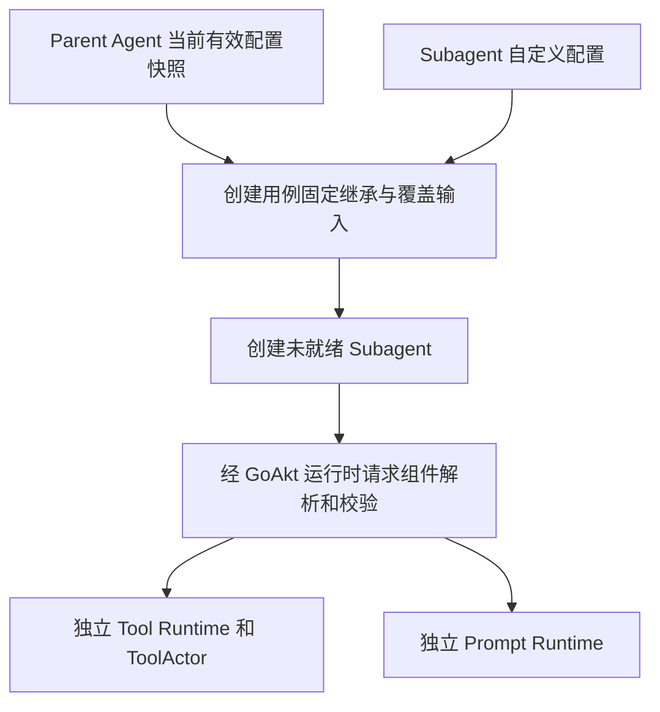

# Subagent 配置继承与 Scope 移除

> 初始化流程已按用户最新决定改为 Registry 配置合并和 AgentCreating 事件驱动，见[初始化方案](./10-runtime-and-initialization.md)。本文尚存的“Agent 主动读取并转交配置”表述不再作为实施依据，其余业务所有权与生命周期约束保留。

状态：创建时快照继承、自定义覆盖、运行隔离及父子生命周期不变已确认；字段级覆盖规则待确认。
入口见[方案总览](../actor-runtime-draft.md)，生命周期通则见[03](./03-migration-and-validation.md)。

## 1. 已确认模型

Subagent 创建时获取 parent Agent 的有效配置快照，应用自己的自定义覆盖，校验后形成独立配置。
继承只发生一次；parent 后续配置变化不会自动传播给已创建的 Subagent。
子 Agent 不通过 parent Scope、动态 parent view 或父 Runtime 查询链寻找配置。

创建用例固定一次性继承输入；子 AgentLoop 创建后经 GoAkt 运行时请求各组件解析所属配置，不提前注入完整配置或组件引用。
候选流程为：从 parent 获取一次一致的有效配置快照 → 固定覆盖输入并创建子 AgentLoop → 经 GoAkt 运行时请求组件应用覆盖及校验 →
完成 Agent/Session 绑定、各组件初始化与 Ready 确认。读取快照和 parent 更新并发时不能跨版本拼接字段；
取快照的接纳顺序及具体持久化方案仍需契约验证。

“有效配置”是 parent 已成功应用的配置，不包含仍在排队或失败的更新请求。
不复制 parent 的 AgentID、SessionID、actor 地址、活动调用、订阅、取消句柄或可变资源实例。
Subagent 获得自己的 SessionID，并以它作为自己的 AgentID；Session seed/历史选择仍由对应 Subagent 用例决定，
配置继承不等于复制 parent Session 历史。

## 2. 配置独立与生命周期关系分离

- parent ID 继续用于父子关系、结果回报和追踪；不用于运行期配置 fallback。
- parent 关闭仍按既有 child-first 规则先关闭子 Agent；不因配置独立而允许 Subagent 脱离生命周期管理。
- Agent Registry 继续协调父子 membership、创建与关闭竞争，不保留 parent 动态配置传播责任。
- 每个 child 自己完成任务结算、Runtime 关闭，再关闭对应 SessionActor；持久化历史保留。
- child 自身的工具变更走自己的业务更新屏障，不等待 parent 的普通配置更新，也不修改 parent 工具集合。
- child 可按自身显式定义引用订阅共享 Registry；这不等于订阅 parent 配置变化。继承的定义是否固定 revision，
  或允许跟随共享定义更新，需在配置引用规则中明确，不能借共享引用恢复隐式父配置传播。

恢复已有 Subagent 时不得无说明地再次读取 parent 最新配置，改变原先创建时的继承结果。
采用持久化有效配置还是可恢复版本引用仍是待决项；需要保存的 credential 仍是引用，不是密钥。

## 3. 配置覆盖规则的确认边界

“parent 快照 + child 显式覆盖 + 校验”已确认。以下是建议规则与待定细节，不自动变成已实现契约：

| 配置类型 | 建议规则 | 待明确 |
| --- | --- | --- |
| 标量 | 未设置沿用，显式值覆盖 | 零值、空字符串与显式清空的表达 |
| 工具集合 | 根据明确操作形成 child 独立集合 | 全量替换、按名称增补/删除的配置语法 |
| Prompt 条目 | 保留名称、顺序及可见范围，显式应用 child 覆盖 | 同名覆盖、删除与集合排序 |
| slice/map 等可变值 | 复制或保持不可变，禁止与 parent 共享可写对象 | 具体 typed config 的复制边界 |
| 权限 | 创建时验证不能越过授权上限，效果处继续检查 | 拒绝越权覆盖还是按明确规则收窄 |
| 凭证 | 继承适用的引用，由 credentials owner 解析 | 引用的可继承范围、失效与更新策略 |

不使用通用 map 深度合并替代 owner-defined 配置规则，不把全部业务配置无差别序列化进 Session。

## 4. 当前 Scope 职责的去向

当前 Scope 不只是配置继承机制。源码 [agent.Scope/ScopeEditor](../../agent/scope.go) 与
[ApplySetup/scopeDraft](../../agentloop/agent_scope_setup.go) 同时承担安装事务、校验和资源所有权。
以下是源码职责到新 owner 的设计映射，尚未执行代码删除：

| 当前职责与入口 | 目标 owner / 机制 | 必须保留 |
| --- | --- | --- |
| 配置/能力查找、ToolLayer/PromptLayer parent view | 固定一次性继承输入；创建后经 GoAkt 运行时请求所属组件解析配置 | 可见性、override 校验；取消运行期 parent 配置 fallback |
| AddPromptSection、AddPromptVariable、SuppressRuntimeContext、UsePromptAssembly | Prompt Registry 定义与本 Agent Prompt Runtime | 顺序、变量、suppressor、组装整体失败 |
| AddTool、AddToolRestriction、AddToolGuard、UseToolExecution | Tool Runtime、ToolActor 与共享 Tools Registry | 注册原子性、更新屏障、执行处权限与公共 policy pipeline |
| UsePreStep、UseRequest、UseRequestError | Agent 执行 owner 的显式策略/定向请求 | 返回值、短路、错误恢复和调用顺序；不能全部广播化 |
| ObserveAgentEvents、ObserveToolResults | 事实由所属 owner 发布，消费者管理 PubSub 订阅 | 区分事实通知与参与成功判定的行为；后者跨 actor 使用 Request + Then |
| ApplySetup、ApplyNestedSetup、Check、commit/rollback | 创建或能力更新事务及其具体 owner | 发布前校验、失败逆序回滚、只清理本次取得的资源 |
| Own、ScopeResources.Close、scopeRegistration.Close | 取得资源的 actor/Runtime | 幂等释放、精确注销、不影响 sibling 或共享资源 |
| agentScope.beginCall/Close | Agent/Runtime 的业务接纳、排空、取消与关闭协议 | 拒绝新业务、等待已接纳工作、关闭顺序 |

实现时还需枚举每个 Setup/observer 的实际消费者，证明上述目标能表达其用例，再删除旧入口。
不新建一个换名后的万能 Scope actor 承接整张表；状态与效果分别归明确 owner。
具体 capability 的字段、端口与 package 迁移在实现设计时确定，本轮不生成占位接口。

## 5. 验收与下一步

- parent 有效配置加 child 覆盖生成可预测结果；parent/child/sibling 的可变配置互不污染。
- parent 后续更新不改变 child 配置和实例；child 自身更新遵循自己的工具更新屏障。
- parent 关闭过程中不得发布新的 child；已有 child 保持原 child-first 关闭与结果结算。
- child 创建失败只清理自己取得的资源，parent 配置、注册和共享资源保持有效。
- child 恢复不隐式重新继承 parent 最新配置；权限和凭证范围通过明确校验。
- 逐项移除 Scope 后，启动回滚、订阅释放、策略短路与取消测试仍有对应证据。

现有五个 GoAkt 实验未覆盖这些规则。本轮只记录已确认方向与职责映射；覆盖细节和恢复规则见
[待决项 O10](./03-migration-and-validation.md#5-待决项)。
