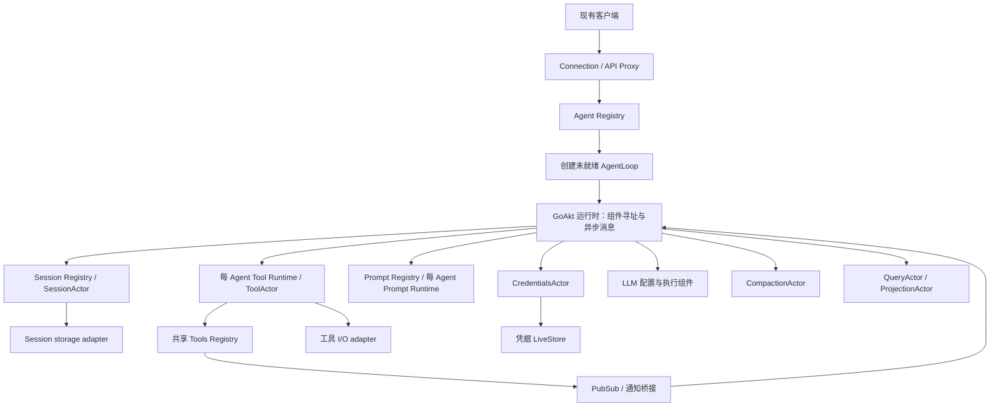
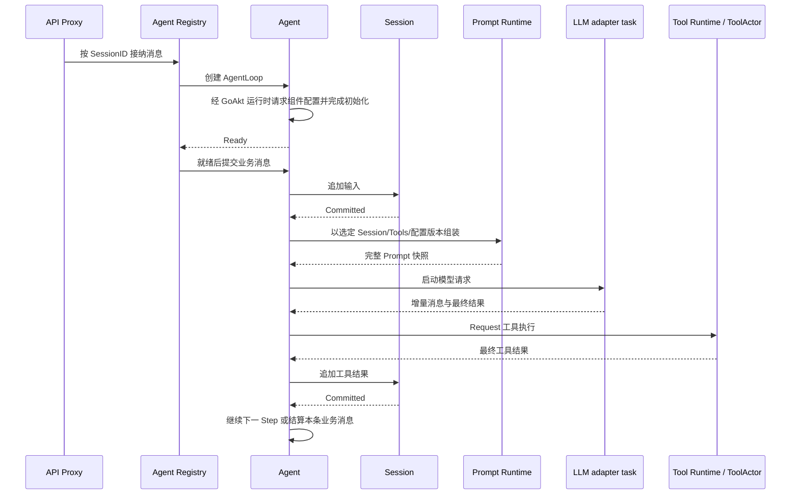

# 整体实现方案与运行架构

状态：实现提案，供整体评审；不代表新增机制全部已确认或已实现。业务所有权遵循[01](./01-ownership.md)，
运行证据以[实验记录](../../experiments/goakt/README.zh-CN.md)为准。日期：2026-09-07。

## 1. 实施目标与范围

将 Plugin/Scope 驱动的组合与运行路径迁为显式装配和异步 actor 协议。保持 Agent、Session、Tools、
Prompt、LLM 的业务所有权、现有客户端协议、日志可重建性和效果处权限检查。

本提案选用 GoAkt v4.5.3 standalone。按稳定逻辑身份寻址、其业务身份跨激活保持的 owner 使用 Grain；
普通 Actor 用于已验证的 TopicActor 和必要的通知适配。Grain 的选择依据是身份、状态与激活生命周期，
不是是否需要延迟回复。PipeTo 同样可以执行异步请求；请求方式单独选择，见[06](./06-messaging-and-tasks.md)。
Grain 是实现载体，不新增业务概念，不改变 AgentID = SessionID。
不启用 cluster、relocation、自动重放工具副作用。暂不维护 GoAkt fork，也不采用保存 ReceiveContext 的回复方式。

本组文档补充代码实现路线，不替代业务契约：

| 文档 | 负责的问题 |
| --- | --- |
| [10 Runtime 与初始化](./10-runtime-and-initialization.md) | 创建后请求配置、组件寻址、就绪与失败协议 |
| 本文 | 整体架构、载体选择、执行主线与实施边界 |
| [06 通信与异步任务](./06-messaging-and-tasks.md) | Request/Then、延迟回复、PipeToSelf、PubSub、错误与背压 |
| [07 生命周期与身份](./07-lifecycle-implementation.md) | 创建、初始化、关闭、最终停用确认、旧身份及重启 |
| [08 工具运行与更新](./08-tools-implementation.md) | 注册、执行、原子发布、退役、异常恢复、MCP |
| [09 模块与迁移](./09-module-implementation.md) | 包级职责、接口迁移、Prompt/Session/LLM、分阶段验收 |

## 2. 运行架构

箭头表示调用或通知方向，不表示 Go struct 循环包含或框架父子树。Grain 不自动形成业务监督树；
Agent Registry、Tool Runtime、Session Registry 分别负责自己的生命周期协议。
共享 Registry 保留一份权威目录，各 Agent 的 Tool/Prompt Runtime 和工具实例独立。Tools Registry 不转发工具执行。
GoAkt 运行时是组件寻址与消息入口，不是 Tool Runtime。AgentLoop 创建后通过它取得组件配置/版本，
不持有组件地址或实例；完整初始化时序见[10](./10-runtime-and-initialization.md)。

## 3. 运行载体与状态分配

| 模块 | 提议载体 | 权威状态与选择理由 |
| --- | --- | --- |
| GoAkt 运行时 | GoAkt 框架已有能力 | 身份、激活、消息与请求关联；不新建 Goren Runtime |
| Agent Registry | 长驻 Grain | 固定目录身份；业务 ID 占用、创建/关闭事务、父子关系 |
| Agent | Grain | 按 AgentID 寻址；接纳顺序、业务队列、Turn/Step、活动请求与结算 |
| Session Registry | 长驻 Grain | 固定目录身份；会话目录、实例代际、创建/恢复/关闭结果 |
| Session | Grain | 按 SessionID 寻址；append FIFO、commit/flush barrier、存储操作结算 |
| Tools Registry | 长驻 Grain | 固定目录身份；候选批次、有效目录、revision、注册实例代际 |
| Tool Runtime | 每 Agent 的 Grain | 按 AgentID 寻址；调用协调、执行预算、更新批次与实例退役 |
| ToolActor | 每 Agent、每工具 Grain | 按 AgentID/ToolName 寻址；活动 operation、取消、工具资源；保留 ToolActor 术语 |
| Prompt Registry / Runtime | 共享 / 每 Agent 的 Grain | 固定定义目录身份 / AgentID；定义目录与组装分别拥有状态 |
| LLM | 配置组件拥有模型/provider 规则，Agent 拥有本次请求状态 | AgentLoop 经 Runtime 请求配置；transport adapter 执行 I/O |
| Credentials | CredentialsActor | 凭据规则、更新顺序、版本及通知，LiveStore 只存储 |
| Compaction | CompactionActor | 按 Session 管任务、取消及压缩提交协调，Session 保留提交权 |
| Query | 有状态查询 owner 使用 QueryActor | 快照、游标、请求与取消；简单读取不新增转发 Actor |
| Projection | 按独立投影的 ProjectionActor | 消费进度、checkpoint、重建与追赶 |
| PubSub 接入 | 普通 Actor 桥接 + TopicActor | 复用已验证的订阅机制，避免假设 Grain 可直接作为 TopicActor subscriber |
| 启动与框架停用适配 | 具名普通 Go 对象、受管理任务 | 框架调用可能等待；任务只做调用、报告结果，不决定业务关闭顺序 |

稳定的是逻辑身份，不是永不变化的内存实例，也不是自动持久化状态。重新激活后的配置/状态恢复和
执行权校验由业务 owner 负责。Grain 以长驻方式配置。激活只建立消息处理所需的最小状态，业务资源在身份和配置初始化验证后获得。
自动再激活不能恢复执行权；具体门禁见[07](./07-lifecycle-implementation.md)。
配置、DTO、模板、纯策略、SDK transport 不机械包装成 Grain。所有具备状态的业务模块仍由具名 owner 管理。

## 4. 一条用户消息的完整主线

图中跨 owner 箭头是逻辑请求，组件寻址及投递经过GoAkt 运行时，不要求 AgentLoop 持有目标地址。请求均异步；业务等待用状态表达。LLM 流式输出采用关联 operation 的增量消息，
最终完成只结算一次；PipeToSelf 的一次完成消息不替代流式协议。
工具 schema 与 Prompt/Session 快照在一个模型请求期间固定。工具更新排在完整业务消息之间。

## 5. 实施前必须明确的接口变化

当前 [tools.ToolRuntime](../../tools/contract.go) 的同步 Execute、Plugin Service 嵌入以及
[Session LiveStore](../../session/live_store.go) 的同步生命周期接口不能直接成为 Grain 内部调用路径。
保留业务值与错误语义，内部调用迁为 owner 的命令/响应。外部 Go 扩展 API 的破坏性变更需要统一迁移调用者，
不在新路径外保留第二套 Plugin Runtime。外部 HTTP 请求可以由边界 adapter 等待业务响应，
它的等待不进入 Grain mailbox；客户端断开与业务取消仍按现有契约映射。

编号历史文档和 AGENTS.md 本轮不修改。进入生产实施前，先在独立变更中更新与新方向冲突的规范，
再按[09](./09-module-implementation.md)迁移；不是边写生产代码边决定所有权。
