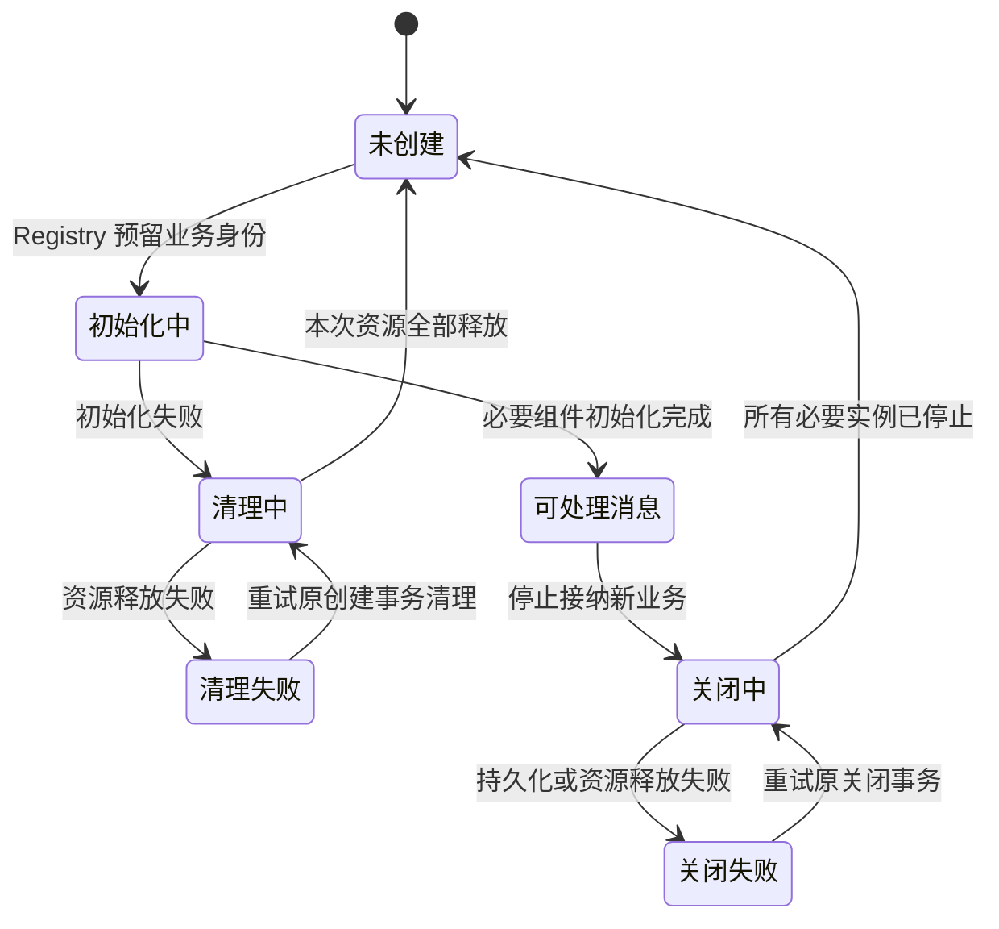
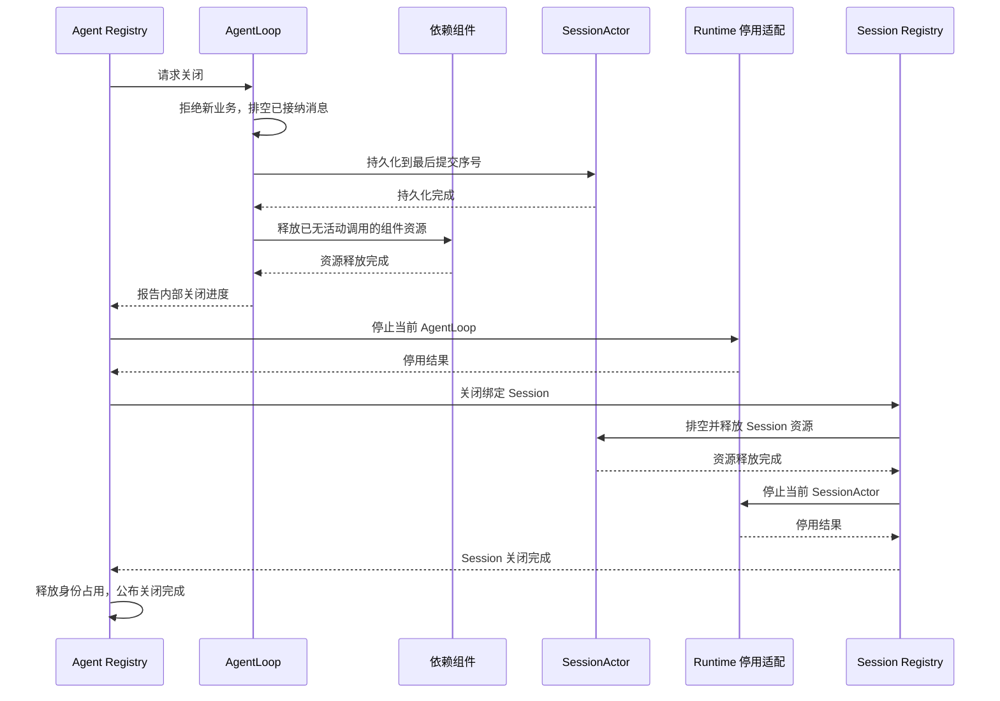

# 生命周期、身份与恢复实现

状态：目标方案已确定，生产实现及框架边界仍按验收项验证。
[Actor 定义](./11-actor-implementation.md) · [初始化](./10-runtime-and-initialization.md) · [框架适配](./06-messaging-and-tasks.md)。

## 1. 身份与执行权

Agent 是业务身份，AgentLoop 是唯一执行 owner，以 Grain 承载。AgentID = SessionID；AgentLoop 与
SessionActor 是不同 Grain 类型，同一业务 ID 不会合并两者。ToolActor 按 AgentID + ToolName 稳定寻址。

实例代次标识一次激活，配置版本标识有效配置变化。两者不改变 Grain 逻辑身份。Agent Registry 管 Agent
实例代次和创建/关闭事务，Session Registry 管 Session 实例，Tools Registry 管工具注册；不再建立另一份业务身份表。
GoAkt 运行时 只维护技术路由，不能自行授予业务执行权。

自动激活只建立最小消息处理状态；资源初始化需要所属创建事务授权。旧消息能触发一个物理 Grain，
但不能恢复已经关闭的业务、执行工具或安装旧配置。授权与实际资源获得均计入创建/排空过程，
不能只查询一次版本后继续在已关闭状态下获取资源。

## 2. 创建事务

1. Agent Registry 按 SessionID 查找、预留身份；同 ID 并发创建合并到原事务。
2. 创建未就绪 AgentLoop，提供业务身份、创建事务和 Runtime 入口，不提供完整组件配置或地址。
3. AgentLoop 经 Runtime 向组件读取/解析配置；此阶段不隐含创建 Session、工具或连接。
4. 配置成功后，AgentLoop 发起 Session 创建/恢复与必要组件初始化。Session Registry 执行 Session
创建，Agent Registry 不重复发起。组件按依赖顺序初始化，独立项可并行。
5. 必要项全部成功后 AgentLoop 报告可处理消息，Agent Registry 才移交排队用户消息。
6. 失败时由组件释放原创建事务取得的资源；Agent Registry 追踪结果，未清理完保持 ID 占用。

Subagent 固定 parent 有效配置快照与覆盖输入后走相同流程，父子关系保持。关闭期间新消息只在 Registry
有界等待区等待，不能进入旧 AgentLoop 或启动同 ID 的新执行 owner。

## 3. 正常业务关闭与最终停用

对外只有“关闭中、关闭失败、关闭完成”。请求关闭不等于关闭完成；调用方可以查询并重试原关闭事务。
内部的“已排空”只是进度，表示现有任务、结果提交及必要持久化均完成，不创建另一种公共关闭结果。

业务子 Agent 由 Agent Registry 按先子后父的顺序协调关闭；父 Agent 当前执行仍需使用子 Agent 时，
先排空该执行，再进入释放阶段。组件资源按依赖逆序释放，不能在前序消息仍需使用时提前关闭。

Runtime 在受管理任务中执行可能等待确认的框架停用操作，不阻塞 Actor 消息循环。
GrainIdentity 是稳定逻辑身份，不是指定激活实例的停止令牌；Registry 持有关闭占用、禁止新的授权初始化，
并核对实例代次后才能停止。具体 GoAkt 消息仅在[通信适配说明](./06-messaging-and-tasks.md#6-框架停用适配)中定义。

## 4. 失败与幂等

| 失败点 | 保留状态 | 重试规则 |
| --- | --- | --- |
| 初始化失败或清理失败 | 创建事务、资源列表、身份占用 | 只清理本次获得的资源，完成后才释放占用 |
| 提交结果未知 | 提交 ID、目标 Session、原业务阶段 | 查询原结果，不重新追加 |
| 持久化失败 | 已提交序号、关闭中状态 | 重试持久化，不重做用户消息，不删除历史 |
| AgentLoop 停用失败 | 当前实例代次、已完成步骤 | 不关闭其尚需使用的 Session，不允许同 ID 替代实例 |
| Session 关闭失败 | AgentLoop 已停止、Session 关闭进度 | 保持 ID 占用，继续重试 |
| 调用方超时 | 原创建/关闭事务 | 超时不撤销事务，查询原结果 |

重复请求关闭关联原事务，已经完成的资源释放不得重复产生副作用。最终关闭成功必须能说明 AgentLoop、
依赖资源及 Session 均已按顺序结束；不能靠框架任务返回就忽略业务失败。

## 5. 进程重启与实例失效

首期 Registry 状态丢失时先停止相关业务接纳，恢复身份和初始化授权后再开放。进程启动标识与实例代次
一起防止旧消息被新实例接受；恢复业务配置与 Session 事实，不恢复旧地址、回复句柄或活动 task。
未知工具副作用不得重放。凭据只恢复引用，subagent 恢复使用自己的创建配置依据，不使用 parent 当前配置替代。

## 6. 实施前验收

必须覆盖初始化关闭竞争、清理重试、同 ID 关闭/重建竞争、最终停用结果、旧初始化授权迟到、
Registry 故障隔离及父子关闭。现有实验的“业务已排空”结果不等于这一整套对外关闭完成协议已验证。
