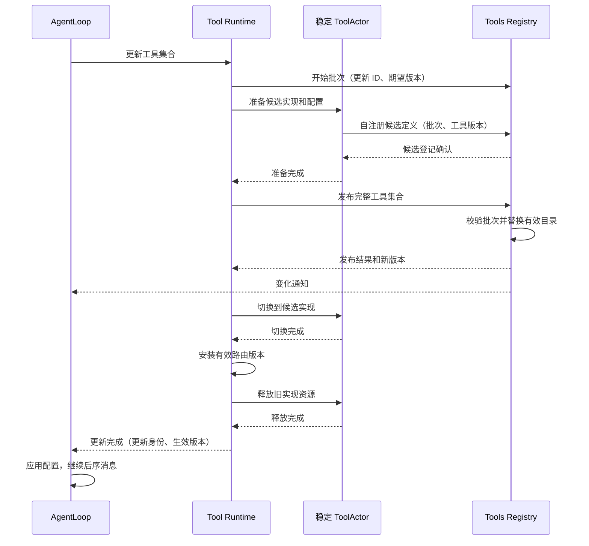

# 工具模块与原子更新实现

状态：本轮确定采用稳定 ToolActor 内切换实现；真实发布与资源释放仍待实现验证。
[Actor 定义](./11-actor-implementation.md#4-tools-registrytool-runtime-与-toolactor) · [通信](./06-messaging-and-tasks.md)。

## 1. 三个 owner 的实现边界

Tools Registry 管各 Agent 的定义目录、配置版本及更新批次；Tool Runtime 管调用、预算、路由和更新过程；
ToolActor 管一个稳定工具身份的实现资源和操作。三者不复制完整业务状态。
工具名称保持 canonical 名称，技术地址由 Runtime 管理，AgentLoop 只指定逻辑目标。

## 配置注册与事件消费

配置注册到 Tools Registry。Registry 分别记录请求应用的配置与已经发布的有效工具目录，两者不能混称“当前配置”。Tool Runtime 消费配置变化，Prompt Runtime 消费已发布定义的变化；AgentLoop 消费更新通知并决定业务屏障时机。

| 事实 | 消费者 | 可以据此执行的动作 |
| --- | --- | --- |
| 工具配置已登记 | 对应 Agent 的 Tool Runtime、AgentLoop | Runtime 取得待应用配置；AgentLoop 按接纳顺序安排更新；尚不能修改正在使用的实例 |
| 工具定义已发布 | 对应 Agent 的 Prompt Runtime、AgentLoop | Prompt 更新本地组装视图；Agent 得知发布进度，但不能解除屏障 |
| 工具更新已完成 | 原更新请求的 AgentLoop | 实例切换和旧资源释放完成，应用有效版本，继续业务消息 |

前两项是 Registry 发布的事件，最后一项是 Tool Runtime 对应用请求的业务回复。配置登记成功不等于实例已更新，事件投递成功不等于消费者已处理。

配置事件含 AgentID 和更新身份，重复事件不得产生第二个更新。AgentLoop 请求 Tool Runtime 应用时指定同一个更新身份，Runtime 只应用该次配置，不用后来收到的新配置替换它。事件可能晚于应用请求到达；此时 Runtime 异步向 Registry 读取该更新对应的配置，再执行相同流程，不等待一个可能丢失的事件，也不读取最新配置冒充指定更新。

待应用更新属于已有更新事务，不是第二套通用消息队列。Registry 保留原更新记录直到结算，以支持晚到读取与结果查询；后续配置更新不能抹掉已经接纳的更新。没有业务需求时不额外保存永久历史配置。

Tool Runtime 收到事件只接收配置，不立即准备或切换资源。只有 AgentLoop 在前序完整用户消息结束后发出应用请求，才进入下文的准备、发布、切换和释放流程。首次初始化没有前序用户消息，仍需完成工具实例和 Prompt 订阅基线后，Agent 才可接纳业务。

Prompt 的订阅初始化、版本追赶和组装约束见 [Prompt 模块](./17-prompt-module.md)。配置驱动实例，定义事件驱动 Prompt；Prompt 组装结果不反向决定工具实例的创建或销毁。

## 2. 执行协议

AgentLoop 经 GoAkt 运行时 向所属 Tool Runtime 请求执行。Tool Runtime 校验工具版本、权限和预算，
完成 pre-policy 后请求 ToolActor；ToolActor 使用 task 执行，完成消息回本 Actor 后回复。
Tool Runtime 完成 post-policy、schema 校验及结果处理，再回复 AgentLoop，由 AgentLoop 提交 Session。

每次调用独立取消 context 和业务 ID；取消始终定位原操作，不根据最新配置重新执行。
请求超时不释放仍在运行的任务预算，不重试未知副作用。效果处仍做文件、网络和进程权限校验。

## 3. 更新事务与唯一发布点

一个 ToolActor 对应 AgentID + ToolName，配置更新不创建同身份的第二个 Grain。
旧实现资源、候选实现资源是 ToolActor 内部的受管理资源，不是两代可同时执行的工具 Actor。
前序完整用户消息结束后，整个 Agent 工具调用进入更新屏障，新用户消息排队。

所有工具准备成功后才允许发布。候选实现禁止执行用户调用；ToolActor 在屏障期拒绝普通执行，
避免绕过 AgentLoop 的消息直接调用尚未完成更新的工具。发布后的配置版本须与执行请求匹配。

目录发布是 Tools Registry 内的一次原子状态替换。不同 Actor 的路由和实现切换不是同一内存事务，
由业务屏障覆盖整个发布、切换、释放过程。ToolsChanged 不能解除屏障。
新增工具才创建 ToolActor；删除工具发布撤销后释放资源并停止 ToolActor。替换仅清理旧实现资源，保留稳定 Actor。

## 4. 重试、退役与故障

| 失败点 | 处理方式 |
| --- | --- |
| 准备候选失败 | 清理候选资源及批次，旧实现继续可用；新增工具清理新建 Actor |
| 发布前失败 | 不修改有效目录/当前实现，清理完成后向 AgentLoop 返回失败 |
| 发布结果未知 | 按更新 ID 查询，不释放可能已发布的候选，不解除屏障 |
| 发布后部分工具未切换 | 保持屏障，按批次继续完成切换；不允许半套工具接收执行 |
| 旧实现释放失败 | 保持更新中并重试释放，不假称更新成功或回滚已发布目录 |
| 重复发布/切换/清理 | 按更新 ID 和配置版本返回原结果，不重复释放资源 |
| 旧注销/旧初始化消息 | 校验实例代次及配置版本，不能删除新定义或重新安装旧实现 |
| MCP 断连/工具死亡 | 立即标记不可调用并结算原调用；恢复发布仍遵守更新屏障 |

候选准备必须与当前实现隔离。若资源不能同时准备，例如独占的连接/进程约束，应在发布前明确拒绝该更新，
不能先破坏旧实现再宣称“发布前失败保留旧配置”。如何支持此类停机替换需作为单独能力设计。

正常更新不保留跨更新的旧代可执行快照；历史 schema/结果继续作为 Session 数据保留。
批次状态保留到 Tool Runtime 确认结算，确认前不得淘汰查询记录。进程丢失内存状态不代表可以自动重放副作用。

## 5. MCP 与扩展迁移

MCPConnectionActor 首期每 Agent/server 独立连接。ToolActor 使用它执行远端请求；工具发现结果交给
Tool Runtime 作为完整批次更新，不逐工具发布半套目录。现有协议适配继续复用。
MCP swap 冲突清空集合与普通准备失败保旧存在兼容差异，必须专门验收，不修改历史方案来掩盖它。

工具代码静态链接，typed config 由 Tools 组件解析；初始化和更新经 Runtime 请求。Scope 的 guard、
restriction、pre/post-policy 迁到明确执行阶段，资源回滚与释放保留。稳定 ToolActor 内的实现资源不是新 Plugin 系统。

## 6. 验收

验证稳定身份不创建第二个同名 Grain、准备不影响当前资源、多工具原子目录发布、部分切换失败、
清理重试、丢确认查询、删除工具与迟到消息、版本匹配、权限及取消隔离。
已有 A→更新→B 实验只证明业务屏障，未证明本版稳定 ToolActor 内切换方案已经实现。

## 已有执行配置的覆盖实现

当前 `tools.Config` 仅包含 `mode` 与 `maxParallelSubCalls`，不包含工具实例清单或各工具参数。先实现这部分纯业务规则：Registry 将全局输入经 ValidateConfig 验证为不可变 ValidatedConfig，再调用 `ValidatedConfig.WithOverrides(Config)` 生成 Agent 配置。该方法仅合并本对象两个已存在的字段并沿用验证，不创建资源、不订阅事件、不保存 Agent 状态。

未指定的指针字段继承默认值；显式值覆盖后重新校验。零并发、未支持模式明确失败，不退回默认。结果保存字段值而非调用方指针；修改原输入不能改变已解析配置。零值 ValidatedConfig 不是有效的全局默认，不应靠覆盖把未初始化基线变成成功。

该接口上游为未来 Tools Registry 的配置应用逻辑，下游为现有接受 ValidatedConfig 的 Tool Runtime 构造。当前新增纯规则不等于 Registry 已支持 Agent 配置注册。工具启停、实例类型和具名工具参数须在真实工具配置设计中实现，禁止把 ToolDefinition 中的执行器对象当作可注册配置。

## 定义输出契约与 Prompt 解耦

现有 tools.Registry 的 promptTools、ToolLayer.ResolveTools 及 Service.Apply/NewLayer 将 Tools 反向注册到 Prompt；关闭还需要注销 Prompt 句柄。这使定义权与消费方向倒置。删除该注册、注销和回调接口，Tools 的构造及局部层创建不接收 PromptRegistry。

Tools 定义 `Definitions` 值，包含可见 `Schemas` 和限制前 `KnownNames`。Registry 从同一有效视图生成完整值并复制 schema 参数；ToolLayer.CaptureDefinitions 只提供定义读取，不携带执行器、Prompt 类型或框架身份。Prompt 事件适配后续负责将生产者值转换为自己的 ToolDefinitions，AgentLoop 不代传 schema。保留 KnownNames 是为了延续 toolOrder 对已知但不可见名称的校验语义，不向模型额外暴露工具。

本步只移除已确认错误的依赖方向，尚未实现 Registry 的 AgentID/版本事件发布和 ToolActor 注册批次；旧 Plugin 生命周期及父层依赖仍待整体迁移，不能将当前读取方法称为新 Registry 已完成。外部工具名称、schema 和错误语义保持原有实现。
