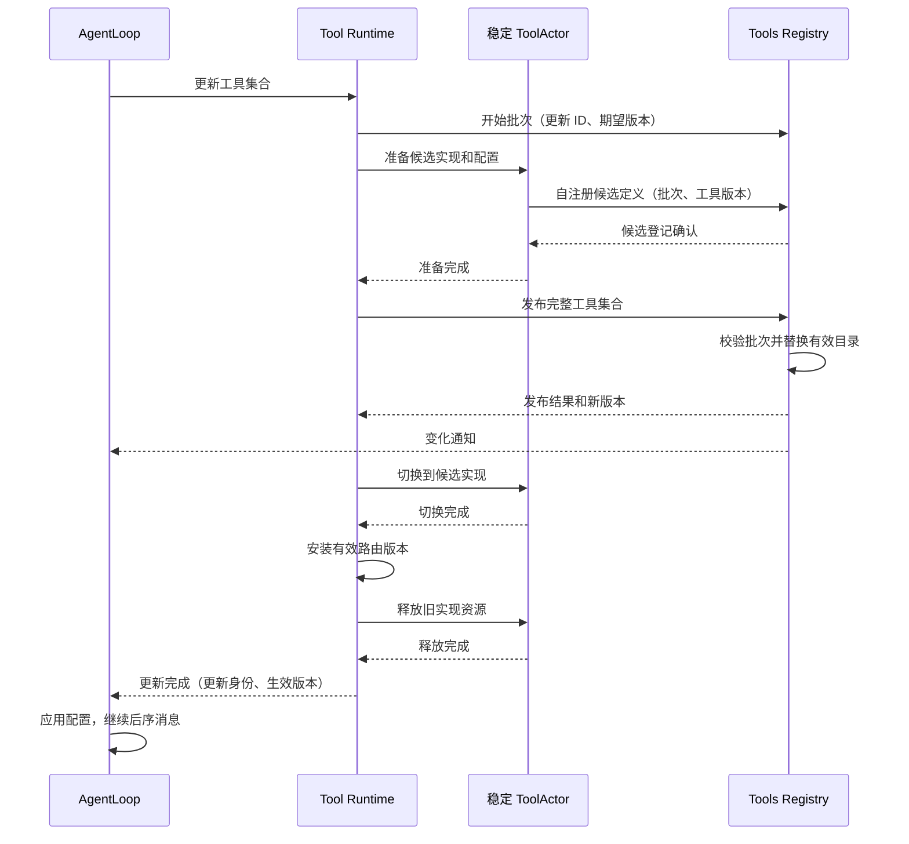

# 工具模块与原子更新实现

状态：本轮确定采用稳定 ToolActor 内切换实现；真实发布与资源释放仍待实现验证。
[Actor 定义](./11-actor-implementation.md#4-tools-registrytool-runtime-与-toolactor) · [通信](./06-messaging-and-tasks.md)。

## 1. 三个 owner 的实现边界

Tools Registry 管各 Agent 的定义目录、配置版本及更新批次；Tool Runtime 管调用、预算、路由和更新过程；
ToolActor 管一个稳定工具身份的实现资源和操作。三者不复制完整业务状态。

本文的 Tools Registry 是配置与定义目录 owner，不是生命周期 owner。Actor 的启动与停止由 Agent Registry 的生命周期编排负责；Tools Registry 不因为名字含 Registry 就承担这些职责。Tool Runtime 决定更新步骤，ToolActor 执行具体实现的准备、切换和资源释放，生命周期请求明确指向 Agent Registry。
工具名称保持 canonical 名称，技术地址由 Runtime 管理，AgentLoop 只指定逻辑目标。

## 配置注册与事件消费

### 配置登记业务接口

Registry Grain 使用 InitializeDefaults、RegisterConfiguration、ReadConfiguration 三个具名消息适配下列业务方法。RegisterConfiguration 回复 Configuration，Found=true 表示登记已完成，Err 可单独报告配置事件投递失败；调用方不得将通知失败视为配置未登记。配置事件在 tools/configuration topic 只携带 AgentID 与更新 ID，不广播 Provider。ReadConfiguration 精确查询已登记快照，不负责重发事件或执行工具。Actor 只执行短业务方法和事件投递，不在邮箱内调用 Provider.Open。

Registry.InitializeDefaults 接收启动时的全局工具配置，只允许初始化一次；未初始化时 Configure 必须失败，不能用未知配置冒充空工具集合。配置条目 Tool 包含 canonical Name、绑定具名配置和借用能力的 tool.Provider、Visible。Provider 是不可变构造描述，Registry 不调用 Open，也不持有构造出的实现或资源。各工具内部字段的默认值由对应 Provider 构造时验证。

Configure 接收唯一更新 ID、AgentID、期望目录版本和完整 Agent 覆盖条目，按名称替换全局同名条目，新增条目追加到末尾。覆盖以完整工具配置为单位，保留默认名称顺序。结果作为 Configuration 固定到同一个 batch，不新增候选配置队列；返回 ConfigurationRegistered 身份供 Actor 发布。Runtime 的 ReadConfiguration 按更新 ID 读取快照，不能用后来配置替代该次输入。此阶段只声明候选名称，实例构造仍由 Runtime 在 Agent 更新屏障内启动，定义发布仍要求全部 Register 完成。

Configure 拒绝重复更新 ID；回复不确定时读取该 ID 的配置，不能比较任意 Provider 实现或用相同 ID 覆盖构造参数。失败校验不创建批次。Abort/Settle 同时释放该批次配置引用；Provider 的资源释放不归 Registry。返回的切片全部复制，Provider 接口值作为只读构造能力借用，不允许回指 Registry/Runtime owner。

候选登记必须满足已登记配置的工具名称与可见性，不能用自注册消息重新决定模型可见性。ConfigurationRegistered 是配置登记完成的业务事实；RegisterConfiguration 是登记请求，两者不使用模糊的 Configure 或 Changed 消息名混称，也不通过叠加 Runtime、Snapshot 等实现细节延长名称。

验收包括未初始化拒绝、全局继承和 Agent 覆盖、名称顺序、同 Agent 未结算更新拒绝、重复 ID 拒绝与精确查询、非法配置不占用更新、输入输出副本隔离、目录发布前 Prompt 基线不可见、结算释放配置引用。动态全局配置变更的逐 Agent 更新发起、生产配置注册入口与事件订阅接线仍待实现；InitializeDefaults 不提供热更新替代路径。

配置注册到 Tools Registry。Registry 分别记录请求应用的配置与已经发布的有效工具目录，两者不能混称“当前配置”。Tool Runtime 消费配置变化，Prompt Runtime 消费已发布定义的变化；AgentLoop 消费更新通知并决定业务屏障时机。

| 事实 | 消费者 | 可以据此执行的动作 |
| --- | --- | --- |
| 工具配置已登记 | 对应 Agent 的 Tool Runtime、AgentLoop | Runtime 取得待应用配置；AgentLoop 按接纳顺序安排更新；尚不能修改正在使用的实例 |
| 工具定义已发布 | 对应 Agent 的 Prompt Runtime、AgentLoop | Prompt 更新本地组装视图；Agent 得知发布进度，但不能解除屏障 |
| 工具更新已完成 | 原更新请求的 AgentLoop | 实例切换和旧资源释放完成，应用有效版本，继续业务消息 |

前两项是 Registry 发布的事件，最后一项是 Tool Runtime 对应用请求的业务回复。配置登记成功不等于实例已更新，事件投递成功不等于消费者已处理。

配置事件含 AgentID 和更新身份，重复事件不得产生第二个更新。AgentLoop 请求 Tool Runtime 应用时指定同一个更新身份，Runtime 只应用该次配置，不用后来收到的新配置替换它。事件可能晚于应用请求到达；此时 Runtime 异步向 Registry 读取该更新对应的配置，再执行相同流程，不等待一个可能丢失的事件，也不读取最新配置冒充指定更新。

待应用更新属于已有更新事务，不是第二套通用消息队列。Registry 保留原更新记录直到结算，以支持晚到读取与结果查询；后续配置更新不能抹掉已经接纳的更新。没有业务需求时不额外保存永久历史配置。

Tool Runtime 收到事件只接收配置，不立即准备或切换资源。只有 AgentLoop 在前序完整用户消息结束后发出应用请求，才进入下文的准备、发布、切换和释放流程。首次初始化没有前序用户消息，仍需完成工具实例和 Prompt 订阅基线后，Agent 才可接纳业务。

Prompt 的订阅初始化、版本追赶和组装约束见 [Prompt 模块](./17-prompt-module.md)。配置驱动实例，定义事件驱动 Prompt；Prompt 组装结果不反向决定工具实例的创建或销毁。

## 2. 执行协议

### ToolActor 准备与登记边界

配置构造消息命名为 Provision，以区别 executionRuntime.Prepare 的单次调用准备。后者执行 pre-policy 和 guard，必要时返回审批需求；Dispatch 包含执行中间件、参数验证与工具体调用，随后执行结果处理和 post-policy。这些业务流程不进入配置构造消息处理器。

`tools/tool/actor.Grain` 由生命周期 owner 创建，Initialize 绑定 CreationID、AgentID、工具名称和共享 Registry 地址，不创建其他 Actor。Provision 接收 Revision、具名 Provider、可见性和本进程取消 context，通过 PipeToSelf 调度 Tool.Provision；业务对象在任务完成前由该任务独占，邮箱不读取或修改它。完成消息回到邮箱后，Grain 调用 Tool.Schema，再通过 RequestGrain 发送 RegisterDefinition，得到登记确认才回复 Completion。

Initialize 的重复请求以五项绑定内容为准：相同 CreationID、AgentID、工具名称、Registry 身份和 Authority 身份返回原绑定确认，不重新创建业务对象；任一不一致均拒绝。确认仅说明绑定相同，不承诺工具已配置或可执行，也不使已关闭资源恢复。Tool.Name 只返回不可变工具名称，用于绑定校验，不能读取或修改候选与当前实现。此幂等契约处理初始化回复丢失，不替代生命周期 owner 的旧身份准入检查。

准备或登记尚在进行时，重复准备请求返回明确的调度忙错误，不创建第二个任务。登记回复丢失后可重试同一 Revision：读取已经准备的候选并重新 RegisterDefinition，不重新 Open。更新 ID 定义同一份配置，调用方不得用相同 Revision 代表另一份 Provider 配置。登记失败保留候选，调用方决定重试登记或在确认未发布后 Abort。CreationID 不匹配的请求不能接触业务对象。

Commit 是短业务操作；Abort、Retire、Close 可能执行资源 I/O，均在独占框架任务中调用业务方法，任务结束后才返回最终结果。关闭必须在工具调用排空后由生命周期 owner 发起；停掉 Grain 不等同于成功关闭业务资源。首个实现切片验证真实 Grain → Registry 注册，以及构造一次、重复登记、错误和取消后的清理；工具调用消息与全局生命周期接线继续单独验证。

### 工具体调用的数据边界

ToolActor 的 Execute 接收 CreationID、目录版本、Invocation 和本进程 context，返回 BodyResult。Actor 只校验创建／Session 路由、调用 ID 及任务占用；Tool.Execute 校验工具名称、有效版本和候选切换屏障，再复用 Invocation.Run 执行工具体。它不重复 pre-policy、审批、执行中间件或输出规范化。调用方 Tool Runtime 完成这些前后阶段，不能直接用 Actor 回复作为最终工具结果提交 Session。

工具体任务可并行，是否允许并行由 Runtime 已有执行策略决定。Actor 的 calls 表只关联在途调用 ID、取消句柄和原回复，不是业务队列或执行历史。任何调用尚未返回时拒绝配置构造、切换及资源清理，防止释放仍被工具体使用的资源。CancelCall 只投递该调用的取消意图，原 Execute 必须等工具体退出后才返回结果。超时不自动重试工具副作用；已结束调用 ID 的持久化幂等不由该表承诺。

Tool Runtime 的 Actor 层使用 `tools/tool/actor.Client`，绑定现有 ToolActor 身份、CreationID 和目录版本，不创建 Actor。Execute 使用 RequestGrain 并关闭请求等待计时器，取消通过工具体 context 或单独 CancelCall 传播，不能用调用方等待超时冒充工具体退出。客户端不保存调用方 Actor 或回调。PipeToSelf 等待一个有缓冲的内部结果通道；Then 只写入该通道，框架任务把具名完成消息送回邮箱，Receive 使用本轮传入的窄接口消费结果。不能在 Then 中同步 TellGrain 给自己，该方法会等待当前邮箱处理完成而超时。调用方在停用时 Dispose，终止等待回复的任务；Dispose 不证明远端工具体已经结束。客户端不做业务重试。

CallResult.Body 是已收到的工具体结果，其中 error 表示工具业务失败；CallResult.Err 是请求失败或无效回复，不能证明工具体已经退出。强制停 Grain 时，在途 Execute 用框架错误回复，不包装成 BodyResult，以保留该区别。Cancellation 只表示取消消息处理结果，不能释放原调用的资源预算。

现有 ToolExecution 含 scheduledExecutionState，后者反向引用 executionRuntime、pipeline 和注册项，不能跨 ToolActor 发送。新增 Invocation 作为工具体输入，只包含调用 ID、根调用 ID、工具名、SessionID 和独立参数副本；不携带调度状态。ToolRunContext.Execution 改为 Invocation，工具体仍能读取其业务身份。Invocation 已移除 Parent／Token；Runtime 的结果归属校验仍使用内部 ToolExecutionToken，不把进程内指针身份放入工具体消息。暂缓的 Subagent 结构化输出调用方以后按具名调用身份迁移，本轮不保留兼容字段。

Invocation.Run 负责调用现有 Executor 和收集工具体产生的上下文／结束 turn 意图，返回 BodyResult（原始 JSON 值、error、追加上下文、结束 turn 标记）。收集器只属于这次工具体调用，返回后关闭，晚到写入不再改变结果。Tool Runtime 在执行仍处于分派阶段时采纳 BodyResult 的效果，继续原有标准化、后置策略及 Session 提交流程。跨 Actor 的请求和回复使用 Invocation／BodyResult，而不是 ToolRunContext 或 ToolExecution。

此修改不改变模型工具 schema、工具名称、Session 事件和附加上下文的提交顺序；暂缓的 Subagent 调用方以后迁移到该输入。验收沿用 Tools 执行和审批测试，增加独立调用的上下文隔离与晚到写入拒绝测试。此步骤只完成业务交互边界，尚不能宣称 INT-23 的生命周期缺失已修复。

AgentLoop 经 GoAkt 运行时 向所属 Tool Runtime 请求执行。Tool Runtime 校验工具版本、权限和预算，
完成 pre-policy 后请求 ToolActor；ToolActor 使用 task 执行，完成消息回本 Actor 后回复。
Tool Runtime 完成 post-policy、schema 校验及结果处理，再回复 AgentLoop，由 AgentLoop 提交 Session。

每次调用独立取消 context 和业务 ID；取消始终定位原操作，不根据最新配置重新执行。
请求超时不释放仍在运行的任务预算，不重试未知副作用。效果处仍做文件、网络和进程权限校验。

## 3. 更新事务与唯一发布点

### 单工具业务对象

`tools/tool.Tool` 是稳定工具身份的纯业务对象，不导入 GoAkt。它保存工具名称、当前实现、待应用候选及待释放旧实现。`Revision` 使用唯一更新 ID 和目标目录版本，防止旧更新消息操作后来的候选；`Implementation` 包含工具定义及可选的 `Resource.Close(context.Context) error`。无独占资源的静态工具无需空 Close 实现。Resource 只负责释放该实现独占的资源，不关闭其借用的 Session、UserQuestions 等共享能力。

接口为 Prepare、Schema、Commit、Retire、Abort、Close 和 Definition。Prepare 接收已构造实现，验证并复制定义后才接管资源；失败时资源仍由提供方清理。Schema 按 Revision 返回候选的模型 schema 副本，用于候选自注册，不暴露 Executor、Resource 或输出呈现接口；不存在、已开始撤销或不匹配的候选返回错误。Commit 仅切换引用，不执行 I/O；Retire/Abort/Close 通过 Resource 释放资源，失败保留对应实现以便重试。相同更新的 Commit/Retire 重试不重复切换或释放；已结算版本不能被重新 Prepare。重复 Prepare 明确拒绝，避免把新构造资源误当作已接管资源。Definition 在候选存在或旧资源未释放时拒绝读取执行定义。

上游 Runtime 负责完整调用排空与目录发布屏障，ToolActor 负责先等待工具任务结束，再串行调度业务方法；不得在业务方法返回前处理另一个修改请求，也不得让后台任务直接修改 Tool 字段。Tool 不保存 PID、GrainContext、框架取消函数或等待回复列表，不自建任务队列。目录事务 ID 转入 Revision.ID，版本必须与执行请求一致；只有 Registry 确认发布后才调用 Commit。单工具对象不能独立证明整个目录已发布。

撤销一旦开始，即使 Close 返回错误也不允许提交候选，因为资源可能已经部分释放。候选记录 discardRequested，仅用于表达不可逆的业务撤销决定，不表示 Actor 正在执行任务。取消同样保留候选与该决定，随后继续 Abort 或 Close。

异步准备使用 `Provider.Open(context.Context) (Implementation, error)`，Provider 是已经绑定工具类型、具名配置及借用能力的构造对象，不是可执行配置或 Plugin。构造对象必须可重复调用，每次返回独立资源；不得持有 Tool、Tool Runtime 或其等待请求。若返回 error 的同时存在需要清理的资源，也必须通过 Implementation.Resource 返回。`Tool.Provision` 先验证更新准入，再调用 Provider；成功后与 Prepare 共用内部定义校验及接管方法，不重复检查更新准入。构造、定义校验或取消失败时，业务层清理新资源；清理失败则保存不可提交的候选供 Abort/Close 重试。失败后的清理不沿用已经取消的准备 context，以免直接跳过资源释放；Resource 必须使 Close 有界结束。此接口只解决构造与资源接管，不代替 Registry 中的全局／Agent 配置合并。

验收直接调用纯业务对象，验证准备不破坏当前实现、切换后旧资源释放失败可重试、候选撤销、过期更新拒绝、定义字节隔离和关闭失败重试。真实 Actor 自注册、任务排空和生产初始化需在后续集成验收，不能由这些业务测试代替。

一个 ToolActor 对应 AgentID + ToolName，配置更新不创建同身份的第二个 Grain。
旧实现资源、候选实现资源是 ToolActor 内部的受管理资源，不是两代可同时执行的工具 Actor。
前序完整用户消息结束后，整个 Agent 工具调用进入更新屏障，新用户消息排队。

所有工具准备成功后才允许发布。候选实现禁止执行用户调用；ToolActor 在屏障期拒绝普通执行，
避免绕过 AgentLoop 的消息直接调用尚未完成更新的工具。发布后的配置版本须与执行请求匹配。

目录发布是 Tools Registry 内的一次原子状态替换。不同 Actor 的路由和实现切换不是同一内存事务，
由业务屏障覆盖整个发布、切换、释放过程。ToolsChanged 不能解除屏障。
新增工具才创建 ToolActor；删除工具发布撤销后释放资源并停止 ToolActor。替换仅清理旧实现资源，保留稳定 Actor。

## 4. 重试、退役与故障

### Runtime 更新业务对象

`tools/runtime.Update` 拥有一次更新的业务进度，不拥有框架地址、任务、邮箱或工具资源。输入为 Registry 的精确 Configuration 与旧工具名称；输出为 Apply 的完成标记与 error。完成标记只在成功结算或发布前回滚清理结束时为 true，清理失败或发布结果未知保持 false，调用方不能解除更新屏障。重复 Apply 从未完成阶段续接，不重新执行已确认步骤。

阶段只保留影响后续业务规则的准备、发布、发布确认、切换、退役、实例移除、候选撤销和完成。成功路径与回滚路径共用实例移除阶段；Settle/Abort 是清理末尾的目录操作，不再各自定义阶段。移除游标结束后，目录操作失败只重试该操作，不重新释放资源。

Catalog 是 Runtime 消费的发布、查询、撤销及结算接口；Instances 是准备、切换、退役、候选撤销和实例移除接口。Instances.Prepare 包含 ToolActor 构造与自注册确认；Remove 必须通过生命周期 owner 关闭资源并移除实例，Runtime 不创建或停止 Actor。各方法由框架适配层完成实际请求；业务对象不引用 GoAkt。Apply 可以等待端口结果，因此必须在框架任务中执行，不能直接在 Receive 中运行；端口错误不等于资源已释放，重试操作必须幂等。

目录端口由 tools/runtime/actor.Catalog 实现，绑定共享 Registry Grain、ActorSystem 和正请求超时，不创建 Actor。它仅供 Apply 所在的框架任务调用，用 AskGrain 等待短 Registry 操作；Actor 邮箱中不得直接调用这些阻塞方法。Publish 将 Catalog 的定义与通知错误原样映射，Update 按更新 ID 查询提交结果；Lookup 保留未找到与已知未发布的区别。ReadConfiguration 同样只取指定 ID，缺失返回业务错误。传输错误、错误类型回复及 Registry 业务错误均向调用方返回，不使用静默空值或备用本地目录。

业务顺序固定为全部准备、发布、全部切换、旧实现退役、移除删除工具、目录结算。发布请求失败必须查询该更新：已发布则继续切换，确认未发布才回滚，未知或查询失败保持屏障。准备失败要撤销包含失败工具在内的已尝试候选，并移除该批次新增实例，最后撤销 Registry 批次；旧实例不被移除。发布后的取消不能回滚目录，继续完成切换和资源清理；发布前取消走回滚。清理与发布后收尾使用不继承请求取消的 context，端口必须有界返回。

验收覆盖多工具顺序、删除与新增、准备失败后的清理、发布回复丢失但实际已提交、查询失败保留状态、部分切换/释放失败续接、不重复成功资源操作和两侧取消。此对象只落实更新业务；执行 policy/中间件、Actor 端口与生产生命周期仍须继续接通。

| 失败点 | 处理方式 |
| --- | --- |
| 准备候选失败 | 清理候选资源及批次，旧实现继续可用；新增工具清理新建 Actor |
| 发布前失败 | 不修改有效目录/当前实现，清理完成后向 AgentLoop 返回失败 |
| 发布结果未知 | 按更新 ID 查询，不释放可能已发布的候选，不解除屏障 |
| 发布后部分工具未切换 | 保持屏障，按批次继续完成切换；不允许半套工具接收执行 |
| 旧实现释放失败 | 保持更新中并重试释放，不假称更新成功或回滚已发布目录 |
| 重复发布/切换/清理 | 按更新 ID 和配置版本返回原结果，不重复释放资源 |
| 旧注销/旧初始化消息 | 校验实例代次及配置版本，不能删除新定义或重新安装旧实现 |
| MCP 断连/工具死亡 | 立即标记不可调用并结算原调用；恢复发布仍遵守更新屏障 |

候选准备必须与当前实现隔离。若资源不能同时准备，例如独占的连接/进程约束，应在发布前明确拒绝该更新，
不能先破坏旧实现再宣称“发布前失败保留旧配置”。如何支持此类停机替换需作为单独能力设计。

正常更新不保留跨更新的旧代可执行快照；历史 schema/结果继续作为 Session 数据保留。
批次状态保留到 Tool Runtime 确认结算，确认前不得淘汰查询记录。进程丢失内存状态不代表可以自动重放副作用。

## 5. MCP 与扩展迁移

MCPConnectionActor 首期每 Agent/server 独立连接。ToolActor 使用它执行远端请求；工具发现结果交给
Tool Runtime 作为完整批次更新，不逐工具发布半套目录。现有协议适配继续复用。
MCP swap 冲突清空集合与普通准备失败保旧存在兼容差异，必须专门验收，不修改历史方案来掩盖它。

工具代码静态链接，typed config 由 Tools 组件解析；初始化和更新经 Runtime 请求。Scope 的 guard、
restriction、pre/post-policy 迁到明确执行阶段，资源回滚与释放保留。稳定 ToolActor 内的实现资源不是新 Plugin 系统。

## 6. 验收

验证稳定身份不创建第二个同名 Grain、准备不影响当前资源、多工具原子目录发布、部分切换失败、
清理重试、丢确认查询、删除工具与迟到消息、版本匹配、权限及取消隔离。
已有 A→更新→B 实验只证明业务屏障，未证明本版稳定 ToolActor 内切换方案已经实现。

## 已有执行配置的覆盖实现

当前 `tools.Config` 仅包含 `mode` 与 `maxParallelSubCalls`，不包含工具实例清单或各工具参数。先实现这部分纯业务规则：Registry 将全局输入经 ValidateConfig 验证为不可变 ValidatedConfig，再调用 `ValidatedConfig.WithOverrides(Config)` 生成 Agent 配置。该方法仅合并本对象两个已存在的字段并沿用验证，不创建资源、不订阅事件、不保存 Agent 状态。

未指定的指针字段继承默认值；显式值覆盖后重新校验。零并发、未支持模式明确失败，不退回默认。结果保存字段值而非调用方指针；修改原输入不能改变已解析配置。零值 ValidatedConfig 不是有效的全局默认，不应靠覆盖把未初始化基线变成成功。

该接口上游为未来 Tools Registry 的配置应用逻辑，下游为现有接受 ValidatedConfig 的 Tool Runtime 构造。当前新增纯规则不等于 Registry 已支持 Agent 配置注册。工具启停、实例类型和具名工具参数须在真实工具配置设计中实现，禁止把 ToolDefinition 中的执行器对象当作可注册配置。

## 定义输出契约与 Prompt 解耦

现有 toolregistry.Registry 的 promptTools、ToolLayer.ResolveTools 及 Service.Apply/NewLayer 将 Tools 反向注册到 Prompt；关闭还需要注销 Prompt 句柄。这使定义权与消费方向倒置。删除该注册、注销和回调接口，Tools 的构造及局部层创建不接收 PromptRegistry。

Tools 定义 `Definitions` 值，包含可见 `Schemas` 和限制前 `KnownNames`。Registry 从同一有效视图生成完整值并复制 schema 参数；ToolLayer.CaptureDefinitions 只提供定义读取，不携带执行器、Prompt 类型或框架身份。Prompt 事件适配后续负责将生产者值转换为自己的 ToolDefinitions，AgentLoop 不代传 schema。保留 KnownNames 是为了延续 toolOrder 对已知但不可见名称的校验语义，不向模型额外暴露工具。

本步只移除已确认错误的依赖方向，尚未实现 Registry 的 AgentID/版本事件发布和 ToolActor 注册批次；旧 Plugin 生命周期及父层依赖仍待整体迁移，不能将当前读取方法称为新 Registry 已完成。外部工具名称、schema 和错误语义保持原有实现。

## Registry 读取状态的迁移前置清理

现有 toolStore 持有 snapshotValue，而快照的 source 又指回该 store，构成对象循环；Registry 还为动态父链维护 source/revision 缓存及第二把读取锁。目标目录不应携带可变存储 owner，也不动态追踪父 Agent。

本步保留已存在的注册与执行接口，先以 setBase 接收创建方捕获的层快照，Registry 只保存 base 值；移除快照 source/revision、缓存及 viewMutex，读取直接解析捕获基线与当前本地层。父层增删不改变已创建子层，子层覆盖和 restriction 的原有解析规则保持。不会新增第二套 Registry 或兼容 Prompt 注册。

上游创建方负责在子 Agent 创建时提供最终配置。当前旧定义快照仍含执行器接口，不能冒充最终可跨 Actor 传输的工具配置；后续 ToolActor 应从独立配置创建实例。toolStore 内锁暂由尚未迁移的并发调用路径需要，不因去掉视图缓存而提前删除。

测试迁移删除 Prompt Plugin 装配，只检查 Tools 自有 CaptureDefinitions 输出、覆盖、restriction 和 schema 复制；Prompt 如何消费该输出由其 Actor 测试负责。新增创建后父层变化不改变捕获视图的业务验证。该步骤不证明目录版本、批次原子发布或初始化查询已经实现。

## Tools 业务执行装配与 Plugin 删除

当前有两条循环：Service 嵌入 ToolLayer，ToolLayer.effects 指回 Service；ToolLayer.runtime 的执行阶段也通过 effects 指回 ToolLayer。删除只有转发职责的 Service，装配改为单向持有：ToolLayer → executionRuntime → pipeline，ToolLayer 同时持有同一个 pipeline。pipeline 只持有明确的策略和通知依赖，不持有 Service、ToolLayer、Registry 或 Runtime。

`Options` 是创建时依赖输入：Before/After 为具名执行前后策略，Execution 为已有工具执行中间件，Results 为结果观察器，Changes 为目录变更观察器，Approvals 为审批能力。没有配置前后策略时分别使用 Allow/Accept；没有通知观察器表示无人订阅，不建立隐藏的 Plugin 通道。主体调用的 schema 校验、取消、审批拒绝、结果规范化及 guard 均保留，策略不能绕过效果处权限校验。

New 接收 ValidatedConfig 和 Options，返回已构造的纯 ToolLayer 与 error。ToolLayer.NewLayer 捕获当前基线并创建独立 pipeline；不存在 Service 包装、Apply、Dispose、Manifest、NewOverlay 或 Factory。调用方通过 Close 关闭业务对象，框架适配在后续迁移中拥有 Actor 生命周期。旧调用方直接改用新构造契约，不提供 Plugin 桥接。

pipeline 拥有本层观察器和执行中间件注册集合；ToolLayer 的 ObserveResults/UseExecution 委托给该对象，执行阶段直接访问 pipeline。关闭只清理本层注册，不关闭外部注入的策略 owner。业务仍存在旧并发执行入口，本步不提前移除其同步保护；Actor 调度与异步审批接入后再收敛实际需要的状态。

删除事件的 Plugin Waterfall 基类及 DeliveryPolicy，保留具名执行输入、输出与 ExecutionCompleted 值。目录变化通知仍服务尚未迁移的本地用例，不冒充版本化 Definitions 发布；返回错误仍按原 mutation 规则处理。正式 Registry 发布失败恢复及更新屏障另按前述批次契约实现。

验收：工具纯业务包不导入 Plugin；构造验证拒绝未校验配置；普通执行、策略拒绝、结果观察、本地中间件及关闭后拒绝执行；工具行为测试迁移为直接构造，不以测试专用 Plugin 适配掩盖生产迁移。全仓旧调用方尚未迁移时如实报告构建边界。

本轮实现记录：删除 tools/plugin.go、plugin_effects.go、factory 和 ToolLayerFactory，移除根契约的 Plugin 嵌入；组合目录撤销旧 Tools Factory 登记。工具测试直接构造业务依赖，不再启动 Plugin Runtime。pipeline_execution.go 与 pipeline.go 共同实现 pipeline；layer_constructor.go 负责创建 ToolLayer。策略、执行中间件和通知观察器的 panic 在业务边界转为 error，避免失去原 Plugin 错误边界后崩溃；目录通知错误仍触发原注册回滚。

`go test -race -count=1 ./tools/... ./systemprompt/...`、`go vet ./tools/... ./systemprompt/...` 通过。覆盖取消传播、审批失败、结果替换、旧注册句柄、捕获基线和新增的策略/观察器 panic。其他模块仍引用已删除的 Tools 构造接口，生产调用方迁移尚未完成；本轮验证不代表全仓可编译或 Tools Actor 已接入。

## 执行策略快照与串行注册入口

pipeline 改为不可变执行规则值，仅包含创建时 Options、按序的 ExecuteMiddleware 和 ResultObserver 接口切片。删除 pipeline 的观察器锁、中间件锁、Close 和注册方法，也删除 ExecuteMiddlewareHandle/ResultObserverHandle 的锁及 active 状态。策略提供者自己的内部状态不由快照冻结。

ToolLayer 的 UseExecution/ObserveResults 返回 RegistrationID；RemoveRegistration(ctx, ID) 幂等删除本层注册。注册目录和顺序由 ToolLayer 保存，变更时创建新的 pipeline，不修改旧切片。注册、移除、关闭与 Prepare 的接纳需要由调用方串行化；目标由 Tool Runtime 邮箱执行，纯业务层不再承诺任意线程并发注册。

executionRuntime.Prepare 在任何前置策略执行前，将当前 pipeline 指针保存到本次调用状态。前置、分派、后置和结果观察均只读取该快照；本层更新只替换下一次 Prepare 使用的指针。在途任务不读取活动注册目录，因此可与之后的串行配置修改并行。旧策略移除不取消已经捕获它的调用，也不代表外部策略资源可以立即销毁；资源释放仍受工具更新屏障约束。

这不是把锁转移到另一层：注册目录没有 mutex，也没有自建队列或活跃标志；只有原有调用状态的取消/阶段同步暂时保留，后续按 ToolActor 调度迁移。业务测试明确覆盖旧调用保留被移除策略、新调用仅使用更新后策略，以及取消的删除命令不改变目录。跨 Actor 的串行控制入口仍待真实 Tool Runtime 接入，不能由纯业务测试声称已实现。

## Tools 子模块与业务边界

按业务职责逐步拆分实际实现，不创建占位目录。`tools` 保留共享定义、调用输入输出及扩展接口；`tools/registry` 拥有目录批次与原子发布业务，`tools/registry/actor` 负责消息接收、串行调度、回复和已提交定义的事件投递。后续 Runtime 与单工具业务分别迁移时另行落实模块接口及验收，不将现有 ToolLayer 整体搬入 Actor。

依赖方向为 Registry Actor → Registry 业务 → tools 共享契约。Registry 业务不得依赖 GoAkt、PID、GrainContext、邮箱或 Actor 客户端；业务对象返回具名结果和 error。候选校验、版本检查、幂等、发布与撤销规则全部由业务对象决定，Actor 不重复实现。共享契约不反向引用 Registry。

本次迁移保持 Begin/Register/Publish/Read/Lookup/Abort/Settle 的业务接口和数据结构，迁移 Go 导入路径，不保留旧路径别名；工具名称、事件载荷与持久化格式不变。验收复用纯业务批次测试、真实 Grain 发布测试和 Prompt 消费测试，分别证明业务规则、投递边界及上游消费没有因目录迁移改变。

## Registry 批次发布业务实现

`toolregistry.Registry` 拥有各 Agent 已发布的 Definitions 及尚未结算的更新批次；现有私有 registry 只服务旧 ToolLayer 的本地执行查找，两者不互相引用。生产共享 Registry Grain 后续独占该业务对象，所有方法由邮箱串行调用，不添加锁。业务对象不执行工具、不持有执行器、不投递框架事件。

接口：Begin 接收更新 ID、AgentID、期望目录版本和有序完整工具名称；Register 接收同一更新 ID 与单个候选 ToolSchema、可见性；Publish 校验候选齐备并一次替换目录，返回 Definitions；Read 提供初始化/追赶基线；Lookup 按更新 ID 返回发布结果；Abort 仅允许发布前撤销；Settle 在 Runtime 完成切换与资源释放确认后删除事务记录。更新 ID 由配置登记 owner 分配，必须唯一；不能重新使用已结算 ID。

关键结构：Registry 保存 Agent 到已发布目录、更新 ID 到 batch 两张表。batch 保存 Begin 输入、候选定义和可选发布结果。一个 Agent 同时只能有一个未结算批次；相同 Begin 输入与候选重试幂等，内容冲突明确失败。工具名称数组控制输出顺序，空数组表示删除全部工具。schema 验证和复制发生在候选登记阶段；外部修改输入或读取结果不能改变 Registry 状态。已发布批次拒绝 Abort，重复 Publish 返回原版本；缺失候选或期望版本冲突不得修改有效目录。

上游 Tool Runtime 发起批次并结算，ToolActor 自注册候选。Registry Actor 在业务 Publish 成功后负责发布返回的事件；事件失败不能回滚目录，调用方通过 Lookup/Read 恢复。Prompt 消费事件或基线，不访问候选。此步骤不包含配置覆盖事件、框架消息适配、Agent 关闭回收或旧 Agent 身份防护；这些契约接通前不能宣称生产更新链路完成。

验收覆盖多工具缺项禁止发布、部分候选失败保留旧目录、重复消息与冲突、发布后不能撤销、空集合发布、按 ID 查询和结算、Agent 隔离及 schema 字节隔离。

### Registry Grain 消息边界

目录请求明确命名为 BeginUpdate、RegisterDefinition、PublishDefinitions、ReadDefinitions、ReadPublication、AbortUpdate、SettleUpdate。它们分别表示声明更新、登记单工具候选、发布完整目录、读取已发布目录、查询指定更新的发布结果、撤销未发布更新、结算已完成更新；不是业务事件。此次只替换进程内 Go 消息类型及调用方，不保留旧名别名，不改变 Registry 业务方法、事件 payload、版本和持久化语义。OnReceive 仍只分派业务方法。

新增 tools/registry/actor.RegistryGrain，以零值 toolregistry.Registry 为唯一业务状态。组合根须用 WithLongLivedGrain 创建共享身份；OnReceive 只处理具名 BeginUpdate、RegisterDefinition、PublishDefinitions、ReadDefinitions、ReadPublication、AbortUpdate、SettleUpdate 命令，立即返回具名结果。Actor 调用方使用 RequestGrain；外部测试允许 AskGrain，Grain 内不做 Ask 或等待其他 owner。

PublishDefinitions 在目录替换后向真实 TopicActor 发送 Definitions，回复同时包含已提交目录和通知入队错误。错误不代表未发布，调用方必须按 Catalog.Version 或 ReadPublication 判定提交结果。重复 PublishDefinitions 可以再次发送相同版本事件，消费方按版本幂等处理。PubSub 仅用于通知，入队成功不代表 Prompt 已应用；ReadDefinitions 提供可验证的基线。此 Grain 不管理业务关闭和实例切换，不能据其回复解除 Agent 更新屏障。强制停止系统会丢失内存目录，不能自动重放未知工具效果。

### 工具定义中的函数适配器移除

删除 ExecutorFunc、OutputRendererFunc、PresentationProjectorFunc、ContentFinalizerFunc、ConcurrencyClassifierFunc。ToolDefinition 保留 Executor 等具名能力接口；生产工具对象直接实现 Execute、Render、ConcurrencySafe，控制工具按实际命令拆出独立对象并仅持有所需依赖。此变更不改变工具名称、schema、输出或取消行为；纯测试闭包适配仅留在所属包的测试文件，不再作为生产扩展 API。既有 Plugin/Scope 调用链不在此处新增兼容桥接。

## 执行视图与调度权限

Scheduler 返回的执行句柄包含阶段状态，只交给执行编排调用方。Pre/Execute/Post policy、Guard、Finalizer 和 ResultObserver 接收的执行视图仅用于读取调用身份与参数，不得携带内部状态或反向引用 Runtime。沿用现有 Execution() 接口，统一在视图复制及请求构造处断开 state；Token 保留关联用途，不赋予调度权限。此调整不改变工具协议、审批规则和持久化内容，也不新增 Actor 状态。

验收：扩展保留执行视图后调用 Scheduler.Dispatch 必须失败且不执行工具体；同次 Prepare 返回的真实句柄仍可正常 Dispatch 和 Finalize，确保拒绝只读视图不会损坏合法执行。

## Session 引用与审批续接迁移

删除 ExecutionSubject 及 Options.Approvals。ToolExecutionInput / ToolExecution 只携带 SessionID，不持有可变 Agent、Session 或注入接口。审批所需事件快照由 Actor 编排向 Session 获取，Tools 不同步调用 Approval Service。

Prepare 遇到 AskDecision 返回 ScheduledApproval 和 ApprovalRequest{SessionID,ToolName,CallID,Reason}，此时不得 Dispatch。Actor 完成 Approval 的 asked/decided 审计后调用 ResolveApproval(execution,outcome)，原执行身份只允许续接一次；允许后仍需 guard 检查和取消检查。拒绝、不可用和取消进入结果处理，不能执行工具体。

普通 Execute 无法跨调用等待审批，只能在 Ask 时失败关闭；生产 Actor 必须使用分阶段 Scheduler 路径。此阶段不创建 Actor 队列或等待 goroutine，保留的 awaiting-approval 是禁止过早派发的业务阶段。旧工具运行时的其他锁与状态仍待整体 ToolActor 迁移，不能据此宣称生产执行编排完成。

## Runtime 实例客户端

runtime/actor.Instances 实现更新业务的 Instances 端口，绑定一个 Agent Creation、Agent Registry、Tools Registry 和正请求超时。它通过 CreateTool 请求生命周期 owner 获得 ToolInstance，再发送 Provision、Commit、Retire、Abort；Remove 委托 RemoveTool，确认资源关闭和框架停用后才忘记路由。客户端不调用 GrainOf，不构造 Provider，不承担更新业务决策。

实例表以工具名称为 key，保存本次 Agent 下已请求的工具创建及其确认身份，仅供串行更新任务使用，不增加 mutex。Prepare 在发送创建前记录责任；创建回复不确定时，清理先重试同名 CreateTool 以确认同一实例，然后 Abort 候选。此确认可能创建未配置的空实例，但不会 Open Provider；回滚仍须 Remove 新增项。移除回复不确定时保留原 CreationID 重试，不能重新创建来猜测移除结果。没有尝试创建的新增项清理直接完成。

验收使用实际 Update、Catalog、Agent Registry、Tools Registry 和 ToolActor：首次发布、替换并释放旧实现、构造失败回滚保持旧版本、删除工具关闭资源。不据此宣称 Runtime Grain、Agent 更新屏障或生产启动接线完成。

## 每 Agent 的更新业务 owner

runtime.Runtime 保存 AgentID、已生效的工具名称/版本、当前 Update 和最近一次已完成更新结果。Directory 组合既有目录更新端口与精确配置读取；Instances 保持实例端口。Apply 读取指定配置，验证所属 Agent 与当前版本，创建并推进 Update；同一未完成更新重试使用原业务进度，不重复读取已结算删除的配置。其他更新不能越过未完成更新。最新已完成请求重试返回原结果，不重新发布或构造工具。

Snapshot 仅在已初始化且没有未完成更新时提供脱离内部切片的名称/版本。回滚完成保留旧集合；发布后清理失败时不能把旧集合当作仍可使用的快照。Runtime 不持有框架地址、ActorSystem、等待回复或业务端口对象，调用者串行执行方法。

### Runtime 关闭业务

Runtime.Close 永久停止该实例的新更新和快照读取。若存在未完成 Update，以取消意图继续原更新：未发布则回滚，已发布则继续提交后的清理，发布状态不确定则保持失败并等待重试。更新回滚完成的原业务错误不阻止资源关闭；未完成的清理错误必须返回。之后逐个 Remove 当前工具，成功后从待关闭集合移除，失败保留当前项。重复 Close 不重复释放已确认移除的工具。关闭调用方仍须先排空执行；目录配置记录的生命周期清理与 Runtime Grain 停用由后续生命周期接线负责，本方法不启动或停用框架自身。

### 新 Runtime 接续已发布目录

同一 Session 的 Agent 关闭后，Tools Registry 的目录版本仍然存在。新 Runtime 必须创建本次工具实例，不能将旧目录视为自身已有的执行快照，也不能假定 Registry 版本归零。

Runtime 的 current 改为可缺省快照：nil 表示本次尚无已完成更新。首次 Apply 接受 Registry 已登记的精确配置及其 ExpectedVersion，实际版本冲突仍由 Registry 的原子发布检查；本次已有快照后继续严格校验 ExpectedVersion。实例准备失败并回滚时 current 仍为 nil；只有完整成功后才设置本次快照。旧实例的释放必须由 Agent 生命周期先确认，这个变化不允许两个 Agent 生命周期并存。

Catalog 客户端补充版本读取及配置登记，以现有 Registry 契约提交完整覆盖。读取不存在的目录返回版本 0；明确空目录返回其真实非零版本。配置通知失败仍保留 Registry 返回的已登记配置与 error，不伪装登记回滚，也不自动重复提交同一 UpdateID。

验收：真实 Registry 业务保留版本 1、旧 Runtime 已关闭后，新 Runtime 首次准备失败不能暴露快照，重试新更新成功发布版本 2 并重新准备实例；Actor 客户端验证配置登记不发布工具定义，以及通知失败后的配置仍可精确读取。Runtime Grain 和生产创建接线仍是后续工作，不能以这些测试替代生产初始化验收。

### Definitions 与单个 Schema 版本

完整 Session 工具目录统一为 `tools.Definitions`，直接包含 AgentID、Schemas 和 KnownNames，删除外层包装，不保留旧类型别名。Schemas 使用 `[]llm.ToolSchema`，目录不再包含 Version 或 Revision。

每个 Schema 独立维护 Version，由 Registry 在发布时按 SessionID 和工具名称分配。首次发布为 1；Description、Parameters 未变化时保持版本，仅变化的工具递增。移除后重新添加沿用该名称的历史版本并递增；隐藏不删除工具，也不改变未修改的 Schema 版本。候选提交 Version 必须为 0，禁止 Provider 分配或覆盖已发布版本。版本不编码进模型请求。

Registry 继续按每 Agent 同时一个未结算更新约束原子发布；UpdateID 标识精确更新及查询结果，不承担排序，也不是换名后的目录版本。Begin/Configure 移除 ExpectedVersion。完整目录不存在与已发布空目录通过查询 Found 区分。发布前先计算全部 Schema 版本，校验全部通过后一次替换目录和版本记录；失败不能消耗部分工具的版本。

Runtime 和 Prompt 对旧目录版本的依赖必须同步删除，不能从 Schema 最大版本推导整套目录版本。涉及删除和重加的通知消费须查询 Registry 当前完整目录确认成员，不能仅靠单个 Schema 版本推断删除。这部分在实际接线与测试完成前保持未完成状态。

验收：修改 A 不增加 B 的版本；相同 Schema 重发不增加版本；删除再添加不复用版本；隐藏后再次可见保持未修改 Schema 的版本；空集合与未初始化可区分；模型请求不包含内部版本。

#### Runtime 与执行契约迁移的已确认影响

代码核对：`tools/runtime.Update` 将 ExpectedVersion + 1 放进 `tool.Revision.Version`；`Tool.Definition` 和执行消息又使用该数值选择实现。独立 Schema 版本不能直接替代它：Provider 可在 Schema 不变时替换实现，Schema 版本应保持不变，执行却必须绑定更新后已确认的实现。后续需以精确更新身份关联准备、提交、清理及执行，删除目录数值依赖；不能给每次实现替换强行增加 Schema 版本。旧更新迟到时的拒绝必须由有效更新及原实例身份契约保证，不能仅删除原数值比较。

Catalog 客户端已移除 Version 方法及 Configure 的 expectedVersion 参数，不添加返回虚构目录版本的兼容 API。真实查询使用现有 ReadDefinitions.Found 区分不存在与已发布空集合。Runtime 和 Tool 的执行关联契约尚待实现与测试，因此 Catalog 整包验收也尚未重新通过。

#### 实现更新身份

`tool.Revision` 改为具名字符串，值为本次唯一更新 ID，仅标识工具实现，不可比较大小。Prepare、Commit、Retire、Abort、Definition、Execute 使用同一身份；Snapshot 返回已结算 UpdateID，不返回目录数值版本。相同 Schema 的新实现具有新更新身份，旧执行请求不能命中新实现。候选 Schema 的 Version 仍由 Registry 独立分配。ToolActor 在调用 Provider 前核实更新属于该 Agent 且尚未发布；已结算、已撤销或其他 Agent 的更新不得重新构造资源。框架回复经当前邮箱继续编排，不能保存旧 GrainContext 发起后续请求。

#### 删除测试专用准备入口

引用审计确认 Tool.Prepare 只被测试调用，生产统一经 Provision 构造并接管资源。删除 Prepare，业务测试复用具名 Provider 夹具从 Provision 验证构造、Schema 校验、切换及清理，不新增转发兼容入口。无效实现由 Provision 清理 Provider 已返回的资源，测试必须验证清理发生且后续 Close 不重复释放。Update.Revision 无调用方，直接删除。

## Runtime 生产初始化与失败清理

生命周期 Registry 负责创建 `<sessionID>.tools` Grain 并授权其第一次物理激活；Runtime Grain 不启动其他 Actor。业务 Runtime.Initialize 接收唯一更新 ID、Agent 覆盖配置、目录和实例端口，登记配置后完成初次准备、发布、切换及旧资源清理。只有成功后才能返回可用快照。默认配置必须由 composition 显式初始化，缺失配置不得静默当成空集合。

登记调用前由业务 Runtime 记录准确更新 ID 作为清理责任；收到有效配置并建立 Update 后，将责任转交 Update。登记失败、无效回复或超时都不能直接丢弃此责任。关闭时按该 ID Lookup；不存在则清理完成，存在且未发布则 Abort；查询或撤销失败保留责任，下次 Close 继续。未经本 Runtime 执行却显示已发布或归属其他 Agent 时返回错误，禁止误撤销或假称清理完成。初始化失败后只能关闭，不重复登记同一 ID。

Grain 只在框架任务中调用 Initialize/Apply/Close，回复在当前邮箱处理；初始化失败由 Agent Registry 统一触发资源清理。组件依赖增加 Tools：Session → Tools → Prompt → AgentLoop。执行完成确认后关闭 Tools Runtime，再清理剩余独立 ToolActor 责任，最后 Prompt、Session flush 及身份释放。生产初始化必须同时验证非空真实 Provider 和显式空配置，不能手工预发布目录让测试通过。

## 执行业务与工具体调用分离

`Scheduler` 是准备、审批续接、分派和结果结算的业务对象。构造时固定工具描述及 policy/middleware/guard 快照，不读取可变分层 registry，不拥有 Actor 或工具资源。`Descriptor` 仅含执行所需的 Schema、输出投影、终态内容处理、超时及并发分类；`ToolDefinition` 继续是 Provider 提供的完整定义，工具体只归 Tool 实例。

`Invoker.Invoke(ctx, Invocation) (BodyResult, error)` 是 Scheduler 的下游端口。BodyResult.Err 表示工具体已返回的业务失败；独立 error 表示调用结果未确认，不能被转换为普通工具结果，也不能自动重复执行。Actor 实现绑定原 Tool CreationID 与已结算更新身份，框架任务等待实际工具体退出，取消只传递执行 context，不用等待者取消伪造完成。

ToolActor 提供按原 CreationID 和实现身份读取 Descriptor 的请求；Runtime 只在工具更新完成后构建 Scheduler，在执行排空前不得更新或释放描述中借用的行为对象。AgentLoop 继续拥有模型批次顺序与 Session 事实提交，Tools 拥有策略与结果规范化。审批仍分为 Prepare 和 ResolveApproval，不能用同步 Execute 的失败关闭分支替代真实审批。

验收覆盖原 Schema/输出校验与中间件语义、Descriptor 不暴露 Executor、工具业务错误与调用结果未知分离、实际 ToolActor 调用及取消退出确认。旧 ToolLayer 的分层构造尚需移除；此处迁移同一个执行算法，不新增第二套执行器或 Plugin 适配。

### Runtime 执行请求契约

单次 `Call` 业务对象持有 Scheduler 的准备句柄、已返回分派结果与最终结果；其方法约束审批、分派及最终处理的合法顺序，不向 Actor 暴露可伪造结果的入口。Runtime Grain 按 CallID 保存调用及当前请求回复，用框架任务运行 Prepare/ResolveApproval/Dispatch/Finalize；不同调用的工具体可重叠，同一调用不得同时执行两个操作。Actor 不判断 policy 或编造失败结果。

具名消息为 PrepareCall、ResolveCallApproval、DispatchCall、FinalizeCall、CancelCall、ReleaseCall，均绑定 Agent CreationID 和 CallID。PrepareCall 的 Context 控制执行意图；等待实际工具体的框架任务不因该 context 取消提前返回。CancelCall 只取消意图。FinalizeCall 只消费 Call 内部持有的真实结果，不能由请求方提交替代结果。ReleaseCall 只释放已结算调用，不能遗忘未确认的执行。关闭 Runtime 时如果尚有调用责任则返回错误，由上游排空、结算、释放后重试；不添加隐式队列。

### 快照与更新身份分离

Snapshot 只保留已结算工具名称，不保留 UpdateID，也不换名为 Revision。UpdateID 只关联配置批次及其完成结果。每个 Tool 在实际提交新实现时生成独立的 Identity；重试同一 Commit 不生成新身份。Describe 返回该实现 Identity 和 Descriptor，执行客户端同时绑定原 Tool CreationID 及 Identity。替换实现后旧 Identity 失效，即使 Schema.Version 未变也不能执行旧请求。Runtime 从实际 Tool 读取这些绑定，不从配置事务推导执行身份。
