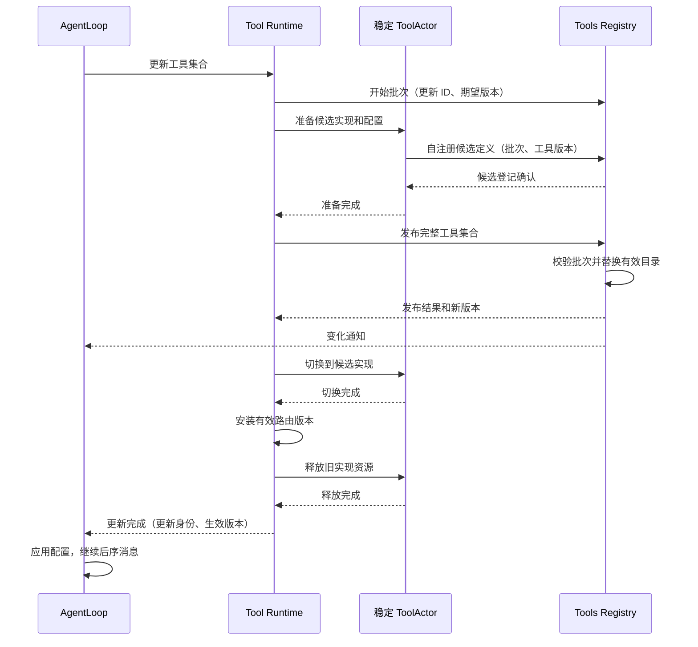

# 工具模块与原子更新实现

状态：本轮确定采用稳定 ToolActor 内切换实现；真实发布与资源释放仍待实现验证。
[Actor 定义](./11-actor-implementation.md#4-tools-registrytool-runtime-与-toolactor) · [通信](./06-messaging-and-tasks.md)。

## 1. 三个 owner 的实现边界

Tools Registry 管各 Agent 的定义目录、配置版本及更新批次；Tool Runtime 管调用、预算、路由和更新过程；
ToolActor 管一个稳定工具身份的实现资源和操作。三者不复制完整业务状态。
工具名称保持 canonical 名称，技术地址由 Runtime 管理，AgentLoop 只指定逻辑目标。

## 配置注册与事件消费

配置注册到 Tools Registry。Registry 分别记录请求应用的配置与已经发布的有效工具目录，两者不能混称“当前配置”。Tool Runtime 消费配置变化，Prompt Runtime 消费已发布定义的变化；AgentLoop 消费更新通知并决定业务屏障时机。

| 事实 | 消费者 | 可以据此执行的动作 |
| --- | --- | --- |
| 工具配置已登记 | 对应 Agent 的 Tool Runtime、AgentLoop | Runtime 取得待应用配置；AgentLoop 按接纳顺序安排更新；尚不能修改正在使用的实例 |
| 工具定义已发布 | 对应 Agent 的 Prompt Runtime、AgentLoop | Prompt 更新本地组装视图；Agent 得知发布进度，但不能解除屏障 |
| 工具更新已完成 | 原更新请求的 AgentLoop | 实例切换和旧资源释放完成，应用有效版本，继续业务消息 |

前两项是 Registry 发布的事件，最后一项是 Tool Runtime 对应用请求的业务回复。配置登记成功不等于实例已更新，事件投递成功不等于消费者已处理。

配置事件含 AgentID 和更新身份，重复事件不得产生第二个更新。AgentLoop 请求 Tool Runtime 应用时指定同一个更新身份，Runtime 只应用该次配置，不用后来收到的新配置替换它。事件可能晚于应用请求到达；此时 Runtime 异步向 Registry 读取该更新对应的配置，再执行相同流程，不等待一个可能丢失的事件，也不读取最新配置冒充指定更新。

待应用更新属于已有更新事务，不是第二套通用消息队列。Registry 保留原更新记录直到结算，以支持晚到读取与结果查询；后续配置更新不能抹掉已经接纳的更新。没有业务需求时不额外保存永久历史配置。

Tool Runtime 收到事件只接收配置，不立即准备或切换资源。只有 AgentLoop 在前序完整用户消息结束后发出应用请求，才进入下文的准备、发布、切换和释放流程。首次初始化没有前序用户消息，仍需完成工具实例和 Prompt 订阅基线后，Agent 才可接纳业务。

Prompt 的订阅初始化、版本追赶和组装约束见 [Prompt 模块](./17-prompt-module.md)。配置驱动实例，定义事件驱动 Prompt；Prompt 组装结果不反向决定工具实例的创建或销毁。

## 2. 执行协议

AgentLoop 经 GoAkt 运行时 向所属 Tool Runtime 请求执行。Tool Runtime 校验工具版本、权限和预算，
完成 pre-policy 后请求 ToolActor；ToolActor 使用 task 执行，完成消息回本 Actor 后回复。
Tool Runtime 完成 post-policy、schema 校验及结果处理，再回复 AgentLoop，由 AgentLoop 提交 Session。

每次调用独立取消 context 和业务 ID；取消始终定位原操作，不根据最新配置重新执行。
请求超时不释放仍在运行的任务预算，不重试未知副作用。效果处仍做文件、网络和进程权限校验。

## 3. 更新事务与唯一发布点

一个 ToolActor 对应 AgentID + ToolName，配置更新不创建同身份的第二个 Grain。
旧实现资源、候选实现资源是 ToolActor 内部的受管理资源，不是两代可同时执行的工具 Actor。
前序完整用户消息结束后，整个 Agent 工具调用进入更新屏障，新用户消息排队。

所有工具准备成功后才允许发布。候选实现禁止执行用户调用；ToolActor 在屏障期拒绝普通执行，
避免绕过 AgentLoop 的消息直接调用尚未完成更新的工具。发布后的配置版本须与执行请求匹配。

目录发布是 Tools Registry 内的一次原子状态替换。不同 Actor 的路由和实现切换不是同一内存事务，
由业务屏障覆盖整个发布、切换、释放过程。ToolsChanged 不能解除屏障。
新增工具才创建 ToolActor；删除工具发布撤销后释放资源并停止 ToolActor。替换仅清理旧实现资源，保留稳定 Actor。

## 4. 重试、退役与故障

| 失败点 | 处理方式 |
| --- | --- |
| 准备候选失败 | 清理候选资源及批次，旧实现继续可用；新增工具清理新建 Actor |
| 发布前失败 | 不修改有效目录/当前实现，清理完成后向 AgentLoop 返回失败 |
| 发布结果未知 | 按更新 ID 查询，不释放可能已发布的候选，不解除屏障 |
| 发布后部分工具未切换 | 保持屏障，按批次继续完成切换；不允许半套工具接收执行 |
| 旧实现释放失败 | 保持更新中并重试释放，不假称更新成功或回滚已发布目录 |
| 重复发布/切换/清理 | 按更新 ID 和配置版本返回原结果，不重复释放资源 |
| 旧注销/旧初始化消息 | 校验实例代次及配置版本，不能删除新定义或重新安装旧实现 |
| MCP 断连/工具死亡 | 立即标记不可调用并结算原调用；恢复发布仍遵守更新屏障 |

候选准备必须与当前实现隔离。若资源不能同时准备，例如独占的连接/进程约束，应在发布前明确拒绝该更新，
不能先破坏旧实现再宣称“发布前失败保留旧配置”。如何支持此类停机替换需作为单独能力设计。

正常更新不保留跨更新的旧代可执行快照；历史 schema/结果继续作为 Session 数据保留。
批次状态保留到 Tool Runtime 确认结算，确认前不得淘汰查询记录。进程丢失内存状态不代表可以自动重放副作用。

## 5. MCP 与扩展迁移

MCPConnectionActor 首期每 Agent/server 独立连接。ToolActor 使用它执行远端请求；工具发现结果交给
Tool Runtime 作为完整批次更新，不逐工具发布半套目录。现有协议适配继续复用。
MCP swap 冲突清空集合与普通准备失败保旧存在兼容差异，必须专门验收，不修改历史方案来掩盖它。

工具代码静态链接，typed config 由 Tools 组件解析；初始化和更新经 Runtime 请求。Scope 的 guard、
restriction、pre/post-policy 迁到明确执行阶段，资源回滚与释放保留。稳定 ToolActor 内的实现资源不是新 Plugin 系统。

## 6. 验收

验证稳定身份不创建第二个同名 Grain、准备不影响当前资源、多工具原子目录发布、部分切换失败、
清理重试、丢确认查询、删除工具与迟到消息、版本匹配、权限及取消隔离。
已有 A→更新→B 实验只证明业务屏障，未证明本版稳定 ToolActor 内切换方案已经实现。

## 已有执行配置的覆盖实现

当前 `tools.Config` 仅包含 `mode` 与 `maxParallelSubCalls`，不包含工具实例清单或各工具参数。先实现这部分纯业务规则：Registry 将全局输入经 ValidateConfig 验证为不可变 ValidatedConfig，再调用 `ValidatedConfig.WithOverrides(Config)` 生成 Agent 配置。该方法仅合并本对象两个已存在的字段并沿用验证，不创建资源、不订阅事件、不保存 Agent 状态。

未指定的指针字段继承默认值；显式值覆盖后重新校验。零并发、未支持模式明确失败，不退回默认。结果保存字段值而非调用方指针；修改原输入不能改变已解析配置。零值 ValidatedConfig 不是有效的全局默认，不应靠覆盖把未初始化基线变成成功。

该接口上游为未来 Tools Registry 的配置应用逻辑，下游为现有接受 ValidatedConfig 的 Tool Runtime 构造。当前新增纯规则不等于 Registry 已支持 Agent 配置注册。工具启停、实例类型和具名工具参数须在真实工具配置设计中实现，禁止把 ToolDefinition 中的执行器对象当作可注册配置。

## 定义输出契约与 Prompt 解耦

现有 tools.Registry 的 promptTools、ToolLayer.ResolveTools 及 Service.Apply/NewLayer 将 Tools 反向注册到 Prompt；关闭还需要注销 Prompt 句柄。这使定义权与消费方向倒置。删除该注册、注销和回调接口，Tools 的构造及局部层创建不接收 PromptRegistry。

Tools 定义 `Definitions` 值，包含可见 `Schemas` 和限制前 `KnownNames`。Registry 从同一有效视图生成完整值并复制 schema 参数；ToolLayer.CaptureDefinitions 只提供定义读取，不携带执行器、Prompt 类型或框架身份。Prompt 事件适配后续负责将生产者值转换为自己的 ToolDefinitions，AgentLoop 不代传 schema。保留 KnownNames 是为了延续 toolOrder 对已知但不可见名称的校验语义，不向模型额外暴露工具。

本步只移除已确认错误的依赖方向，尚未实现 Registry 的 AgentID/版本事件发布和 ToolActor 注册批次；旧 Plugin 生命周期及父层依赖仍待整体迁移，不能将当前读取方法称为新 Registry 已完成。外部工具名称、schema 和错误语义保持原有实现。

## Registry 读取状态的迁移前置清理

现有 toolStore 持有 snapshotValue，而快照的 source 又指回该 store，构成对象循环；Registry 还为动态父链维护 source/revision 缓存及第二把读取锁。目标目录不应携带可变存储 owner，也不动态追踪父 Agent。

本步保留已存在的注册与执行接口，先以 setBase 接收创建方捕获的层快照，Registry 只保存 base 值；移除快照 source/revision、缓存及 viewMutex，读取直接解析捕获基线与当前本地层。父层增删不改变已创建子层，子层覆盖和 restriction 的原有解析规则保持。不会新增第二套 Registry 或兼容 Prompt 注册。

上游创建方负责在子 Agent 创建时提供最终配置。当前旧定义快照仍含执行器接口，不能冒充最终可跨 Actor 传输的工具配置；后续 ToolActor 应从独立配置创建实例。toolStore 内锁暂由尚未迁移的并发调用路径需要，不因去掉视图缓存而提前删除。

测试迁移删除 Prompt Plugin 装配，只检查 Tools 自有 CaptureDefinitions 输出、覆盖、restriction 和 schema 复制；Prompt 如何消费该输出由其 Actor 测试负责。新增创建后父层变化不改变捕获视图的业务验证。该步骤不证明目录版本、批次原子发布或初始化查询已经实现。

## Tools 业务执行装配与 Plugin 删除

当前有两条循环：Service 嵌入 ToolLayer，ToolLayer.effects 指回 Service；ToolLayer.runtime 的执行阶段也通过 effects 指回 ToolLayer。删除只有转发职责的 Service，装配改为单向持有：ToolLayer → executionRuntime → pipeline，ToolLayer 同时持有同一个 pipeline。pipeline 只持有明确的策略和通知依赖，不持有 Service、ToolLayer、Registry 或 Runtime。

`Options` 是创建时依赖输入：Before/After 为具名执行前后策略，Execution 为已有工具执行中间件，Results 为结果观察器，Changes 为目录变更观察器，Approvals 为审批能力。没有配置前后策略时分别使用 Allow/Accept；没有通知观察器表示无人订阅，不建立隐藏的 Plugin 通道。主体调用的 schema 校验、取消、审批拒绝、结果规范化及 guard 均保留，策略不能绕过效果处权限校验。

New 接收 ValidatedConfig 和 Options，返回已构造的纯 ToolLayer 与 error。ToolLayer.NewLayer 捕获当前基线并创建独立 pipeline；不存在 Service 包装、Apply、Dispose、Manifest、NewOverlay 或 Factory。调用方通过 Close 关闭业务对象，框架适配在后续迁移中拥有 Actor 生命周期。旧调用方直接改用新构造契约，不提供 Plugin 桥接。

pipeline 拥有本层观察器和执行中间件注册集合；ToolLayer 的 ObserveResults/UseExecution 委托给该对象，执行阶段直接访问 pipeline。关闭只清理本层注册，不关闭外部注入的策略 owner。业务仍存在旧并发执行入口，本步不提前移除其同步保护；Actor 调度与异步审批接入后再收敛实际需要的状态。

删除事件的 Plugin Waterfall 基类及 DeliveryPolicy，保留具名执行输入、输出与 ExecutionCompleted 值。目录变化通知仍服务尚未迁移的本地用例，不冒充版本化 DefinitionsChanged 发布；返回错误仍按原 mutation 规则处理。正式 Registry 发布失败恢复及更新屏障另按前述批次契约实现。

验收：工具纯业务包不导入 Plugin；构造验证拒绝未校验配置；普通执行、策略拒绝、结果观察、本地中间件及关闭后拒绝执行；工具行为测试迁移为直接构造，不以测试专用 Plugin 适配掩盖生产迁移。全仓旧调用方尚未迁移时如实报告构建边界。

本轮实现记录：删除 tools/plugin.go、plugin_effects.go、factory 和 ToolLayerFactory，移除根契约的 Plugin 嵌入；组合目录撤销旧 Tools Factory 登记。工具测试直接构造业务依赖，不再启动 Plugin Runtime。pipeline_execution.go 与 pipeline.go 共同实现 pipeline；layer_constructor.go 负责创建 ToolLayer。策略、执行中间件和通知观察器的 panic 在业务边界转为 error，避免失去原 Plugin 错误边界后崩溃；目录通知错误仍触发原注册回滚。

`go test -race -count=1 ./tools/... ./systemprompt/...`、`go vet ./tools/... ./systemprompt/...` 通过。覆盖取消传播、审批失败、结果替换、旧注册句柄、捕获基线和新增的策略/观察器 panic。其他模块仍引用已删除的 Tools 构造接口，生产调用方迁移尚未完成；本轮验证不代表全仓可编译或 Tools Actor 已接入。

## 执行策略快照与串行注册入口

pipeline 改为不可变执行规则值，仅包含创建时 Options、按序的 ExecuteMiddleware 和 ResultObserver 接口切片。删除 pipeline 的观察器锁、中间件锁、Close 和注册方法，也删除 ExecuteMiddlewareHandle/ResultObserverHandle 的锁及 active 状态。策略提供者自己的内部状态不由快照冻结。

ToolLayer 的 UseExecution/ObserveResults 返回 RegistrationID；RemoveRegistration(ctx, ID) 幂等删除本层注册。注册目录和顺序由 ToolLayer 保存，变更时创建新的 pipeline，不修改旧切片。注册、移除、关闭与 Prepare 的接纳需要由调用方串行化；目标由 Tool Runtime 邮箱执行，纯业务层不再承诺任意线程并发注册。

executionRuntime.Prepare 在任何前置策略执行前，将当前 pipeline 指针保存到本次调用状态。前置、分派、后置和结果观察均只读取该快照；本层更新只替换下一次 Prepare 使用的指针。在途任务不读取活动注册目录，因此可与之后的串行配置修改并行。旧策略移除不取消已经捕获它的调用，也不代表外部策略资源可以立即销毁；资源释放仍受工具更新屏障约束。

这不是把锁转移到另一层：注册目录没有 mutex，也没有自建队列或活跃标志；只有原有调用状态的取消/阶段同步暂时保留，后续按 ToolActor 调度迁移。业务测试明确覆盖旧调用保留被移除策略、新调用仅使用更新后策略，以及取消的删除命令不改变目录。跨 Actor 的串行控制入口仍待真实 Tool Runtime 接入，不能由纯业务测试声称已实现。

## Registry 批次发布业务实现

`tools.Registry` 拥有各 Agent 已发布的 Definitions 及尚未结算的更新批次；现有私有 registry 只服务旧 ToolLayer 的本地执行查找，两者不互相引用。生产共享 Registry Grain 后续独占该业务对象，所有方法由邮箱串行调用，不添加锁。业务对象不执行工具、不持有执行器、不投递框架事件。

接口：Begin 接收更新 ID、AgentID、期望目录版本和有序完整工具名称；Register 接收同一更新 ID 与单个候选 ToolSchema、可见性；Publish 校验候选齐备并一次替换目录，返回 DefinitionsChanged；Read 提供初始化/追赶基线；Lookup 按更新 ID 返回发布结果；Abort 仅允许发布前撤销；Settle 在 Runtime 完成切换与资源释放确认后删除事务记录。更新 ID 由配置登记 owner 分配，必须唯一；不能重新使用已结算 ID。

关键结构：Registry 保存 Agent 到已发布目录、更新 ID 到 batch 两张表。batch 保存 Begin 输入、候选定义和可选发布结果。一个 Agent 同时只能有一个未结算批次；相同 Begin 输入与候选重试幂等，内容冲突明确失败。工具名称数组控制输出顺序，空数组表示删除全部工具。schema 验证和复制发生在候选登记阶段；外部修改输入或读取结果不能改变 Registry 状态。已发布批次拒绝 Abort，重复 Publish 返回原版本；缺失候选或期望版本冲突不得修改有效目录。

上游 Tool Runtime 发起批次并结算，ToolActor 自注册候选。Registry Actor 在业务 Publish 成功后负责发布返回的事件；事件失败不能回滚目录，调用方通过 Lookup/Read 恢复。Prompt 消费事件或基线，不访问候选。此步骤不包含配置覆盖事件、框架消息适配、Agent 关闭回收或旧 Agent 身份防护；这些契约接通前不能宣称生产更新链路完成。

验收覆盖多工具缺项禁止发布、部分候选失败保留旧目录、重复消息与冲突、发布后不能撤销、空集合发布、按 ID 查询和结算、Agent 隔离及 schema 字节隔离。

### Registry Grain 消息边界

新增 tools/actor.RegistryGrain，以零值 tools.Registry 为唯一业务状态。组合根须用 WithLongLivedGrain 创建共享身份；OnReceive 只处理具名 Begin、Register、Publish、Read、Lookup、Abort、Settle 命令，立即返回具名结果。Actor 调用方使用 RequestGrain；外部测试允许 AskGrain，Grain 内不做 Ask 或等待其他 owner。

Publish 在目录替换后向真实 TopicActor 发送 DefinitionsChanged，回复同时包含已提交目录和通知入队错误。错误不代表未发布，调用方必须按 Catalog.Version 或 Lookup 判定提交结果。重复 Publish 可以再次发送相同版本事件，消费方按版本幂等处理。PubSub 仅用于通知，入队成功不代表 Prompt 已应用；Read 提供可验证的基线。此 Grain 不管理业务关闭和实例切换，不能据其回复解除 Agent 更新屏障。强制停止系统会丢失内存目录，不能自动重放未知工具效果。

### 工具定义中的函数适配器移除

删除 ExecutorFunc、OutputRendererFunc、PresentationProjectorFunc、ContentFinalizerFunc、ConcurrencyClassifierFunc。ToolDefinition 保留 Executor 等具名能力接口；生产工具对象直接实现 Execute、Render、ConcurrencySafe，控制工具按实际命令拆出独立对象并仅持有所需依赖。此变更不改变工具名称、schema、输出或取消行为；纯测试闭包适配仅留在所属包的测试文件，不再作为生产扩展 API。既有 Plugin/Scope 调用链不在此处新增兼容桥接。

## Session 引用与审批续接迁移

删除 ExecutionSubject 及 Options.Approvals。ToolExecutionInput / ToolExecution 只携带 SessionID，不持有可变 Agent、Session 或注入接口。审批所需事件快照由 Actor 编排向 Session 获取，Tools 不同步调用 Approval Service。

Prepare 遇到 AskDecision 返回 ScheduledApproval 和 ApprovalRequest{SessionID,ToolName,CallID,Reason}，此时不得 Dispatch。Actor 完成 Approval 的 asked/decided 审计后调用 ResolveApproval(execution,outcome)，原执行身份只允许续接一次；允许后仍需 guard 检查和取消检查。拒绝、不可用和取消进入结果处理，不能执行工具体。

普通 Execute 无法跨调用等待审批，只能在 Ask 时失败关闭；生产 Actor 必须使用分阶段 Scheduler 路径。此阶段不创建 Actor 队列或等待 goroutine，保留的 awaiting-approval 是禁止过早派发的业务阶段。旧工具运行时的其他锁与状态仍待整体 ToolActor 迁移，不能据此宣称生产执行编排完成。
