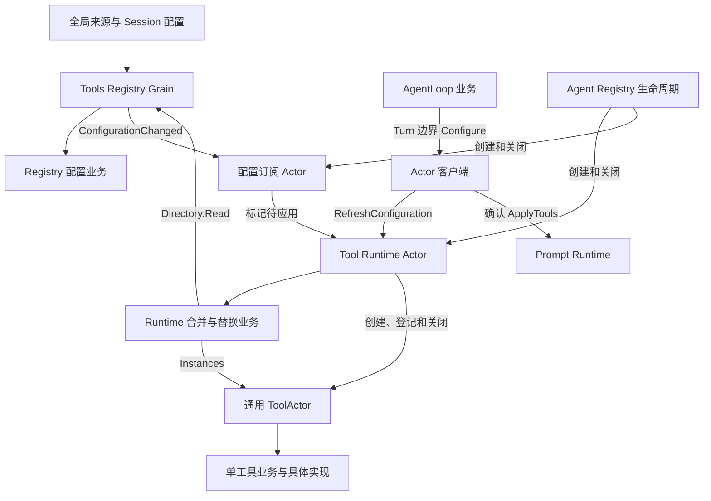
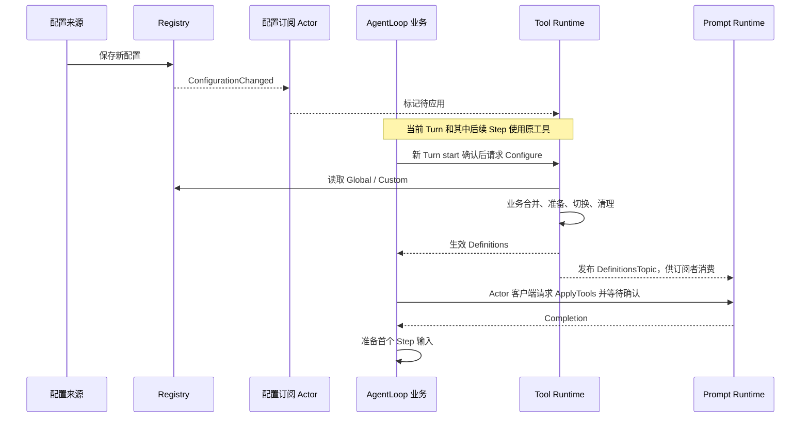

# Tools 实现方案

本文拥有 Schema Registry、每 Agent Tool Runtime 与通用 ToolActor 的最终职责和契约。替代此前 Registry 候选批次、Provider 注册和发布事务设计；外部工具名称、JSON Schema、Session 事件与 wire 语义保持不变，不保留旧 Go API 别名。

## 架构与依赖

Registry 保存配置事实；Runtime 决定继承合并、工具集合切换和失败清理；Tool 业务管理单个实现。Actor 只适配消息、执行框架任务、传递取消与回复，不执行策略规则。业务对象不持有 Actor、ActorSystem 或上游 owner，不建立循环引用。

## Registry 的接口与数据

| 对象或字段 | 含义 |
| --- | --- |
| Catalog.Schemas | 一个全局来源或一个 Session 声明的 llm.ToolSchema |
| Catalog.Policies | key 为工具名；value 为显式配置字段和借用的执行策略能力 |
| Registry.sources | key 为来源 ID，如 local、mcp:docs；value 为该来源的完整 Catalog |
| Registry.sessions | key 为 SessionID；value 只含自定义 Catalog，不复制全局值 |
| Configuration | 分别返回 Global 与 Custom，由 Runtime 合并 |
| RegistryGrain.actors | key 为 AgentID 与工具名称；value 为已初始化 ToolActor 地址与 CreationID |

RegisterSource 原子替换一个来源；ConfigureSession 原子替换 Session 自定义值；Read 返回脱离调用方修改的配置；RemoveSource / RemoveSession 删除指定配置。同名全局 Schema 或 Policy 不跨来源隐式覆盖，冲突直接拒绝。Registry 按每个 Schema 的内容独立维护 Version，没有目录 Revision。

Policy 的 Enabled、Visible 以可选布尔值表示是否覆盖；Before、After、Execution、Results 非 nil 时覆盖继承值；Guards 非 nil 时替换继承列表，显式空列表清除 Guards。策略协作者为借用能力，Registry 不关闭它们。不同 Agent 并发使用共享能力时，其实现承担自己的并发约束。

Registry 不保存 Provider、Executor、候选资源或 Runtime 更新状态。Actor 地址登记由 Tool Runtime Actor 在 ToolActor 初始化确认后执行；关闭工具并撤回原 CreationID 的地址后停用实例。迟到撤回不能移除同名工具的新生命周期。

配置消息为 RegisterSource、RemoveSource、ConfigureSession、RemoveSession、ReadConfiguration。变更事件 ConfigurationChanged 只携带影响范围，SessionID 为空表示全局来源。通知失败不回滚已保存配置，调用方可以读取核实并重试通知。

## Runtime 的接口与数据

Runtime 通过 Directory.Read 读取配置；Merge 按名称用 Session Schema 覆盖全局，并逐字段合并 Policy。禁用工具不进入工作集合，不可见工具可以执行但不进入模型可见 Schemas。全局不存在的名称不能仅靠 Session Policy 创建工具。

| 对象或字段 | 职责 |
| --- | --- |
| Tool | 一项合并后的 Schema、可见性和执行策略 |
| Runtime.current | 已完整应用的工具集合 |
| Runtime.pending | 尚未结束的替换及清理责任 |
| Runtime.versions | key 为工具名；value 为最后应用的 Schema，跨禁用/删除保留内容版本历史 |
| Snapshot.Policies | key 为生效工具名；value 为该次快照固定的执行策略 |
| Update | 保留准备、切换、释放、回滚的进度；不保存 Registry 事务 |
| Runtime Actor.tools | key 为工具名；value 为该工具的生命周期责任，包含 CreationID、首次激活身份、地址、关闭进度和在途请求 |
| Providers | key 为工具名；value 为组合入口借用的 Provider 构造器，不是运行实例 |

Initialize 首次应用；Apply 读取并合并最新配置，或继续未完成的替换；Snapshot / Definitions 只暴露完整生效集合；Close 释放实际工具责任，失败保留进度。Schema 内容和可比较策略身份均未变化时不重新 Open。比较不深入借用策略的内部状态，避免读取其他 Agent 正在使用的业务对象。

Update 先 Prepare 全部工具，再 Commit 全部工具，之后 Retire 旧实现和 Remove 删除项。开始切换之前的失败或取消撤销所有已尝试准备，包括部分创建失败的资源。开始切换后不能假装回滚，必须继续清理；失败保留原进度供后续 Apply 或 Close 继续。在全部工作确认前，不允许快照或新工具调用越过屏障。

## 通用 ToolActor 与具体工具接入

所有工具共用 tools/tool/actor.Grain，每 Agent 每工具独立实例。组合入口分别提供 Catalog 和 Providers；Schema Registry 不保存构造器。组合入口通过 GoAkt WithExtensions 安装不可变 Providers；Tool Runtime 创建 ToolActor，ToolActor 初始化时按名称取得并绑定 Provider。Agent Registry 不接收或选择构造器。Runtime 的 Instances 适配器只将合并后的 Schema 交给 ToolActor.Provision。Provider.Open 返回独立工作及资源；Tool 校验名称与定义，再安装有效 Schema。

ToolActor 的请求为 Initialize、Provision、Commit、Retire、Abort、Describe、Execute、CancelCall、Close。CreationID 区分生命周期；Revision 标识一次替换；Identity 标识已提交实现。Schema Version 不是执行地址或工具调用身份。

Tool 业务保存 current、candidate、retiring。candidate 是尚未切换的工作；Commit 将其变为 current，把旧 current 留给 Retire；Abort 只撤销候选。失败保留资源，不能用强制停 Actor 代替业务关闭确认。没有自动广播注册，也没有专属 ApprovalActor。

删除仅测试使用的 ToolActor.Client 及其消息包装。生产工具调用统一由 Instances 适配器按名称查询地址、读取 Descriptor 和实现 Identity，再由执行端口调用 ToolActor；不保留第二套固定地址客户端。

## Turn 边界与 Prompt 交互

生产生命周期启动配置订阅 Actor 并在关闭 Runtime 前停止它。初始化和订阅确认都触发一次配置核实，覆盖首次读取与建立订阅的间隔。进行中的刷新不会清除后到通知。生产路径通过直接确认 ApplyTools 保证后续 Prompt 组装看到相同定义；DefinitionsTopic 是通知，不能替代该确认。Prompt ToolsSubscriber 仍是独立可组合的订阅适配，生产路径不再额外启动重复订阅者。

Configure 由 AgentLoop 业务决定何时请求。Actor 客户端只完成 Runtime 与 Prompt 的协议交接，不决定 Turn / Step。刷新取消以本次请求 ID 匹配；取消只中断准备意图，原请求等业务回滚或切换清理返回。配置失败结束本 Turn 的准备，Inbox 尚未消费的输入保留；Runtime 保留未清理资源供后续更新或生命周期关闭处理。

## 调用与关闭契约

Call 拥有执行前策略、中间件、工具体结果和最终结果。Runtime Actor 按 CallID 保存业务 Call 和取消/回复句柄。PrepareCall、DispatchCall、FinalizeCall、ReleaseCall 映射到业务操作；CancelCall 不证明工具退出。工具体可并发调度，但调用方必须遵守业务并发分类。同一调用的阶段不并发运行。

AgentLoop 提交工具调用事实后请求执行，工具体结果经 Call 规范化后由 AgentLoop 提交 Session，再释放调用责任。BodyResult.Err 是已返回的业务失败；独立请求 error 表示结果未确认，不允许自动重复副作用。

关闭先冻结 Agent 输入并等待执行结束，再停止配置订阅、关闭 Runtime 和实际 ToolActor，最后关闭 Prompt、Session flush、停用并释放身份。初始化失败由生命周期自动清理；失败不能丢弃原资源责任。

## 验证与剩余工作

现有验收覆盖多来源冲突、Schema 独立版本、Session 覆盖与继承、Policy 合并、候选回滚、部分切换恢复、关闭重试、实际 ToolActor 执行与取消、生产初始化与 HTTP 流式输出。

TestHTTPToolsChangeOnlyBetweenTurns 使用真实 HTTP、WebSocket、AgentLoop、Registry、Runtime、Prompt 与 ToolActor：工具体运行中修改全局 Schema；同一 Turn 的后续模型请求仍使用旧定义；下一 Turn 使用新定义；旧工作和关闭后的工作各释放一次。模型和工具通过可控测试提供者运行，不代表真实模型服务验收。

审批 AskDecision 已由执行业务按名称调用通用 ToolActor 续接；完整审批审计与默认工具现已接入，生产证据见本文末节。此前未接线的 Approval Journal/Execute 草稿和专属 Actor 方案不作为现有能力保留。AgentLoop 多工具批次的并行选择仍需独立验收；MCP 外部来源已由 [MCP Client 基本功能](42-mcp-client.md)单独接入。

## 生命周期归属修复：原因、方案与验收

### 产生原因

此前实现把“Agent Registry 编排 Agent 组件生命周期”扩大成“Agent Registry 管理组件内部的每项资源”，将单工具创建、激活确认、地址登记、关闭和资源表也放入 Agent Registry。与此同时，Tool Runtime 已经负责决定有效工具集合和替换流程，却必须反向请求 Agent Registry 执行单工具生命周期。结果是工具业务决策与资源责任分属两个 owner，工具更新要求上层 Registry 理解内部步骤，关闭也形成两条管理路径。

构造器装配存在相同边界错误：Provider 最初随 CreateAgent 传递，随后改为 Agent Registry.providers / InstallTools，只改变了保存位置，仍让 Agent 生命周期 owner 承担具体工具实现装配。Schema 是可覆盖的配置，Provider 是进程内实现能力，两者不能因为按同一工具名索引就合并为同一职责。

### 确定修复方案

本次用户确认的关系为 Agent Registry → Tool Runtime → ToolActor。Agent Registry 只保存并关闭整个 Runtime；删除其中的单工具资源种类、工具生命周期表、CreateTool / RemoveTool / ClaimTool 消息。Runtime Actor 保存按工具名索引的实例责任，框架任务创建或停止 ToolActor；业务 Runtime 通过 Instances 端口请求操作，不依赖 GoAkt。

ToolActor 初始化向其 Runtime 请求 Claim，固定首次物理激活身份；同名新激活不能接管旧工作责任。只有初始化和工具地址登记都确认后才允许 Provision。初始化失败且从未发送 Provision 时可以直接撤回地址并停用空实例；已经发送 Provision 的资源必须经业务 Close 确认。关闭或撤回失败保留实例记录，不能删除后创建替代实例。

CreateAgent 和 Tool Runtime 不保存构造器表。组合入口通过 GoAkt WithExtensions 安装 ToolActor 适配层的 Providers，key 为工具名，value 为借用的 Provider；表复制后不可修改。ToolActor 在 Initialize 按名称取得一个构造器。框架的可序列化 GrainDependencies 不用于存储 Provider 实例，不添加独立实现 Registry Actor。具体工作始终由 Tool 业务调用 Provider.Open；初始化不启动工具工作。

### 上下游契约与验收

Agent Registry 等待整个 Tool Runtime 初始化或关闭的结果，不逐个操作 ToolActor。Runtime 业务通过 Instances 端口表达准备、切换和释放要求；适配器向本 Runtime Actor 请求单工具生命周期操作。Runtime Actor 只执行框架身份和通信协议，工具集合合并与替换决策仍在业务对象。ToolActor 通过身份确认消息联系 Runtime，不保存指向上游业务对象的引用。

验收要求：

1. Agent Registry 不再存在单工具资源表、Provider 表和 CreateTool / RemoveTool / ClaimTool 路由；Tool Runtime 是唯一单工具生命周期入口。
2. 工具更新经过真实 Runtime 与 ToolActor，旧工作释放一次；关闭失败保留原地址和清理责任，重试不重新 Open。
3. 强制停用后的新物理激活不能复用旧生命周期身份；不能用新空实例的关闭成功证明旧工作已释放。
4. Provider 缺失时初始化明确失败；未进入 Provision 的空实例可以清理，已进入 Provision 的工作必须完成业务关闭。
5. HTTP 生产接线验证配置在 Turn 边界生效；同一 Turn 后续 Step 不混入新定义，Prompt 与 Runtime 使用相同已生效定义。

当前进度：上述职责迁移和命名审批路由已提交于 `ada26fd`，默认审批工具的审计和 Interaction 接线仍未完成。实现位于 [Runtime 工具生命周期](../../tools/runtime/actor/runtime_tools.go)、[Instances 适配器](../../tools/runtime/actor/instances.go) 和 [Provider 装配](../../tools/tool/actor/providers.go)。已有 [真实 Runtime 生命周期测试](../../tools/runtime/actor/instances_test.go) 覆盖替换、关闭失败恢复与旧身份再激活防护；上一轮相关 Tools / Agent 测试通过。`TestAgentCreationWithProductionConfigurationOwners/missing-provider` 已验证缺少实现时返回初始化错误、CloseAgent 确认清理、Registry 不保留调用地址且没有执行 Open。`go test -race -count=1 ./tools/... ./agent/... ./agentloop/... ./systemprompt/... ./internal/server -timeout=60s` 通过，包含真实 HTTP/WebSocket 的 `TestHTTPToolsChangeOnlyBetweenTurns`；这不代表审批与并行批次已完成。

服务器验证发现的中间件取消问题单独记录于 [集成问题记录](./40-integration-findings.md#中间件取消与原调用完成交错2026-09-09)，不能将关闭失败直接归因于 ToolActor 生命周期迁移。审批与并发剩余工作以本文前节为准，本次边界修复不表示 Tools 重构整体完成。

## 审批续接修复

根因是 `execution.Call.Preparation` 暴露审批请求，而 Runtime Actor 只保留 Stage 并丢弃请求；AgentLoop 又没有审批分支。因此原工具进入等待审批后没有业务推进者。Actor 不应补上读取审批策略、请求回答、解释结果的第二套流程。

确定接口：`Scheduler.PrepareCall` 在同一业务准备操作内完成前置策略和所需审批，只返回可派发或可结算的 Call。按 canonical name `approval` 从本次已生效工具描述中选择工具，用现有 Invoker 调用通用 ToolActor，不新增专属 Actor 或 Approver 接口。审批工具参数为 `approval.Permission`（toolName、callId、reason）；SessionID 来自 Invocation，不能由参数改写；输出为 JSON 编码的 `approval.Outcome` 字符串。该内部工具契约不改变已有 HTTP、WebSocket 或 Session 审计格式。组合入口将审批 Schema 与 Provider 一并注册，默认不向模型展示。

审批子调用使用独立 CallID 并保留原 RootCallID，共用原请求取消 context。准备任务会等待审批工具实际返回，配置切换和 Runtime 关闭不能跨过该调用。取消后不启动原工具；取消等待期间的审计收尾由审批工具负责。这里只将已返回的审批结论交给现有策略业务，不重复执行前置策略，允许结论之后仍检查 Guards。

没有生效的审批工具时，按既有 unavailable 语义拒绝原调用。审批工具明确返回错误或非法输出时形成失败结果；独立投递错误使用 DeliveryError 保留未确认责任，不生成原工具完成结果，也不自动重复审批。删除仅由测试驱动的公开 ApplyApproval 入口及对外返回审批请求的接口，内部策略测试仍可验证审批状态机。

验收分别覆盖：按名称调用及子调用关联、允许/拒绝/取消/不可用结果、缺少审批工具、非法输出、投递回复不确定、策略不重复，以及真实 Registry → Runtime → 通用 ToolActor 接线。审批 Service 的 asked/decided 审计与 Interaction 仍须另行接入和验证，不能用可控工具回复的接线测试代替完整审批验收。

审批续接实施证据：`scheduler_approval.go` 负责具名请求与结果消费；`runtime_calls.go` 只调度完整准备操作。公开 `Call.ApplyApproval` 和冗余 `tools.ApprovalRequest` 已删除，内部使用 Approval 拥有的 Permission。`TestPreparationCallsNamedApprovalBeforeOriginalBody` 覆盖允许、拒绝、取消、不可用、缺少工具、错误回复及取消优先；`TestUnconfirmedApprovalCannotDispatchOrFinalizeOriginalCall` 验证未确认回复不会重新调用或伪造结果。`TestRuntimePreparationUsesNamedToolAndWaitsForApprovalExit` 使用真实 Registry、Runtime 与通用 ToolActor，验证按名称路由、隐藏工具、策略仅执行一次、等待期间配置屏障及取消传播。`go test -race -count=1 ./tools/execution ./tools/runtime/actor -timeout=45s` 通过；该证据不包含 Approval Service 的审计或 Interaction。

提交前补充验证：`go test -race -count=1 ./tools/... ./approval/... ./agent/... ./agentloop/... ./systemprompt/... ./internal/server -timeout=60s` 与受影响模块的 `go vet` 通过。整仓 `go test -count=1 ./... -timeout=60s` 仍因暂缓迁移的 subagent 引用已删除 Plugin，以及 tests/architecture 中旧架构断言等检查失败，不能宣称整仓通过。默认审批工具与客户端回答装配仍按 [Approval 方案](./20-approval-module.md) 跟进。

## 内置审批与提问装配验收

默认启动已装配隐藏 approval 与可见 ask_user_question。执行经真实 Registry → Runtime → 通用 ToolActor；Session 审计使用固定创建身份，Interaction Gateway 通过 WebSocket 发请求、HTTP /api/respond 接收回答。UserQuestions 的重复 Provider 接口与独立 Grain / Client / pending 表已移除，QuestionService 直接在通用 ToolActor 任务中执行。详见 [审批模块](./20-approval-module.md) 与 [服务装配](./41-server-composition.md)。

`TestHTTPBuiltInToolInteractions` 覆盖回答、拒绝、中途取消、Agent 关闭、完整 Server 关闭、断线重连保持原请求、重复回答拒绝、恢复数据库中的 asked/decided 与工具结果。`TestRequestHeaderSchemaSurvivesSessionEncoding` 修复多行 schema 被 Session 编码后误判配置不一致的问题，不改变模型参数或持久化格式。

本轮 Tools / Approval / UserQuestions / ToolAskUser / Agent / AgentLoop / Prompt / Session / API Proxy / Server 的 fresh race 测试与 vet 已通过。整仓测试仍失败：暂缓迁移的 subagent 依赖已删除 Plugin，architecture 检查包含旧路径/旧生命周期与命名问题；另观察到 Workspace 重启测试的 actor is not alive，需单独核实。不能宣称整仓通过。

仍未完成：AgentLoop 的业务多工具并发调度和端到端验收；生产 Session 技术故障后的审批自动恢复（业务幂等重试不等同于自动恢复）。MCP 按 [独立模块](42-mcp-client.md)通过配置启用；暂缓的 subagent 不属于本轮默认工具装配。

本批实现提交：`e954b2c`。完整服务关闭场景的追加 race 验收通过；Workspace 重启测试单独 fresh 重复 30 次通过，整仓中的一次失败暂未复现，仍保留记录，不据此修改其生命周期。
