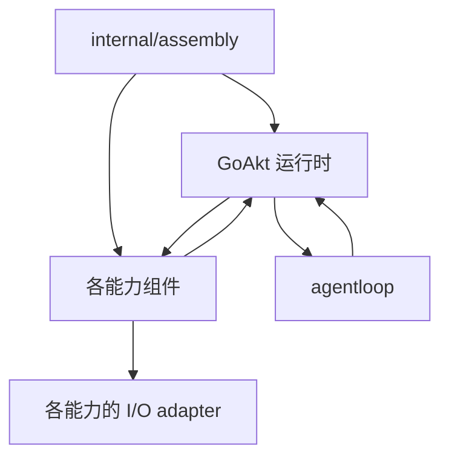
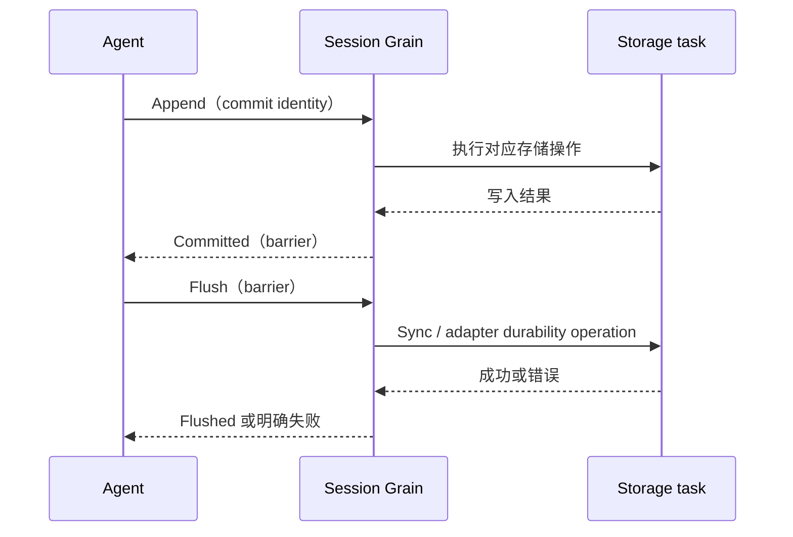

# 模块级实现与迁移顺序

> 初始化流程已按用户最新决定改为 Registry 配置合并和 AgentCreating 事件驱动，见[初始化方案](./10-runtime-and-initialization.md)。本文尚存的“Agent 主动读取并转交配置”表述不再作为实施依据，其余业务所有权与生命周期约束保留。

状态：实现提案；目标路径是包布局建议，本轮不创建代码占位包。
[整体架构](./05-implementation-overview.md) · [通信机制](./06-messaging-and-tasks.md)。

## 1. 包与依赖方向

目录按业务能力和现有调用关系组织，先在能力包内用具名类型区分 owner，不统一拆分契约包与 runtime 包。
internal 只限制仓库外导入，不表示运行时层级；未导出类型也能隐藏实现。需要拆包时必须说明实际外部
扩展需求或依赖问题，不能因为引入 Actor/Grain 就生成一组同构目录。

| 能力 / 现有区域 | 包内实现职责 | 目录决定 |
| --- | --- | --- |
| internal/assembly | 启动组件、连接GoAkt 运行时、严格解码启动配置 | 保留服务器装配职责；不替 AgentLoop 组装完整配置 |
| agent | 身份、创建/关闭、Registry、配置请求契约 | 保留能力边界，去掉 Plugin/Scope 依赖 |
| agentloop | Agent 执行状态、初始化协调、业务队列、Turn/Step | 保留与 agent 的既有职责区分，不因 Grain 化整体迁目录 |
| tools | Tools Registry、Tool Runtime、ToolActor、定义及执行规则 | 先在 tools 内实现；不另建 toolsruntime |
| session | Session Registry、SessionActor、日志、commit/flush | 在 session 能力内组织；存储适配按现有边界保留 |
| systemprompt | 定义、Registry、每 Agent Runtime、组装 | 在现有能力包内组织 |
| credentials | CredentialsActor 承接 Manager 的规则与更新状态 | LiveStore 保持存储 adapter，不接管规则 |
| Compaction | CompactionActor 管理任务、取消及提交协调 | 沿现有压缩能力组织，包路径随真实 caller 盘点确定 |
| Query / Projection | 查询 owner / 各独立投影 Actor | 沿查询、投影能力组织，不按框架类型分目录 |
| llm | 模型/provider 配置组件与请求执行能力 | 保留当前能力边界，SDK transport 仍是普通对象 |
| GoAkt 运行时 | 框架身份、激活、消息与请求关联 | 直接使用 GoAkt，不新建对应业务包 |
| internal/connection、API Proxy | 外部协议适配 | 保留 carrier 边界 |

GoAkt 运行时 与每 Agent Tool Runtime 不同。前者定位组件并投递消息，后者拥有工具实例、执行预算和调用结算。
组件的业务注册信息仍归各 Registry，GoAkt 运行时 不另存一份工具 schema 或配置权威副本。

图表示运行期消息路径，响应不形成对象循环嵌套。组件契约由能力 owner 定义；Runtime 不返回组件对象给消费者。
组件内部的 storage/SDK 构造仍可由装配负责，但 AgentLoop 配置及组件地址不提前注入。

## 2. Agent 模块

Agent Registry 按 SessionID 处理创建、查找、关闭、父子关系与等待区；AgentLoop 创建后先进入初始化状态，
通过GoAkt 运行时请求各组件配置及版本，汇总就绪状态，全部必要配置成功后才开始用户业务。
不在构造时注入完整有效配置、组件对象、存储句柄或 SDK 实例。
初始化与后续业务均经 Runtime 向指定组件发送请求，详见[10](./10-runtime-and-initialization.md)。
Agent 自身保留两个层次：mailbox 处理消息，业务 FIFO 排列用户消息与工具更新。消息返回不等于业务消息完成。

| 输入 | 处理与下游 | 完成边界 |
| --- | --- | --- |
| 用户消息 | Session 追加输入 → Prompt 组装 → LLM → 工具 → Session 结果 | 包含交互等待及全部必要提交的完整业务消息结算 |
| 工具更新 | 排队后请求 Tool Runtime | 更新确认和旧资源退役后才能处理后序消息 |
| 取消/问答响应 | 路由到当前执行/交互 operation | 保留 Inbox/KeepInbox，取消接纳与最终退出分开 |
| Close | 拒绝新业务，排空后 flush、关闭依赖 | 业务 业务已排空；最终停用由 Registry 确认 |

Followup/Steer/Inject、maintenance、WhenIdle 逐项沿当前调用者核对，不能把所有输入一律归为新的 FIFO 用户任务。
子 Agent 创建复制 parent 有效配置快照加自身覆盖；保留 parent-child membership 和 child-first，
详细字段覆盖待决项仍见[04](./04-subagent-configuration.md)。

## 3. Session 模块

Session Registry 只管目录与生命周期。Session Grain 管日志语义、序号、写队列、已提交快照与 flush barrier；
storage adapter 只执行 I/O 和请求的事务，不决定哪些事件应提交、取消后应保留哪些数据。

append 与 flush 进入同一有序写队列，一次最多一个未结算存储事务。Committed 和 Flushed 各自有明确边界：
模型输入可重建事实在提交后可见，Flushed 表示指定前缀满足所选 adapter 的持久化保证。
接纳业务关闭不提前释放文件/连接；flush 失败保持 Closing 并允许重试，已提交事实不回滚。

生产迁移先对齐当前 Session 的 commit/flush 时点，不能把文件实验中的“写文件后 commit”直接强加给
当前内存提交、写后持久化的语义。JSONL/SQLite 分别验证恢复、损坏修复与 release retry；SQLite 按现有
sqlc 约束实现。查询已提交快照，跨 sender 的“最新读取”显式指定 barrier。

## 4. Prompt 模块

Prompt Registry 保存定义、顺序、revision 和适用范围；Prompt Runtime 保存本 Agent 配置、已应用快照、
活动组装任务。Agent 请求组装时提供固定的 Session barrier、Tools revision、Prompt revision 和配置版本。
Runtime 要么返回完整匹配的结果，要么明确失败/未就绪，不在一次组装里隐式混入最新目录。

静态模板和纯求值继续普通函数；耗时变量来源经受管理 task 或独立有状态 owner 的 Request。
订阅目录变化只使快照失效或触发准备，不能直接改变已发模型请求。组装取消传播给每个尚未结束的求值任务。
未知变量、Persona、工具排序、runtime context suppressor 和覆盖顺序均保留测试。
是否把所有 Prompt 定义更新也排入 Agent 与工具相同的业务屏障尚未确认；本提案只保证请求快照固定，
不自动扩大已确认的工具更新规则。

## 5. LLM、交互与其他能力

| 能力 | 首期实现职责 | 关键契约 |
| --- | --- | --- |
| LLM | Agent 拥有请求和流状态；provider adapter 执行请求 | 流增量有 operation/generation，最终完成一次；取消需等流读取任务退出 |
| Approval / Interaction | 保留独立问答/审批 owner；Agent 记录等待关联 | 回答推进当前业务消息，不能作为屏障后的新消息堵住自己 |
| Credentials | CredentialsActor 承接 Manager，拥有来源优先级、解析、更新顺序、有效版本及通知 | AgentLoop 只取配置/凭据引用，不取 secret；LiveStore 只存储 |
| Workspace / 文件 / 进程 | 保留 capability 与 effect adapter | 效果处校验路径、工作目录、权限和 sandbox |
| Compaction | CompactionActor 拥有任务接纳、执行状态、取消、压缩候选及提交协调 | Session 拥有日志提交权，冲突需校验源 barrier，不由 Compaction 直接改日志 |
| Query | 有独立查询状态的 QueryActor 管理快照、游标、请求与取消 | 简单快照读取可直接请求 Session/ProjectionActor，不建立纯转发 Actor |
| Projection | 每种独立投影的 ProjectionActor 拥有消费进度、checkpoint、重建与追赶 | 映射函数保持无状态，adapter 只存储；消费者失败不回滚源事件 |
| MCP | 沿 ToolActor 与连接 owner 接入 | 自注册批次、generation、断连、MRTR 与取消隔离 |

这些 owner 纳入主体模块设计，不再笼统留给“其余能力”。Credentials 按配置/凭据域、Compaction 按 Session、
Projection 按投影身份确定稳定身份；Query 的游标寿命和请求范围决定是否需要稳定 Grain，不能仅凭模块名选择载体。
具体分区粒度是实现提案，外部契约不改变。算法、模板、查询表达式及 storage adapter 仍为普通对象。

## 6. 对外接入与配置

Connection 继续使用 Echo v5，框架 context 不进入核心能力。API Proxy 继续拥有既有 wire envelope 与
请求关联，内部通过命令端口取得结果；WebSocket 下行从 Session/Agent 事实流映射，日志可补读。
HTTP caller 退出不自动销毁 Grain；取消按既有请求语义发给业务 owner。

启动配置严格解码到各 owner 的 Go 类型，组合根启动组件并注册框架 Grain 类型。
AgentLoop 创建后，由各组件解析属于自己的 Agent 配置并通过 Runtime 返回值及版本，AgentLoop 负责汇总而非解析所有组件配置。
Subagent 的 parent 快照与自定义覆盖作为一次性初始化输入，由相应组件处理，不恢复动态 parent 查找。删除 Plugin 不表示删除已需支持的
动态工具/配置更新：这些更新进入相应 owner 的显式事务。移除 Cordis 式表达式/Scope 动态继承，
但保留资源安装检查、失败回滚、订阅释放、策略短路与错误恢复。

## 7. 实施批次与出口

执行顺序、各 Actor 所属批次、前置条件和验收统一由[实施计划](./12-implementation-plan.md)维护，本文不再保留另一套批次编号。
各批次必须可编译、可测试；同一 Agent 不混用新旧状态 owner。代码与设计文档分开提交。

## 8. 决策与验证清单

| 项目 | 当前结论 | 进入相关实施前的条件 |
| --- | --- | --- |
| Grain 作为主体载体 | 已选定目标载体，已有核心通信实验 | 按契约落地；不等同所有模块均已迁移 |
| 受管理 task 与接续桥接 | 有实验可行路径 | 错误/超时/强制停用时无遗留等待任务 |
| 业务关闭 / flush | 文件 fixture 已通过 | 生产 Session 语义及最终框架停用竞争 |
| 旧代防护 | Registry 存活的基础路径已通过 | 授权/退休竞争、旧初始化与 Registry 故障隔离 |
| 工具更新 | 业务屏障已通过 | 真实 Registry 批次、路由与退役失败恢复 |
| Subagent 覆盖 | 创建时快照继承已确认 | 字段级 merge/replace、权限和恢复规则 |
| Prompt 更新 | 请求快照固定 | 是否增加业务屏障单独决定 |
| MCP swap 失败 | 与普通失败保旧有差异 | 保留或调整具体 observable behavior 的决定 |

这是一份可评审、可按批次执行的实现方案；未验证项是明确的实施出口条件，不应被默认值或静默回退替代。
