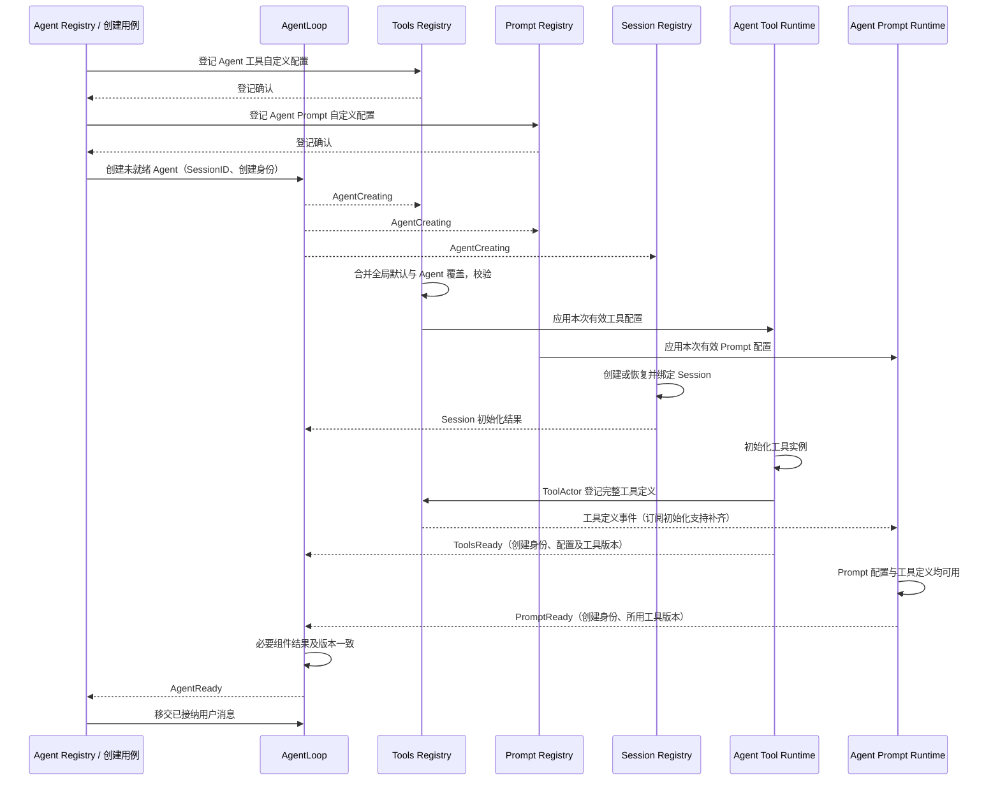

# GoAkt 运行时、组件寻址与 AgentLoop 初始化

状态：按用户最新确认改为 Registry 配置合并与 AgentCreating 事件驱动初始化；替代此前 AgentLoop 逐项读取、合并、转交配置的流程。尚未实现完整生产链。
[整体方案](./05-implementation-overview.md) · [通信机制](./06-messaging-and-tasks.md) · [模块划分](./09-module-implementation.md)。

## 1. Runtime 的职责

这里的 Runtime 就是 GoAkt 提供的 ActorSystem 与 Grain 运行能力。Goren 不再实现系统 Runtime、
组件地址注册服务或全局请求中转层。调用方使用框架逻辑身份发起异步请求；GrainIdentity 是框架寻址值，
不是组件业务对象，也不代表该实例已获得业务执行授权。

| Owner | 负责 | 不负责 |
| --- | --- | --- |
| GoAkt 运行时 | Grain 身份、激活、消息投递、框架请求关联 | 业务授权、配置规则、工具更新、Session 提交 |
| 组件 Actor / Registry | 配置、业务目录、就绪资格、版本、资源与生命周期 | 重建框架地址表 |
| AgentLoop | 发布创建事件、汇总就绪、有效版本、业务执行 | 保存组件对象、SDK 或存储句柄 |
| 每 Agent Tool Runtime | 工具生命周期、调用路由、执行预算、更新与结算 | 系统消息运行能力 |

业务 Registry 维护业务注册信息。框架可寻址不等于业务已就绪，各 owner 仍须校验授权与实例代次。

## 2. 初始化顺序

全局默认配置预先登记到各能力 Registry。创建用例先把该 Agent 的自定义配置登记到对应 Registry，确认登记成功后创建未就绪 AgentLoop。登记阶段只固定配置输入，不提前创建工具、Session 或连接；部分登记失败按原创建事务清理。

AgentLoop 启动后发布 AgentCreating，携带 AgentID = SessionID 和原创建身份。各能力订阅者处理自己负责的配置，不接收包含所有模块配置的任意 map。组件寻址和消息投递均由 GoAkt 完成，不新增事件中转业务 Runtime。

图中 Tools Registry 到 Runtime 的配置应用使用有结果的异步请求；AgentCreating 和定义变更使用事件。ToolActor 的登记、批次发布与资源完成详见[工具方案](./08-tools-implementation.md)，此处不改变发布事务。

Ready 名称是具名业务消息语义，不是框架激活成功。PromptReady 只有自身配置、订阅基线及对应工具定义均已应用时才成功；ToolsReady 只表示实例初始化完成，不代替 PromptReady。两条通知乱序到达不影响 Agent 汇总；Agent 必须核对它们属于同一次创建且工具版本一致。其他必要能力按相同的所属配置和完成契约接入，不假设只有图中三个必要项。

订阅者在服务器允许创建 Agent 前完成共享订阅初始化。PubSub 没有可靠业务完成保证：缺少必要结果时创建保持未就绪，通过原创建身份向缺失组件查询初始化结果或重发同一次初始化触发，不盲目创建第二套资源。重复 AgentCreating 返回原初始化进度/结果，不重复注册工具。具体桥接沿用[通信方案](./06-messaging-and-tasks.md)。

## 3. 配置所有权与变化

| 数据 | 权威 owner | 规则 |
| --- | --- | --- |
| 全局默认工具配置 | Tools Registry | 作为各 Agent 的默认输入，不是共享工具实例 |
| Agent 自定义工具配置 | Tools Registry，按 AgentID 登记 | 显式配置覆盖默认值；未指定沿用默认 |
| 有效工具配置 | Tools Registry 解析与校验 | 发送给对应 Tool Runtime；定义发布与实例完成分别确认 |
| 已应用工具版本 | Tool Runtime；Agent 记录完成结果 | 不把尚未应用的目标配置标记为正在执行的配置 |
| Prompt 配置与定义 | Prompt Registry | 生成对应 Agent 的有效配置，Prompt Runtime 消费 |
| 工具模型可见定义 | Tools Registry | Prompt Runtime 订阅已发布事实，组装不反向驱动实例生命周期 |

每个能力定义自己的具名配置、覆盖和校验规则，不做任意 JSON/map 深合并。工具按名称覆盖、显式禁用和显式空值的 Go 表达须在工具配置模块设计中确定；不能将未指定同时解释成删除。初始事件处理固定输入版本，重复事件使用同一次初始化输入，不因全局默认后来变化而重算同一次创建；后续变化是独立更新。

全局配置改变后由所属 Registry 重新计算受影响 Agent 的目标配置；Agent 自定义覆盖保留。工具变更通过事件触发原更新流程，等待 AgentLoop 前序完整业务结束，完成屏障中的发布、切换和清理后才应用。Prompt、Credentials 等变化不自动套用工具屏障。

Subagent 仍在创建时固定 parent 已应用配置，加自身覆盖，登记为 child 的独立输入；不持有 parent Runtime，也不再读取 parent 最新配置。全局默认只是覆盖基线，不能覆盖已经固定的继承值。继承字段是否显式跟随共享定义引用继续由[Subagent 配置规则](./04-subagent-configuration.md)确定，不通过事件恢复隐式 parent 动态管理。

Agent 只汇总自身必须知道的就绪和应用结果；组件不把业务对象、SDK 客户端、存储句柄或秘密返回 Agent。AgentCreating 事件也不承载所有能力的配置或凭据值。

## 4. 初始化失败与关闭

每个请求携带创建事务与目标配置版本的关联。失败保持未就绪，不开始用户业务；已取得的资源由其 owner
按原创建事务清理。Runtime 负责投递清理请求，不能把发出请求当成资源已释放。
超时查询原操作状态，不盲目重建组件。迟到结果必须校验事务与 incarnation，不能将已关闭 AgentLoop 恢复为 Ready。

组件暂时不可用时，Runtime 返回明确的寻址/投递失败，禁止退回旧 Plugin 查找或默认空配置。
哪些组件属于必要项由该 Agent 的配置契约确定；可选组件明确未启用，不能把必要组件失败当成可选。
初始化与关闭竞争由 Agent Registry 保持身份占用，顺序见[07](./07-lifecycle-implementation.md)。

## 5. 框架调用与局部适配

业务 owner 直接使用 GoAkt 的 RequestGrain / RequestActor 与 Then 发起和接续异步请求，
使用 DeferResponse 保留业务延迟回复能力。稳定逻辑身份由组件协议确定，框架负责定位及激活。
不得另建逻辑身份到 PID 的共享路由表，也不通过一个公共 Actor 转发所有请求。

需要新的消息上下文时，在发起方实现局部接续适配；外部 I/O 通过 PipeToSelf 回到消息处理。
适配只处理任务取消、结果交付和框架 API 限制，不持有业务目录、配置或组件生命周期权威。
请求超时由业务 owner 查询原操作，框架投递成功不能替代业务完成确认。
最终停用也由生命周期 owner 发起局部异步任务，不能在消息循环里同步等待。
具体适配通过[通信契约](./06-messaging-and-tasks.md)及[实施计划](./12-implementation-plan.md)验证。

## 6. 验收

验证配置先登记、创建事件触发初始化、必要项缺失不 Ready、组件乱序回复、超时后迟到结果、初始化关闭竞争、
配置版本一致性、Subagent 一次性快照输入、工具更新屏障、框架重新激活后的授权校验及投递失败上报。
已有 Grain 实验没有覆盖这套完整配置发现流程，不能把 19 项实验通过当作本轮初始化方案已经实现。

补充验收：全局默认与自定义覆盖、重复创建事件不重建、创建中默认变化不改变原输入、Prompt 配置与工具事件两种到达顺序、工具版本不一致不能 Ready、缺事件后按原创建身份恢复、空工具集合明确完成初始化。

## 7. 生产入口迁移证据

`agent/registry_lifecycle.go:construct` 当前顺序为 beginConstruction → Factory 构造 Host → Attach → ApplySetup → EnterServing → Announce → publish。`agentloop/construction.go:CreateAgent` 在返回 Host 前已调用 Session Prepare 并进入完整 construct。

因此不能在现有 Announce 上简单改名发布 AgentCreating；此时 Session、Prompt 与 Tools 已被旧构造链装配。事件驱动改造必须将身份预留/未就绪 Agent 创建与组件初始化分开，替换 Factory 的完整同步构造责任，同时保留原失败清理与身份占用。发布 AgentReady 才对应现有对外 publish 的接纳边界。这里只记录接入位置，不宣称生产流程已经切换。
