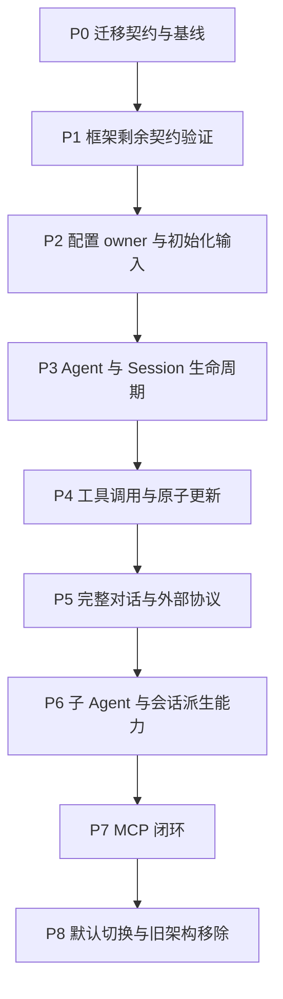

# Actor 架构实施计划

状态：分模块重构进行中；Agent/AgentLoop 已提交业务层和部分 Actor 驱动，完整执行链尚未接通。最新完成证据及待办见本文第 13、14 节；P0–P8 表示整体验收目标，不因局部测试通过而标记完成。
[设计入口](../actor-runtime-draft.md) · [各 Actor 定义](./11-actor-implementation.md) · [模块职责](./09-module-implementation.md)。

## 1. 实施约束与当前基线

在当前项目的 `refactor-actor` 分支增量实施，不另开项目。已有 MCP 工作保存在检查点 `c359000`，
后续迁移复用正确的协议与传输实现。仅修改当前 Actor 设计文档；本计划不扩散更新历史设计。
进入生产实现时，再按已确认方向修订与 Plugin/Scope 冲突的仓库规范。

运行能力直接采用 GoAkt v4.5.3。不得先创建自建系统 Runtime、技术地址注册服务、全局中转 Actor、
通用 service locator 或占位包树。Tool Runtime、Prompt Runtime 是有独立业务状态的 owner。
包按现有能力组织，框架局部适配放在实际调用方；有重复且一致的需求后再考虑提取。

按用户后续确认允许破坏性重构，底层迁移期间不要求每个模块及全仓同时编译通过，也不保留过渡性代码。
已完成模块须记录实际验证范围；同一 Agent 身份只由一套 owner 服务。最终切换仍须通过完整构建和调用链验收。

`experiments/goakt` 已有 19 项顶层契约测试，覆盖核心异步通信、业务关闭、基础旧代防护、工具更新屏障及文件 flush。
这是先前实验结果，部分测试专门复现框架限制；不等同生产验收。本次文档更新不重跑或新增宣称 Go 测试结果。
根模块与实验模块分开验证，开始实施时重新记录实际基线及既有失败。

## 2. 顺序与依赖



批次内先完成协议、状态转换和失败测试，再实现调用链。不以创建完 Actor 类型作为批次完成标准。

| 批次 | 完成后可观察的结果 | 主要 owner / 修改范围 |
| --- | --- | --- |
| P0 | 原行为、目标行为、迁移差异及验证命令有明确记录 | 组合根、各能力契约、Actor 文档 |
| P1 | 延迟回复、局部接续和最终停用具备可用于生产的证据 | GoAkt 实验及实际发起方适配方案 |
| P2 | 新建 Agent 可请求并获得版本明确的配置输入 | CredentialsActor、ModelConfigActor、WorkspaceActor；三个业务 Registry 的配置读取 |
| P3 | 同 SessionID 创建、初始化、排队、关闭与重新创建完整可用 | Agent Registry、AgentLoop、Session Registry、SessionActor |
| P4 | 一个真实工具可调用、取消和更新，A→更新→B 严格成立 | Tools Registry、Tool Runtime、ToolActor |
| P5 | 客户端完成一轮含工具及交互的对话并可重放 | Prompt Registry、Prompt Runtime、InteractionActor、LLM、接入层、通知桥接 |
| P6 | 子 Agent 生命周期与压缩、查询、投影保持既有行为 | Agent Registry、CompactionActor、QueryActor、ProjectionActor |
| P7 | MCP 配置到连接、工具更新、调用、重连及关闭完整可用 | MCPConnectionActor、MCP ToolActor、工具 owner |
| P8 | 默认服务器运行 Actor 路径，Plugin/Scope 生产路径删除 | 组合根、CLI、全部迁移调用方及能力文档 |

## 3. P0：固定迁移契约与记录基线

核对当前调用链及已有未提交工作，固定本次所用框架依赖。逐项登记原 Service/Event/Waterfall 的真实消费者，
标明哪些行为参与成功判定、哪些只是提交后通知；不能把可否决事件直接改成 PubSub。
外部协议差异必须指向既定基线的源符号、当前 Go 实现及验证 fixture。

交付迁移清单：旧入口、目标 owner、保留行为、适配位置、删除条件、对应测试。
在涉及的 owner 内确定 typed 消息、操作关联、查询结果、失败分类和取消完成语义；不新增统一万能消息 DTO。

出口：基线检查结果可复现；没有未解释的外部行为变更；各后续批次的待决项有归属。
已有失败单独记录，不能将其包装成本次通过，也不借机进行无关清理。

## 4. P1：补齐框架契约

继续使用嵌套实验模块，只补尚未证明的边界：

- Request + Then 后需要新消息上下文时，局部接续在成功、超时、取消、停用下均终止，无遗留任务或重复回复。
- Grain 重新激活后恢复所需请求策略；旧实例、旧初始化与迟到任务结果不能获得新业务授权。
- 最终框架停用与并发重新请求竞争时，不错误停用新的合法实例；确认结果交给业务生命周期 owner。
- Registry 授权和释放竞争可串行判定；Registry 故障时禁止凭空恢复授权，明确整组停止或恢复策略。

框架停用存在限制时，先收敛可实现的身份保留及重试协议，再进入生产；不能用发出停用消息冒充停用完成。
业务关闭完成必须同时满足业务结算、资源释放及框架停止条件。

出口：新增契约测试通过普通、race 与 vet 检查；每个测试明确实际证明范围。
不修改 GoAkt 源码来掩盖 API 限制，不引入第二个框架运行层。

## 5. P2：配置 owner 与创建输入

实现 CredentialsActor、ModelConfigActor 和 WorkspaceActor，保留各自配置规则与存储边界。
Session Registry、Tools Registry、Prompt Registry 提供所属配置读取与解析请求；读取阶段不创建 Session、工具或连接。
组合根只注册框架类型、启动共享 owner 并设置配置来源，不预先组装 Agent 的完整有效配置。

配置响应包含值、版本和必要业务 ID；凭据值不进入 Agent 配置、Session、错误或日志。
模型传输需要凭据时走凭据 owner 授权的解析路径。确定 Subagent 各配置字段的覆盖、权限及恢复规则，
使后续创建输入可固定为一次快照。

出口：严格解码、配置缺失、版本关联、环境优先级、并发读取及失败可观察性有测试；
只读配置请求不产生资源副作用。每个新增 Actor 有实际消费者和可运行行为。

## 6. P3：Agent 与 Session 生命周期

按[初始化方案](./10-runtime-and-initialization.md)实现：接收 SessionID → Agent Registry 预留身份 →
创建未就绪 AgentLoop → AgentLoop 请求配置 → 请求 Session 创建/恢复及必要能力初始化 → 汇总成功 → 开始业务。
本批使用明确的最小无工具配置，不把尚未实现的必要能力静默忽略。

落实业务 FIFO、独立控制消息、初始化失败清理、关闭重试和身份占用。
SessionActor 接入真实存储，独占日志提交、序号及 flush 判定；适配器仅执行请求的 I/O。
正常关闭先结算 Agent 工作，再完成 Session flush，确认 Agent 停止后关闭 Session，最后释放身份。

出口：并发同 ID 创建合并；未就绪消息不执行；初始化与关闭竞争不泄漏；关闭失败保留可重试状态；
flush 失败不虚报成功，重试不重复日志；关闭期间新消息等待，旧身份再激活无业务权限。

## 7. P4：工具调用与更新

先迁移一个真实文件工具，接通 AgentLoop → Tool Runtime → ToolActor 的异步请求和结果回写。
公共策略、预算及结算由 Tool Runtime 拥有，文件效果发生处执行安全检查；工具 I/O 通过任务回到 mailbox。

ToolActor 向共享 Tools Registry 提交所属 Agent 的注册信息。批次登记与发布由 Registry 串行判定；
同一 AgentID + ToolName 保持稳定 Grain，在内部准备候选实现与资源。
严格实现[工具更新协议](./08-tools-implementation.md)：前序业务结算 → 准备 → 原子发布目录 → 切换实现 →
释放旧资源 → 更新完成 → 后序业务。新增、删除工具分别创建、停止对应 Grain。

出口：真实多工具批次无半套目录；发布前失败保旧；确认丢失可查询原操作；发布后释放失败阻止 B 并可重试；
候选实现不可执行，旧版本调用被拒绝；取消、权限、结果 schema 和多 Agent 隔离全部覆盖。
PubSub 只通知目录变化，不能解除更新屏障。之后逐类迁移其余内置工具，不留下未说明的缺失能力。

## 8. P5：完整对话与协议

实现 Prompt Runtime 的版本固定组装、InteractionActor 的结构化问答及审批状态。
模型配置经 ModelConfigActor 获取，复用正确 LLM transport；流式 I/O 通过受管理任务推进，AgentLoop 保留本轮执行权威。
落实 Prompt 更新的应用时机；在未明确前只保证单次模型请求使用固定快照，不扩大为全局更新屏障。

贯通接入 → Agent Registry → AgentLoop → Prompt/LLM → 工具/交互 → Session 提交 → 下行。
NotificationBridge 和框架 TopicActor 处理提交后事实通知，明确缓冲溢出后的补读或失败行为。
保留 HTTP、WebSocket、请求关联、取消、KeepInbox、结构化提问和历史重放语义。

出口：无密钥 fixture 完成真实服务器调用链；TypeScript→Go golden 覆盖 wire、顺序、错误和取消；
断连、慢消费者、迟到流输出不会污染新一轮。真实 provider 测试无凭据时明确跳过，不能取代 keyless 验收。

## 9. P6：子 Agent 与会话派生能力

落实一次性 parent 有效配置快照 + child 覆盖；child 创建后仍请求各组件解析和初始化。
父子 membership、结果回报、父关闭期间禁止新建 child、child-first 关闭保持原语义，无运行期 Scope 回查。

实现 CompactionActor 的快照任务、取消和提交冲突处理，最终日志提交仍归 SessionActor。
ProjectionActor 管投影进度、追赶及重建；QueryActor 管查询准入、快照、游标和取消，简单读取不机械增加转发。

出口：父子配置独立、关闭顺序正确；压缩与新写入竞争不覆盖新数据；投影重放幂等、失败可恢复；
查询的一致性与取消有明确测试，存储适配器不接管上述业务决策。

## 10. P7：MCP 闭环

以检查点中的协议实现为起点，迁入每 Agent + server 的 MCPConnectionActor，首阶段不跨 Agent 共享连接。
先核对连接替换失败的既有可观察行为与新工具发布协议是否冲突，再确定兼容映射；有差异时记录具体迁移决定。

完成配置、连接、工具发现、批次更新、调用、请求关联、取消、重连和释放。
远端目录变化进入 Agent 工具更新 FIFO，连接层不得绕过 Tool Runtime 直接替换模型可见工具集。

出口：本地可控 MCP server 覆盖目录变动、断连、重复/迟到响应、取消及关闭；跨 Agent 连接和权限隔离；
不存在只有 SDK 方法而没有服务器入口或生命周期的半实现。

## 11. P8：默认切换与删除旧路径

核对迁移清单全部完成，再将组合根默认切换到 Actor。移除 Plugin、Scope、旧注册和监听生命周期路径、
临时适配及已无消费者的依赖；不保留两个 LLM runtime 或两个同职责 Agent owner。
启动失败逆序清理，服务器关闭覆盖全部 owner 和资源，CLI 与外部载体维持兼容。

每个真实能力包更新 colocated README.zh-CN.md，描述运行模型、上下游和失败行为。
实现/测试/依赖与设计文档分开提交；本计划本身不执行提交。

最终出口：根模块执行适用的格式、依赖、普通测试、race、vet、build 和架构检查；实验模块独立验证。
如修改 Web 源码，再执行锁定依赖安装和生产构建；文档执行链接及空白检查。
报告真实运行命令、已有失败和未覆盖边界。只有完整调用链、生命周期及外部协议验收通过后才宣布迁移完成。

## 12. 当前工作入口

下一步先收敛 AgentLoop 主驱动的业务入口、异步请求、完成消息和失败处理，再按第 14 节补齐实现；不重新从已完成的模块初始化工作开始。

设计依据：[Agent 职责](./32-agent-module.md) · [AgentLoop 需求与实现](./30-agentloop-business.md) · [Prompt](./17-prompt-module.md) · [工具调用与更新](./08-tools-implementation.md)。

## 13. 已完成进度（2026-09-08）

分支为 `refactor-actor`。代码提交 `9c6e055`，文档提交 `73064b6`，均已完成本地提交，未推送。以下是已提交切片，不表示整个 AgentLoop 或 P3–P8 已完成。

| 已完成切片 | 实现与验证入口 |
| --- | --- |
| 业务 Agent 与运行 Client 分离；输入提交确认、取消意图及已接纳执行 | [业务准入测试](../../agentloop/agent_admission_test.go)、[Client 测试](../../agentloop/actor/client_test.go) |
| Agent Registry 身份、父子关系及当前资源范围的关闭协调 | [Registry 测试](../../agent/registry/grain_test.go) |
| ReactLoopAgent 生命周期、Turn/Step 合法转换及真实提交确认 | [生命周期测试](../../agentloop/agent_lifecycle_test.go)、[Step 测试](../../agentloop/agent_step_test.go) |
| Session、模型配置、Prompt 的异步初始化片段 | [Grain 测试](../../agentloop/actor/grain_test.go)、[配置测试](../../agentloop/actor/configuration_test.go) |
| Step 领取、上下文读取、Prompt 组装、pre-step 决策及输入提交 | [准备驱动测试](../../agentloop/actor/grain_step_test.go) |
| 领取及 Step 开始提交结果不确定时回读核对 | [领取恢复测试](../../agentloop/agent_input_recovery_test.go)、[准备驱动测试](../../agentloop/actor/grain_step_test.go) |
| Turn 结束提交、必要回读和 Session flush；失败保留重试位置 | [业务收尾测试](../../agentloop/agent_settlement_test.go)、[Actor 收尾测试](../../agentloop/actor/grain_settlement_test.go) |
| ModelRequest/Attempt 业务规则及部分模型流调度 | [请求业务测试](../../agentloop/internal/modelrequest/model_request_test.go)、[流调度](../../agentloop/actor/grain_stream.go) |

提交前对暂存快照独立执行以下检查并通过，排除了未暂存改动对这些包的影响：

```sh
go test -race -count=1 ./agent/... ./agentloop/... ./systemprompt/... ./session
go vet ./agent/... ./agentloop/... ./systemprompt/... ./session
go build ./agent/... ./agentloop/... ./systemprompt/... ./session
```

这里 `./session` 仅指根包。`agent/actor`、`agent/middleware`、`agent/middleware/actor` 当时没有包内测试，命令通过不能作为这些包已有独立行为覆盖的证据。文档检查覆盖暂存 Markdown 的 78 个本地链接目标，`git diff --check` 通过。最初 backlog 更新仅执行文档检查；其后 AL-04 的取消修复在当前工作区重新通过 `go test -count=1 ./agentloop/...`、`go test -race -count=1 ./agent/... ./agentloop/...`、相同 Agent/AgentLoop 范围的 vet 和 build，4 份变更文档的 40 个本地链接目标及差异检查通过。后续验证不扩展到全仓或完整执行链。

全仓构建尚未通过：`internal/assembly/catalog.go` 仍引用已删除的 Agent、AgentLoop、Session Query/Title factory。API Proxy、装配、Subagent、Compaction、TokenMeter 等未完成改动仍在工作区，不包含在上述提交完成声明内。真实模型、工具、磁盘持久化和完整客户端对话不能由局部夹具测试代替。

## 14. AgentLoop Backlog

以下项目全部保持未完成；“部分实现”仅表示已有可复用代码。实现前更新所属模块设计，完成后在本节登记代码位置、测试范围和提交号。这里记录验收缺口，不另行改变模块所有权。

### AL-01 消息唤醒与主驱动 — 部分实现

Owner：AgentLoop 业务层与 Actor。输入准入及已接纳执行的业务记录已有实现，Actor 尚未把它们串到 Turn 开始、Step 循环和 FinishActivity。

验收：通过真实异步 Client 输入启动执行；Followup、Steer、Inject 的唤醒语义分别成立；输入删除、取消后新输入、连续 Turn 不漏执行或重复执行；WhenIdle 等待后继工作及资源收尾结束。主驱动的每个异步边界须有具名完成消息，合法转换只由业务状态机决定。

### AL-02 完整模型请求 — 部分实现

Owner：AgentLoop、Agent 中间件、LLM。ModelRequest 已有业务实现，Actor 的 requestModel 仍接收 PreparedLlmCall，尚未驱动完整请求链。

主驱动依赖已核对：llm/runtime_service.go 与 prepared_call.go 仍是旧 Runtime/PreparedLlmCall 绑定；当前没有 LLM 请求 Actor。Tools 仅有 Registry Actor，tools/runtime.go 仍是旧 executionRuntime，不能将其描述为每 Agent Tool Runtime 已接通。完整调度接线必须包含这两个 owner 的迁移，不通过提前注入调用或同步执行包装绕过。

模型请求取消已统一由 ReactLoopAgent 读取：StartRequest 拒绝取消后新建，AdvanceRequest 不再接收外部取消参数，单次 BeginModel 拒绝取消后启动或与完整请求并行。[业务测试](../../agentloop/agent_request_test.go) 覆盖请求前、历史读取后、配置回复后的取消及重复启动/完成拒绝；AgentLoop 范围的 race、vet、build 通过。该修复未接通实际 LLM 请求，AL-02 保持未完成。

验收：每次尝试重新读取 Session、调用配置中间件、准备 LLM 调用并验证模型可见输入；请求头、上下文、流块与最终消息按原契约提交；错误恢复决定重试；取消及关闭失败不提前续步。替代流与真实 Adapter 终端均须覆盖。需迁移 LLM owner 的旧实现，不增加第二套 Runtime 或兼容包装。

### AL-03 每 Agent 工具运行与批次调度 — 部分实现

Owner：AgentLoop 批次业务、Tools Registry、Tool Runtime、ToolActor。已有 ToolBatch 规则，AgentLoop 尚未接通工具实例及真实调用。

验收：本 Agent 的实例初始化完成后才执行工具；并发上限、独占工具、模型顺序提交、取消与结果收尾、additionalContexts、concludesTurn 均进入同一 Step/Turn 流程。策略、审批及执行限制由工具 owner 执行。

### AL-04 turn-stopping 异步钩子 — 内部驱动已实现，主驱动未接通

Owner：AgentLoop 与 Agent 中间件。新增 grain_turn.go 内部异步调用边界，主驱动尚未调用。

验收：按序等待钩子，期间允许 Steer 与取消；钩子返回后读取已提交 Inbox 决定同 Turn 续步或收尾；失败不能作为普通通知吞掉；拒绝重复或越阶段的完成请求。取消权威来源已修正：CompleteStopping 不再接收外部 cancellation；ContinueTurn、CompleteStopping 与首次 PrepareTurnEnd 读取业务对象已记录的取消意图。私有停止转换不能被外部跳过；固定后的结束事实不受迟到取消改写。新增 [边界测试](../../agentloop/agent_turn_flow_test.go) 覆盖 Steer/取消顺序、钩子失败、重复完成和固定结论。此项修复已随代码提交 `d16dad0` 完成。Actor 内部驱动通过具名完成消息调用 CompleteStopping；[交错测试](../../agentloop/actor/grain_turn_test.go) 验证等待期间 Steer、取消确认与原钩子完成分离，以及禁止提前收尾。该测试已使用真实 GoAkt、中间件协调器和具名处理者夹具，覆盖取消投递失败重试且保留首次原因；不代表真实业务钩子和主驱动已接通，AL-04 保持未完成。

### AL-05 工具更新屏障 — 未接通

Owner：Tools Registry、Tool Runtime、Prompt Runtime、AgentLoop。初始化读取工具基线已实现，不代表动态更新屏障已完成。

验收：A 用户消息完整处理结束后才应用更新，更新完成后执行 B；实例、工具定义及 Prompt 使用一致版本；重复、迟到、失败更新不解除屏障，不修改 A 的快照。按已确认工具协议补齐生产事件消费及确认。

### AL-06 维护、取消与异常收敛 — 部分实现

Owner：AgentLoop。已有部分提交恢复与资源关闭，维护流程及主驱动重试仍缺失。

验收：维护与执行互斥，维护期间唤醒不丢失；覆盖领取、Turn/Step 开始、逐条消息、模型/工具结果和结束提交的不确定结果。未确认写入不得按失败回复直接回滚；回读或关闭失败保留所需事实并支持明确重试。业务关闭及 WhenIdle 不能早于这些工作结束。

取消投递补充：GoAkt v4.5.3 本地 TellGrain 经 localSend 等待 err 通道确认，GrainContext.Response 不确认该通道。停止钩子、AgentLoop 准备阶段及 Agent 中间件内部的取消均已改为异步 RequestGrain 并检查 Completion。准备阶段仅取消正在等待的 Prompt 或 pre-step 请求，不向尚未调用的组件发送取消。取消投递错误与原 Invoke 的业务失败分开，允许重试投递且不阻断原调用退出。新增 [准备取消测试](../../agentloop/actor/grain_cancel_test.go) 和实际协调器交错测试；Agent/AgentLoop 范围的非缓存 race、vet、build 再次通过。新增 [多层 around 测试](../../agent/middleware/actor/grain_cancel_test.go) 验证正常返回、取消等待下游退出、非法下游回复时释放 Continue 并等待上游结束；Agent/AgentLoop 范围的非缓存 race、vet、build 通过。完成取消请求的内部消息统一命名 completeCancel，不表示原业务执行结束。Turn 开始已切换为幂等提交，删除 ReconcileTurnStart 和 Actor 回读分支；[业务测试](../../agentloop/turn_start_test.go) 与 [Actor 测试](../../agentloop/actor/grain_start_test.go) 覆盖回复丢失、未提交重试、取消后保持同一身份及零回读。完整主驱动、维护及其余写入迁移仍未完成，AL-06 保持未完成。

### AL-07 生产装配及上下游迁移 — 未完成

Owner：组合根、Registry、API Proxy、Subagent 及各资源 owner。

验收：移除已删除 factory 的引用，接通唯一 Actor 创建路径；父关闭先完成子关闭，各 Agent 自行释放资源；同 SessionID 再创建受到旧回复防护。保留现有客户端协议和取消契约，删除旧 Plugin/Scope 调用，不新增占位兼容层。

### AL-08 完整回归验收 — 未完成

Owner：各行为所属模块及生产组合。

验收：真实 Actor 链覆盖普通对话、工具、审批、Steer、取消、模型重试、工具更新、父子关闭及 Session flush/replay；单独验证真实存储和可选真实 provider。最终运行适用全仓测试、race、vet、build、架构及协议检查，准确记录失败和测试跳过情况。局部包通过不关闭此项。

### AL-09 当前文档一致性 — 部分清理

Owner：当前 Actor 设计与模块 README。已修正本实施计划的旧起点及 AgentLoop Actor README 中的 execution/WhenIdle 旧描述。

验收：继续核对设计演进段落与当前代码，移除或明确标识已废弃接口、阶段及验证结论；进度统一指向本节。仅维护当前 Actor 文档和相关模块 README，不扩散到历史设计。


### Session 幂等迁移进度（未提交）

已实现 IdempotentWrite、Log 的原提交核对与分离结果返回、Grain 的重复通知抑制；TurnEnd 写入已采用此契约，删除对应 AgentLoop 回读分支。验证覆盖重复结果、后续追加后仍返回原范围、日志重建后的重试、内容冲突、伪造回执拒绝和实际 PubSub 不重复通知。Session/Agent/AgentLoop 子包范围的非缓存 race、vet、build 通过，新增 PubSub 测试单独通过 race。

Turn 开始已完成幂等迁移。下一步迁移 Step、Inbox 和模型/工具结果的幂等身份，逐项删除相应回读补偿。普通 Batch 仍非幂等；主驱动与全仓迁移目标未完成。上文关于 Turn 结束回读的进度由此记录替代。

### 本次进度提交（2026-09-08）

代码提交 `d16dad0` 包含 Session 可选幂等写入契约、Turn 开始与结束的原结果重试、停止钩子调度及异步取消确认。普通 Batch 仍是无条件追加；完整主驱动、LLM 与 Tool Runtime 接线仍按上述 backlog 推进。

本次在工作区执行 `go test -race -count=1 ./session/... ./agent/... ./agentloop/...`、同范围 `go vet` 和 `go build`，全部通过。文档本地文件链接与 `git diff --check` 通过；未据此声明整仓或生产对话链路通过。

### 普通 Agent 激活与 API 接线审计（2026-09-09）

[激活入口设计](./39-agent-activation.md) 记录已核对的上游缺口：Agent Registry 已实现 CreateAgent/Resolve/CloseAgent，统一核心组件及能力 Registry 的生命周期；AgentLoop 只初始化并释放自身执行状态，不再启动其他 Actor。API 不应通过新 map 或旧 Scope/ModelSelectionRef 补偿这些缺口。

RPC、Credentials、LLM、Settings、Preset、Commands API 已迁移至领域子模块；Commands 运行客户端真实 Grain 测试通过。Session API 业务与旧依赖已分离；普通 Agent Actor Client、事件订阅与生产组装仍未完成。Subagent 暂缓，不以其历史 Session 来源代替普通 Agent 当前归属检查。

### Agent 生命周期与命名迁移（本次工作区）

生命周期实现及验收依据见 [Agent 生命周期](./39-agent-activation.md) 和 [Registry README](../../agent/registry/README.zh-CN.md)。Registry 以 SessionID 索引创建身份，Actor 名称统一 `<sessionID>.<service>`；共享 Initialize、Session 初始化/恢复、Commands 和 Projection Cache 初始化显式传递业务身份，不从 Name 解析。RuntimeName 放在各服务已有消息文件，不保留独立单函数文件或旧名称回退。

已实现并发创建共享、固定输入冲突拒绝、初始化最终确认、初始化期间关闭、逆序组件关闭与失败重试、Session flush 完成后释放身份、同 SessionID 再创建和旧激活校验。Compaction 启动由它自己的 Registry 处理，Agent Registry 只使用通用组件生命周期消息。

API Proxy 的 ordinary Resolver、旧 Session/Scope 清理和生产组合仍是独立待办，Subagent 暂缓；不得将本次生命周期验证替代 AL-08 全链回归。
