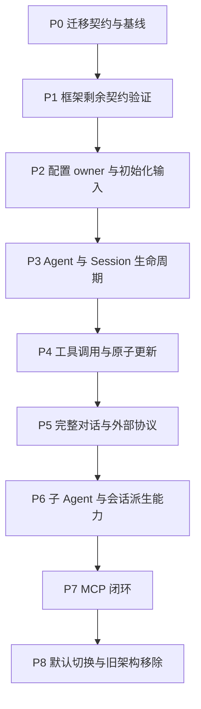

# Actor 架构实施计划

状态：P0/P1 已开始，P2 的 Credentials 和 ModelConfig 默认读取生产切片已实现；AgentLoop 版本化配置接入和其余能力待实施。本文确定执行顺序与验收出口，不表示生产代码已迁移。
[设计入口](../actor-runtime-draft.md) · [各 Actor 定义](./11-actor-implementation.md) · [模块职责](./09-module-implementation.md)。

## 1. 实施约束与当前基线

在当前项目的 `refactor-actor` 分支增量实施，不另开项目。已有 MCP 工作保存在检查点 `c359000`，
后续迁移复用正确的协议与传输实现。仅修改当前 Actor 设计文档；本计划不扩散更新历史设计。
进入生产实现时，再按已确认方向修订与 Plugin/Scope 冲突的仓库规范。

运行能力直接采用 GoAkt v4.5.3。不得先创建自建系统 Runtime、技术地址注册服务、全局中转 Actor、
通用 service locator 或占位包树。Tool Runtime、Prompt Runtime 是有独立业务状态的 owner。
包按现有能力组织，框架局部适配放在实际调用方；有重复且一致的需求后再考虑提取。

每批完成一条可运行的业务路径，保持编译通过。过渡期由组合根选择完整实现，同一 Agent 身份只能由
一套 owner 服务，不在单个 Agent 内交叉使用新旧状态机。未达到最终切换标准前，实验路径不能宣称可替换服务器。

`experiments/goakt` 已有 19 项顶层契约测试，覆盖核心异步通信、业务关闭、基础旧代防护、工具更新屏障及文件 flush。
这是先前实验结果，部分测试专门复现框架限制；不等同生产验收。本次文档更新不重跑或新增宣称 Go 测试结果。
根模块与实验模块分开验证，开始实施时重新记录实际基线及既有失败。

## 2. 顺序与依赖

批次内先完成协议、状态转换和失败测试，再实现调用链。不以创建完 Actor 类型作为批次完成标准。

| 批次 | 完成后可观察的结果 | 主要 owner / 修改范围 |
| --- | --- | --- |
| P0 | 原行为、目标行为、迁移差异及验证命令有明确记录 | 组合根、各能力契约、Actor 文档 |
| P1 | 延迟回复、局部接续和最终停用具备可用于生产的证据 | GoAkt 实验及实际发起方适配方案 |
| P2 | 新建 Agent 可请求并获得版本明确的配置输入 | CredentialsActor、ModelConfigActor、WorkspaceActor；三个业务 Registry 的配置读取 |
| P3 | 同 SessionID 创建、初始化、排队、关闭与重新创建完整可用 | Agent Registry、AgentLoop、Session Registry、SessionActor |
| P4 | 一个真实工具可调用、取消和更新，A→更新→B 严格成立 | Tools Registry、Tool Runtime、ToolActor |
| P5 | 客户端完成一轮含工具及交互的对话并可重放 | Prompt Registry、Prompt Runtime、InteractionActor、LLM、接入层、通知桥接 |
| P6 | 子 Agent 生命周期与压缩、查询、投影保持既有行为 | Agent Registry、CompactionActor、QueryActor、ProjectionActor |
| P7 | MCP 配置到连接、工具更新、调用、重连及关闭完整可用 | MCPConnectionActor、MCP ToolActor、工具 owner |
| P8 | 默认服务器运行 Actor 路径，Plugin/Scope 生产路径删除 | 组合根、CLI、全部迁移调用方及能力文档 |

## 3. P0：固定迁移契约与记录基线

核对当前调用链及已有未提交工作，固定本次所用框架依赖。逐项登记原 Service/Event/Waterfall 的真实消费者，
标明哪些行为参与成功判定、哪些只是提交后通知；不能把可否决事件直接改成 PubSub。
外部协议差异必须指向既定基线的源符号、当前 Go 实现及验证 fixture。

交付迁移清单：旧入口、目标 owner、保留行为、适配位置、删除条件、对应测试。
在涉及的 owner 内确定 typed 消息、操作关联、查询结果、失败分类和取消完成语义；不新增统一万能消息 DTO。

出口：基线检查结果可复现；没有未解释的外部行为变更；各后续批次的待决项有归属。
已有失败单独记录，不能将其包装成本次通过，也不借机进行无关清理。

## 4. P1：补齐框架契约

继续使用嵌套实验模块，只补尚未证明的边界：

- Request + Then 后需要新消息上下文时，局部接续在成功、超时、取消、停用下均终止，无遗留任务或重复回复。
- Grain 重新激活后恢复所需请求策略；旧实例、旧初始化与迟到任务结果不能获得新业务授权。
- 最终框架停用与并发重新请求竞争时，不错误停用新的合法实例；确认结果交给业务生命周期 owner。
- Registry 授权和释放竞争可串行判定；Registry 故障时禁止凭空恢复授权，明确整组停止或恢复策略。

框架停用存在限制时，先收敛可实现的身份保留及重试协议，再进入生产；不能用发出停用消息冒充停用完成。
业务关闭完成必须同时满足业务结算、资源释放及框架停止条件。

出口：新增契约测试通过普通、race 与 vet 检查；每个测试明确实际证明范围。
不修改 GoAkt 源码来掩盖 API 限制，不引入第二个框架运行层。

## 5. P2：配置 owner 与创建输入

实现 CredentialsActor、ModelConfigActor 和 WorkspaceActor，保留各自配置规则与存储边界。
Session Registry、Tools Registry、Prompt Registry 提供所属配置读取与解析请求；读取阶段不创建 Session、工具或连接。
组合根只注册框架类型、启动共享 owner 并设置配置来源，不预先组装 Agent 的完整有效配置。

配置响应包含值、版本和必要业务 ID；凭据值不进入 Agent 配置、Session、错误或日志。
模型传输需要凭据时走凭据 owner 授权的解析路径。确定 Subagent 各配置字段的覆盖、权限及恢复规则，
使后续创建输入可固定为一次快照。

出口：严格解码、配置缺失、版本关联、环境优先级、并发读取及失败可观察性有测试；
只读配置请求不产生资源副作用。每个新增 Actor 有实际消费者和可运行行为。

## 6. P3：Agent 与 Session 生命周期

按[初始化方案](./10-runtime-and-initialization.md)实现：接收 SessionID → Agent Registry 预留身份 →
创建未就绪 AgentLoop → AgentLoop 请求配置 → 请求 Session 创建/恢复及必要能力初始化 → 汇总成功 → 开始业务。
本批使用明确的最小无工具配置，不把尚未实现的必要能力静默忽略。

落实业务 FIFO、独立控制消息、初始化失败清理、关闭重试和身份占用。
SessionActor 接入真实存储，独占日志提交、序号及 flush 判定；适配器仅执行请求的 I/O。
正常关闭先结算 Agent 工作，再完成 Session flush，确认 Agent 停止后关闭 Session，最后释放身份。

出口：并发同 ID 创建合并；未就绪消息不执行；初始化与关闭竞争不泄漏；关闭失败保留可重试状态；
flush 失败不虚报成功，重试不重复日志；关闭期间新消息等待，旧身份再激活无业务权限。

## 7. P4：工具调用与更新

先迁移一个真实文件工具，接通 AgentLoop → Tool Runtime → ToolActor 的异步请求和结果回写。
公共策略、预算及结算由 Tool Runtime 拥有，文件效果发生处执行安全检查；工具 I/O 通过任务回到 mailbox。

ToolActor 向共享 Tools Registry 提交所属 Agent 的注册信息。批次登记与发布由 Registry 串行判定；
同一 AgentID + ToolName 保持稳定 Grain，在内部准备候选实现与资源。
严格实现[工具更新协议](./08-tools-implementation.md)：前序业务结算 → 准备 → 原子发布目录 → 切换实现 →
释放旧资源 → 更新完成 → 后序业务。新增、删除工具分别创建、停止对应 Grain。

出口：真实多工具批次无半套目录；发布前失败保旧；确认丢失可查询原操作；发布后释放失败阻止 B 并可重试；
候选实现不可执行，旧版本调用被拒绝；取消、权限、结果 schema 和多 Agent 隔离全部覆盖。
PubSub 只通知目录变化，不能解除更新屏障。之后逐类迁移其余内置工具，不留下未说明的缺失能力。

## 8. P5：完整对话与协议

实现 Prompt Runtime 的版本固定组装、InteractionActor 的结构化问答及审批状态。
模型配置经 ModelConfigActor 获取，复用正确 LLM transport；流式 I/O 通过受管理任务推进，AgentLoop 保留本轮执行权威。
落实 Prompt 更新的应用时机；在未明确前只保证单次模型请求使用固定快照，不扩大为全局更新屏障。

贯通接入 → Agent Registry → AgentLoop → Prompt/LLM → 工具/交互 → Session 提交 → 下行。
NotificationBridge 和框架 TopicActor 处理提交后事实通知，明确缓冲溢出后的补读或失败行为。
保留 HTTP、WebSocket、请求关联、取消、KeepInbox、结构化提问和历史重放语义。

出口：无密钥 fixture 完成真实服务器调用链；TypeScript→Go golden 覆盖 wire、顺序、错误和取消；
断连、慢消费者、迟到流输出不会污染新一轮。真实 provider 测试无凭据时明确跳过，不能取代 keyless 验收。

## 9. P6：子 Agent 与会话派生能力

落实一次性 parent 有效配置快照 + child 覆盖；child 创建后仍请求各组件解析和初始化。
父子 membership、结果回报、父关闭期间禁止新建 child、child-first 关闭保持原语义，无运行期 Scope 回查。

实现 CompactionActor 的快照任务、取消和提交冲突处理，最终日志提交仍归 SessionActor。
ProjectionActor 管投影进度、追赶及重建；QueryActor 管查询准入、快照、游标和取消，简单读取不机械增加转发。

出口：父子配置独立、关闭顺序正确；压缩与新写入竞争不覆盖新数据；投影重放幂等、失败可恢复；
查询的一致性与取消有明确测试，存储适配器不接管上述业务决策。

## 10. P7：MCP 闭环

以检查点中的协议实现为起点，迁入每 Agent + server 的 MCPConnectionActor，首阶段不跨 Agent 共享连接。
先核对连接替换失败的既有可观察行为与新工具发布协议是否冲突，再确定兼容映射；有差异时记录具体迁移决定。

完成配置、连接、工具发现、批次更新、调用、请求关联、取消、重连和释放。
远端目录变化进入 Agent 工具更新 FIFO，连接层不得绕过 Tool Runtime 直接替换模型可见工具集。

出口：本地可控 MCP server 覆盖目录变动、断连、重复/迟到响应、取消及关闭；跨 Agent 连接和权限隔离；
不存在只有 SDK 方法而没有服务器入口或生命周期的半实现。

## 11. P8：默认切换与删除旧路径

核对迁移清单全部完成，再将组合根默认切换到 Actor。移除 Plugin、Scope、旧注册和监听生命周期路径、
临时适配及已无消费者的依赖；不保留两个 LLM runtime 或两个同职责 Agent owner。
启动失败逆序清理，服务器关闭覆盖全部 owner 和资源，CLI 与外部载体维持兼容。

每个真实能力包更新 colocated README.zh-CN.md，描述运行模型、上下游和失败行为。
实现/测试/依赖与设计文档分开提交；本计划本身不执行提交。

最终出口：根模块执行适用的格式、依赖、普通测试、race、vet、build 和架构检查；实验模块独立验证。
如修改 Web 源码，再执行锁定依赖安装和生产构建；文档执行链接及空白检查。
报告真实运行命令、已有失败和未覆盖边界。只有完整调用链、生命周期及外部协议验收通过后才宣布迁移完成。

## 12. 下一次实际工作

从 P0 开始：读取生产调用链，形成迁移契约清单并记录根模块基线；随后完成 P1 的剩余框架实验。
不从批量创建 Actor 文件、建立 Runtime 包或删除 Plugin 开始。

实施记录：[迁移基线](./13-migration-baseline.md) · [局部接续设计](./14-continuation-design.md)。

首个生产能力切片：[Credentials 模块设计](./15-credentials-module.md)。

模型配置切片：[ModelConfig 模块设计](./16-model-config-module.md)。

Prompt 业务快照拆分：[Prompt 模块设计](./17-prompt-module.md)，尚未完成该模块 Grain/装配切换。
