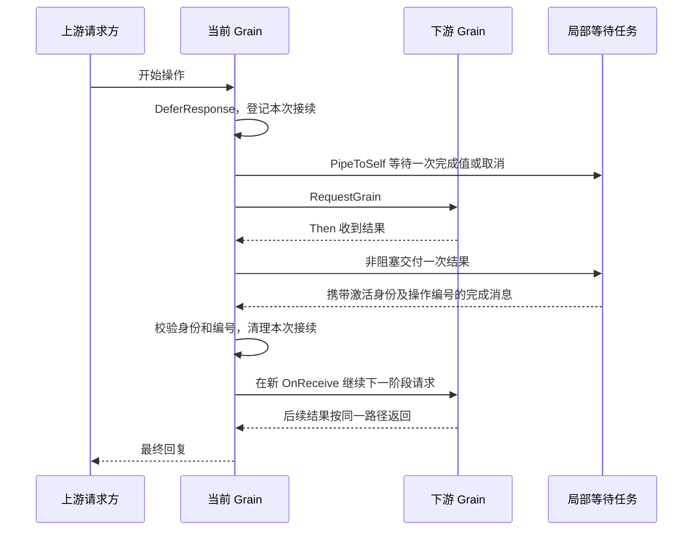

# 局部异步接续设计与验证

状态：已按先设计后实现完成局部实验及验证，尚未迁入生产。所属批次 P1；不是新的生产模块或系统 Runtime。
上位契约见[通信机制](./06-messaging-and-tasks.md)及[各 Actor 定义](./11-actor-implementation.md)。

## 1. 问题与根因

GoAkt v4.5.3 的 Then 回调不提供新的 GrainContext；原上下文只在本次 OnReceive 有效。
需要在后续阶段继续 Request 时，不能捕获旧上下文，也不能在回调内同步 TellGrain 给自身等待处理。

框架 `GrainContext.PipeToSelf` 委托 `PipeToGrain`，最终通过 `ActorSystem.TellGrain` 投递到稳定身份。
这不是对某次激活的定向投递，停用后迟到结果可能重新激活 Grain。框架任务超时也不意味着实际 task 已退出。
源码依据：[grain_context.go](https://github.com/Tochemey/goakt/blob/v4.5.3/actor/grain_context.go)。

## 2. 模块架构

本批以 ContinuationGrain 模拟一个分阶段请求 owner，文件 `continuation_grain_test.go` 包含其完整实现及测试。
它保留一个当前请求，并在结果回到新 OnReceive 后继续下一个异步请求。
后续生产能力复制明确的局部规则，不先提取公共 Runtime 或通用业务消息框架。

## 3. 接口设计与上下游契约

实验开始消息提供目标 GrainIdentity、请求超时及阶段数量；不携带下游对象。
上游通过 Request 得到最终响应，查询消息在等待时仍能处理。
取消请求仅取消本 owner 的框架等待；它不证明下游业务已取消。本批使用无实际效果的下游 fixture。
真实工具取消必须使用独立业务命令，并等其效果结算。

业务完成响应使用 `continuationOutcome{Payload, Err}`；上游先判断框架请求 error，再读取业务 Err。

关闭消息停止接纳并取消本地等待，完成消息回到 mailbox 后才回复“本地接续已排空”。
此响应不叫业务关闭完成，不代表下游效果、Session flush 或最终框架停用已经完成。
异常 OnDeactivate 取消剩余等待任务；不能在 hook 同步等待会向自身投递的任务。

Then 只向容量为 1 的私有完成通道交付值，不修改 owner，也不持有 GrainContext。
任务捕获取消上下文、通道、激活身份和操作编号，不引用 owner。完成消息一律确认投递，即使已过期。
框架请求在发起后必须登记 Then；失败/超时均成为同一种带关联的完成值，不能丢失错误。

## 4. 关键数据结构

`ContinuationGrain` 保存本次激活的随机身份、单调操作编号、当前 continuation、待回复的上游请求及关闭状态。
随机身份仅用于拒绝旧 task 结果，不承担业务授权或持久化身份。业务 Registry 的授权仍独立必要。

`continuation` 表示一次本地等待：编号、取消函数、框架 RequestCall。它不保存 owner 或下游业务对象。
`continuationResult` 表示一次完成：激活身份、编号、payload 和 error；只用于实验，生产使用所属业务的 typed 结果。
测试观测通道只由 driver 消费，用于确认等待 task 退出，生产协议不暴露这些通道。

对象图为 owner → continuation → 框架 handle；任务 → 不可变输入及取消上下文。
自定义业务对象无 continuation → owner 反向引用，不捕获 GrainContext。GoAkt handle 的框架内部引用不由本实验改造。
所有 owner 状态变更仅在 OnReceive 内发生。

## 5. 设计决策

保留 Grain 的稳定业务身份，增加完成消息的激活匹配，不通过修改 Grain key 规避旧代问题。
每个等待任务有显式取消和退出路径，不用 WithTimeout 替代实际任务取消。
业务错误保留 Go `error` 类型。进程内业务响应携带 `Err error`，通过 `GrainReply.Response` 作为普通消息值返回，
不使用 `GrainReply.Err` 传递需要保留具体类型、包装链和 `errors.Is/As` 语义的业务错误。
`Then` 的 error 参数表示框架请求失败；业务响应的 Err 表示业务操作失败。取消保留 `context.Canceled`，
不额外发明取消结果类型。框架错误通道将普通 error 转为字符串并以 `errors.New` 重建，这也是两类通道需要区分的原因。
本约定适用于当前进程内消息；未来若启用远程消息，须单独设计错误编码，不能假定 Go error 可直接跨进程序列化。
一次结果投递使用有缓冲通道且不关闭，避免停用清理与 Then 竞争产生阻塞或 send-on-closed-channel。
新阶段只能在新消息处理上下文发起；旧完成、重复完成不会推进状态或重复回复。

最终框架停用单独验证 TellGrain 返回值与 OnDeactivate 返回的先后、错误传播。
该实验不把稳定身份当作精确停止令牌，也不证明重复旧停用命令不会命中新激活；后者须在生命周期 owner
设计中保证单一停用事务、保留身份占用及无悬挂重试，并以竞争测试验证。

## 6. 验收

覆盖多阶段成功、下游错误、等待超时、取消、正常排空、强制停用后任务退出，以及旧完成对新激活无效。
以显式 gate 和观测消息控制竞争，不用固定 sleep 猜测业务先后；最终测试超时只作失败上限。
`error_reply_grain_test.go` 的 ErrorReplyGrain 用同一个包装错误对照两条路径，验证业务消息保留 `errors.Is/As`，
框架错误通道只保留描述。`deactivation_grain_test.go` 的 DeactivationGrain 验证停用 hook 成功与失败的确认时机。
测试 driver 可以同步 Ask，所有 fixture owner 间只使用 Request/Then。

新增文件命名对应 fixture 职责；若拆分 ContinuationGrain 方法，继续使用 `continuation_grain_` 前缀。
结构体字段和 keyed literal 纵向排列。普通测试、race、vet 通过后再记录实际证据与未覆盖范围。

## 7. 2026-09-07 验证结果与边界

新增 6 项顶层测试，实验模块合计 25 项。实际执行 `go test -count=1 -timeout=60s ./...`、
`go test -race -count=1 -timeout=60s ./...`、`go vet ./...`，全部通过。

ContinuationGrain 验证新上下文发起第二次请求、错误/超时、取消/本地排空、强制停用后等待任务退出。
重新激活后再次发起请求，再投递旧激活且编号相同的完成值，验证不能结算新操作，并验证重新激活恢复请求策略。
ErrorReplyGrain 对照证明进程内 Err error 保留原对象、errors.Is、errors.As，而框架错误 envelope 丢失普通错误类型。
DeactivationGrain 验证 Tell 停用在 hook 完成之后返回，并保留 hook 失败信息。

本批未验证框架内部全部 goroutine 无泄漏；退出观测只覆盖本地等待 task。未证明投递失败后的生产恢复、
同一身份的停用重试与新授权竞争、Registry 故障恢复、完整业务资源排空。P1 仍有这些剩余工作，不能宣布整体完成。
