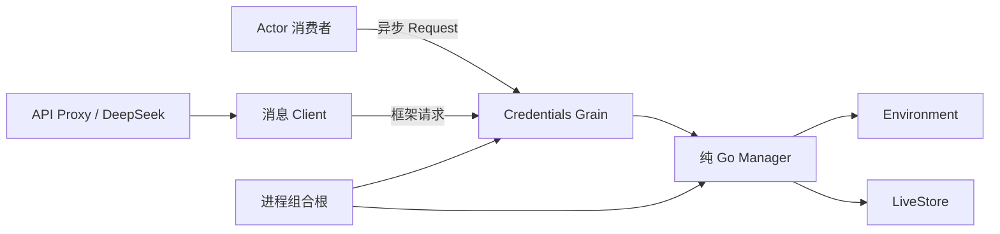

# Credentials 模块设计

状态：本次提交包含 Credentials 业务层、存储适配及 Grain/Client。下述生产装配与调用方迁移仍在工作区，未包含在本次模块提交中。
本文先于代码形成，并按本轮确认收敛为简单 get/set Actor。上位契约见[各 Actor 定义](./11-actor-implementation.md)。

## 1. 模块架构

`credentials.Manager` 是纯 Go 业务对象，负责环境优先级、只读判定、凭据名校验、空值规则及存储调用。
它不导入 Plugin、GoAkt 或具体存储。`credentials/actor.Grain` 是框架消息处理对象，仅转交请求和返回结果。

Grain 在一次消息处理中完成 get/set；框架邮箱保证串行处理，框架生命周期负责停用。
不需要异步读取、PipeToSelf、自建 queue、执行 Grain 或 sequence/activation/active/closing/waiters 状态。
业务对象间没有反向持有：Grain → Manager → Environment/LiveStore。

## 2. 接口设计与上下游契约

移除 `Ref` 包装类型，凭据名直接使用 string；`ValidateRef` 检查 POSIX 环境变量名，Manager 在业务入口执行校验。
Provider 保留 Resolve、Describe、Set、Unset；Resolve 简化为 `(Resolved, error)`，不存在返回 ErrNotFound。
去掉 Plugin Service 嵌入。DeepSeek 将 ErrNotFound 映射为原有 MISSING_CREDENTIAL，其他错误原样返回。
NewManager 返回纯业务对象，不再可挂载 Plugin。组合根直接初始化 Grain；不再存在 Credentials Plugin 服务注册。

Grain 接收 Initialize（仅供组合根安装 Manager）、Resolve、Describe、Set、Unset。
每个业务消息携带调用 context 和凭据名，Set 另带值。context 只用于本进程调用期限与存储取消检查，不是 wire DTO。

Resolution 返回 Resolved、Err；Description 返回 Info、Err；Completion 返回 Err。
业务 error 作为普通响应值传递，保留 errors.Is/As。Request/Ask 自身的错误表示框架请求失败。
既有 Host 的 ref 字段、错误码、来源字段、文件键和秘密值保护规则不变；不引入新业务枚举替代 error。

现有非 Actor 消费者通过 Client 等待框架响应，调用期限仍由原 context 控制。
后续 Actor 消费者直接 RequestGrain，不在 mailbox 内调用 Client 同步等待。
简单存储在 Grain 的当前消息处理中完成；调用方使用异步 Request 与此并不冲突。

## 3. 关键数据结构

Grain 只保存 Manager 引用；消息、响应均为具名结构体，不添加通用可选字段大对象。
Manager 只保存 Environment 与 LiveStore 两个消费者接口。
Client 构造后只持有固定的框架实例，通过框架 GrainOf 定位固定 Credentials 身份；无 Bind/Unbind、mutex 或自建寻址表。
它不保存凭据或业务规则。
进程持有共享 ActorSystem；Credentials 不持有框架生命周期安装对象。

首次初始化后不允许覆盖 Manager；框架重新激活的空 Grain 不会自行取得业务依赖。
本批不实现可恢复的 Credentials 虚拟激活流程。正常服务为 long-lived Grain；异常停用须由装配恢复。

## 4. 设计决策与生命周期

Credentials 是简单 get/set 能力，直接使用框架串行消息处理。慢存储会延长这一条消息的处理时间，
不以额外队列、任务状态机或第二个 Actor 优化未提出的需求。存储适配器每次调用自行关闭文件资源。

调用方取消不代表已执行文件效果可回滚；Manager/LiveStore 保留既有取消检查与真实存储结果。
框架停止负责停止接纳和调度 OnDeactivate，Grain 没有独立业务关闭协议。
不复用复杂 Agent/Session 关闭、版本更新与旧任务保护设计到本模块。

进程启动唯一 GoAkt ActorSystem，调用 `assembly.InitializeCredentials(ctx, system, local.Config, Environment)`，
由该组合函数创建 LiveStore、Manager，向固定 Grain 发送 Initialize 并检查 Completion.Err，成功后返回不可变 Client。
组合函数不启动、停止框架，也不发布 Plugin Service。初始化失败由进程停止框架并退出；不开放 HTTP 入口。
退出时先关闭尚未迁移的业务模块和入口，最后停止共享 ActorSystem，避免消费者还在执行时丢失 Credentials。

尚未迁移的 DeepSeek Factory 和 API Proxy Host 接收显式 credentials.Provider 依赖，删除对该能力的 plugin.Require/ServiceOf。
剩余 Catalog 通过 Environment.Credentials 转交这一边界客户端；不负责构造 Credentials，不新增通用服务查找表。
旧模块自身的 Plugin 生命周期保持现状。每迁移一个模块就删除该模块的旧架构，不提前全局拆除。

## 5. 文件职责与兼容迁移

`credentials.go` 保存业务值与接口，`manager.go` 保存完整业务实现。
actor 子包的 `grain.go` 保存消息处理，`messages.go` 保存消息和响应，`client.go` 保存边界请求适配。
删除整个 `credentials/factory` 包及 PluginName 常量；`internal/assembly/credentials.go` 只负责直接装配。方法拆文件时使用相同对象前缀，结构体字段逐行排列。

公开 Go API 的变化为 Ref/NewRef 移除、参数变为 string/ValidateRef、Resolve 改为两个返回值及 ErrNotFound，以及 Manager 不再实现 Plugin。
当前调用方和测试同步迁移，不保留兼容包装。外部协议和磁盘格式不变。

## 6. 验证证据

- `credentials/manager_test.go`：非法凭据名在业务入口被拒绝，不触及存储。
- `credentials/local/store_test.go`：真实文件持久化、删除、元数据及环境优先级。
- `credentials/actor/grain_test.go`：真实框架 get/set、写后读顺序、取消及业务 error 包装链。
- `internal/assembly/credentials_test.go`：直接装配真实 Grain、文件读写及失败边界；无需 Plugin Runtime。
- `tests/architecture/credentials_boundary_test.go`：纯业务包不依赖框架及适配器。

本次仅含已暂存文件的独立快照通过 `go test -race -count=1 ./credentials/...` 与 `go vet ./credentials/...`。上列装配及架构测试尚未提交，不计入本次验证；未验证全仓生产链路。

## 7. 冗余清理

Grain 在 OnReceive 中直接分派消息，不再增加 perform 的 any→any 中间层；未知消息交给框架 Unhandled。
存储编解码在 Ref 移除后直接使用 string map，删除同类型 map 的重复分配和复制。
DeepSeek 调用 Manager 所属能力完成凭据名校验；API Proxy 仍保留决定既有错误映射的入口校验。
测试不为简单 get/set Grain 启用重入；只有真正发起异步 Request 的测试调用方配置请求策略。

Factory、Installation 及 Credentials 的原始 JSON Factory 配置入口直接删除。生产路径由已有 CLI 数据目录推导
local.Config.Path，继续调用存储适配器的路径校验；不再为已删除入口保留 JSON 解码器或测试。
对外 HTTP/WebSocket 字段与磁盘格式不变；破坏性变化仅涉及内部 Go 装配 API。
