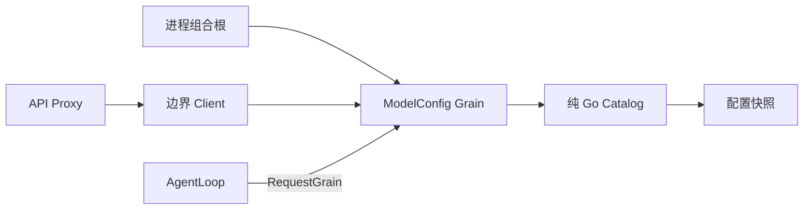

# ModelConfig 模块设计

状态：本次提交包含业务配置与 Grain/Client；默认模型生产读取的切换仍在工作区，AgentLoop 版本化 Resolve 接入待主循环迁移。上位职责见[Actor 定义](./11-actor-implementation.md)。本模块替换 `agentdefaultmodel` 的 Plugin 默认模型能力，并提供后续 AgentLoop 初始化所需的具名消息契约。

## 架构及职责

`llm/modelconfig.Catalog` 是纯 Go 配置 owner，保存一份当前配置与版本，验证 provider 定义、默认路由和凭据引用，按 Agent 覆盖解析请求参数。`llm/modelconfig/actor.Grain` 串行处理读取、解析和更新，GoAkt 管理邮箱和生命周期。它不执行模型 I/O，不持有 SDK 或秘密值。

业务对象单向持有；Catalog 不持有 Grain 或消费者。现阶段 API Proxy 经 Client 读取默认选择；AgentLoop 完成迁移时直接发送 Resolve。现有 LLM adapter 继续负责精确模型能力和 reasoning 校验，配置解析不复制厂商规则，也不以配置目录冒充模型执行路由。

## 接口与关键结构

- Definition：Default 为 llm.CallConfig；Providers 为具名 Provider 列表。
- Provider：ID 和 CredentialRef；不携带秘密、SDK 或网络句柄。
- Snapshot：Version 和完整 Definition 的深复制。
- Resolved：Version、合并后的 llm.CallConfig 和 CredentialRef。
- Catalog.Current() 返回当前 Snapshot；Read(version) 仅接受当前版本，旧版本明确返回 ErrVersion。已经返回的快照由请求持有，不回查可变配置；不建立无限历史缓存。
- Resolve(version, overrides)：version=0 使用当前版本；非零版本必须匹配。显式 provider 覆盖必须同时给出 model，避免把旧 provider 的 model 静默套入新 provider。未指定的参数继承默认值；切换模型时不继承旧模型的 reasoning effort。保留 Stop 的 nil/空列表区分。
- Replace(expectedVersion, definition)：先完整校验候选值并深复制，成功后一次替换并递增版本；版本冲突或校验失败不修改当前状态。

框架消息为 Initialize、Read、Resolve、Replace；响应为 Configuration、Resolution、Completion，业务错误保留 error。模块间不暴露 any；框架入口的类型分派和内部请求辅助方法允许 any。边界 Client 的公开方法返回上述具名类型。

## 决策及上下游契约

默认模型部署值继续为原 DeepSeek route/model。移除 agentdefaultmodel.Factory、StaticPlugin 和无 Settings 时实际为空操作的 SaveSelection，不新增兼容服务注册。Host describe 与 Session 新建/恢复读取 ModelConfig 默认值，读取错误向上传递，不能返回空模型冒充成功。

现有 Session 中已记录的模型选择优先于默认值。现有无 context 的 ModelSelectionRef 回调只读取日志和创建时已取得的默认快照，不在回调内同步请求 Grain。session.selectModel 仍先经 LLM adapter 验证再更新该 Session；它不会修改全局默认模型，此行为与旧 SaveSelection 空操作一致。

组合根在共享 ActorSystem 启动后初始化 ModelConfig，成功后把 Reader 接口交给未迁移的 API Proxy。Catalog 不接受 Plugin Service 查找。配置更新不修改此前请求持有的快照。调用方取消等待不承诺回滚已经由 Grain 执行的更新；更新是否成功以实际响应或随后读取的版本为准。未迁移的 AgentLoop/LLM 路径不会被声称已使用版本化 Resolve。

## 生命周期、文件及验证

Catalog 只有配置与版本，无 mutex、自建队列、active/closing/waiters。Grain 为 long-lived，初始化只允许一次；框架 Stop 处理生命周期。
`catalog.go` 为业务实现，`configuration.go` 为值与接口；`actor/grain.go`、`actor/messages.go`、`actor/client.go` 为框架边界。每个结构体字段和 keyed literal 字段逐行排列。

本次独立提交快照的竞态测试与 vet 通过，业务测试覆盖配置输入/输出隔离、参数覆盖、非法更新不发布和版本冲突。actor 子包当前没有独立测试；实际 Grain 请求、生产默认读取、Session 日志选择及 Host describe 集成不属于本次验证。目标保持外部 RPC 字段与持久化格式不变。

## Agent 旧模型选择与 Prompt 解耦清理

当前源码证据：agent/model_selection_setup.go 已删除，但 ModelSelectionRef 仍保留 effective 与 Assembled；effective 已无写入点，Assembled 无生产调用方。旧 TestModelSelectionSnapshotsPromptAndRequestTogether 仍引用已删除的 AssemblyMiddleware / AssembleRequest / NewModelSelectionSetup。这些残留不能作为 Actor 模型选择的契约继续保留。

移除 effective、Assembled 及旧 Prompt 截取测试；保留尚被 API 模型选择调用方使用的 Current、SetCurrent 和默认来源语义。该清理不替换尚未迁移的 Agent 请求装配，不声称模型选择 Actor 已完成；后续在请求执行边界从模型配置 owner 取得固定参数，Prompt 不保存模型选择状态。Assembled 是已无调用方的 Go 内部组合 API，删除不改变 HTTP/WebSocket 字段或 Session 存储格式。
