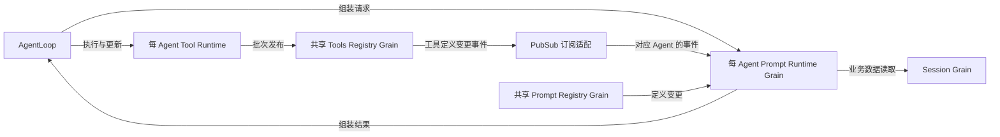

# Prompt 模块设计

状态：共享 Registry、每 Agent 独立 Prompt Runtime、订阅 Tools Registry 事件及 Agent 消费 Prompt 的方向已由用户明确。下面细化消息和一致性契约，尚未全部实现。原“AgentLoop 搬运工具定义并执行组装”的草案撤回；审查依据见[上下游契约审查](./18-interaction-review.md)。

## 架构与所有权

Prompt Registry 管共享文本与变量定义；Prompt Runtime 管每 Agent 的配置、已消费定义及一次组装过程。Tools Registry 是工具定义的唯一权威，Prompt Runtime 订阅对应 Agent 的工具事件，保存供组装使用的只读视图。Tool Runtime 消费 Registry 配置事件，管工具资源、执行和更新过程，不提供第二套可独立修改的目录。配置登记和有效定义发布是不同阶段，见[工具事件契约](./08-tools-implementation.md#配置注册与事件消费)。

AgentID = SessionID。AgentLoop 请求 Prompt 组装并消费结果，不搬运工具定义，不执行 Prompt 内部的模板流程。Prompt Runtime 不持有 Agent 对象，也不反向请求 Agent。子 Agent 配置从 parent 有效配置复制后覆盖；订阅的是本 Agent 工具事件，不动态继承 parent Runtime。

框架负责投递和调度，桥接只适配 TopicActor 与 Grain，不成为新的业务 owner。沿用[通信方案](./06-messaging-and-tasks.md)已验证的普通 Actor 订阅方式；不得在 Grain Receive/Then 中同步 Ask 或 TellGrain 等待。

## 工具事件与消息接口

下表为目标契约，名称表示业务语义；具体 Go 类型放在对应能力的 actor 适配包，业务值留在能力包。业务 error 保持 error，不以字符串传递。

| 消息 | 发送方 → 接收方 | 数据与完成含义 |
| --- | --- | --- |
| 工具定义已变更 | Tools Registry → 对应 Prompt Runtime | AgentID、集合版本、完整模型可见定义及必要的名称范围；只在完整目录原子发布后发送 |
| 读取当前工具目录 | Prompt Runtime → Tools Registry | AgentID；返回当前完整目录及版本。用于初始化和恢复，不作为每次组装的常规路径 |
| 组装请求 | AgentLoop → Prompt Runtime | 已应用工具版本和本次请求关联；本 Agent 身份由目标 Runtime 确定 |
| 组装结果 | Prompt Runtime → AgentLoop | Prompt 文本/上下文、有序工具 schemas、实际采用的工具版本、error |
| 工具更新完成 | Tool Runtime → AgentLoop | 原更新身份、生效版本、error；发布、切换及旧资源释放全部完成才成功 |

完整事件允许落后消费者直接应用较新的完整集合，无需维护逐工具增删日志。空集合也是有效事件，用于清除全部工具。schema、描述和名称数据不含工具执行闭包、ToolActor 指针或 secret。边界必须复制可变容器，不能把 Registry 内部 map/slice 交给消费者修改。

事件不是执行资格确认。Tools Registry 发布成功时，ToolActor 的实现切换可能尚未完成；Prompt 可以接收并保存新定义，但 Agent 在工具更新屏障内不会开始下一次业务组装。屏障及故障处理仍由[工具方案](./08-tools-implementation.md)约束，ToolsChanged 不能解除屏障。

## 初始化与订阅恢复

1. Prompt Runtime 初始化配置并建立对应 Agent 的订阅，等待框架订阅确认。
2. 订阅确认之后，异步请求 Tools Registry 的当前完整目录。
3. 事件和查询响应都进入同一个应用规则：核对 AgentID，只应用更高版本。查询旧响应不得覆盖先到的新事件；首次版本和空目录由 Registry 明确定义，不以空 slice 判断是否初始化完成。
4. 获得有效目录且订阅成功后才报告初始化完成。订阅失败或目录读取失败明确返回，不把空工具当默认成功。

这样覆盖订阅前发生的发布，也覆盖订阅后、查询前发生的发布，不要求框架提供跨 Actor 的原子“订阅加查询”。同版本重复事件无副作用；同版本数据必须由 Registry 保证一致。恢复订阅后再次读取完整目录，以弥补断线或桥接溢出。

目录版本只在 Registry 当前业务实例内可比较；消费关系重新建立时重新获取基线。旧订阅投递不能污染新消费者实例，桥接清理和实例防护沿用[生命周期协议](./07-lifecycle-implementation.md)，不把稳定 Grain 名称当作实际实例凭据。

## 组装与事件的先后关系

AgentLoop 消费 Tool Runtime 的更新完成响应后才开始下一条业务消息，但该响应与 PubSub 事件来自不同发送路径，不能假定 Prompt 已先消费事件。因此组装请求携带 Agent 已应用的工具版本。

- 本地版本匹配：直接用本地工具定义及本次 Prompt 定义组装，不查询 Tools Registry。
- 本地版本落后：本次不得用旧定义返回成功。异步读取一次权威目录补齐，再检查期望版本；这是落后恢复路径，不新增重试队列或无限等待事件。
- 本地或恢复目录版本高于请求版本：明确返回版本冲突，不用最新定义替代旧请求，也不保留任意历史可执行目录来满足旧请求。
- 补齐仍未达到期望版本：返回未就绪错误；Agent 保留原业务任务并处理同步问题，不把它当作业务成功、跳过该消息或忙循环重发。

事件更新仅修改之后组装使用的视图。一次组装开始时固定所需定义与工具值，后续事件不修改正在求值的输入。这里的快照是隔离当前请求的数据值，不新增保存历史快照的 owner。

正常工具更新排在完整业务消息之间，当前模型请求及其工具执行结算后才可更新；因此正常路径不需要旧工具继续可执行。对绕过正常顺序或迟到请求，版本检查明确拒绝。

## 纯业务与框架实现

纯 Go 对象负责文本/变量求值、排序、Complete、suppression 和单次插值；Prompt Runtime 的 Grain 负责订阅数据应用、异步依赖请求、组装结束及取消回复。纯业务对象不包含 GoAkt、goroutine、Session owner 或 parent Runtime。

当前 `Snapshot.Assemble` 可作为内部业务算法继续使用，但不作为要求 AgentLoop 自行组装的公共协议。外部依赖取值不能在注册表邮箱内执行：现有策略可以在求值期间登记新条目，邮箱内等待会形成自锁。耗时求值由 Prompt Runtime 所属受管理任务执行，完成后回到本 owner 回复 Agent。

ToolProvider 跨模块回调由事件视图替代。目标不自动注入 provider/model 变量；模型选择及后续 LLM 参数解析由模型配置与调用流程负责，不依赖 Prompt 组装。

`toolOrder` 当前表达模型呈现顺序，不表达执行顺序。源代码核对支持其保留在 Prompt 呈现职责，见[审查第 7 节](./18-interaction-review.md#7-工具实例与-prompt-结果的关系核对)；不因模板排序驱动 Tool Runtime 创建或删除实例。无论归属如何，保留 rest、未知名称、重复名称以及限制前名称范围的现有语义；本次不改变配置字段或持久化格式。

## 生命周期与失败

AgentLoop 请求关闭前先排空业务；Prompt Runtime 收齐活动组装任务和已发依赖请求的结算，再解除订阅并释放本地视图。取消接纳不等于任务退出，迟到结果不得结算新的请求。框架停用不替代业务关闭确认。

组装失败不发起 LLM 网络请求。Session 的 Step、上下文和请求头提交顺序沿当前业务契约，不因改用消息而重排。Session 最终记录的模型可见输入支持重建，不能只保存 Registry 版本而省略实际输入。

## 实现状态与验证

已有代码实现了纯 Prompt 定义 Snapshot、去除 layer 对 parent 的实时遍历、共享注册 Grain 和部分显式装配。每 Agent Prompt Runtime 的订阅、主动取值和完整组装协议尚未实现；旧 Prompt Plugin/Factory、PromptLayerFactory 及 Client.NewLayer 过渡入口已删除；旧调用方和测试尚待重写，当前允许中间编译失败。默认装配测试已改为显式消费实际初始化的 Prompt Grain，保留完整默认 Prompt 内容断言。通过共享 Grain 测试不等于本模块完成。

实施前先完成 Session 输入契约；按本节边界实现订阅视图及组装，切换生产调用方后删除 ToolProvider、Middleware 和 Prompt Plugin/Factory，不保留平行兼容路径。

验收必须覆盖：订阅前更新、订阅后查询前更新、查询响应晚于新事件、重复和旧事件、其他 Agent 事件隔离、空工具集合、订阅失败、恢复补齐、组装早于事件到达、版本冲突、组装中更新不改变输入、取消和关闭清理。业务回归覆盖排序/覆盖/插值、Prompt 与 LLM schemas 一致、工具屏障和 Session 输入重建。

## 工具定义值输入实施

纯组装输入使用 `ToolDefinitions{Schemas, KnownNames}`，由 Prompt Runtime 消费工具事件后的视图提供。它是 Prompt 的消费数据，不是 Registry 的写入配置或执行 owner。KnownNames 保留限制前名称范围，用于原 toolOrder 校验；nil 时以可见 schemas 名称为范围。

删除 ToolProvider、ToolProviderFunc、AddToolProvider、对应注册表成员及 Actor 注册消息，不保留回调查询最新目录的路径。Schema 复制、保留名称检查及排序继续由现有纯算法执行，工具版本匹配由 Prompt Runtime 的组装协议负责，纯算法不重复管理版本状态。AgentLoop 只请求组装并消费结果，不提供该定义集合。

## 每 Agent Runtime 的业务状态

`systemprompt.Runtime` 保存 AgentID、Prompt 定义快照及已应用的工具定义/版本。NewRuntime 建立纯状态，不创建框架 Actor 或业务资源。ApplyTools 接收目标 AgentID、版本及完整 ToolDefinitions；其他 Agent 的数据拒绝，旧/重复版本不覆盖，非法新集合不部分修改状态。版本从 1 开始，0 表示尚未取得基线，空工具集合也须明确应用一个版本。

Runtime.Assemble 只接受期望工具版本，不接受调用方提供的工具定义；工具数据来自已消费事件。版本不匹配返回具名 error，异步追赶由 Grain 处理。Prompt 定义更新通过 SetDefinitions 显式传值；纯业务不持有 Registry 或订阅器。构造、变更、组装由所属 Grain 串行发起，纯对象不添加 mutex、goroutine 或任务队列。

当前首先验证工具视图隔离、版本匹配、输入复制和组装；Session/Approval 数据请求及真实订阅适配尚未接入，不能把纯对象验证称为完整 Prompt Runtime 已上线。

## Runtime Grain 任务适配

新增 RuntimeGrain，与共享注册 Grain 分开。接收具名初始化、工具视图应用、组装、取消和关闭命令；纯 Runtime 仍不持有框架对象。一次只执行一个组装，额外组装明确返回忙，不维护自定义队列。工具事件仍可在组装期间应用。

开始任务前在邮箱内按值捕获 Runtime（内部定义发布后不可变），PipeToSelf 仅读取该捕获值；完成消息携带本次操作 ID，匹配原延迟回复。普通 error 保留在业务结果中，panic 转为明确失败，避免任务消失后一直等待。关闭取消当前组装，待任务结束后回复关闭完成；框架强制停用仅取消并结束待回复，不冒充正常业务排空。

此适配先验证任务与更新隔离；完整 AgentCreating 授权、PubSub 订阅初始化/注销和 Session/Approval 数据请求仍待接入，不作为完整可上线 Runtime。

RuntimeGrain 验证修正：GoAkt v4.5.3 的 GrainContext.DeferResponse 仅在 requestID 非空的异步请求中生效；AskGrain 不建立该请求关联。首个测试超时源于测试错误使用 AskGrain，现改用普通 Actor 的 RequestGrain，并在业务适配中明确拒绝错误同步入口。真实异步组装/并行接收工具更新的竞态测试已通过；订阅与完整生命周期仍未验证。

Middleware 后处理移除后，删除 preparedAssembly、assemblyPolicy、contextResolution 和重复输出复制。运行上下文抑制在 resolveContexts 入口一次完成并跳过提供者；说明注释保留在该入口及快照字段。Complete 输出仍保留，普通变量/工具/上下文定向测试与 Actor 竞态测试通过。

## 注册身份与删除契约

注册业务层统一分配不复用的 RegistrationID，注册表保存 ID 到条目种类及名称的映射。AddSection/AddContext/AddVariable/AddRuntimeContextSuppressor 返回 ID；Remove(ctx, ID) 返回是否实际删除及 error。不存在的 ID 幂等成功，不影响同名的新注册，也不修改已捕获快照。取消在业务修改前检查，失败不删除。

Grain 直接转发注册及删除，只有实际变更才增加快照版本，不再保存第二份注册映射。Client 返回具名 ID，通过 Remove 发删除消息。删除 PromptHandle、binding 和原子注销状态；业务对象不反向引用 owner 或框架。此为内部 Go 契约破坏性迁移，旧 Plugin 调用方按目标契约迁移，不保留句柄桥接；外部协议与 Session 持久化形状不变。验收覆盖重复删除、同名重新注册、跨 owner/关闭后旧身份失效，以及历史快照不变。

## 行为测试迁移边界

Prompt 测试直接构造纯 PromptLayer；子层通过 DeriveLayer 捕获父层快照，不启动 Plugin。保留内置文本、变量插值、动态提供者求值、同名定义覆盖、Complete、运行上下文抑制、输入校验和快照隔离的断言。删除只验证已移除 Middleware/ToolProvider 注册机制的测试段：工具集合由 Runtime 的版本化值输入及 Actor 的在途组装隔离测试覆盖，工具配置继承归 Tools Registry，不再由 Prompt 覆盖工具提供者。旧注册身份保护由 registration_test.go 及 Actor 注册测试覆盖。

实施验证更新：旧 systemprompt Plugin/Middleware 测试已迁移，`go test -count=1 ./systemprompt/...` 整包通过。新增真实 GoAkt 关闭测试用可控提供者区分“收到取消”与“完成清理”：清理未结束时不回复关闭成功，关闭期间拒绝工具更新，结束后原组装返回 context.Canceled，重复关闭幂等，关闭后的组装返回 ErrUnavailable。测试请求 Actor 与既有异步测试一致配置重入；未配置时请求未开始，不能把该测试超时归因于业务清理逻辑。此证据不覆盖框架停用后的重新激活授权或完整 Agent/Session 关闭链。

## 模型关联的原始证据与边界

固定基线 47f943859bef60e4160492346772ded9b24f765a 的 packages/core/agent/src/model-selection.ts 定义 ModelSelectionRef.current/assembled。installModelSelection 在 system-prompt/assemble 开始时捕获 current，完成后把 provider/model 注入普通 variables；agent/request 使用同一 assembled 设置 LLM 参数。这保证组装期间用户切换模型不会把本次提示变量与调用模型分开。PromptLayer 自身只有普通变量注册，没有模型配置、模型版本或模型就绪状态。

已撤销 Prompt.Runtime.ApplyModel、ModelVersion 和模型未就绪限制，也已撤销 AgentLoop 提前准备并跨重试复用 PreparedLlmCall 的调整。后者只能 Stream 一次，不能作为可重复调用的模型快照。

当前默认提示词没有引用 provider/model，目标不自动注入这两个变量，不为它们订阅模型配置事件或建立跨 Actor 的模型变量关联。普通变量机制保留，VariableValue 可作为固定值提供者；自定义模板引用的变量需显式注册。相较原始实现，自动模型变量注入明确移除，依赖它的自定义模板需要调整。模型选择及调用参数一致性仍由模型配置和 LLM 调用流程负责。

## 注册状态串行边界与 Session 输入

PromptLayer/promptStore 的写入与 Capture 由 Registry Grain 邮箱串行调用，任务只持有捕获的不可变定义快照。移除 promptStore 内部读写锁，避免框架之外维护第二套并发控制；纯对象调用者承担串行访问约束。Snapshot 包含提供者接口，提供者自身的可变状态不受注册集合快照保护。

Approval 已改为独立策略及回答契约，当前没有生产提供者使用 AssembleContext.Session。删除该可变 Session 引用和 AgentLoop 的传入；Prompt 需要的上下文应由拥有其业务语义的模块提供值或定义，不能把整个 Session 暴露给文本提供者。SessionID 仍用于每 Agent Runtime 的消息身份校验，不是 Session 对象引用。

## 工具订阅适配

ToolsSubscriber 是普通 GoAkt Actor，订阅 tools/definitions，将同一 Agent 的 Definitions 转成 Prompt Runtime 的 ApplyTools 异步请求。它只持有 AgentID、Prompt 与 Registry 的 GrainIdentity、协调者 PID 和停止转发标记，不保存工具目录、在途计数或业务关闭状态。工具事件契约由 tools 包定义，Prompt 负责消费映射。

收到 SubscribeAck 后通知协调者订阅已建立；订阅器随后向真实 Tools Registry 异步查询权威基线，协调者等待应用结果。每次转发请求结束通知协调者请求对应版本及 error；旧版本可能由 Runtime 幂等忽略，因此成功不表示该版本取代了更新的本地版本。组装的版本检查由纯 Runtime 执行。

停止订阅先封闭新的事件转发，再请求 Unsubscribe。收到 UnsubscribeAck 就报告 ToolsUnsubscribed；它只确认取消订阅，不等待转发结果，也不代表 Runtime 业务排空。已发出的请求可能随后返回 ToolsApplied。协调者须单独请求 Runtime 业务关闭，关闭后拒绝迟到更新；不得仅据取消订阅确认停用并重新激活同一 Grain 身份。完整身份恢复防护仍由生命周期方案约束。

TopicActor 会监视普通订阅 Actor，强制停止的注册清理由框架完成。创建方须配置 RequestGrain 所需重入模式。ToolsSubscriber 不复制框架生命周期或请求状态，不以 pending、unsubscribed、reported 或累计失败字段组成另一套关闭状态机。

### 请求回调边界与验证

GoAkt v4.5.3 的 ReceiveContext 只在当前 Receive 内有效。Then 只捕获普通 context、框架 PID 及版本，直接向协调者投递 ToolsApplied，不保留 ReceiveContext，不经过额外自身消息跳转。每次请求的错误独立交给协调者，框架超时不证明目标没有执行。

验证采用真实 TopicActor 和 RuntimeGrain，覆盖订阅确认、完整事件应用、旧版本、错误目录、其他 Agent 隔离、空集合及注销后停止转发；可控延迟 Grain 用于验证取消订阅不等待在途应用结果。发布端与初始化基线查询已有真实 Grain 实现及验证，身份恢复及生产生命周期协调仍待实现，不能由订阅适配测试推导整条链路已完成。

本轮验证：`go test -race -count=1 ./systemprompt/actor` 与 `go vet ./systemprompt/...` 通过。真实 Runtime 用例确认工具应用、旧版本不覆盖、错误目录保留原视图及空集合清除；延迟 Grain 用例确认注销不等待应用回复，晚到业务 error 保留 errors.Is 语义。完整生产链路尚未验证。

### 订阅后的基线追赶实现

ToolsSubscriber 新增真实 Tools Registry Grain 地址。SubscribeAck 后先发送 ToolsSubscribed，再通过 RequestGrain 查询 Read(AgentID)，不让 AgentLoop 搬运定义。此前“协调者查询基线”的未接入步骤收敛到消费适配器内部，协调者仍负责等待 ToolsApplied 和启动/关闭屏障。

基线回复通过具名内部消息回到订阅 Actor 邮箱，检查停止转发标记后复用 Definitions 的应用路径；这次回自身有明确用途：禁止取消订阅后由迟到基线发起新 ApplyTools。Then 不保存 ReceiveContext，也不修改业务对象字段。没有目录时向协调者报告 ErrToolsNotReady，保持 Runtime 未就绪，不能将版本 0 或空值当作有效空工具集合。有效空集合仍须有 Registry 发布版本。RefreshTools 支持协调者显式重读基线，不添加定时器、请求计数或自建队列。

SubscribeAck 之后的基线读取与正常事件允许交错：Runtime 忽略旧版本，禁止晚到基线覆盖较新事件。读取失败不清除已有目录，取消订阅后丢弃迟到基线。测试验证发布早于订阅仍完成组装、无目录不伪造就绪，以及发布后更新与重读；旧事件和关闭行为继续由既有测试覆盖。

## AgentLoop 异步初始化契约

InitializeRuntime 改为接收 AgentID、Prompt Registry 与 Tools Registry 的 GrainIdentity，不再接收外部准备的 Snapshot。RuntimeGrain 异步请求 Prompt Registry.Prepare，创建候选纯 Runtime，再请求 Tools Registry.Read 并应用同 Agent 的已发布工具基线；全部成功后安装业务 Runtime，回复 RuntimeInitialized{ToolsVersion, Err}。未发布工具目录是初始化失败，空工具集必须作为有效目录明确发布，不能静默退化为空工具。

运行状态、Snapshot 与版本仍由原业务对象拥有；初始化操作只保存原请求、延迟回复及取消资源。任何阶段失败不安装半成品 Runtime。消息回调通过具名内部结果回到邮箱后发起下一次请求，不保存池化上下文。外部 Actor 配置变化仍使用既有事件消费入口，本次基线读取不取代后续更新屏障。

AgentLoop 根据创建身份创建 Prompt Runtime 框架地址，在初始化请求前登记清理责任。关闭先请求 CloseRuntime 确认组装结束，再等待框架停用，最后关闭 Session。Prompt 失败时保留 Session；重试不重复已成功停用的 Prompt 实例。

## 独立 Schema 版本的消费契约

用户确认工具目录不再维护 Version/Revision，Prompt 不得再以数值非零判断已初始化，也不能从 Schema 最大版本合成目录版本。Runtime 以是否已安装完整工具基线区分未初始化和已发布空集合；ApplyTools 接收 AgentID 与完整 ToolDefinitions，Assemble 只接收 context。Schema.Version 在快照、排序、组装及 Clone 中必须完整保留。业务对象只接收消费端已确认的当前完整基线，不负责发消息。

工具定义通知只触发读取 Registry 当前目录，不能直接把迟到通知的旧成员覆盖当前集合。消费端需将读取及应用串行化，防止多个读取回复倒序；删除和空集合以 Registry 当前完整成员为准，不能从局部 Schema 版本推断。初始化必须等待完整基线安装，失败保持未就绪。

AgentLoop 的旧 ToolsVersion 字段、初始化参数及 Step 版本检查也必须删除；已有状态机负责初始化准入，Step 仍冻结完整 Prompt 快照并拒绝修改已提出的输入。执行选择使用 Tool Runtime 已结算实现身份，不能使用 Prompt 的 Schema 版本替代工具实例身份。

验收包括：空集合初始化；单个 Schema 版本在 Prompt 快照和模型输入中保留；旧通知不能恢复已删除工具；更新期间已捕获组装输入不变化；Agent 初始化无需虚构目录版本。实施按业务、Actor 消费、AgentLoop 调用契约推进，全部通过前不能声明集成完成。
