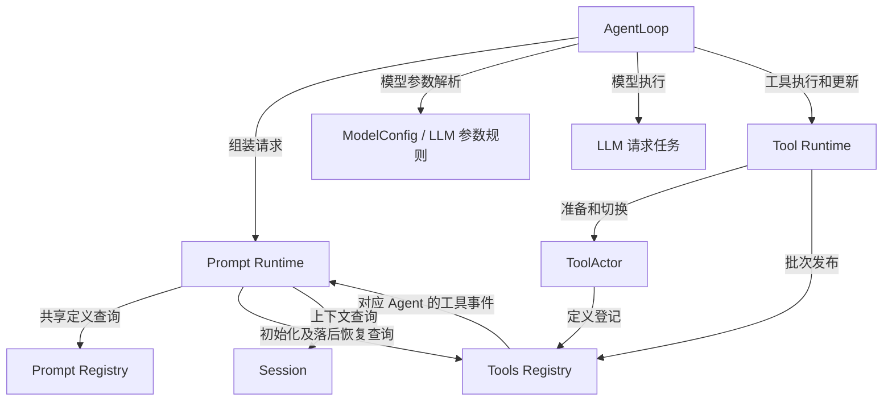

# Agent 请求主线上下游契约审查

状态：审查记录及修订建议，不代表新增接口已确认或实现。依据用户关于 Tools Registry、Agent 消费 Prompt 的纠正，停止扩大有争议的生产接口改动。范围限 Actor 文档及相关业务调用链，不更新历史设计。

## 1. 审查结论与证据

| 问题 | 当前证据 | 影响及处理 |
| --- | --- | --- |
| Prompt 的组装权威前后冲突 | [整体方案](./05-implementation-overview.md)第 4 节、[Actor 定义](./11-actor-implementation.md)第 5 节要求 Agent 请求完整 Prompt；[Prompt 模块](./17-prompt-module.md)又让 Agent 持定义快照自行求值 | 恢复 Prompt 作为组装服务的边界；是否执行任务是 Prompt 内部实现，不成为 Agent 的模板知识 |
| 工具定义读取责任漂移 | [工具方案](./08-tools-implementation.md)第 1 节已规定 Registry 管定义目录；17 草案改成 Tool Runtime 提供 schemas | Registry 提供已发布目录查询，Tool Runtime 拥有执行资源与更新流程；不能存在两个可独立修改的定义权威 |
| 固定策略对象被当作固定输入 | `systemprompt/snapshot.go` 固定 Provider 成员；`tools/layer.go:ResolveTools` 仍读 `registry.promptTools()` | 定义策略固定并不证明工具数据固定；需在组装请求内固定查询结果 |
| 模型选择靠隐式阶段共享 | `agent/model_selection_setup.go` 的 Prompt Middleware 写 effective，Request Middleware 再读 | 保留单次 Step 模型一致性，替换共享 Ref；实际参数确定时点需要连同 adapter 校验一起设计 |
| 模型配置准备晚于文本求值 | `agentloop/rla_step.go:prepareStep` 先 Assemble；`rla_model_request.go:buildModelCall` 后 PrepareCall | 不能仅删除 Middleware，必须证明 Prompt 中模型信息与实际请求配置仍一致 |
| 完成图省略真实日志顺序 | `prepareStep` 在持久化 Step 前求值；`openStep`、`appendStepMessages`、`buildModelCall` 分别提交 | 概念图不能直接翻译为“先写用户消息再组装”的新生产顺序；保留拒绝 Step、请求头和失败结算语义 |
| 新增工具图错误提前准备候选 | 17 草案先候选登记再等屏障；08 第 3 节在前序业务完成后才准备批次 | 继续以 08 的屏障覆盖准备、发布、切换、释放；不新增后台候选准备机制 |

以上问题不需要推翻共享 Registry、每 Agent 独立 Runtime、Session 独立 owner 或稳定 Grain 身份。需要修复的是组件的职责和数据契约，不是再增加一层协调对象。

## 2. 业务主线与完成责任

| 步骤 | 发起者 | 数据/行为 owner | 完成证明 |
| --- | --- | --- | --- |
| 接纳用户消息、创建 Agent | Agent Registry | Agent Registry 管身份；AgentLoop 管执行 | 目标 Agent 初始化完成并接纳消息；不等于 Turn 完成 |
| 读取组装上下文 | Prompt Runtime | Session 管已提交数据，Prompt 管所需读取范围 | 得到对应日志位置的数据；读取失败不能静默用空上下文 |
| 接收工具定义 | Prompt Runtime 订阅事件 | Tools Registry 管 Agent 有效工具目录 | 正常使用事件视图；初始化/恢复查询补齐，组装须匹配 Agent 已应用版本 |
| 准备 Prompt | AgentLoop 请求 Prompt Runtime | Prompt Runtime 管组装、依赖响应和取消 | 完整组装结果；不能只回调一个可继续读最新数据的 Provider |
| 发起模型请求 | AgentLoop | LLM adapter 管模型参数及 I/O，AgentLoop 管本次请求 | 流式片段和关联最终结果；开始流不代表完成 |
| 执行工具 | AgentLoop 请求 Tool Runtime | Tool Runtime 管策略及调用，ToolActor 管效果资源 | 执行、后置处理及取消结算完成 |
| 记录模型/工具结果 | AgentLoop | Session 管日志语义、提交及 flush | 原提交确认；未确认不能声称整条业务消息结束 |
| 更新工具集合 | AgentLoop 在前序消息完成后请求 Tool Runtime | Tool Runtime 协调，Registry 原子发布，ToolActor 切换 | 发布、切换及旧资源释放全部确认 |

这里只规定 owner，不改动现有 Step 日志的具体事务顺序。业务选择和存储动作仍分别由 Session 和 adapter 负责。

## 3. 消费方向建议

后续用户已明确：Prompt Runtime 订阅对应 Agent 的工具定义事件，常规组装使用已消费的本地视图。下图中工具查询仅用于订阅初始化和落后恢复；最新模块契约见 [Prompt 模块设计](./17-prompt-module.md)。

图只画请求和登记方向。响应通过框架请求关联返回，不能据此给被请求对象加 Agent 指针。Prompt 的消费者是 Agent；Prompt 的数据提供方是各业务 owner。Prompt 不请求 Agent 来获取自己被调用所需的数据，也不自行选择 Agent 下次使用的模型。

纯模板和排序算法仍是普通 Go 对象；Prompt Grain 用异步组件请求或受管理任务完成组装。需要耗时取值时，不在 Registry mailbox 内调用会反向等待 Registry 的函数。移出 Registry 邮箱不意味着必须把组装权威移到 AgentLoop。

## 4. 接口形状建议与必要约束

不先写一套框架无关 Request/Response 总线；在各能力 actor 适配层使用具名消息，业务 error 保持 error。

| 接口 | 输入语义 | 输出语义 | 不应包含 |
| --- | --- | --- | --- |
| Prompt 组装 | SessionID、本次模型信息、已应用工具版本、必要读取位置 | 文本/上下文、实际采用的工具 schemas、来源信息、error | Agent owner、可回调 Agent 的通用接口 |
| Registry 工具查询 | AgentID、期望已应用版本 | 对应 Agent 的模型可见定义及必要排序校验数据、error | ToolActor 对象、可直接执行的闭包 |
| Session 上下文读取 | SessionID 和明确的数据读取契约 | 脱离 owner 的业务数据、日志位置、error | 可任意修改 Session 的 Context |
| Tool Runtime 执行 | 工具调用身份、名称、参数及所属有效工具版本 | 最终业务结果、error | Prompt 注册信息或模板逻辑 |
| 工具更新完成 | 原更新身份 | 已应用版本、error | 要求 Agent 转交 Prompt 的完整工具定义副本 |

Agent 只传自己拥有的执行约束，Prompt 自己请求组装所需的数据。schemas 由 Registry 派生，Prompt 返回给 Agent 用于模型调用是数据消费链，不形成新的定义写入权威。

“返回脱离 owner 的数据”需要防止 map/slice/JSON RawMessage 底层别名被修改；不据此创造保存任意历史版本的系统。正常工具更新仍不保留旧版可执行实例。

## 5. 尚需逐项确定的边界

这些是落实模块接口前必须解决的业务问题，不作为默认已确认方案。

| 项目 | 根因/证据 | 收敛方向及需要验证的行为 |
| --- | --- | --- |
| toolOrder 的唯一 owner | 目前配置在 Prompt，Registry 输出注册顺序与 KnownNames；表示模型呈现顺序，不表示执行顺序 | Registry 输出定义及名称范围；是否由 Prompt 保留呈现排序需单独确定，不能因为“工具”一词机械搬给 Tool Runtime |
| 模型可见集合与执行权限 | `tools/registry.go:promptTools` 使用 visible；执行时还包含参数相关策略 | 目录保存发布时可见集合；参数相关权限在执行效果处验证。不能把展示可见等同于操作授权 |
| 模型参数最终确定 | ModelConfig 与 adapter 默认值尚未统一；选模型 API 当前还校验图像能力 | 明确默认/恢复/用户覆盖的优先级和解析时点，再将同一模型信息用于 Prompt 和 LLM；不删除能力校验 |
| Session 读取范围 | 组装先于 Step 的部分日志提交，当前贡献拿完整 Context | 按实际贡献读取字段设计窄契约，说明包括哪些已提交内容、待处理消息是否影响上下文；不能读 latest 代替必要的先后关系 |
| Prompt 更新生效时点 | 11 要求定义更新不影响已发请求，但没有批准所有 Prompt 更新加入工具屏障 | 一次组装固定已取定义；是否需指定版本由真实跨请求一致性要求决定，不提前新增队列/历史版本库 |
| PromptRuntime 生命周期 | 17 当前让 Agent 管求值任务；11 原方案让 PromptRuntime 管当前组装与取消 | 以组装请求 owner 管依赖请求和结束回复；Agent 只等整体完成。收齐取消后才关闭，具体延迟回复契约在模块设计落实 |

## 6. 实现状态和下一步

现有 Prompt Snapshot/Grain 代码只证明定义捕获及注册操作可运行，不证明每 Agent PromptRuntime 的组装协议已经完成。生产默认装配及对应测试已改为显式 Prompt 依赖；默认内容断言仍保留。该调用方修复不能被算作最终业务架构完成。

先讨论并确定第 5 节中 toolOrder、目录读取及模型解析的边界，再将认可的结论合并到 17；同时明确纯业务输入和实际调用者。之后实现 Prompt Runtime 主动请求数据的组装路径，替换 ToolProvider、Middleware 和 Session owner 引用，并更新关联行为测试。原 17 的冲突草案已撤回，现由订阅方案替代；本文其余待定项仍需逐项落实。历史文档不随本次审查改写。

## 7. 工具实例与 Prompt 结果的关系核对

本节记录源代码证据及修订建议，不把讨论中的假设当作已有行为。

- `tools/registry.go:find` 和 `promptTools` 均使用 `catalog.view().visible`：有效目录同时支撑执行查找与模型定义输出。
- `tools/runtime.go:Prepare` 从 Registry 查找定义，并进入执行策略检查；不是根据 PromptAssembly 创建或销毁工具。
- `systemprompt/tool_order.go:orderToolSchemas` 重排 schemas，rest 保留未显式列出的工具。该配置不表示工具实例集合，也不表示执行优先级。
- `agentloop/rla_model_request.go:executeModelRequest` 将组装结果中的 Tools 交给模型请求，模型返回的调用再进入 Tool Runtime。当前不存在专门保存“本次 Prompt 允许集合”的独立权限 owner。

因此建议保留“配置决定实例、Registry 发布定义、Prompt 消费定义、Agent 消费 Prompt、Tool Runtime 执行”的方向。若让实例创建依赖 Prompt，而 Prompt 又等待这些实例登记定义，会形成业务初始化等待环，即使 Go struct 不互相包含也无法正确推进。

会话中提出“Prompt 只展示部分工具时，执行检查本次允许集合”属于额外策略建议，不是当前已实现语义；本轮不增加该状态或推导出新的授权模型。执行仍检查有效工具集合及既有策略，效果处权限校验保持。未来若明确要求请求级动态工具子集，需要独立定义它与有效目录、执行授权和 Session 记录的关系。

排序的证据支持 toolOrder 留在 Prompt 的呈现职责；原来将它移到 Tool Runtime 的理由不成立。该判断不改变 Registry 对定义及可见集合的权威。后续设计可据此收敛，无需为排序迁移实例管理。
