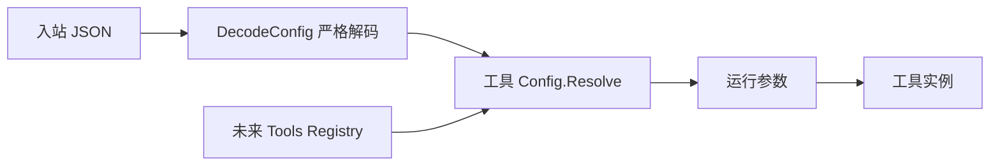

# Subagent 工具配置迁移

状态：具名配置与纯 Tool 已迁移，旧 Plugin/Factory 已删除。Registry 发布、Prompt 指令消费及生产装配尚未接入。

## 边界与接口

`subagent/tools/delegation` 拥有 Config、AgentOptions、ToolFilter、DepthLimit、默认值及 Config.Resolve。DecodeConfig 承担原始 JSON 的严格对象/未知字段解码；Registry 使用具名 Config，不依赖已删除的 Plugin Factory 包。

Config.Resolve 返回 Settings/error，负责配置到运行参数映射及现有参数校验，不创建 Plugin、子 Agent 或工具实例。返回值复制可变数据，不保存输入指针。New 继续调用同一验证函数，避免直接 Go 构造绕过规则。

## 数据与依赖

Config 保留 provider、toolName、enableRunInBackground、backgroundMode、agentOptions、persona、toolFilter、maxDepth；DepthLimit 保留数字与 provider-managed 的联合语义。默认配置由 DefaultConfig 返回。对象之间仅按值映射，无反向 owner 引用。

## 兼容与验证

迁移来源为原 factory/config.go；删除原导出类型，不保留别名。组合根改用 delegation.Config 和 NewNumericDepthLimit。原始 JSON 结构不变。纯配置错误仍使用 error；已有错误前缀本轮保持，避免顺带改错误断言。

验证数字/联合值、默认值、配置到运行参数映射、参数非法值、可变输入隔离，以及直接工具构造。默认服务器装配尚待 Tools Registry 路径接入，该迁移不代表 Registry 事件或 ToolActor 初始化已经实现。

## 显式空过滤列表修复

原 Factory 映射的 `append([]string(nil), values...)` 将显式空 allow/deny 变成 nil；`tools/restriction.go:compileRestriction` 以 nil 判断该限制是否存在，因此会丢失配置语义。尤其 allow 为空而 deny 非空时，配置仍可能通过验证，但空 allow 的禁止所有工具语义消失。

Config.Resolve 在字段指针非 nil 时分配长度匹配的新 slice，保留显式空集合；未指定字段仍为 nil。JSON 字段与类型不变，行为修复为 Tools 现有 nil/empty 契约。覆盖测试须同时验证 allow 空、deny 非空以及仅有空 deny 的配置，不只验证普通非空复制。

纯配置的 BackgroundMode、Settings、解码、验证与复制方法集中在 config.go；工具方法集中在 tool.go。plugin.go 已删除。

## Delegation 业务工具与注册职责分离

删除 delegation.Plugin、Factory 及 Tool/Prompt 注册句柄。New(Settings, subagent.Starter) 构造纯 Tool，复用 Settings 校验并复制配置；对象只持有配置与已有 Starter 接口，不持有 Registry、Prompt、Actor 或生命周期回调。Tool.Definition 只接收 SeedBuilder 的 ParentContextPolicy 值，返回独立工具定义与 error，不传 SeedBuilder 对象；非法策略明确拒绝。

Tool.Instructions 返回可选的固定背景委派说明文本。只有 enableRunInBackground 且模式为 continuable 时返回说明，其他情况返回空串。它不注册 Prompt；后续由配置/定义发布路径将说明交给 Prompt 消费，保留原 tool:<toolName>、order=116.5 的呈现归属。动态 SeedBuilder 可用性及定义撤销属于 Tool Runtime/Registry 的更新批次，不能在工具业务对象中重新实现事件监听或注册状态机。

严格 JSON 解码迁入本包 DecodeConfig，返回已校验 Settings。保留默认配置、provider、provider-managed 及显式空过滤列表语义，拒绝非对象、未知字段、重复字段及多个 JSON 值。复用 internal/jsonvalue 的无损 JSON 校验，也明确拒绝负零和不可精确表示的数字；不再依赖 Plugin Factory 校验器。

OneShot/Continuable 路由、Wait 后读取 Result、背景 OneShot 无 Jobs 时拒绝，以及子 Agent 与父 Agent 的业务生命周期关系不变。当前 execute 仍消费进程内 Agent/Starter；后续迁移为 Actor 异步请求，不把本步称为调用链已切换。工具自身无外部资源，不添加 Close/Dispose 空实现。

验收：构造验证、配置复制、按父上下文策略生成定义、输出 schema 不共享可变字节、可选说明文本、严格解码及原前台/后台路由用例。取消与资源回收的整链路验证留在 Starter 和 Actor 生命周期实现。

本轮实现直接删除 Plugin、Factory、Prompt 注册及 SeedBuilder 事件监听；组合目录撤销对应 Factory 与旧默认 Plugin 条目，没有添加兼容装配。工具实现通过 Tool 自身实现 tools.Executor，避免额外执行回调包装。工具定义的输出 schema 每次复制，不暴露共享可变字节。

验证覆盖原前台/后台路由、Jobs 排除、严格 JSON 和显式空过滤列表、新构造验证、按 ParentContextPolicy 生成定义及 schema 隔离。全部测试在本包直接构造 Tool；生产 Starter/Agent Actor 交互仍待后续实现。
