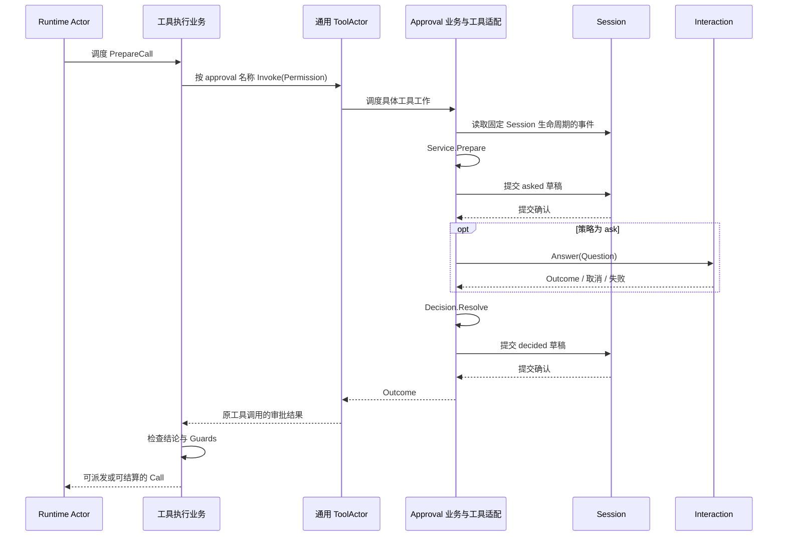

# Approval 模块业务迁移

## 架构与职责

Approval 拥有 ask/never 策略选择、策略文本以及 asked/decided/policy 审计语义。Session 拥有日志提交与持久化；Interaction 拥有客户端回答等待与取消；Prompt 消费策略文本。Approval 业务不依赖 tools、GoAkt、Agent 或可变 Session 对象。

审批通过名为 `approval` 的通用 ToolActor 接入，不启动专属 Approval Actor。Schema 与 Provider 分别由组合入口装配；工具的创建、工作替换和关闭遵循 [Tools 生命周期方案](./08-tools-implementation.md)。目前命名工具路由已接通，实际审批工具及其 Session / Interaction 适配仍待完成。

## 主要对象、接口与数据

| 对象 | 职责 |
| --- | --- |
| Config / ValidatedConfig | 校验默认策略，子配置按创建时的父配置值继承并覆盖 |
| Policy | 从事件快照解析最后一次策略覆盖，生成策略文本 |
| Service | 根据固定事实准备审批 Decision 或策略变更草稿 |
| Decision | 固定本次策略、Question 和审批 ID，生成前置与终态审计草稿 |
| Resolution | 返回 Outcome 与必须先提交的 decided 草稿 |
| Permission | 命名审批工具参数：toolName、callId、reason，不携带 SessionID |
| Answerer | 接收已审计的 Question，等待一个 Outcome，观察取消并释放等待资源 |

`New(ValidatedConfig)` 创建独立 Service；没有 Plugin、Factory、父 Service 或 Prompt 注册回调。`ValidatedConfig.WithOverrides` 只继承配置值，不动态关联父 Agent。

`Service.Prepare(Request)` 接收 SessionID、完整事件快照和工具信息，检查开放 Turn，解析策略并生成 Decision。`Decision.Asked` 生成 `approval/asked` 草稿；`Decision.Question` 返回独立回答参数；`Decision.Interactive` 决定是否请求回答；`Decision.Resolve` 接收回答、取消事实和失败，返回 Resolution。业务对象不提交草稿，也不能据草稿存在宣称已经审计。

`Service.ChangePolicy` 返回可选 PolicyChange（Draft、Notice），相同策略返回 nil。`DelegationPolicyDraft` 返回带 delegation 来源的 never 草稿。策略变更必须先由 Session 提交，再发送 Notice。`Policy.Resolve` 拒绝损坏或非法的最新覆盖，不静默回退；`Policy.Text` 拒绝非法值。

## 工具调用与审计契约

图中 Session / Interaction 路径是待接入契约，不能当作已有生产实现。

SessionID 只能来自 Invocation，不允许 Permission 改写目标 Session；参数保留原工具 CallID，审批子调用另有独立 CallID 和原 RootCallID。结果是 JSON 编码的 Outcome 字符串；默认 Schema 应对模型隐藏。内部工具接入不改变原 Asked、Decided、PolicyChanged 的 wire 名称或字段。

asked 提交确认前不请求回答，decided 提交确认前不允许原工具继续。取消优先于晚到允许；never 不请求回答；不可用或非法回答不能放行。取消不得跳过终态审计，原工具仍等待审批工作实际退出。

缺少已生效的审批工具时，执行业务按 unavailable 拒绝原工具；已确认的工具失败进入失败结果。投递回复不确定使用 DeliveryError 保留调用责任，不自动重复审批、不伪造原工具完成事实。

## 当前实现与验收

纯业务测试覆盖默认和覆盖配置、损坏事件、delegation 来源、取消优先、拒绝、不可用、审计草稿 ID 配对和数据隔离。API Interaction 已实现 Answerer，但尚未由实际审批工具调用。

`tools/execution/scheduler_approval.go` 已把 AskDecision 续接到具名工具调用；Runtime Actor 不解释审批流程。公开 `Call.ApplyApproval` 与冗余 `tools.ApprovalRequest` 已删除，调用方不能自行传入允许结论。

`TestRuntimePreparationUsesNamedToolAndWaitsForApprovalExit` 使用真实 Registry、Runtime 与通用 ToolActor，覆盖允许、拒绝、取消、隐藏工具、策略仅执行一次及审批等待期间禁止配置切换。测试工具提供可控结果，不运行 Service 审计或真实客户端回答；相关 race 测试通过。

剩余实现必须完成：实际工具 Provider、Session 生命周期固定与审计提交适配、Interaction 装配、asked/decided 回复丢失后的幂等核实、取消期间审计收尾、HTTP/WebSocket 完整回答验收。组合入口需要在接纳 Agent 前完成这些依赖装配；现有不可变 Providers 扩展与晚创建的 Session / Interaction 客户端之间的装配顺序需要落实，不能用未初始化字段或运行期可变 Provider 表掩盖。
