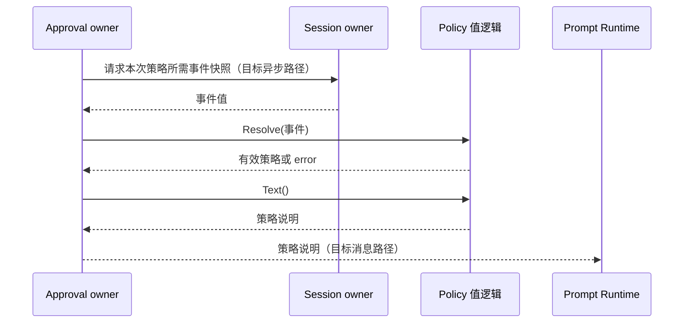

# Approval 模块业务迁移

## 架构与对象职责

Approval 拥有 ask/never 策略选择、策略文本以及 asked/decided/policy 审计语义。Session 拥有日志与持久化，Interaction 拥有等待和回答，Prompt 只消费最终策略文本。框架负责跨 Actor 请求、取消与任务调度。

当前已移除 Approval 向 Prompt 注册回调的依赖。`Policy` 是策略值，负责根据 Session 事件快照解析覆盖值及生成策略说明。`ValidatedConfig` 是独立默认配置，子 Agent 创建时用父 Agent 的有效配置值加自定义覆盖生成；不保存父 Service。`Service` 已通过 Answerer 接口执行审批用例，Plugin/Factory/Waterfall 已删除；完整 Actor 调度仍待接入。

## 接口和关键数据

- `Policy.Resolve([]session.Event) (Policy, error)`：以接收者为默认值，从事件快照倒序解析最后一个 approval/policy；损坏或非法的最新策略事件返回 error，不回退到旧事件。
- `Policy.Text() (string, error)`：输出已确定策略的固定提示文本；非法值返回 error，不默认按 ask 处理。
- `ValidatedConfig.WithOverrides(Config) (ValidatedConfig, error)`：省略 policy 继承已验证值，显式值校验后覆盖；结果不保留外部指针。
- `New(ValidatedConfig, Answerer)` 构造独立 Service，不接收 PromptRegistry。创建方传入已合并配置，不动态读取父策略 owner。

原 Asked、Decided、PolicyChanged 的 wire 名称和 JSON 字段保持不变。本步不改变审批请求先写 asked、再决定、最终写 decided 的顺序，也不改变答复与取消竞争语义。

## 上下游交互

最后的 Actor 消息路径尚未接入；当前移除回调后，不能宣称生产 Prompt 已继续显示 Approval 文本。不得为了保留旧构建而恢复双向回调或 Plugin 适配。后续需要按请求关联及 Session 版本传递该结果，并由 Agent 初始化/更新流程控制就绪。

## 设计决策与验证

默认配置、Session 显式覆盖和生成的提示文本是不同数据；Prompt 不解析 Approval 审计事件，不决定策略。用户切换和 delegation 固定 never 的来源校验继续由 Approval 负责。子配置继承一次，后续父配置改变不静默改变已有子 Agent。

验证覆盖：默认/覆盖优先级、最后事件生效、损坏事件拒绝、delegation 来源、配置指针隔离、非法策略和文本一致性。旧 Plugin/回答器/Session 写入集成测试尚需按后续 Actor 设计迁移；定向业务测试不能代替该验证。

## 审批用例脱离 Plugin

`Service` 只持有独立默认策略与消费方定义的 `Answerer` 接口。`New(ValidatedConfig, Answerer)` 校验配置后返回业务对象；无 NewOverlay、Manifest、Apply、Dispose 或 Factory。子配置已在构造前合并，所有 Service 使用同一构造路径。

回答契约为 `Answer(context.Context, Question) (Outcome, error)`。Question 仅含已提交 asked 的 RequestID、SessionID、ToolName、CallID 和 Reason，不传递 Agent/Session 对象。回答适配器负责选择和等待配置的回答端，后续由 Interaction Actor 实现；Approval 不再遍历 Plugin Waterfall。缺少回答端、非法回复、接口错误或 panic 均形成 unavailable，never 不调用回答端。

业务用例不创建 goroutine 或结果队列。回答端必须在取消时结束等待，清理自身等待资源后返回；Service 在回答返回后再次检查取消，以确保晚到允许不能覆盖已发生的取消，随后追加配对 decided。旧测试中的不响应取消回答器不再作为合格接口实现：异步消息等待和及时取消由框架适配负责验证，不能在业务层通过遗留 goroutine 伪造完成。完整 Actor 适配尚未接入，此变化不能声称生产取消链已验证。

当前 Session 提交仍经 ApprovalTarget 的窄进程内接口完成，后续迁移为 Session owner 请求；先保留审计/策略行为测试，不新增同步 Actor 包装。删除旧 Factory 目录及组合配置中的 Factory 注册，不保留 Plugin 桥接。

实施结果：Approval 整包竞态测试和 vet 通过，Tools 生产构建通过。Service 方法按职责分在 service.go 与 service_policy.go，Policy 值规则保留在 policy.go。原 Factory 配置错误用例迁移到业务测试，旧 Plugin Scope 测试替换为独立回答端和审计关联验证；回答端选择/继承的完整 Actor 路由仍待集成验证。

## Session Context 删除后的业务边界

旧 Service.Request 和 ApprovalTarget 把 Session 读取/提交、Agent 注入、Answerer 等待与策略规则组合在同步调用中，随 Context 删除一起退出，不引入替代 Context 的接口。Request 改为 SessionID、完整事件快照和工具信息；Service.Prepare 校验开放 turn、解析策略并生成独立 Decision。

Decision 保存分离的 Question 和本次有效 Policy。Asked 返回前置审计草稿；Interactive 决定是否请求回答；Resolve 根据取消、策略和回答结果返回 Resolution{Outcome,Draft}。业务层不提交任何草稿，也不声称已经审计。Actor 必须先收到 asked 提交确认，才能调用回答端；decided 提交成功后才能向工具返回 Outcome，取消不能跳过终态审计。

Service.ChangePolicy 接收事件快照，返回可选 PolicyChange{Draft,Notice}，相同有效策略返回 nil。Actor 提交 Draft 成功后才请求 Agent 注入 Notice。DelegationPolicyDraft 返回带 delegation 来源的 never 草稿，创建编排负责纳入 Session 初始日志。业务层不持有 Actor、Session、Agent 或 Answerer。

Answerer 暂留为 InteractionGateway 的消费边界；后续通过 Actor 请求接线。旧同步 Service 测试替换为草稿与策略业务测试，审计先后顺序、回答取消、panic 和最终关闭仍需 Actor 集成测试，不能把删除旧流程当作已实现。
