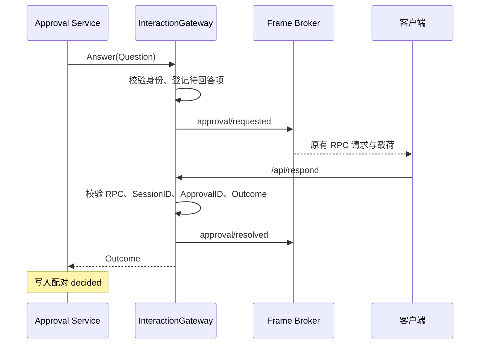

# Interaction 审批回答契约迁移

## 职责与依赖

InteractionGateway 管审批请求的 RPC 关联、待回答状态、客户端响应校验和终态 frame。Approval 管策略与审计；Session 管日志。Gateway 实现 Approval 消费方定义的 Answerer，不持有 Approval Service 或 Session，也不再通过扫描 Session 日志猜测当前 asked ID。

本步只迁移业务接口；Gateway 现有 mutex、PendingResponse、frame broker 和关闭机制暂未替换为 Actor。不可将此步骤称为 Interaction Actor 已完成。

## 接口与数据

`Answer(ctx, approval.Question) (approval.Outcome, error)` 接收 Approval 在 asked 成功提交后生成的 Question：ID、SessionID、ToolName、CallID、Reason。缺少 ID、SessionID 或工具名称返回 error。对同一 SessionID/ID 的并发重复请求拒绝，不创建第二个待回答项；已完成请求的重放防护属于发起方业务关联与后续 Actor 请求协议，不在 Gateway 保存永久历史。

PendingApproval 保留 RPCID、SessionID、RequestID、工具说明、PendingResponse 和完成协调对象。请求发布前先登记响应；发布失败撤销响应并清理本次 pending。返回前完成 resolved frame 与待回答项释放，满足 Answerer 清理契约。

## 交互流程

取消和关闭撤销尚未结算的请求并发布 cancelled，晚到响应不能再次完成。回答与取消竞争仍由 PendingResponse 的首个结算者决定；Gateway 不在成功 Wait 后重新覆写该关联结果。删除 plugin.ErrPluginNotActive 的特殊等待分支；Gateway 只依赖调用 Context 和自身 Close，不把 Plugin 生命周期当作业务输入。

## 兼容与验证

保持原 approval/requested、approval/resolved、/api/respond 字段、RPC 关联、SessionID/ApprovalID 双重校验以及可接受的 allowed-once/rejected 响应。原 Plugin Waterfall 入口与 Host 对应注册删除，不保留包装层。现有交互测试改用真正的 Approval Service + Gateway Answerer，验证正常回答、并发关联、取消、关闭；后续还需真实 Actor 生命周期和协议 fixture 验证。

实施结果：Gateway Answerer、Host 旧 Waterfall 删除及现有交互测试迁移完成。根包竞态测试和 vet 通过；新增缺少身份和重复 pending 请求验证。Session 子包旧模型选择调用仍阻止 apiproxy/... 整体构建，生产组合与 Actor 适配未完成。
