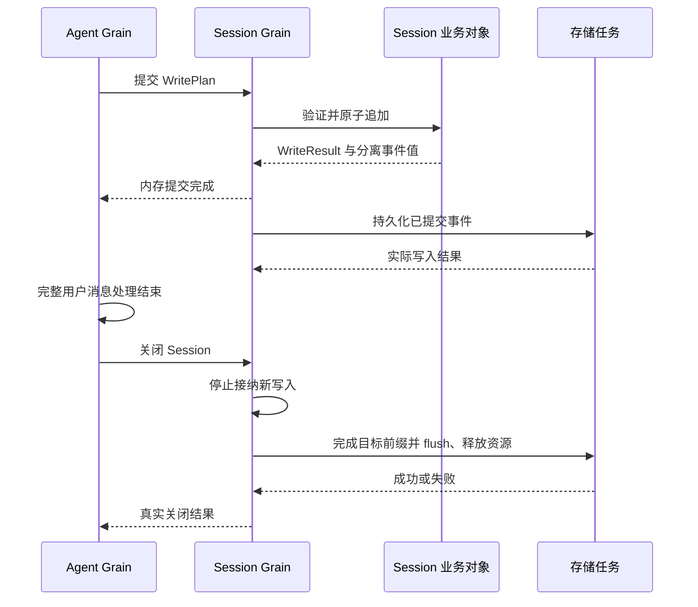

# Session 业务状态与 Actor 迁移

状态：源码边界已核对，以下是模块实施设计；已实现 Session Grain 内存提交、持久化及业务关闭；恢复已接入，Registry 授权和生产调用链尚未接通。
跨模块规则归[生命周期方案](./07-lifecycle-implementation.md)和[模块方案](./09-module-implementation.md)。本文件只细化 Session，不修改历史设计。

## 现有实现证据

- session_context.go：sessionContext 组合 eventLog 与 sessionLifecycle，不是独立的第三份日志。
- session_context_commit.go：Commit 进入生命周期串行区；WritePlan 根据队首快照生成事件；commitBatch 原子写入内存，之后逐条发送 CommitNotice 通知。
- event_log.go：eventLog 拥有头信息、连续事件序列、surface 和派生模型消息缓存；不执行持久化。
- memory_store_lifecycle.go：Flush 捕获当前 WriteBarrier，经 publisher.Flush 请求持久化；Release 在 flush 成功后才完成释放。失败不得报告关闭成功。
- agentloop/rla_turn.go：Agent 选择 TurnStarted 等业务事实并请求 Session 提交；Agent 不分配 Session 事件序号。
- agentloop/rla_step.go：Agent 当前持有整个 Session Context；目标消息边界应返回值快照，不把该可变对象传入 Prompt。

因此，Commit 成功表示内存事实及派生视图已提交；Flush 成功表示指定前缀满足存储持久化保证。这两个完成边界必须保留。

## 模块架构与对象职责

| 对象 | 状态和行为 | 不拥有 |
| --- | --- | --- |
| Session 业务对象 | 从现有 eventLog 收敛日志、头信息、surface、消息派生和原子提交规则 | 框架身份、锁、订阅者、存储任务、Agent 对象 |
| Session Grain | 独占业务对象，处理提交/读取/flush/关闭消息，安排持久化任务并结算回复 | Turn/Step 决策、模型调用、工具执行 |
| Session Registry | 创建及关闭授权、Session 目录、身份占用，关闭成功后允许回收 | 日志副本、事件序号、模型消息投影 |
| 存储 adapter | 编解码、文件或数据库 I/O、请求的持久化操作 | 事件含义、提交时点、修复决策、Agent 生命周期 |

不在原 sessionContext 外再包一层带相同生命周期的 Actor。迁移时保留原日志规则，删除被邮箱替代的串行控制、重入 context 标记与 Plugin publisher。现存 memoryStore、sessionLifecycle 的运行状态需要沿其真实调用方迁移后移除，不能把它们整体注入 Grain。

## 接口设计

消息使用具名输入和回复，error 不转换成字符串。以下为目标契约语义，具体 Go 声明随对应实现一起迁移，不创建占位类型。

| 请求 | 输入 | 返回 | 上游契约 |
| --- | --- | --- | --- |
| 初始化 | 原创建身份、SessionID、创建配置或恢复后的验证数据 | 创建身份、当前 WriteBarrier、error | 同一次创建重试不能重复追加 seed；需要 Registry 授权 |
| 提交 | 原创建身份、WritePlan | WriteResult、error | Plan 必须确定、无外部 I/O，不保留 Session 对象；事件含义由用例 owner 决定 |
| 读取 | 原创建身份、要求可见的 WriteBarrier | Snapshot、error | 返回完整值快照；不能用另一个 Session 或尚不存在的前缀冒充成功 |
| 持久化 | 原创建身份、WriteBarrier | 已持久化前缀、error | 成功覆盖请求前缀；请求超时不撤销内存事实 |
| 关闭 | 原创建身份 | 关闭结果、error | Agent 处理完当前业务后提出；封闭新写入，完成 flush 和资源释放后确认 |

Actor 间使用 RequestGrain；需要等待 I/O 的请求使用 DeferResponse。存储任务只接收分离的头信息/事件值，不捕获业务 Session、GrainContext 或可变容器；完成经 PipeToSelf 回邮箱，由 Grain 推进持久化前缀及回复。

业务对象内部沿用 WritePlan、EventDraft、WriteResult、Snapshot 和 WriteBarrier，不引入第二套“Actor 日志 DTO”。存储 adapter 的数据库行、文件句柄不出现在消息中。

## 关键数据结构与不变量

- 事件序列连续且只追加；一次批次任何校验失败都不改变日志、surface 或派生缓存。
- Snapshot 的 Events、Surface、Barrier 对应同一已提交前缀，并与调用方可变字节隔离。
- WriteBarrier 已有 SessionID 和 NextSeq；不再添加同义 sequence 字段。
- Grain 的持久化进度表示已满足 durability 的前缀，不复制事件日志。存储任务持有本次捕获的输入值和框架取消/回复资源。
- 框架稳定身份不等于业务初始化授权。旧创建身份的迟到提交、flush 或关闭不得影响同 SessionID 的新实例。
- 持久化只允许一个未结算写操作；append 与 flush 顺序统一。具体任务合并和并发 flush 回复管理须随 adapter 调用链验证，不提前添加通用 queue/waiters 框架。

## 交互与关闭顺序

持久化失败不回滚已经可见的内存事实。Flush/关闭失败保留恢复所需状态和身份占用；后续显式重试继续满足原前缀。不能因请求超时、收到取消或 TopicActor 注销确认就停用 Session 并允许重新激活。

Session 不替 Agent 判断“整条用户消息已处理完”。Agent 负责等待模型、工具、交互和必要提交结束，再请求 Session 关闭。Parent/subagent 生命周期依旧由 Agent Registry 管理。

## 实施顺序与验收

1. 收敛日志业务对象：沿现有测试保留批次原子性、seed、surface 与重建语义；不改外部持久化格式。
2. 核对 persistence 的真实 CommitNotice/Flush/Release 消费链，把同步事件副作用替换为具名存储操作契约。
3. 实现 Session Grain 的提交、快照及单写持久化调度，再实现 flush/关闭延迟回复；删除被替代的生命周期同步。
4. 迁移 Agent、查询和投影调用方，移除可变 Session Context 传递及旧 Plugin 装配。
5. 真实 Actor 与存储 adapter 验证：批次失败不提交；提交与 flush 分界；并发发送的实际接纳顺序；I/O 失败及重试；取消不谎报退出；旧身份迟到消息；JSONL/SQLite 恢复和释放失败；Agent 工作结束前不关闭 Session。

仅通过日志单测、或用内存 fake 返回 flush 成功，都不足以证明生产关闭链路完成。

## 本轮实施记录

log_commit.go 已承接 WritePlan 的快照构建、完整校验、取消检查、原子提交和 WriteResult 生成。sessionContext 只负责现存接纳规则以及提交后的通知，业务提交不再读取生命周期 publisher。通知 panic 返回独立的发布错误，保留已经提交的事件和 barrier；接纳结束用 defer 保证后续请求不被卡住。

本步没有新增 Actor 包装或第二套日志，也未新增锁。eventLog 原有读取锁与 sessionLifecycle 尚由旧并发调用路径使用，生产 Actor 独占访问及旧调用方迁移后再移除，不能宣称已经完成无锁 Session。go test -race -count=1 ./session/... 通过，覆盖原子性、取消、恢复、持久化和新增的通知失败不回滚用例；这些仍是现有 Session 实现的验证，不证明目标 Actor flush/关闭链路已接通。

### 日志对象与内存 Grain 入口

现有 eventLog 直接更名并导出为 Log，不复制状态或算法；NewLog 构造该业务对象，Commit、Snapshot、Barrier 提供 Actor 所需的真实操作。旧 New/sessionContext 在其调用方迁移前仍使用同一个 Log 实现，不增加兼容别名。Log 的现存读取锁暂用于旧 Context 的并发读者；Grain 自身不引入锁、队列或自建运行阶段。

session/actor.Grain 按 SessionID 作为框架 Name，Initialize 从 Self.Name 取得身份，消息仅携带原创建 ID 与创建配置；重复同创建 ID 不再创建日志，其他创建 ID 不能覆盖已有日志。Commit 和 Read 均核对原创建 ID；未初始化或身份不符明确失败。Read 的可选最低 WriteBarrier 必须属于本 Session 且不超过已提交前缀。返回快照可以比最低前缀新，但内部必须一致，不伪造历史精确版本。

本步只实现内存提交与读取，立即回复，不实现假的 Flush/Close 成功。外部测试可 AskGrain 驱动；Actor 调用方仍用 RequestGrain。没有 commit 去重承诺，超时不能盲目重发 WritePlan。创建 ID 校验只能隔离当前 Grain 内的旧命令；完整 Registry 授权、强制停用后的初始化防护和持久化恢复仍待接入，不能把本步称为完整生命周期。

内存入口实施验证：真实请求 Actor 通过 RequestGrain 调用 Session Grain，覆盖初始化前拒绝、框架名称决定 SessionID、重复初始化不清空、不同创建身份拒绝、最低 barrier 校验、原子批次失败与读写结果字节隔离。go test -race -count=1 ./session/... 通过；没有据此声明强制重激活安全或持久化关闭已完成。

### 持久化任务与 flush 实施契约

Session Grain 的 Initialize 必须由组合根/创建协调者提供具名 Storage 端口（Load、AppendBatch），现有 Backend 可直接满足，不再注入 SessionLogStore Plugin。该端口仅用于本机初始化，不能进入用户配置、公开协议或 AgentCreating 事件。共享数据库 adapter 的 Close 由组合根负责，单 Session 不关闭整个数据库。

Commit 仍立即确认内存提交，然后由 Grain 为待持久化前缀启动至多一个 PipeToSelf 任务。任务仅持有分离 Header/Snapshot、存储接口和取消 context；任务完成回邮箱后推进 durable 前缀，后续提交合并到下一次批次，不复制 liveWriter 的 timer、mutex 或 pending 事件队列。

Flush 指定原创建 ID 与 WriteBarrier，用 DeferResponse 保留框架回复，直到持久化前缀覆盖要求。多个 flush 仅记录各自要求和框架回复，不自行调度存储队列。外部请求取消不取消共享写任务；强制停用取消任务并返回不可用，不声明正常排空。写错误不回滚内存，flush 返回原 error；显式重试前从 Backend.Load 核对已存在的相同前缀，避免“实际写入但回复失败”后重复追加。不同头信息、非匹配前缀或 torn-tail 明确拒绝，恢复修复仍交由恢复用例，不在 adapter 中猜测业务。

现存 SQLite AppendBatch 在事务提交成功后返回，无独立 Sync 接口；本步骤的 Flushed 表示该 Backend 原有耐久性保证。未产生事件的空日志沿用现有惰性 materialize 行为，不为 flush 额外创建空 Session 记录。

持久化实施验证：Session Grain 已接 Storage.Load/AppendBatch 与 PipeToSelf，真实 SQLite 阻塞写入测试确认邮箱继续服务 Read/Commit、Flush 等待目标前缀；不确定写入结果测试确认 Load 核对后不会二次 AppendBatch。尚无业务 Close、恢复授权或生产调用方接入。

### Session 业务关闭实施契约

Close 携带原创建 ID。首次有效请求捕获当前 WriteBarrier 并封闭 Commit；Initialize 也不能重新打开该日志。已提交前缀全部持久化、且实际存储任务完成回邮箱后才返回 Closed。关闭不取消原写任务，不提前释放其预算或存储引用。

Grain 只保留一个 shutdown 业务操作（固定 barrier 与框架延迟回复）。没有独立的 active/closing/closed 标志组合：存在 shutdown 就表示写接纳永久封闭；持久化前缀覆盖目标且无在途写操作才表示该关闭已完成。重复关闭共享目标，可收到各自框架回复；写失败返回 error 并保留 shutdown，重试 Close 继续核对/写入原前缀。成功后释放 Grain 对共享 Storage 的引用，不调用共享 adapter.Close。

Read 可继续查询关闭后的不可变内存事实；合法 Flush 若其前缀已持久化直接成功。Registry 后续负责在业务关闭成功后停用 Grain 并管理重新激活授权。本步不允许仅凭框架停用替代该协议。

业务关闭实施验证：真实 RequestGrain 与 SQLite 测试确认延迟关闭、并发重复关闭、错误后保持写入封闭、显式重试及共享 Backend 保持可用。Session Registry 的创建授权和停用后身份防护仍未实现，不能据此宣布完整生命周期完成。

### 恢复入口与既有修复规则

Resume 使用具名 RecoveryStorage（Storage 加 Revision、CommitRepair）读取原 SessionID。恢复算法复用 persistence 的已知事件、surface、请求头与中断工具结果规则；独立的 Recovery 值携带创建配置和请求 adapter 执行的 LogRepair。修复决策留在业务层，adapter 只执行事务。

核对源码后确认：旧 preparedSource 会补齐中断 Turn/Step，并用修复后事件作为 seed 构造本次 Session；必要的 end-seed 标记由现有日志构造产生。目标保留该行为，不把恢复解释为禁止追加任何标记。

Resume 通过 PipeToSelf 执行读取/校验/版本核对/必要修复及重新读取。修复成功后必须重读其 revision 和完整日志，不复用可能已过时的输入。任务构造独立 Log，完成后才将唯一所有权转给 Grain；任务不修改已激活日志。读取、校验或修复失败不安装半成品，允许同创建请求重试。未完成恢复期间拒绝第二次初始化/恢复；关闭协调者需等待原恢复结果后按创建身份关闭，不将未初始化错误当作关闭成功。该协调流程仍由后续 Registry 实现。

恢复后的 durable 前缀等于实际存储事件数，新产生的 end-seed 经现有后台持久化路径追加。恢复绝不重新执行历史工具效果；未知结果使用既有 TOOL_OUTCOME_UNKNOWN 等事件表达。完整旧身份授权仍未由 Resume 的本地字段检查解决。

恢复实施验证：persistence.Recover 已同时服务原 preparedSource 和新 Resume 任务；真实 SQLite 测试确认修复结果与既有 seed 生命周期一致，修复失败不安装日志并可重试。go test -race -count=1 ./session/... 通过。

### Registry 创建授权与单实例绑定

新增 session.Registry 作为 Session 业务身份权威，session/registry.RegistryGrain 串行处理其具名 Reserve、Claim、Retire、Release 操作。它只保存 SessionID 对应的创建 ID、已绑定实例 ID 和撤销标记；不保存框架地址、日志、SDK、任务或等待队列。不是通用消息路由表，也不复制 GoAkt 注册信息。

Reserve 由创建协调者预留业务身份；同创建 ID 重试幂等，其他创建 ID 在释放前拒绝。Claim 将本次创建绑定到唯一实例 ID；相同实例重试允许，不同实例不能凭旧创建 ID 再获授权。实例 ID 是 Session Grain 每次 OnActivate 生成的随机值，补足框架稳定逻辑身份不能区分物理重激活的边界，不控制框架调度。Retire 撤销后禁止任何 Claim，且不能通过重复 Reserve 撤销退休状态。Release 只接受已撤销的同创建身份，实际业务关闭和框架停用成功由协调者负责先确认，不能把该元数据操作当作关闭完成。

Session Grain 在初始化或恢复之前通过 RequestGrain Claim，不能只在本地比较创建 ID。Registry 状态丢失时新的空 Registry 不会自动授予旧创建请求；需要上游重新完成授权流程。元数据 owner 和叶子 Grain 校验已实现；真实框架验证旧请求重新激活 Grain 后不能获取旧授权，但生产创建/关闭协调尚未接通。

### 初始化授权接入

Initialize/Resume 首次执行前向共享 RegistryGrain 异步 RequestGrain Claim。OnActivate 仅生成本实例随机身份，不授予创建权限。授权期间只保留一个初始化操作及框架延迟回复；拒绝并行初始化，不建立请求队列。纯 Log 可以预先构造以验证和复制输入，但获得授权前不能安装为可读状态、读写存储或返回成功。

Claim 结果通过具名内部消息回到邮箱，再以新的 GrainContext 开始持久化或恢复；异步回调不得保留池化 GrainContext。授权失败不安装日志。重新激活后的不同实例不能重复取得旧创建授权；正常业务关闭后的重新打开必须由协调者撤销旧创建、确认停用、释放并预留新创建。强制停用不证明旧任务退出，因此本步不自动释放授权或自动恢复。

实现约束与验证：GoAkt 4.5.3 的 actorSystem.localSend 在 Tell 分支等待目标处理确认；直接在 Then 中 TellGrain 给自身会阻塞到超时。因此初始化授权使用 PipeToSelf 等待单次 RequestGrain 结果，Then 仅填写任务结果通道，不保留 GrainContext。OnDeactivate 取消这项等待并使原延迟回复失败。Session 全包 go test -race -count=1 与 go vet 通过；真实 SQLite/GoAkt 测试确认未授权不触碰存储、关闭后重激活不能复用旧创建、正常新预留可打开。关闭协调及强制停用后的任务退出证明仍未完成。

### Session Registry 关闭用例

CloseSession 是 Agent 生命周期协调者在 Agent 已排空并停止后调用的具名异步命令，携带 SessionID 和原创建 ID。Registry 校验当前预留，然后向 Session Grain RequestGrain Close；只有收到业务成功及其 WriteBarrier 后才撤销创建授权。撤销后由 PipeToSelf 任务发送框架 PoisonPill 并等待处理确认，最后回到 Registry 邮箱释放预留和回复 Closed。PoisonPill 是 GoAkt 的框架停用消息，不能替代前面的业务 Close。

Registry 只为每个关闭用例保留原创建 ID、业务关闭成功结果及 GoAkt 延迟回复。重复请求加入同一关闭操作；失败回复本轮请求但保留身份占用。业务 Close 成功后不再重复要求可能已停用的 Grain 返回业务结果，停用失败重试从该检查点继续。不同创建不能加入旧关闭，关闭成功后迟到旧请求不能释放新预留。此处不建立通用任务调度器或独立关闭 Actor。

初始化期间 CloseSession 保留框架延迟回复与身份占用；Registry 通过 PipeToSelf 等待原初始化结算后自动继续关闭，不将正常等待作为错误返回。生产 AgentCreating 订阅及 Agent Registry 仍待迁移，测试用真实框架请求验证本入口，不声称旧 Agent Factory 已接通。

关闭结果保留：Registry 按 Session 保存最后一份成功关闭结果，重复 CloseSession 返回相同前缀，不能因原回复丢失而重新执行关闭。新创建 Reserve 成功后移除旧结果；同一个已完成创建 ID 不可重新预留。此结果只证明 Session 关闭，不证明 Agent 已结束；Agent 侧顺序仍由上游负责。真实框架测试验证关闭等待、失败重试、并发请求、停用确认及结果重读。

### Registry 创建与恢复入口

CreateSession / ResumeSession 是创建协调者调用的业务入口，包含 SessionID、创建 ID 及所属存储端口；CreateSession 另带创建配置。Registry 预留身份后才请求对应 Grain Initialize/Resume。首个请求固定本次输入和存储端口，同创建 ID 的并发请求共享初始化结果；重复调用不能切换创建/恢复方式或改变创建配置。失败保留身份和原输入，允许重试原操作，不能偷偷改为另一套资源。

Registry 到 Grain 的初始化请求不因外部调用者超时而终止；框架 RequestGrain 使用无自动超时策略，直到初始化返回或框架终止请求。请求结果直接在 Registry 的 Then 中完成框架回复，不在回调中再次操作 GrainContext。Registry 邮箱允许重入，因此 Session Grain 可以在初始化过程中向同一 Registry 请求 Claim，不产生同步互等。

CreateOptions 提供深复制，Registry 收到请求时固定种子事件及元数据指针。Registry 只保留初始化输入和框架请求回复，不持有 Session.Log，不执行存储 I/O。CloseSession 在初始化尚未结算时保留延迟回复和身份，初始化结算后自动继续关闭。关闭成功时移除本次创建输入。该入口完成后才具备 AgentCreating 订阅者所需的 Session 生命周期契约；生产订阅与旧 Factory 替换仍是下一步。

### 初始化失败后的空实例关闭

初始化返回失败后，Registry 仍占用本次身份；CloseSession 必须能够关闭无日志的 Grain，才能完成失败清理。Session Grain 无日志且无授权/恢复任务时，通过 RequestGrain Claim 再次确认关闭所属的创建身份；授权成功且邮箱回调确认仍无初始化任务和日志，才封闭初始化并返回零前缀 Closed。该结果表示本实例没有待持久化事实，不表示磁盘上没有 Session，更不删除存储记录。

关闭授权等待期间不自行维护队列或关闭标志。若初始化已开始或完成，授权回调拒绝本次空关闭，Registry 保留身份并允许重试正常 Close；不能把新安装的日志误报为零前缀已关闭。未授权的旧关闭请求不能封闭空实例。初始化中的 CloseSession 由 Registry 等待原操作结算，不取消可能正在执行修复的存储任务。

初始化关闭衔接：opening 只增加一次请求的完成信号，初始化结果回到 Registry 邮箱时发出。关闭等待任务捕获该信号和取消 Context，不访问 opening/closure 可变字段；完成后发送具名 closureReady，再使用新的 GrainContext 执行原关闭流程。并发关闭仍共享已有 closure 的延迟回复，不新增通用等待队列。初始化成功走持久化关闭，初始化失败走空实例关闭；Registry 停用取消等待并返回失败，不能冒充业务关闭成功。

### Registry 生命周期记录归并

框架适配层以 SessionID 保存一份 lifecycle，包含本轮创建 ID、初始化输入与请求、关闭操作、最终关闭结果。移除 openings/closures/receipts 三张并行表及各子对象重复的创建 ID。初始化输入用 initialization 表达，不用 opening 暗示它只在初始化进行中存在。关闭成功在同一记录中清除初始化输入与关闭操作，只保留结果；新预留成功时整体替换旧记录。

session.Registry 继续独立拥有无框架依赖的预留和 Claim 规则；lifecycle 只持有 GoAkt 请求句柄、任务完成信号和结果，不复制框架调度状态。该修改不改变消息契约或日志语义，用原创建/恢复/失败清理/关闭/重复结果和旧身份防护测试验证。

### AgentCreating 订阅接入

agent.CreatingNotice 是内部创建事件，主题 agent/creating，只含 AgentID（等于 SessionID）和创建 ID。它不替代既有 agent/created 的对外发布语义，也不携带 Agent 对象、配置或存储端口。生产创建链必须先向 Session Registry RegisterSession，固定创建/恢复方式、种子和存储端口；登记只占用身份与保存输入，不创建 Grain 或执行存储 I/O。

Session 的 AgentSubscriber 在组合根指定的启动观察 Actor 收到 AgentsSubscribed 后才视为订阅就绪。订阅者将 Creating 转为 Registry.StartSession 的有结果异步请求；Registry 只使用先前登记的输入，缺少登记或错误创建身份明确失败。重复事件使用同一初始化操作，不新增日志或更换配置。结果以 InitializedNotice 事件在 session/initialized 发布，携带 SessionID、创建 ID、分离 Header/Barrier 和 error；Agent 必须核对身份后消费。

StartSession 同时是丢失事件或结果时的显式补读/重试入口，不承诺 PubSub 可靠投递。订阅者不保存配置、日志或创建状态，实际初始化由 Registry 独占。订阅者停用依赖 TopicActor 监控移除订阅；已发出的初始化不因订阅者退出回滚。事件发布与 Agent 必要组件汇总仍须在 AgentLoop 生产迁移时接入，不能把此订阅测试称为生产已切换。

事件接入验证：真实 GoAkt TopicActor 与 SQLite 测试确认 RegisterSession 不激活 Session、不读写存储，只有匹配的 Creating 事件触发初始化。重复触发不会重复写入种子，关闭后的旧事件被拒绝，缺登记与缺失持久化日志返回明确错误；Module 内部 StartSession 请求保持异步。生产 AgentLoop 发布与就绪汇总仍未接通。

## 按 owner 拆分框架实现

事件订阅器移动到 `session/subscriber`，独立负责 `agent/creating` 到 Registry `StartSession` 的消息转换，以及 `session/initialized` 结果发布。它只保存 Registry 的框架身份与启动观察者 PID，不持有 Registry 或 Session 实例。构造函数、就绪通知和结果事件随实现移动，不保留 `session/actor` 转发别名。事件 topic、字段、错误语义不变。

Session Grain 保留在 `session/actor`；Registry Grain 已移动到 `session/registry`。原先 Session 通过 `GrainOf[*RegistryGrain]` 获取授权方、Registry 通过 Session Grain 具体类型进行创建的类型环，改为下述 Authority 身份与根包授权契约。创建、恢复、关闭、重复请求和旧身份防护测试同步更新调用路径。

订阅器的集成验证继续放在 `session/actor` 的外部测试包，使用现有真实 Registry、Session 和 SQLite 测试设施；该测试包对订阅器的依赖不进入生产依赖图。

### Registry 拆分的授权契约

`session.Claim` / `session.Claimed` 定义创建身份与运行实例绑定的请求和结果，只有值字段与 error，不引用框架。Registry 处理 Claim；Session 只消费该契约。Initialize、Resume 与空日志 Close 接收框架 `Authority` 身份，Registry 转发时填写自身身份。该字段用于进程内部路由，不接受来自 HTTP 或用户配置的任意授权方，不是安全隔离边界。缺少授权身份时明确拒绝，禁止回退到硬编码 Registry 类型查找。

Registry 位于 `session/registry`，依赖 Session Grain；Session Grain 只依赖根包授权消息，不依赖 Registry 实现。订阅器改为依赖 Registry 请求与 Session 结果。框架身份按值传递，不增加自定义 Ref、Factory 或 Service Locator。

## 运行身份与业务边界修正

CreationID 表示编排层的一次创建尝试，InstanceID 表示一次 Grain 激活；两者均不是 Session 业务身份。原先放在根包的创建授权 Registry 和 Claim / Claimed 属于运行生命周期实现，应分别归入 `session/registry` 私有 authority 与 `session/actor` 消息契约。Session 日志、业务事件、Header 和存储协议继续只使用 SessionID 与业务序号。

该调整不删除旧激活、重复关闭和延迟释放防护，也不改变它们的判定行为。框架协议内部继续传递运行身份；业务 API 不负责理解它们。Projection 的 History、Change、CommitNotice 中混入 CreationID 的问题将通过拆分 Unit 注册与投影状态解决，不以改名隐藏运行身份。

## 根包旧生命周期退役

删除 Context / sessionContext、MemoryStore、Preparation、Session Plugin 和 Factory，以及旧 Created / Disposed / EventAppended / FlushRequested 类型。Root Log 只保留日志事务、派生消息与分离快照，不保留委托旧 Context 的 New 别名。调用方直接使用业务 Log 或 Actor 具名请求，不能补回兼容包装。

TimeSource 留作 Log 时间输入，默认时钟移至 time_source.go；session/event topic 的 canonical 字符串保留在 events.go，消息数据使用 actor.CommitNotice。Log 不使用读写锁：所有方法均由拥有者串行调用，I/O 任务只收到分离快照。进程级事件类型注册表的锁仍保护公共定义注册，不与 Session 生命周期混淆。

纯日志测试保留事务原子性、取消、panic、seed、Surface 和数据隔离，迁到 Log。旧队列/Store 状态机测试删除；新 Actor 的队列顺序、授权、flush 与关闭测试是相应验证入口。Agent Inbox、AgentLoop、Query、Title、API Proxy 和 Subagent 仍有旧 Context 依赖，需继续迁移，不能把中间编译失败描述为完成。
