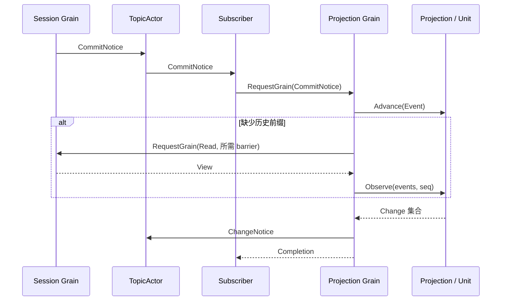

# Session Projection 模块实现设计

## 目标与边界

Projection 使用领域 Unit 从 Session 日志计算派生视图，支持增量更新、快照与 checkpoint 恢复。纯业务层不依赖 Plugin、GoAkt、存储或 Actor 创建身份。Session 是日志与 durable barrier 的唯一 owner，ProjectionCache 负责可重建 checkpoint 的存储和冷读取加速。

本次为破坏性迁移，旧 Plugin 与 Factory 已删除，不提供兼容包装。存储 checkpoint 的版本、序号、值字段和投影视图 JSON 格式不变；旧调用者需迁移到新的 owner 和消息接口。

## 对象与数据结构

| 对象 | 职责与依赖 |
| --- | --- |
| Unit | 领域定义状态版本、初始状态、事件折叠与视图转换；同步纯计算 |
| Registry | Unit 定义、注册 ID、引用计数及离线 checkpoint 恢复；不持有在线 Projection |
| Projection | 一份日志的派生状态，单向引用 Registry；拥有各 Unit 的状态与已处理序号 |
| Snapshot / Change | 完整投影值及其对应序号，不含运行身份 |
| Checkpoint | 按 Unit key 保存内部 state、版本和序号，不是 Session 事实源 |
| Grain | Registry 与独立 Projection 的框架 owner；按运行身份隔离对象 |
| Subscriber | TopicActor 所需的普通 Actor 订阅端，转发通知，不持有投影状态 |

Registry 的 registrationsByID 将一次注册 ID 映射到 Unit key；registrations 将 key 映射到共享定义与引用计数。Projection 的 cells 将活跃 Unit 注册对象映射到 JSON 状态和游标；最后一个注册移除后，重新注册相同 key 得到新对象，不能复用旧状态。业务对象之间没有循环引用。

运行身份仅存在 Actor 层：Grain 按 SessionID、CreationID 选择独立 Projection；Release / Forget 和迟到结果检查也由该层处理。纯业务接口不接受 CreationID、InstanceID 或 GrainIdentity，原 History 包装已删除。

## 业务接口与算法

Registry 提供 Register、Remove、NewProjection、RestoreFloor、ViewCheckpoint、Restore。注册返回独立 RegistrationID；兼容的相同 key/version 注册引用原 Unit，不兼容版本明确拒绝。旧 ID 重复移除不影响后续注册。

Projection 提供 Snapshot(events)、Checkpoint(events)、Observe(events, seq)、Advance(event)。前三者接受从 0 开始的完整连续日志。Advance 只使用现有状态处理连续事件；任何 Unit 缺少前缀时返回 ErrHistoryRequired，且不安装任何状态。

所有 Unit 的转换与视图先计算、验证，再统一安装。错误保留旧游标，重复事件不重复通知。读取旧快照会按请求日志计算，但不能倒退在线游标。状态、视图和交给 Unit 的事件均复制，包括事件溯源与 surface 元数据，防止 Unit 修改日志。

Restore 是离线计算，不修改在线 Projection。部分日志必须有版本兼容、序号匹配的 checkpoint；否则要求从序号 0 重读。业务层不使用 mutex，不执行 I/O，由所属 Actor 串行调用。

## 通信机制

Session Grain 成功提交后，按日志顺序发布 sessionactor.CommitNotice；初始化 seed 安装后也发布对应记录。恢复历史不伪造新的业务事件，通过首次缺口或快照查询重建投影。

Grain 请求用于 Unit 注册、快照、checkpoint、恢复和订阅器内部转发，Agent 不主动调用投影更新。组合根启用 PubSub，为 Subscriber 开启请求重入，并等待 Subscribed 后放行事件。

补读使用 RequestGrain 和延迟回复，回调只捕获上下文值、目标 Projection 和回复句柄，不保留 GrainContext。目标在补读期间被 Forget 后，结果明确失败，不发布已释放 Projection 的变更。Unit 或补读失败由订阅器记录，不能回滚已经提交的 Session 事件。

## 持久化事件与非持久化通知

Event 是 Session 日志中可持久化、可回放的记录；名称不表示当前已经 flush。Notice 是进程内通知，不写入 Session 日志。CommitNotice 表示内存提交，ChangeNotice 封装 Change 并附加 Actor 路由身份，不能作为持久化成功凭据。创建链使用 CreatingNotice / InitializedNotice；请求、结果与订阅确认仍按操作含义命名。topic 和外部协议字段保持原值。

## ProjectionCache 的关系

ProjectionCache 不将 ChangeNotice 直接作为 checkpoint：对外 view 与内部 state 可以不同，事件也不含完整 Unit 版本信息。缓存根据 Session 追加、关闭、阈值或定时器决定何时请求 checkpoint。它必须确认 Session flush 已覆盖 checkpoint 对应的日志前缀，才能写入缓存存储。Actor 重构保留这个职责关系，调度交给框架。

## 当前证据与剩余工作

纯业务测试覆盖晚注册、重复事件、失败原子性、历史快照、独立 Projection、同名 Unit 重注册与版本恢复。框架测试覆盖创建身份隔离、通知、checkpoint 和恢复；真实 Session Grain 与 SQLite 测试覆盖提交订阅、迟订阅导致的前缀补读及后续增量计算。

ProjectionCache、subagent、API Proxy 和生产组合根仍待迁移。Session 关闭通知及关闭后迟到通知的完整回收策略尚未接入；Forget 的在途结果防护不能替代整条关闭链。PubSub 尽力投递，消费者需要从日志取得查询基线，不能把测试通过等同于生产重构完成。

## 关闭通知与已知关闭身份

Registry 在 Session 业务关闭、框架停用和创建授权释放均成功后发布 sessionactor.ClosedNotice，随后回复关闭调用方。失败不发布成功关闭通知。通知只表示 Session 已完成关闭，不表示所有订阅器已经处理它。

Projection Subscriber 订阅 CommitNotice 和 ClosedNotice。收到 ClosedNotice 后，Grain 将对应运行键的 Projection 值置空，保留已知关闭标记；后续相同创建的通知或读取返回明确错误，不重新创建 Projection。新创建使用不同键，不受旧关闭通知影响。空值标记只保留两个运行身份字符串，直到 Projection Grain 停用，不保存日志、业务状态或回复句柄。对于任意延迟通知，需要保留该拒绝依据，不能直接删除键后把迟到通知当首次创建。

Forget 与 ClosedNotice 都释放对应创建，并使在途补读结果失效。PubSub 丢失关闭通知仍可能延迟清理；生产关闭编排的强确认机制及 ProjectionCache 的最终 checkpoint 顺序尚未接入，本次不把发布通知等同于完整系统关闭确认。
