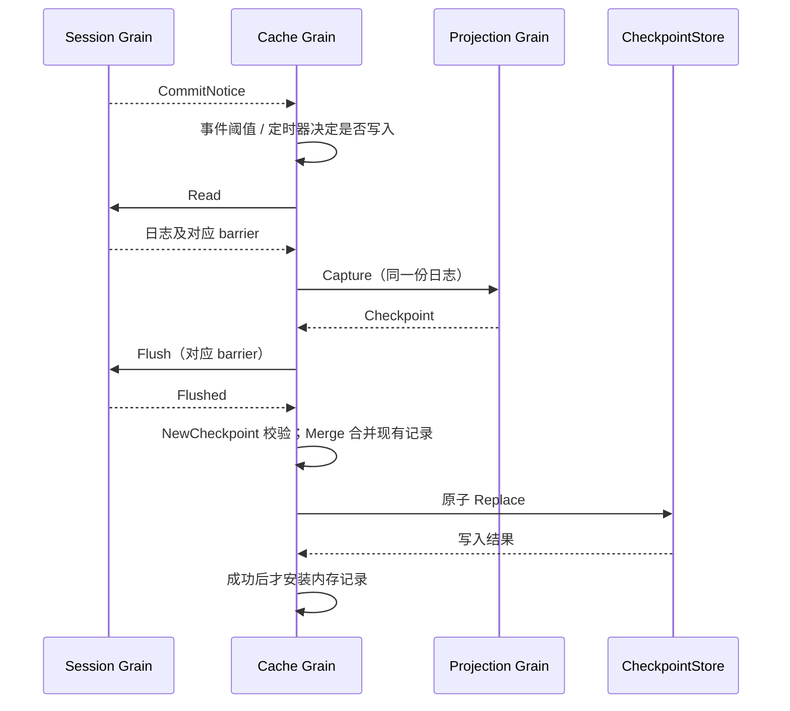

# ProjectionCache 模块实现设计

## 职责与当前问题

ProjectionCache 保存可重建的投影内部状态，用于 cached snapshot 和 cold restore。Session 日志是事实源，Projection 拥有 Unit 算法；缓存不能用 ChangeNotice 中的对外 view 替代 checkpoint state。

当前实现的 ProjectionCache、liveCheckpointer、checkpointRecords 和 snapshotReader 将运行状态、锁、后台 goroutine、定时器、读写与业务规则混合。旧 Plugin 和 Factory 依赖已删除的 Projection 接口。迁移不提供兼容构造器，不把这些调度对象原样包进 Grain。

## 对象与依赖

- CheckpointRecord：日志身份与 Unit 行集合，拥有验证、复制、合并规则，不拥有存储或生命周期。
- LogIdentity：持久化日志的 CreatedAt、CWD，防止相同 SessionID 指向不同日志时复用旧缓存；不是 Actor 创建身份。
- 缓存 Grain：独占已确认写入的记录，接收 Session 通知和缓存请求，安排框架任务与定时器。
- CheckpointStore：执行读取、原子替换及关闭；SQLite/sqlc 适配器保留，不决定何时写入。
- Projection Grain：提供 checkpoint 与版本恢复请求；Session Grain 提供日志、flush 与最终 durable barrier。

框架层持有运行身份与在途操作，业务数据中不含 CreationID、InstanceID、PID、GrainIdentity 或回调。模块对象不能反向引用拥有者。

## 写入流程与契约

NewCheckpoint 校验 Header.ID 与 durable barrier 的 SessionID 一致，NextSeq 非负，每个 Unit 的状态版本和 JSON 合法，候选行具有同一序号，且所有行均在 durable prefix 内。Capture 成功不是写入许可，Flush 失败不能写 checkpoint。

同一日志身份下，Merge 保留当前未被新集合覆盖的 Unit；相同 key/version 不允许较旧 seq 覆盖较新 seq。不同版本采用当前请求的定义结果，不能通过版本数字大小推断先后。日志身份变化时整体替换，不合并旧日志行。输入输出均复制，失败不能污染已确认状态。

写入任务必须按 Session 串行；存储成功后才更新内存缓存。任务取消后不能假定底层写入已经退出。最终关闭需要明确等待已开始的写入结果，不能只依赖 best-effort ClosedNotice。

## 读取与恢复

CachedSnapshot 校验 Header 与 LogIdentity，向 Projection 请求兼容版本的 view；缺失或不匹配返回 cache miss。

ColdSnapshot 使用 RestoreFloor 选择起点，分页读取 durable 日志，每页通过 Projection.Restore 推进。页大小保留现有 512 条限制；所有页必须属于同一日志 revision，禁止把不同修订拼接成快照。缺少兼容 checkpoint 或日志身份不匹配时从 0 重建。成功后的 write-back 失败只影响缓存，不改变已经证明的读取结果。

无 Unit 时仍需读取日志末尾以报告真实 AsOfSeq。存储失败、无效 checkpoint、跨页 revision 变化必须显式处理，不伪造空快照。

## 调度与生命周期

保留事件数量、时间间隔、turn/end 和关闭触发的业务语义。框架负责计时、消息串行处理、异步请求和 I/O 任务，不保留手写后台调度循环或多层 mutex。具体 Grain 请求、定时器消息和关闭编排在纯业务规则迁移后落实到接口，不提前堆叠运行状态。

## 迁移验证清单

1. 记录复制、日志身份更换、混合新旧 Unit 行合并、版本切换、durable cut 校验。
2. 写入失败不发布内存缓存、同 Session 写入顺序、不同 Session 可独立推进。
3. 分页恢复、checkpoint 不兼容回退、跨页 revision 防护、空 Unit 读基线。
4. 事件和计时触发、重复通知、关闭期间在途写入、最终 checkpoint 与 Session flush 顺序。
5. 迁移 API Proxy、组装与 SQLite 接线，删除旧 Plugin、Factory、调度对象及旧构造接口；执行模块和生产路径检查。

当前记录业务规则、串行写入确认、已保存快照读取和分页冷读取已有实现与聚焦测试。自动触发、最终关闭编排、冷读取写回与生产接线仍未完成，不宣称 ProjectionCache 已完成 Actor 重构。

## 已确认记录的业务对象

Cache 是纯业务内存对象，records 将 SessionID 映射到已经确认持久化的 CheckpointRecord。它不持有 CheckpointStore、Session、Projection 或 Actor 引用，不使用锁。Snapshot 返回分离记录，Match 额外校验持久化日志身份。

Prepare 验证输入并与现有记录合并，返回待写入的分离记录；nil 表示现有记录已覆盖输入，无需写入。Prepare 不更新缓存。外层只有收到存储成功结果后才能调用 Confirm；Confirm 拒绝同日志下会倒退现有兼容行的确认。初始化时也用 Confirm 安装从存储读取并验证的记录。

单个 Session 的写入串行性由框架层保证；不能以业务对象无锁为理由同时使用多个任务改写相同 Session。日志身份不同的延迟确认由 Actor 的运行身份检查拦截，业务层不接收 CreationID。

旧 checkpointRecords / recordEntry 的存储所有权、锁和 I/O 方法删除，原 Plugin / Factory 一并移除。旧 facade、live checkpointer 和 reader 的调用暂时不兼容，后续直接迁移其调度行为，不增加转发层恢复编译。

## 分页恢复业务对象

Replay 拥有一次耐久日志重放的游标、最初日志身份、revision、累计 checkpoint 和最终读取结果。它不执行 I/O，不引用 Registry、Grain 或存储对象。NewReplay 接收已选择的起点和可选 checkpoint；Next 返回下一页位置。框架读取后先 ValidatePage，再请求 Projection.Restore，最后 Accept 同页及其计算结果。任何校验失败不推进游标或安装状态。

ValidatePage 拒绝 SessionID 不符、日志身份变化、revision 变化、不连续序号、超出 512 条限制，以及 HasMore=true 的空页。Accept 另外验证结果的 AsOfSeq 和全部 checkpoint 行序号对应当前页末尾。Result 只在最后一页成功接收后可用，返回分离 Header、Snapshot 和 Checkpoint。

checkpoint 日志身份不匹配以 ErrCheckpointIdentity 返回，框架可以丢弃缓存重新从 0 开始。其他 checkpoint 不兼容恢复错误同样由外层最多执行一次全量重试；耐久读取失败不伪造成缓存命中。该对象只有重放进度，不承担请求排队、任务调度或 Actor 创建身份防护。

## Checkpoint 触发进度

Progress 表示一份日志已经观察到的前缀、已经 checkpoint 的前缀、尚未覆盖的 turn/end 和最早写入期限。它只回答是否应写入，不持有 timer、attempt、goroutine、锁或关闭状态。Config 保留 WriteEveryEvents 与 WriteInterval，默认 200 条和 5 秒。

Observe 使用日志序号去重，第一次出现未保存输入时记录期限。Due 在达到事件阈值、遇到尚未保存的 turn/end 或期限到达时为真。写入失败不调用 Confirm，进度保持待保存；成功 Confirm 前缀后，只清除已覆盖部分，新输入仍保留。捕获日志可能领先于通知消费，Confirm 可以把已观察前缀推进到已确认前缀，后续较旧通知应被忽略。

旧调度器、facade 和相应实现绑定测试删除；业务 Progress 测试替代触发规则测试。旧测试中同 Session 串行写、不同 Session 并行、关闭排空、最终 checkpoint、分页 I/O、write-back 失败隔离等行为列入框架接线阶段，尚无替代测试前不能宣称这些行为已迁移。

## 写入 Actor 的实现方案

每个 SessionID 对应一个缓存 Grain，拥有纯业务 Cache 和一个独立 Writer Actor。Writer 仅调用共享 CheckpointStore.Replace，不决定合并、触发或耐久前缀。不同 Session 的 Writer 独立接收消息；共享适配器的关闭仍由组合根负责。

Initialize 安装共享存储端口和可选的已加载记录。Write 携带 Header、Rows 与已确认 durable barrier；Grain 先 NewCheckpoint 和 Prepare，再使用 RequestActor 向 Writer 发起写入。采用 StashNonReentrant，在请求未结束时由 GoAkt 暂存其他普通消息，包括后续 Write 和 Close，不维护业务 queue、waiters、activeAttempt 或锁。

内部存储请求不设超时：外层调用者超时不能被解释为底层 Replace 已结束。Then 只在收到实际结果后 Confirm 并回复。Close 排在已接收写入之后，停止 Writer，但不关闭共享 CheckpointStore。OnDeactivate 负责释放 Writer；正常编排必须先 Close，不能用强制停用代替成功关闭。

本阶段实现持久化入口与确认顺序。自动订阅、Progress 定时触发、Session Read / Projection Capture / Flush 链和冷读取分页编排随后接入；Write 的 durable barrier 只接受内部编排结果，不是外部用户可声明的耐久凭据。

## 已保存快照的请求接口

CachedSnapshot 携带 Header 和目标 Projection Grain 身份；调用方负责解析该框架地址，缓存业务对象不持有地址。缓存 Grain 先校验自身 SessionID、初始化状态与持久化日志身份；没有匹配记录时直接返回 Snapshot{Value:nil}。有记录时使用 RequestGrain(ViewCheckpoint) 请求当前 Unit 定义的兼容视图，再通过 CheckpointRecord.Snapshot 校验并计算公共 AsOfSeq。Snapshot.Err 保留计算或通信错误；错误不能降级成 cache miss。

该请求不读取 Session 日志，也不写存储；返回的是已保存 checkpoint 的视图，不能声明它代表最新日志。请求期间仍由 StashNonReentrant 保持同一缓存 Grain 的消息顺序，回调仅捕获分离记录与 GrainReply，不捕获池化 GrainContext。没有兼容 Unit 时返回 miss。冷读取分页编排继续独立使用 Replay。

## 分页 Reader Actor

ColdSnapshot 请求携带 DurableEventReader 和 Projection Grain 地址。缓存 Grain 复制已有记录，创建一次性 reader Actor，并把框架 GrainReply 交给它；不把 GrainContext 或缓存对象传入。reader 独占 Replay、当前页和最多一次的无 checkpoint 重试。缓存 Grain 不反向保存 reader，对冷读取没有等待队列。

reader 在 PostStart 请求 RestoreFloor，再用框架 PipeTo 执行单页 I/O；结果回到邮箱后先 ValidatePage，再 RequestGrain(Restore)。异步回调仅把具名阶段结果投递给自身 PID，下一页从新的 ReceiveContext 启动。完成或错误均回复 ColdView 并 Shutdown；不关闭共享日志适配器。无 Unit 时从 0 分页读取到实际日志末尾，保持真实 AsOfSeq。

ColdView 返回耐久读取结果及恢复后的 checkpoint。本阶段不自动写回，避免在尚未验证日志修订和当前 Unit 定义的情况下覆盖正在更新的缓存；最终 write-back 与生命周期编排仍待接入。缓存 Close 只排空已有写入，不声称等待独立的冷读取；组合根关闭共享适配器前必须停止并排空其读取使用者。

## 旧组装入口退役

Projection 与 ProjectionCache 的旧 Factory、PluginName、FailureReporter 已随模块移除。internal/assembly 的 Catalog 和默认 PluginSpec 必须同时删除对应导入、Factory 注册和 JSON Factory 配置；Diagnostics 不再接收已删除的 ProjectionCache.Failure。不得为了旧组合根继续编译而重新提供这些接口。

旧 assembly 测试中的 Plugin service 查询和 Factory 配置拒绝断言随旧入口删除。默认 Subagent 投影注册的业务验收仍然需要在 Actor 组合根迁移时恢复，不能以删除旧断言当作通过该验收。新的 SQLite 打开、LoadAll、Projection 注册、订阅确认、缓存 Grain 初始化及 API Proxy 接线尚待落地；这一步只删除失效入口，不表示生产切换完成。

## 生产读路径与共享生命周期接线

现有每 Session Grain 的 Initialize、CachedSnapshot、ColdSnapshot、Write、Close 保持业务语义。新增同包 Registry 只负责缓存身份初始化与排空，不复制 Cache、Replay 或 Projection 算法；冷 Session 没有 Agent，因此该 Registry 是进程资源，不挂在某个 Agent 的生命周期中。

ConfigureRegistry 接受共享 CheckpointStore 和启动 LoadAll 结果，逐项验证并复制记录。CacheForSession 返回已初始化 Grain；框架 StashNonReentrant 串行化初始化请求，entries 记录已取得身份及失败责任。初始化结果不确定时不暴露可用地址。CloseRegistry 冻结取得请求，向实际登记的 Grain 发 Close；失败保留对应登记，成功删除，重复关闭成功。不关闭共享存储。业务缓存命中、日志身份检查、Unit 恢复、分页重放仍由原实现负责。

API 的 actor.Cache 实现 sessionapi.ProjectionCache，先向 Registry 取得地址，再提交原 CachedSnapshot/ColdSnapshot 消息；没有新建重放算法或无缓存兼容路径。组合根创建独立 projections.sqlite、LoadAll、配置共享 Registry，并注册 title.Unit 与 SessionListMetadataUnit，设置 Sessions.Cache。关闭网络和 API 后关闭 Cache Registry、停止框架中的剩余读取者，再关闭共享存储。独立冷读取被强制中止时底层 I/O 的完全排空仍需故障集成验证，不能以正常关闭测试代替。

验收：真实 Server 重启后的 session.list 恢复已提交标题；真实 SQLite 下 16 个并发取得请求共享一个缓存身份，写入后重复关闭不丢记录，不提前关闭共享适配器，关闭后拒绝新取得。自动 checkpoint 触发、冷读取写回及最终 checkpoint 调度仍是待完成项，本次没有以新 Registry 替代这些业务规则。
